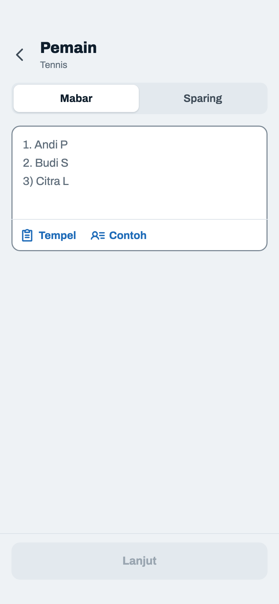
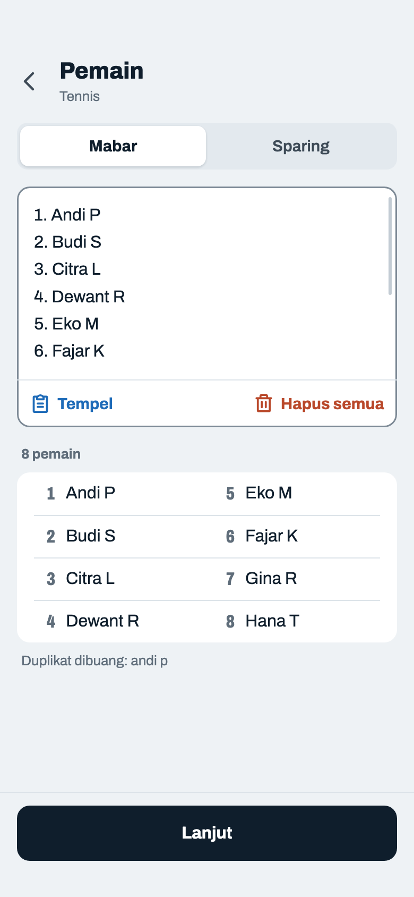
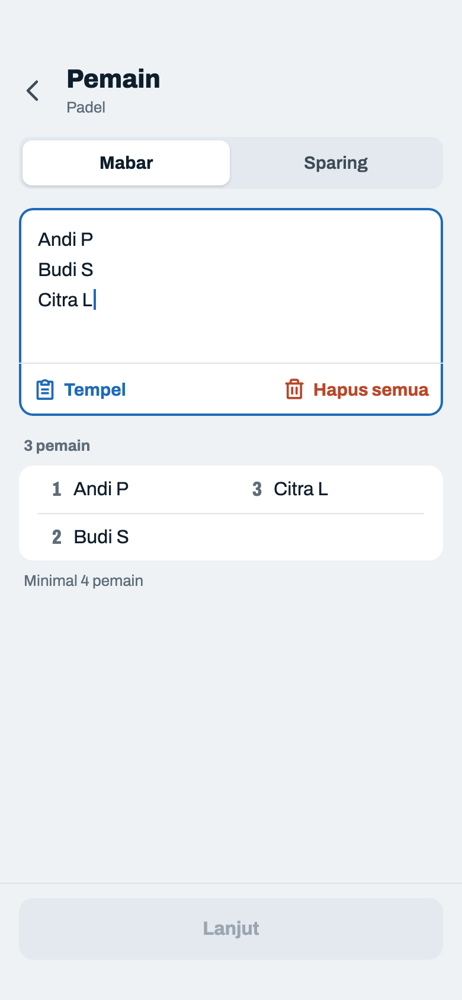
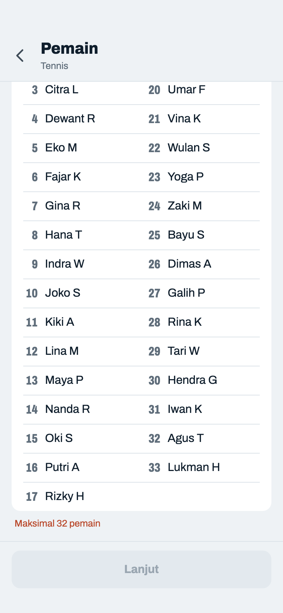
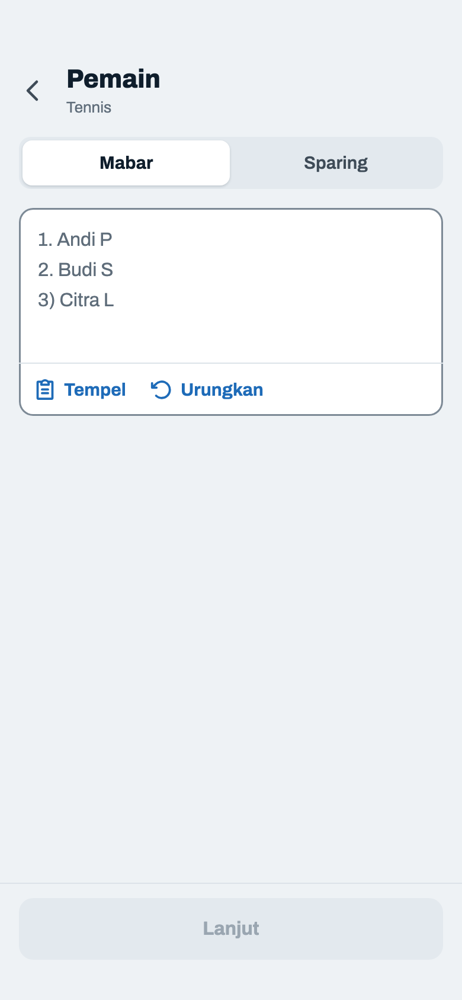

# Pemain

> Dihasilkan `tool/hifi_extract.py` dari `design/hifi.html`. Jangan diedit langsung.

Satu kotak teks untuk ditempel dari grup WhatsApp, dengan aksinya menempel di bawah kotak. Penomoran dan bullet dibersihkan diam-diam; daftar bernomor di bawahnya menunjukkan hasil akhirnya.

## 02a · Kosong

Komponen: `MabarAppBar`, `MabarButton`, `MabarTextButton`, `MabarIconButton`, `MabarActionBar`, `MabarSegmented`, `MabarField`, `NameListField`

- Pilihan **Mabar / Sparing** paling atas (keputusan host 19, K4): Mabar = layar ini apa adanya (02a–02d), Sparing = dua blok klub (13a–13g). Default Mabar; pilihan tidak diingat antar turnamen. Isi kotak tiap pilihan disimpan sendiri selama layar terbuka, jadi pindah pilihan tidak menghapus ketikan.
- Tidak autofocus: jalan utamanya Tempel dari grup WhatsApp, jadi keyboard tidak langsung menutupi layar.
- Kotak teks 4–6 baris lalu scroll di dalam (dulu 5–8); daftar lengkapnya terbaca di bawah, jadi kotaknya tidak perlu tinggi. Keyboard multiline, huruf awal tiap kata kapital.
- Aksi menempel di bawah kotak teks sebagai toolbar `.txtbtn` (teks biru + ikon 20), bukan chip.
- "Contoh" (8 nama contoh) hanya ada saat kosong, karena ia mengganti seluruh isi; kalau tetap ada saat terisi, satu ketukan salah menghapus daftar host. Toolbar paling banyak dua tombol, jadi muat juga di HP 360 dp.
- Subjudul penjelas dan baris "Boleh pakai 1. 2) -" dihapus. Parser tetap membuang `1.` `2)` `03 -` `4:` `-` `*` `•`, spasi ganda, dan baris kosong.

## 02b · Terisi · ada duplikat

Komponen: `MabarAppBar`, `MabarButton`, `MabarTextButton`, `MabarIconButton`, `MabarActionBar`, `MabarGroup / MabarRow`, `MabarSegmented`, `NameListField`, `RosterPreview`

- Hasil parser tampil sebagai daftar bernomor dua kolom (`.roster`), urut ke bawah dulu. Nomornya memastikan penomoran dari WhatsApp sudah dibuang dan jumlahnya pas; kolom rata membuat 30 nama tetap rapi, tidak seperti chip yang membungkus tidak rata.
- Teks berisi 9 baris; kotak menampilkan 6 dan sisanya di-scroll (garis scroll di kanan).
- Duplikat (tidak peka huruf besar) tidak masuk daftar; yang pertama dipertahankan. Namanya disebut di catatan bawah, seperti sekarang.
- Setelah ada isi, toolbar: Tempel + Hapus semua. "Tempel" menambahkan di baris baru (kalau kosong, mengganti isi). "Hapus semua" langsung mengosongkan tanpa dialog → 02e, toolbar "Tempel · Urungkan" (keputusan 115).
- Jumlah ditulis sekali di label daftar; tombol cukup "Lanjut" → Konfigurasi dengan olahraga + daftar pemain.

## 02c · Jumlah belum memenuhi

Komponen: `MabarAppBar`, `MabarButton`, `MabarTextButton`, `MabarIconButton`, `MabarActionBar`, `MabarGroup / MabarRow`, `MabarSegmented`, `MabarField`, `NameListField`, `RosterPreview`

- Daftar dan jumlahnya diperbarui tiap ketikan. Kurang dari 4 bukan error (host masih mengetik), jadi catatannya abu-abu, bukan clay.
- Tombol mati sampai jumlahnya 4–32.

## 02d · Lebih dari 32 · halaman di-scroll

Komponen: `MabarAppBar`, `MabarButton`, `MabarTextButton`, `MabarIconButton`, `MabarActionBar`, `MabarGroup / MabarRow`, `MabarSegmented`, `NameListField`, `RosterPreview`

- Mulai ±18 pemain daftarnya lebih panjang dari layar, jadi halaman di-scroll; app bar dan action bar tetap. Frame ini digulir sampai bawah. Daftar tetap menampilkan semua nama supaya host bisa memilih siapa yang dihapus dari kotak teks.
- Catatan clay "Maksimal 32 pemain" (batas 32 sejak 3.10.0, keputusan 142) menggantikan "Minimal 4", sama seperti pesan error di Konfigurasi. Daftarnya tidak ikut diwarnai. Tombol mati.
- Begitu konten ter-scroll ke bawah app bar, app bar mendapat garis tipis di bawahnya.
- Nama panjang dipotong elipsis di kolomnya; nama lengkapnya tetap tersimpan.

## 02e · Sesudah Hapus semua · Urungkan

Komponen: `MabarAppBar`, `MabarButton`, `MabarTextButton`, `MabarIconButton`, `MabarActionBar`, `MabarSegmented`, `MabarField`, `NameListField`

- Dari 02b: "Hapus semua" langsung mengosongkan kotak, tanpa dialog (keputusan 115, PRD 17.10 A-8). Daftar, label jumlah, dan catatan duplikat hilang; placeholder 02a tampil lagi; Lanjut mati.
- Toolbar "Tempel · Urungkan": Urungkan (ikon `arrow-counter-clockwise`, biru seperti Contoh) menempati tempat Contoh. Tetap dua tombol, jadi muat di HP 360 dp.
- Urungkan → teks kembali persis seperti sebelum Hapus semua, termasuk baris duplikat yang dibuang parser: 9 baris, 8 pemain, "Duplikat dibuang: andi p", Lanjut aktif, toolbar Tempel … Hapus semua (02b).
- Urungkan hilang begitu isi kotak berubah dengan cara lain: ketik "R" → 1 pemain, toolbar Tempel … Hapus semua (pola 02c); Tempel → isi tempelan, toolbar Tempel … Hapus semua. Kotak kosong lagi sesudah itu → "Tempel · Contoh" (02a).
- Hanya Hapus semua terakhir yang bisa diurungkan; keluar dari layar (←, back HP) membuangnya.
- Sparing (13a–13g): sama, per kotak klub. Hapus semua di satu klub tidak menyentuh kotak klub lain, dan Urungkan klub itu hanya ada di toolbar kotaknya.
