# Konfigurasi

> Dihasilkan `tool/hifi_extract.py` dari `design/hifi.html`. Jangan diedit langsung.

Satu layar yang selalu muat (keputusan host 33, 2026-11-11): nama turnamen opsional paling atas, Pasangan Fixed / Mixed / Mexicano, lalu Skor dan Court masing-masing satu baris berisi nilainya; rinciannya di sheet. Skor punya tiga format yang dipakai di mabar tennis maupun padel: Race to, Best of, dan Americano (Mexicano hanya Americano). Estimasi di tombol. Layar dibuka dengan pengaturan turnamen terakhir di HP itu (03q). Untuk Mixed dan Mexicano tombol langsung membuat Round 1; aturan dan estimasi ada di sheet Cara kerja (06k, 16c). Menggantikan 03a–03e lama (2026-11-11).

## 03a · Turnamen pertama di HP · Fixed · Race to 6

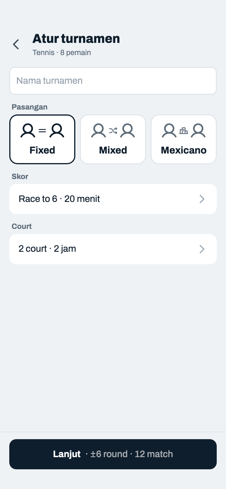

Komponen: `MabarAppBar`, `MabarButton`, `MabarIconButton`, `MabarActionBar`, `MabarGroup / MabarRow`, `MabarField`, `ModePicker`

- Satu layar yang selalu muat, berapa pun jumlah court (keputusan host 33): nama turnamen, Pasangan, lalu Skor dan Court masing-masing satu baris berisi nilainya. Ketuk baris → sheet berisi grup yang sama dengan Konfigurasi lama (Skor 03d, Court 03g). Tidak ada field yang hilang. Enam sasaran ketuk, tidak pernah digulir.
- Frame ini = turnamen pertama di HP itu: default Fixed, Race to 6, durasi 20 menit (Padel 15 menit), 2 court × 2 jam. Turnamen berikutnya dibuka dengan pengaturan turnamen terakhir (03q).
- Kotak "Nama turnamen" paling atas, boleh kosong. Tanpa label grup: isinya sudah menjelaskan diri, seperti nama court. Maks 40 karakter (cukup untuk gabungan klub: "Mabar Jumat PB Garuda x Matcha Club 2026"); ketikan ke-41 tidak masuk, tanpa penghitung karakter. Spasi di awal/akhir dibuang; kosong = tanpa nama, semua tampilan sama dengan turnamen tanpa nama. Hanya diisi di sini; setelah turnamen dibuat tidak bisa diubah (keputusan host 2026-10-23). Tidak ikut diingat dari turnamen terakhir.
- Kartu mode tiga kolom (`.modes.m3`) tanpa teks deskripsi, hanya gambar dan nama (keputusan host 35). Ilustrasi dari ikon Phosphor: `user` + penghubung + `user`; penghubung `equals` (Fixed), `shuffle` (Mixed), `ranking` (Mexicano, ikon yang sama dengan Klasemen). Orang 30 pt, penghubung 16 pt, warna ikut teks; kartu terpilih bertepi tinta 2 pt. Tinggi kartu 86 pt, isi rata tengah.
- Baris Skor = `format N · durasi menit`; "menit" ditulis penuh, tidak disingkat (keputusan host 37). Stepper di dalam sheet tetap "mnt". Baris Court = `n court · j jam`; booking berbeda → rentang terpendek–terpanjang ("6 court · 1–2 jam", 03h). Chevron = baris bisa dibuka. Teks terlalu panjang → elipsis (tidak terjadi dengan batas sekarang: "Americano 99 · 180 menit" 24 karakter).
- Estimasi di tombol: `±round = booking terpendek ÷ durasi` = 120 ÷ 20 = 6, `match = round × court` = 12. Lanjut → Pasangan (04).

## 03b · Mixed · Best of 5

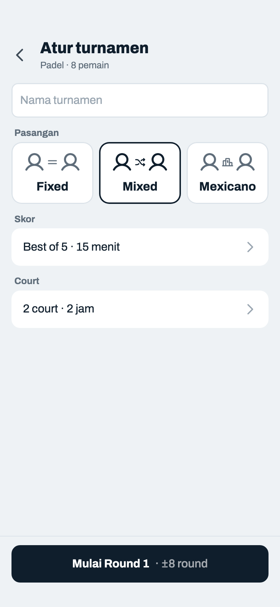

Komponen: `MabarAppBar`, `MabarButton`, `MabarIconButton`, `MabarActionBar`, `MabarGroup / MabarRow`, `MabarField`, `ModePicker`

- Mixed: tombol langsung ke Jadwal Mixed dan membuat R1 (sheet 06k muncul sekali). Estimasi: 2 jam ÷ 15 menit = ±8 round.
- Berpindah Fixed ↔ Mixed tidak mengubah baris Skor dan Court.
- Best of N: paling banyak N game, yang menang game lebih banyak jadi pemenang; boleh berhenti begitu satu tim mencapai ⌊N ÷ 2⌋ + 1 (3–1 di Best of 5). Jumlah game 1–15, default 5. Di Input Skor, mengisi satu sisi otomatis mengisi kotak lawan yang masih kosong dengan N − x, seperti Americano. N genap: 03f.

## 03c · Mexicano dipilih · format jadi Americano

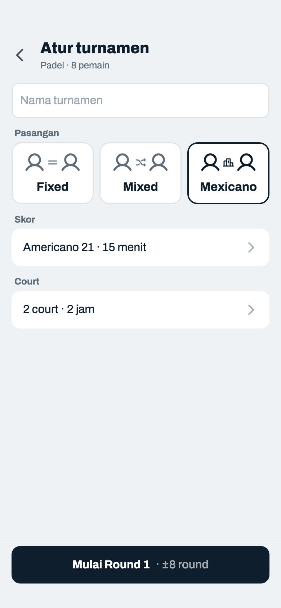

Komponen: `MabarAppBar`, `MabarButton`, `MabarIconButton`, `MabarActionBar`, `MabarGroup / MabarRow`, `MabarField`, `ModePicker`

- Keadaan setelah mengetuk Mexicano di 03b: baris Skor berubah dari "Best of 5 · 15 menit" menjadi "Americano 21 · 15 menit" (keputusan host 34). Dari Race to juga menjadi Americano 21. Kalau formatnya sudah Americano, N-nya tetap (Americano 24 tetap 24, 03q). Durasi dan Court tidak berubah.
- Kembali ke Fixed atau Mixed tidak mengembalikan format sebelumnya: baris Skor tetap "Americano 21 · 15 menit", Best of 5 tidak kembali (keputusan host 34).
- Tidak ada tulisan atau tanda bahwa Race to / Best of tidak tersedia: akibatnya terbaca di baris Skor, pada saat host memilih Mexicano. Di sheet Skor segmented tidak ditampilkan (03e).
- Tombol dan estimasi sama dengan Mixed (PRD 14.2): Mulai Round 1 → Jadwal Mexicano + R1, sheet Cara kerja Mexicano muncul sekali (16c). Tanpa layar Pasangan.
- Sparing tidak menawarkan Mexicano (keputusan 27): Konfigurasi sparing hanya dua kartu (13h–13j).

## 03d · Sheet Skor · Mixed · Best of 5

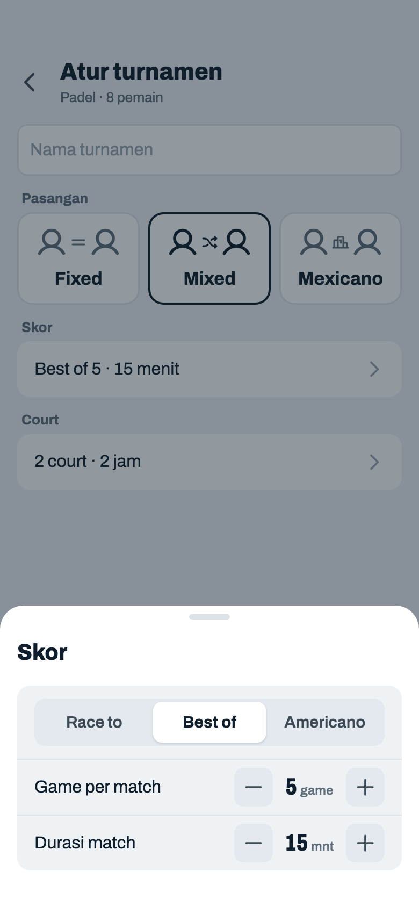

Komponen: `MabarAppBar`, `MabarButton`, `MabarIconButton`, `MabarActionBar`, `MabarGroup / MabarRow`, `MabarSegmented`, `MabarStepper`, `MabarField`, `showMabarSheet`, `ModePicker`

- Ketuk baris Skor. Isi sheet = grup Skor lama apa adanya: segmented Race to / Best of / Americano, angka format (Race to 2–9 "Target game", Best of 1–15 "Game per match", Americano 2–99 "Poin per match"), Durasi match.
- Sheet jenis kelola (seperti Kelola pemain 08a): tanpa footer, tiap perubahan langsung berlaku dan baris Skor di belakangnya ikut berubah. Tutup dengan geser turun, ketuk scrim, atau back.
- Durasi match selalu kelipatan 5 menit (minimal 5, maksimal 180): stepper ±5, angka yang diketik dibulatkan ke kelipatan 5 terdekat. Angka format skor tidak bisa keluar batas lewat stepper; kalau diketik, nilainya dikembalikan ke batas terdekat.
- Race to N: siapa duluan menang N game, target 2–9 (4 = gaya Fast4, 6 = satu set, 8 = pro set). Skor akhir N lawan 0..N−1; match langsung selesai begitu satu tim mencapai N. Tidak ada 7–5 / 7–6 (keputusan host 2026-10-22).
- Americano N: poin reli, total per match paling banyak N; boleh berhenti lebih awal begitu lawan tidak mungkin mengejar (07m). Default 21, batas 2–99 (kotak skor 2 digit). Total genap boleh seri.

## 03e · Sheet Skor · Mexicano

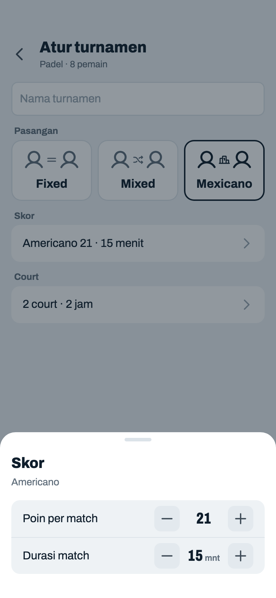

Komponen: `MabarAppBar`, `MabarButton`, `MabarIconButton`, `MabarActionBar`, `MabarGroup / MabarRow`, `MabarStepper`, `MabarField`, `showMabarSheet`, `ModePicker`

- Mexicano hanya punya satu format (keputusan 24), jadi segmented tidak ditampilkan; formatnya tertulis sebagai subjudul fakta "Americano". Yang bisa diubah: Poin per match (2–99) dan Durasi match.
- Race to dan Best of tidak digambar pudar: segmen mati butuh alasan, dan alasan tidak boleh berupa kalimat di layar.

## 03f · Sheet Skor · Best of 6 · bisa seri

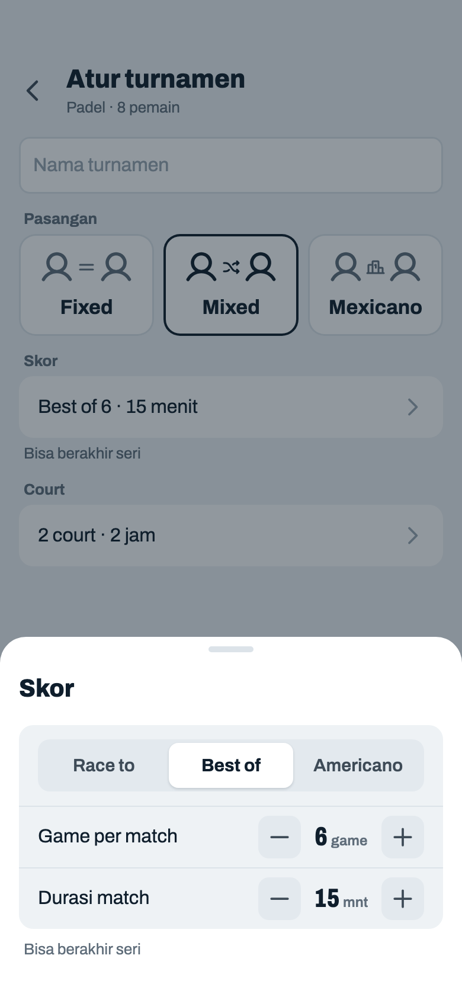

Komponen: `MabarAppBar`, `MabarButton`, `MabarIconButton`, `MabarActionBar`, `MabarGroup / MabarRow`, `MabarSegmented`, `MabarStepper`, `MabarField`, `showMabarSheet`, `ModePicker`

- Best of N genap (mis. 6) bisa berakhir seri 3–3. Catatan kecil ink-3 "Bisa berakhir seri" di bawah grup, di dalam sheet dan di bawah baris Skor di layar (tempatnya sama dengan catatan error 03l). Seri dihitung setengah menang di Win %.
- Catatan hilang begitu N ganjil lagi.

## 03g · Sheet Court · 2 court

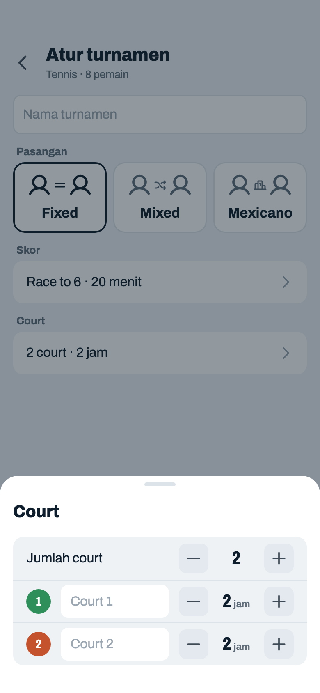

Komponen: `MabarAppBar`, `MabarButton`, `MabarIconButton`, `MabarActionBar`, `MabarGroup / MabarRow`, `MabarStepper`, `MabarField`, `showMabarSheet`, `ModePicker`, `CourtColorPicker`

- Ketuk baris Court. Isi sheet = grup Court lama apa adanya: Jumlah court 1–10 (court baru ikut urutan palet, 2 jam), lingkaran warna (ketuk → 03k), nama (kosong = "Court n"), booking per court 1–12 jam.
- Stepper di semua baris sejajar satu kolom (lebar angka tetap 60 pt), termasuk baris court yang punya lingkaran warna dan kolom nama; kolom nama yang menyesuaikan.
- Jenis kelola seperti 03d: perubahan langsung berlaku, baris Court dan estimasi di tombol ikut berubah. Kotak nama court aktif → sheet naik bersama keyboard.

## 03h · Mixed · 6 court · nama diisi

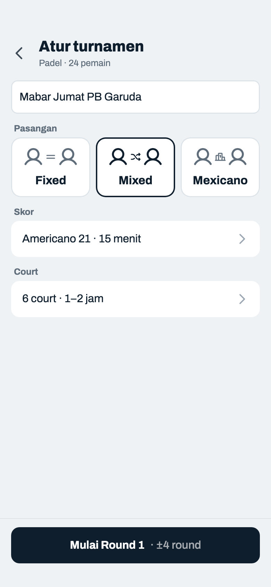

Komponen: `MabarAppBar`, `MabarButton`, `MabarIconButton`, `MabarActionBar`, `MabarGroup / MabarRow`, `MabarField`, `ModePicker`

- Layar tidak bertambah panjang: enam court tetap satu baris. Booking berbeda ditulis rentang "1–2 jam".
- Estimasi memakai booking terpendek: 1 jam ÷ 15 menit = ±4 round.
- Nama terisi "Mabar Jumat PB Garuda", tanpa fokus: tepi biasa, teks tinta.

## 03i · Sheet Court · 6 court · booking berbeda

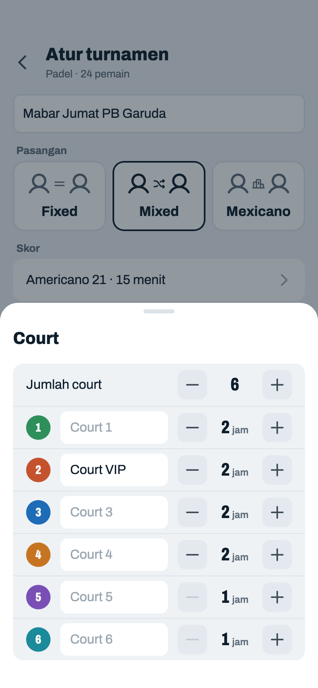

Komponen: `MabarAppBar`, `MabarButton`, `MabarIconButton`, `MabarActionBar`, `MabarGroup / MabarRow`, `MabarStepper`, `MabarField`, `showMabarSheet`, `ModePicker`, `CourtColorPicker`

- Court 1–4 dua jam, Court 5–6 satu jam (tombol − mati di batas 1 jam). "Court VIP" = nama custom, dipakai di header Input Skor dan sheet Lanjutkan; strip di Jadwal tetap nomor + warna.

## 03j · Sheet Court · 10 court (maksimum)

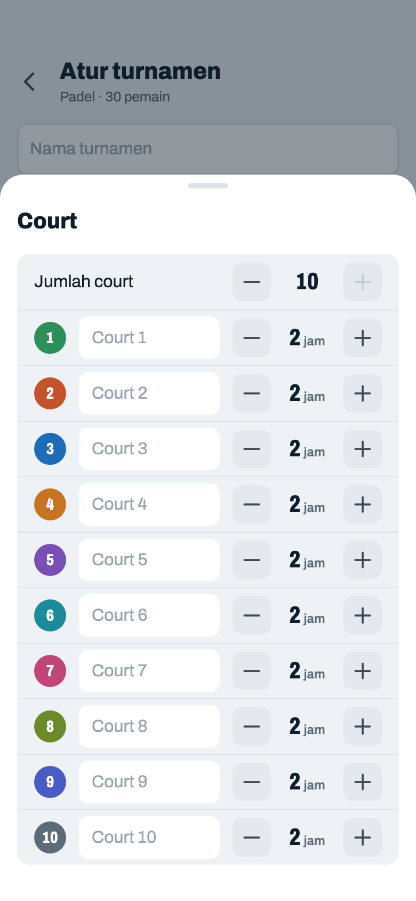

Komponen: `MabarAppBar`, `MabarButton`, `MabarIconButton`, `MabarActionBar`, `MabarGroup / MabarRow`, `MabarStepper`, `MabarField`, `showMabarSheet`, `ModePicker`, `CourtColorPicker`

- Batas 10 court: tombol + Jumlah court mati. Sebelas baris masih muat tanpa digulir; saat keyboard naik, isi sheet digulir di dalam, judul tetap (aturan `showMabarSheet`).
- 30 pemain, 2 jam ÷ 15 menit = ±8 round.

## 03k · Sheet warna court · di atas sheet Court

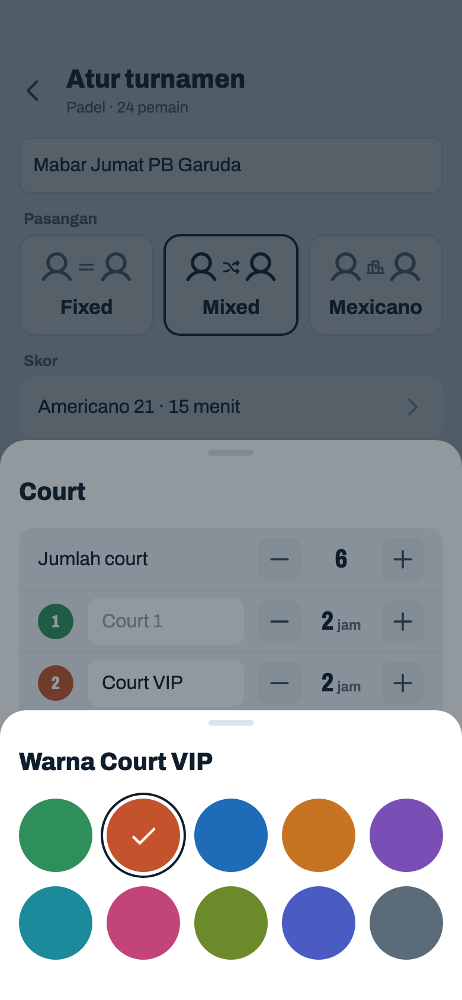

Komponen: `MabarAppBar`, `MabarButton`, `MabarIconButton`, `MabarActionBar`, `MabarGroup / MabarRow`, `MabarStepper`, `MabarField`, `showMabarSheet`, `ModePicker`, `CourtColorPicker`

- Ketuk lingkaran warna Court 2 di sheet Court (03i) → sheet warna di atasnya, dengan scrim kedua. Ketuk satu warna → terpilih, sheet warna tertutup, kembali ke sheet Court. Tutup juga dengan ketuk di luar atau geser turun.
- Isi sama dengan sebelumnya: 10 warna, warna sama di dua court boleh. Kalimat "Ketuk warna untuk ganti" tetap tidak ada.
- Judul = "Warna" + nama court: "Warna Court VIP"; nama kosong = "Warna Court 2" (keputusan host 42).
- Di 2 court sheet Court lebih pendek, jadi hampir seluruhnya tertutup sheet warna.

## 03l · Durasi tidak muat · tombol mati

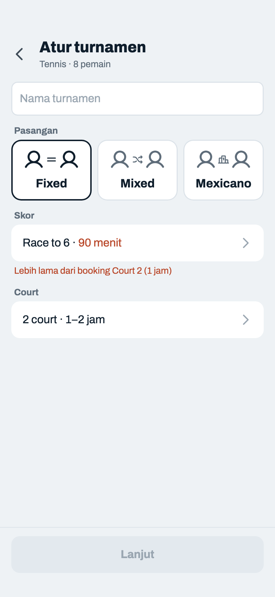

Komponen: `MabarAppBar`, `MabarButton`, `MabarIconButton`, `MabarActionBar`, `MabarGroup / MabarRow`, `MabarField`, `ModePicker`

- Muncul kalau `booking terpendek ÷ durasi = 0` (60 ÷ 90). Durasi di baris Skor clay, catatan error di bawah grup Skor menyebut court penyebabnya, tombol mati polos ("Mulai Round 1" untuk Mixed/Mexicano).
- Catatan yang sama di dalam sheet Skor (03m) dan sheet Court (03n), jadi host tahu sebelum menutup sheet mana pun.

## 03m · Sheet Skor · durasi tidak muat

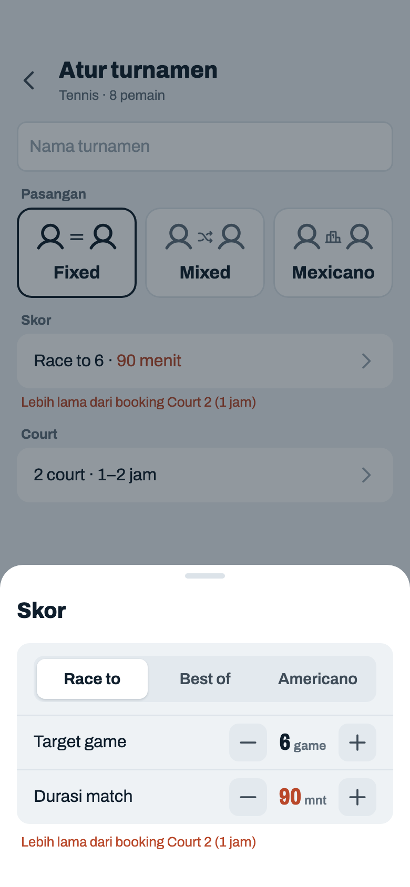

Komponen: `MabarAppBar`, `MabarButton`, `MabarIconButton`, `MabarActionBar`, `MabarGroup / MabarRow`, `MabarSegmented`, `MabarStepper`, `MabarField`, `showMabarSheet`, `ModePicker`

- Begitu stepper Durasi melewati booking terpendek, angkanya clay dan catatan error muncul di bawah grup di dalam sheet. Turun ke 60 menit → catatan hilang di sheet dan di layar.

## 03n · Sheet Court · durasi tidak muat

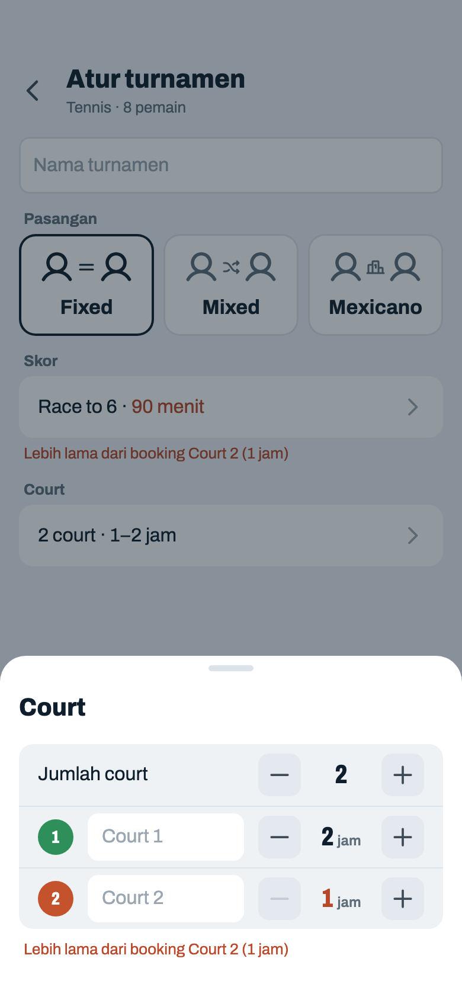

Komponen: `MabarAppBar`, `MabarButton`, `MabarIconButton`, `MabarActionBar`, `MabarGroup / MabarRow`, `MabarStepper`, `MabarField`, `showMabarSheet`, `ModePicker`, `CourtColorPicker`

- Angka jam court penyebab (Court 2, 1 jam) clay, seperti angka durasi; catatan yang sama di bawah grup. + di Court 2 (2 jam) → keduanya hilang dan tombol aktif lagi.

## 03o · Nama aktif · keyboard

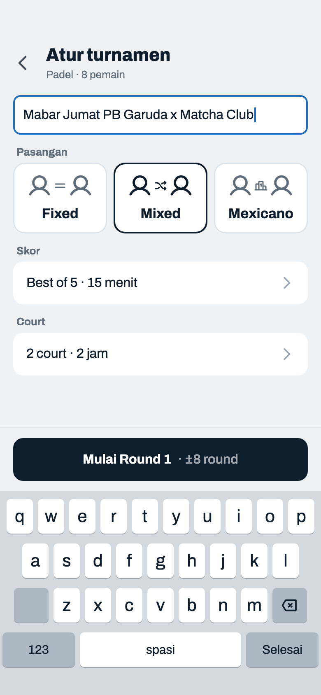

Komponen: `MabarAppBar`, `MabarButton`, `MabarIconButton`, `MabarActionBar`, `MabarGroup / MabarRow`, `MabarField`, `ModePicker`

- Kotak nama aktif: tepi biru court 2 pt dan kursor, seperti kotak lain. Keyboard huruf kapital di awal kata; tombol keyboard "Selesai" menutup keyboard.
- Action bar ikut naik di atas keyboard (jarak bawah 12, tanpa safe area); isi di bawahnya terpotong dan bisa digulir. Keyboard di frame hanya penanda (`.kbd`), tingginya mengikuti HP.

## 03p · Durasi kosong · sedang diketik

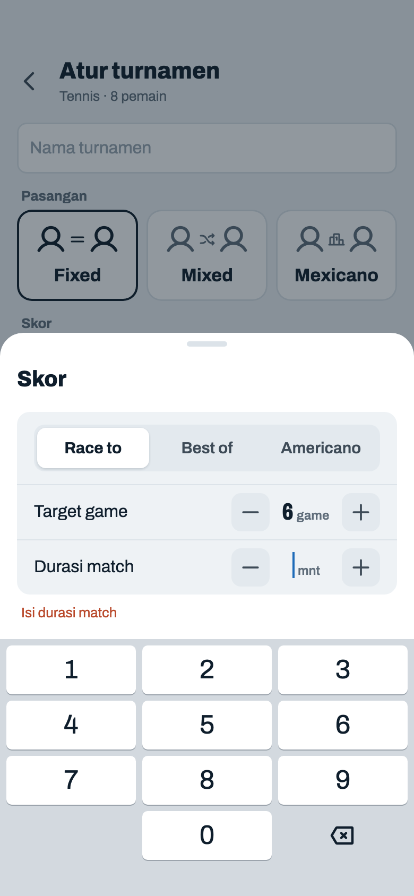

Komponen: `MabarAppBar`, `MabarButton`, `MabarIconButton`, `MabarActionBar`, `MabarGroup / MabarRow`, `MabarSegmented`, `MabarStepper`, `MabarField`, `showMabarSheet`, `ModePicker`

- Ketuk angka durasi di sheet Skor → diketik langsung dengan keyboard angka; sheet naik bersama keyboard. Isinya dihapus → "Isi durasi match" clay di bawah grup di sheet dan di bawah baris Skor, baris Skor menulis "– menit" clay, tombol mati polos.
- Keyboard ditutup atau sheet ditutup selagi kosong → keadaan ini tetap sampai durasi diisi (tidak diisi otomatis).

## 03q · Pengaturan terakhir di HP · Mexicano · 3 court

Komponen: `MabarAppBar`, `MabarButton`, `MabarIconButton`, `MabarActionBar`, `MabarGroup / MabarRow`, `MabarField`, `ModePicker`

- Turnamen kedua dan seterusnya: layar dibuka dengan pengaturan turnamen terakhir yang dimulai di HP itu (keputusan host 36): mode, format + N, durasi, dan court (jumlah, nama, warna, booking). Contoh: turnamen terakhir Padel Mexicano, Americano 24, 15 menit, 3 court × 2 jam.
- Nama turnamen tidak ikut diingat: hampir selalu beda tiap turnamen, dan nama lama yang terbawa akan tercetak di poster.
- Tanpa penanda "pengaturan terakhir": layarnya sama dengan Konfigurasi biasa. Turnamen pertama di HP = default 03a.
- Estimasi dari nilai yang terisi: 2 jam ÷ 15 menit = ±8 round.
- Turnamen terakhir Mexicano lalu host memilih Sparing: kartu Mexicano tidak ada, jadi mode terisi Mixed dengan format dan court yang sama (keputusan host 38, disetujui 2026-11-12).
