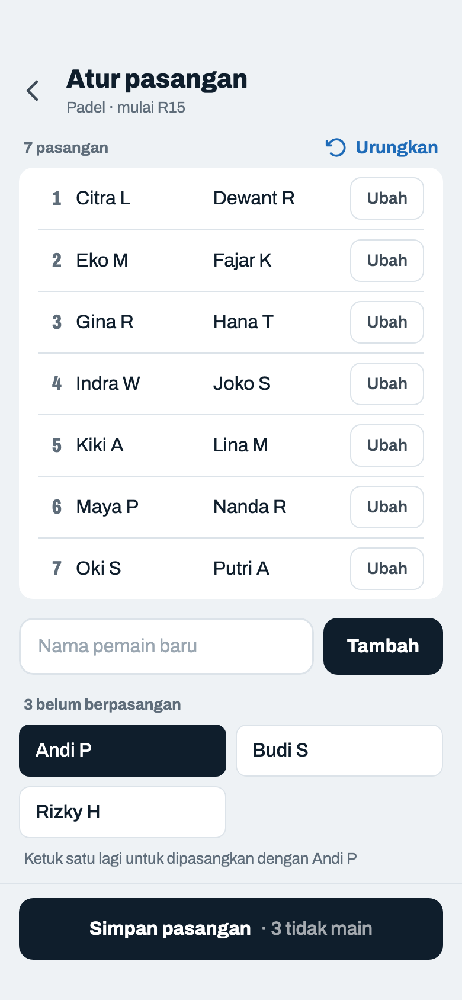
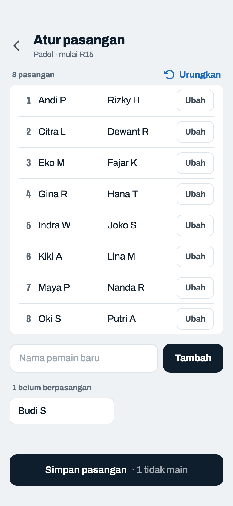
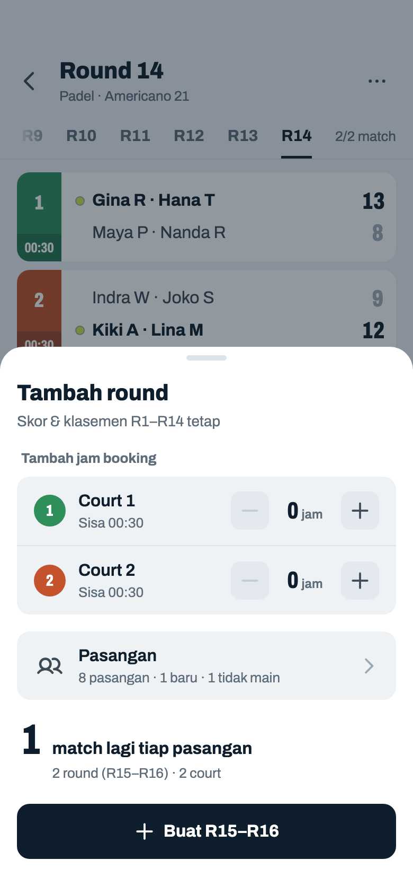

# Pasangan (Fixed)

> Dihasilkan `tool/hifi_extract.py` dari `design/hifi.html`. Jangan diedit langsung.

Hanya untuk mode Fixed. Satu daftar pasangan bernomor dengan dua kolom nama rata, bahasa visual yang sama dengan daftar di layar Pemain. Di Manual, pemain yang belum berpasangan ada di bawahnya sebagai chip dua kolom dan pindah ke daftar begitu dipasangkan. Pasangan diacak begitu layar dibuka; peringatan "tidak bisa diubah" ada di dialog saat menekan Buat jadwal. Setelah round-robin selesai, pasangan bisa diatur ulang sebelum round tambahan (04f–04h).

## 04a · Acak

Komponen: `MabarAppBar`, `MabarButton`, `MabarTextButton`, `MabarIconButton`, `MabarActionBar`, `MabarGroup / MabarRow`, `MabarGroupHeader`, `MabarSegmented`, `PairList`

- Kartu 2×2 diganti daftar bernomor: satu baris per pasangan, nama rata dalam dua kolom, jadi 10 pasangan tetap rapi dan tidak ada kartu yang lebih tinggi dari sebelahnya.
- "Acak ulang" jadi tombol teks di ujung label daftar (`.ghead`), bukan tombol yang mengambang di tengah. Jumlah pasangan pindah dari subjudul ke label.
- Jumlah pasangan ganjil (mis. 3) tetap boleh: tiap round satu pasangan istirahat. Buat jadwal → dialog 04d.

## 04b · Manual · sedang memilih

Komponen: `MabarAppBar`, `MabarButton`, `MabarTextButton`, `MabarIconButton`, `MabarActionBar`, `MabarGroup / MabarRow`, `MabarGroupHeader`, `MabarSegmented`, `PairList`, `MabarChip`

- Dua bagian, urutan kerja dari atas: pasangan yang sudah jadi, lalu pemain yang belum berpasangan. Pemain yang sudah dipasangkan pindah ke daftar atas, tidak lagi tampil pudar di bawah, jadi tiap nama hanya ada di satu tempat.
- Chip dua kolom rata 44 pt (`.chips.cols`), bukan chip yang membungkus tidak rata. Slot kosong bergaris putus dihapus; progres ada di label "1 dari 4 pasangan".
- Ketuk A (gelap), lalu B → baris baru di daftar atas. Ketuk A lagi melepas pilihan. Catatan di bawah chip mengikuti keadaan: "Ketuk dua pemain…" atau "Ketuk satu lagi untuk dipasangkan dengan A".
- "Urungkan" melepas pasangan terakhir dan pilihan yang menggantung; mati kalau belum ada pasangan. Pindah ke Manual mengosongkan semua pasangan tanpa konfirmasi; kembali ke Acak membuang hasil manual.

## 04c · Jumlah pemain ganjil

Komponen: `MabarAppBar`, `MabarButton`, `MabarTextButton`, `MabarIconButton`, `MabarActionBar`, `MabarGroup / MabarRow`, `MabarGroupHeader`, `MabarSegmented`, `PairList`

- Pemain sisa jadi baris terakhir daftar dengan nomor "–" dan keterangan pudar, bukan kotak terpisah. Satu catatan di bawahnya dengan "Ubah pemain" → kembali ke layar Pemain dengan daftar tetap terisi.
- Di Manual, pemain terakhir yang tidak punya lawan pasangan berakhir di baris yang sama begitu chip-nya tinggal satu.

## 04d · Dialog · buat jadwal

Komponen: `MabarAppBar`, `MabarButton`, `MabarTextButton`, `MabarIconButton`, `MabarActionBar`, `MabarGroup / MabarRow`, `MabarGroupHeader`, `MabarSegmented`, `PairList`, `showMabarSheet`, `showMabarConfirm`

- Menggantikan kotak merah permanen "Pasangan tidak bisa diubah setelah jadwal dibuat". Memakai `showMabarConfirm` varian lanjut.
- Konfirmasi → Jadwal Fixed (round-robin penuh dibuat sekaligus).

## 04e · Manual · 30 pemain (terpadat)

Komponen: `MabarAppBar`, `MabarButton`, `MabarTextButton`, `MabarIconButton`, `MabarActionBar`, `MabarGroup / MabarRow`, `MabarGroupHeader`, `MabarSegmented`, `PairList`, `MabarChip`

- Kondisi terpadat Manual: 30 pemain, setengah jalan (7 pasangan + 16 chip). Daftarnya lebih panjang dari layar, jadi halaman di-scroll seperti layar Pemain; app bar dan action bar tetap. Baris pasangan 40 pt (sama dengan daftar di layar Pemain, tidak bisa diketuk) dan chip 44 pt.
- Nama panjang dipotong elipsis di kolomnya, sama seperti daftar di layar Pemain.

## 04f · Atur pasangan · sebelum round tambahan

Komponen: `MabarAppBar`, `MabarButton`, `MabarTextButton`, `MabarIconButton`, `MabarRowAction`, `MabarActionBar`, `MabarGroup / MabarRow`, `MabarGroupHeader`, `MabarField`, `PairList`, `MabarChip`

- Dibuka dari baris Pasangan di sheet Tambah round (06w). Mulai dari pasangan yang sekarang; tanpa Acak, karena biasanya hanya satu-dua pasangan yang berubah. Contoh: Budi S pulang setelah R14, Rizky H datang menggantikannya.
- "Ubah" (`.rowact`, baris 52 pt) memisahkan pasangan itu: kedua pemain pindah ke "belum berpasangan". Label dipilih host (2026-11-03, dulu "Pisah"). Ketuk dua chip → pasangan baru, mengisi tempat pasangan yang dipisah (di sini nomor 1), jadi urutan pasangan lain dan lawannya di round tambahan tetap: round-robin diulang dari awal, R15 = lawan R1 dengan Andi P + Rizky H di tempat Andi P + Budi S.
- Pemain pengganti: kolom nama + Tambah, sama dengan Kelola pemain (08a): nama dibersihkan, tidak boleh sama dengan pemain mana pun di turnamen ini, maks 30 pemain. Pemain baru masuk "belum berpasangan".
- "Urungkan" membatalkan langkah terakhir (ubah, pasangkan, tambah pemain); mati kalau belum ada perubahan.
- Pemain yang masih belum berpasangan saat disimpan tidak ikut round tambahan; skor dan klasemennya tetap (Total Point tertinggal, keputusan host 2026-11-03). Jumlahnya ditulis di tombol. Pemain itu muncul lagi di "belum berpasangan" saat Atur pasangan berikutnya.

## 04g · Atur pasangan · siap disimpan

Komponen: `MabarAppBar`, `MabarButton`, `MabarTextButton`, `MabarIconButton`, `MabarRowAction`, `MabarActionBar`, `MabarGroup / MabarRow`, `MabarGroupHeader`, `MabarField`, `PairList`, `MabarChip`

- Andi P + Rizky H mengisi nomor 1. Budi S tidak dipasangkan → tidak ikut round tambahan. Catatan "Ketuk dua pemain…" hilang selama tinggal satu chip.
- Simpan → kembali ke sheet Tambah round (04h); belum ada yang berubah di turnamen sampai "Buat R…" diketuk. Kembali (←) membuang perubahan.
- Tombol mati dengan alasan "· minimal 2 pasangan" kalau pasangannya kurang dari dua.

## 04h · Sheet tambah round · pasangan diatur

Komponen: `MabarAppBar`, `MabarButton`, `MabarIconButton`, `MabarActionBar`, `MabarGroup / MabarRow`, `MabarStepper`, `RoundTabs`, `MatchScoreRow`, `showMabarSheet`, `CourtColorPicker`

- Baris Pasangan menulis hasil Atur pasangan: jumlah pasangan · pasangan baru · pemain yang tidak main. Estimasi ikut daftar baru (jumlah pasangan ganjil → +2 per putaran, 06y).
- "Buat R15–R16": pemain pengganti masuk daftar pemain turnamen, pasangan baru dipakai mulai R15. Pasangan yang tidak berubah tetap satu baris di Klasemen; yang berubah tampil per pemain (09g).
