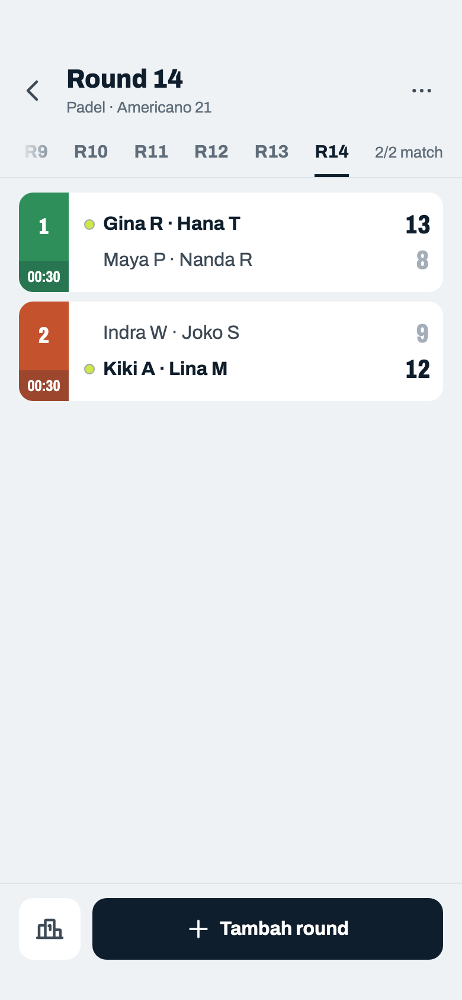
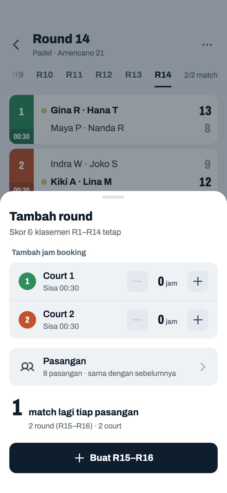
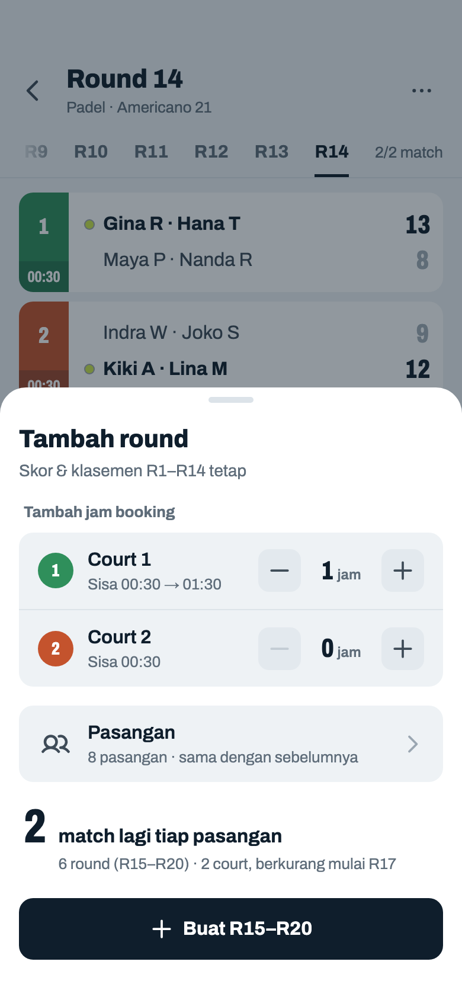
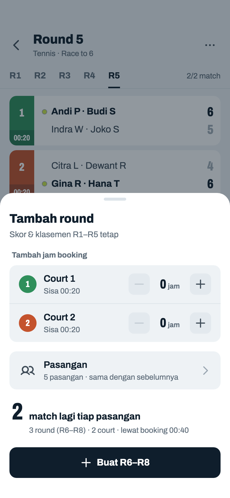
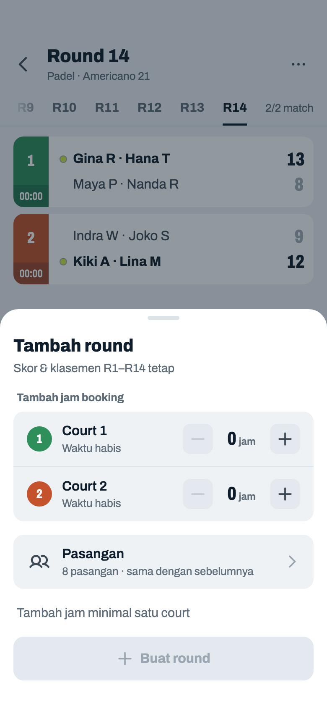

# Jadwal Fixed

> Dihasilkan `tool/hifi_extract.py` dari `design/hifi.html`. Jangan diedit langsung.

Round-robin penuh dibuat sekaligus. Contoh: Tennis, 10 pemain (5 pasangan), 2 court, jadi tiap round satu pasangan istirahat. Tombol akhiri yang dulu berupa lingkaran merah tanpa label pindah ke menu ⋯. Setelah semua match terisi, round tambahan dibuat per putaran dari sisa booking (06v–06z).

## 06a · Round berjalan

Komponen: `MabarAppBar`, `MabarButton`, `MabarIconButton`, `MabarActionBar`, `MabarGroup / MabarRow`, `MabarGroupHeader`, `RoundTabs`, `MatchScoreRow`, `RestingList`

- Judul = round yang dibuka. Subjudul: olahraga · format skor. Waktu tidak lagi di subjudul ("45m dari 2 jam"): sisa booking ditulis per court di kotak jam strip, hitung mundur jam:menit, hanya di round yang sedang dibuka (aturan lengkap 06p). Emoji ⏱ dihapus.
- Fixed mendapat hitung mundur yang sama, tanpa Kelola court: court hanya bisa ditambah di Mixed (keputusan host 2026-10-22). Jadwal Fixed dibuat lengkap di awal, jadi waktunya hanya informasi.
- Tab default = round pertama yang masih ada match kosong. Pilihan tab bertahan; tidak pindah otomatis saat round selesai.
- Progress bar dihapus; "1/2 match" di ujung tab menggantikannya.
- Baris "Istirahat" hanya muncul kalau jumlah pasangan ganjil: paling banyak satu pasangan bye per round (`byePairIdByRound`), nama depan dipisah titik tengah.
- Ketuk baris yang sudah terisi → Input Skor dalam mode ubah (07i). Round sebelumnya tetap bisa diubah.

## 06b · Membuka round yang belum terbuka

Komponen: `MabarAppBar`, `MabarButton`, `MabarIconButton`, `MabarActionBar`, `MabarGroup / MabarRow`, `MabarGroupHeader`, `RoundTabs`, `MatchScoreRow`, `RestingList`

- Semua tab bisa dibuka untuk melihat lawan berikutnya, tapi baris di round yang terkunci tidak bisa diketuk dan tidak punya tombol "Isi skor".
- Kotak info "Round belum bisa dimulai" diganti satu baris dengan ikon gembok.

## 06c · Turnamen diakhiri

Komponen: `MabarAppBar`, `MabarButton`, `MabarIconButton`, `MabarActionBar`, `MabarGroup / MabarRow`, `MabarGroupHeader`, `RoundTabs`, `MatchScoreRow`, `RestingList`

- Setelah "Akhiri": match kosong jadi "Tidak dimainkan" (tidak bisa diketuk), tidak ada lagi titik live, dan tombol Klasemen jadi tombol utama. Semua match terisi tanpa diakhiri: 06v (Tambah round).
- Fixed yang sudah diakhiri tidak bisa dilanjutkan, jadi tidak ada "Lanjutkan turnamen" atau "Tambah round".
- Ikon ⋯ tetap aktif: "Akhiri turnamen" hilang, "Live score" tetap ada (12f). Dulu pudar dan mati karena menunya kosong (2026-10-22); sejak live score menunya tidak pernah kosong (2026-10-24).

## 06d · Menu ⋯ · Fixed

Komponen: `MabarAppBar`, `MabarButton`, `MabarIconButton`, `MabarActionBar`, `MabarGroup / MabarRow`, `MabarGroupHeader`, `RoundTabs`, `MatchScoreRow`, `RestingList`, `MabarMenu`

- Ikon ⋯ sekarang berfungsi (dulu cuma hiasan). Isi menu Fixed: "Live score" → dialog 12b / sheet 12c, lalu garis dan "Akhiri turnamen" → dialog 06e.
- Setelah diakhiri, "Akhiri turnamen" tidak tampil lagi; Live score tetap (12f).

## 06e · Dialog · akhiri turnamen

Komponen: `MabarAppBar`, `MabarButton`, `MabarTextButton`, `MabarIconButton`, `MabarActionBar`, `MabarGroup / MabarRow`, `MabarGroupHeader`, `RoundTabs`, `MatchScoreRow`, `RestingList`, `showMabarSheet`, `showMabarConfirm`

- Dipakai Fixed dan Mixed. "Akhiri" mengubah semua match kosong jadi tidak dimainkan, menandai turnamen selesai, lalu membuka Klasemen.

## 06v · Semua match terisi · tambah round

Komponen: `MabarAppBar`, `MabarButton`, `MabarIconButton`, `MabarActionBar`, `RoundTabs`, `MatchScoreRow`

- Contoh: Padel, Americano 21, 16 pemain (8 pasangan), 2 court 4 jam, 15 mnt per match. Round-robin 28 match = 14 round = 3 j 30 m, jadi setelah R14 masih ada sisa 00:30 (turnamen live TBNE36, 2026-11-03).
- Muncul saat semua match Fixed sudah terisi dan turnamen belum diakhiri: Klasemen pindah jadi ikon di kiri (seperti Mixed 06l), tombol utama "Tambah round" → sheet 06w. Tetap muncul kalau booking sudah habis (06z); jamnya ditambah di sheet.
- Klasemen tetap "Final · 14 round · 28 match" sampai round tambahan dibuat, lalu kembali Sementara ("R15 · 28 dari 32 match").
- Setelah "Akhiri" tetap 06c: Fixed yang sudah diakhiri tidak bisa dilanjutkan.

## 06w · Sheet · tambah round

Komponen: `MabarAppBar`, `MabarButton`, `MabarIconButton`, `MabarActionBar`, `MabarGroup / MabarRow`, `MabarStepper`, `RoundTabs`, `MatchScoreRow`, `showMabarSheet`, `CourtColorPicker`

- Satu putaran = tiap pasangan main sekali lagi (8 pasangan → 4 match). Jumlah putaran = paling sedikit yang mengisi sisa booking, dibulatkan ke atas supaya tiap pasangan dapat jumlah match yang sama. Round yang lewat booking tetap dibuat; host menghentikannya kapan saja lewat "Akhiri" (06e), match yang belum main jadi "Tidak dimainkan".
- Hitungan (`RoundRobinGenerator.extraRounds`): ① round yang muat tiap court k = ⌊(sisa + tambahan) ÷ durasi⌋, sama dengan 08c ② putaran ditambah satu per satu sampai jumlah round ≥ k terbesar ③ round ke-r memakai court dengan k ≥ r; setelah semua habis, court dengan k terbesar ④ angka besar = match tambahan tiap pasangan.
- Contoh frame ini: sisa 00:30, durasi 15 → k = 2 di kedua court → 1 putaran = 2 round (R15–R16), pas. Kalau sisa 00:45 → k = 3 → 2 putaran = 4 round (R15–R18), keterangan "4 round (R15–R18) · 2 court · lewat booking 00:15".
- Lawan: urutan round-robin diulang dari awal, jadi R15–R16 = lawan dan court R1–R2 (Andi P · Budi S vs Oki S · Putri A, …). Tidak ada yang bertemu lawan yang sama untuk ketiga kalinya sebelum semua bertemu dua kali.
- "Buat R15–R16": jam tambahan masuk ke booking court (dihitung seperti 08c), sheet tertutup, Jadwal pindah ke R15 dengan titik live (tampilan 06a). Setelah round tambahan terisi semua, 06v muncul lagi.
- Baris Pasangan → Atur pasangan (04f): sebelum round tambahan, host bisa memisahkan pasangan dan memasukkan pemain pengganti; hasilnya kembali ke sheet ini (04h). "sama dengan sebelumnya" = belum diubah. Pasangan hanya bisa diatur di sini; kalau ada yang pulang di tengah round-robin, tetap WO.

## 06x · Tambah round · jam ditambah di satu court

Komponen: `MabarAppBar`, `MabarButton`, `MabarIconButton`, `MabarActionBar`, `MabarGroup / MabarRow`, `MabarStepper`, `RoundTabs`, `MatchScoreRow`, `showMabarSheet`, `CourtColorPicker`

- Jam ditambah per court, 0–6 jam, sama dengan 08c (sering cuma sebagian court yang bisa diperpanjang).
- Court 1 +1 jam: k = 6, Court 2 k = 2 → 2 putaran = 8 match: R15–R16 di 2 court, R17–R20 di Court 1 saja, pas dengan booking. "berkurang mulai R…" sama dengan 08c.

## 06y · Tambah round · pasangan ganjil, lewat booking

Komponen: `MabarAppBar`, `MabarButton`, `MabarIconButton`, `MabarActionBar`, `MabarGroup / MabarRow`, `MabarGroupHeader`, `MabarStepper`, `RoundTabs`, `MatchScoreRow`, `RestingList`, `showMabarSheet`, `CourtColorPicker`

- Turnamen 06a–06e (10 pemain, 5 pasangan, 2 court 2 jam, 20 mnt), R5 selesai 20.40 → sisa 00:20 → k = 1.
- Pasangan ganjil: satu pasangan selalu istirahat di tiap putaran round-robin, jadi +1 untuk semua tidak mungkin; satu putaran tambahan = tiap pasangan +2 (5 pasangan → 5 match, 3 round: 2 + 2 + 1). Baris Istirahat di R6 dan R7 satu pasangan seperti biasa; R8 (satu match) tanpa baris Istirahat.
- Lewat booking = (round − k terbesar) × durasi = (3 − 1) × 20 → "lewat booking 00:40" (format jam:menit seperti kotak jam). Hanya muncul kalau round tambahan melewati booking.
- Lawan pasangan ganjil memakai siklus Walecki: tiap putaran tiap pasangan bertemu dua lawan berbeda, dan putaran berikutnya tidak mengulang lawan sampai semua bertemu dua kali.

## 06z · Tambah round · waktu habis

Komponen: `MabarAppBar`, `MabarButton`, `MabarIconButton`, `MabarActionBar`, `MabarGroup / MabarRow`, `MabarStepper`, `RoundTabs`, `MatchScoreRow`, `showMabarSheet`, `CourtColorPicker`

- Booking semua court habis (atau sisanya kurang dari satu match): tombol mati sampai jam ditambah minimal satu court, sama dengan 08d.
