# Input Skor

> Dihasilkan `tool/hifi_extract.py` dari `design/hifi.html`. Jangan diedit langsung.

Papan skor gelap dengan satu angka besar per tim untuk ketiga format, dan keypad sendiri. Ketuk kotak untuk memilih, ketik angka (maksimal 2 digit), → pindah ke tim lawan. Format dan targetnya ditulis di subjudul sebagai pengingat host.

## 07a · Race to 6 · kosong

Komponen: `MabarAppBar`, `MabarButton`, `MabarTextButton`, `MabarIconButton`, `ScoreBoard / ScoreKeypad`

- Header: nama court sebagai judul, subjudul round · format · sisa booking court itu (07l). "ROUND 1 · MATCH 1", badge court, ikon olahraga, dan chip metode skor dihapus.
- Race to tidak mengisi otomatis: skor lawan harus diketik karena bisa berapa saja di bawah target.
- WO di kanan atas → sheet 07j.

## 07b · Race to 6 · selesai

Komponen: `MabarAppBar`, `MabarButton`, `MabarTextButton`, `MabarIconButton`, `ScoreBoard / ScoreKeypad`

- Pemenang ditandai bola di kolom tetap di kiri nama (10 pt), sejajar tengah dengan dua baris nama. Kolom ini ada di kedua tim (kosong kalau belum/tidak menang), jadi dua baris nama selalu rata dan nama tidak bergeser saat bola muncul. Tim yang kalah dipudarkan, seperti baris Jadwal. Nama 20/700.
- Simpan → kembali ke Jadwal tanpa toast.

## 07c · Race to 6 · selisih satu game

Komponen: `MabarAppBar`, `MabarButton`, `MabarTextButton`, `MabarIconButton`, `ScoreBoard / ScoreKeypad`

- Race to N murni: match langsung selesai begitu satu tim mencapai N, jadi menang selisih satu game (6–5) sah. Tidak ada 7–5 / 7–6 dan tidak ada tie-break: itu skor set standar (wajib selisih 2), format lain (keputusan host 2026-10-22).

## 07d · Race to 6 · belum selesai

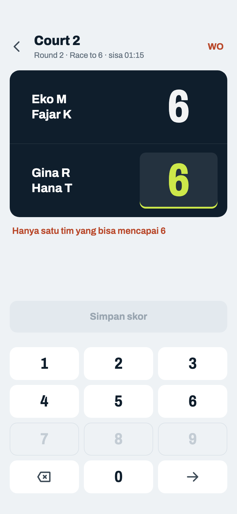

Komponen: `MabarAppBar`, `MabarButton`, `MabarTextButton`, `MabarIconButton`, `ScoreBoard / ScoreKeypad`

- Pesan lain: "Belum ada yang sampai 6" (mis. 5–3), "Skor akhir race to 6: 6–0 sampai 6–5" (skor di atas 6, hanya dari data lama). Angka 7 ke atas tidak bisa diketik sama sekali (07k).
- Kedua tim tidak bisa sama-sama mencapai target: match sudah selesai saat tim pertama mencapainya (keputusan host 2026-10-22).
- Satu sisi terisi, sisi lain kosong: Simpan mati tanpa pesan (sedang mengetik).

## 07e · Best of 5

Komponen: `MabarAppBar`, `MabarButton`, `MabarTextButton`, `MabarIconButton`, `ScoreBoard / ScoreKeypad`

- Isi satu sisi; kotak lawan yang masih kosong terisi `N − x` dan tampil pudar sebagai tanda otomatis. Mengetik di kotak lawan menimpa nilai otomatis; sisi pertama tidak dihitung ulang (07m, 07o).
- Angka di atas N tidak bisa diketik: tombol 6–9 mati untuk Best of 5.

## 07f · Best of 6 · seri

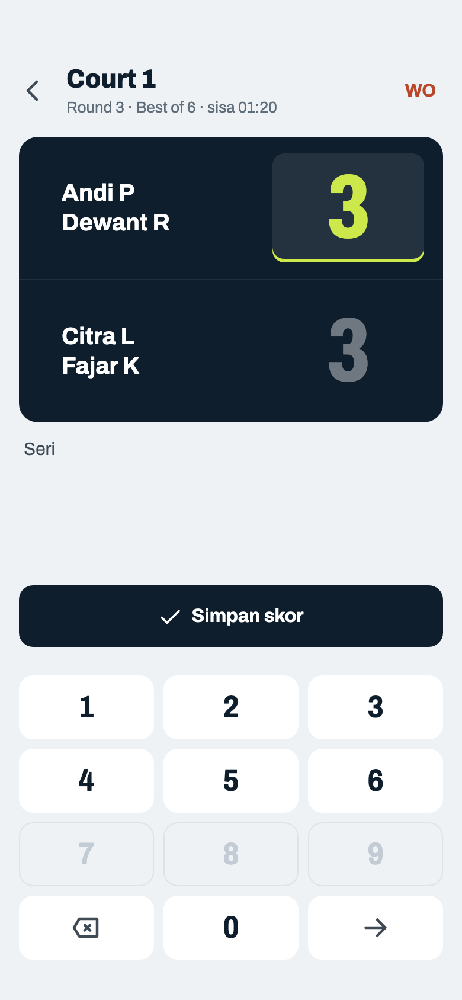

Komponen: `MabarAppBar`, `MabarButton`, `MabarTextButton`, `MabarIconButton`, `ScoreBoard / ScoreKeypad`

- Hanya mungkin kalau N genap. Seri dihitung setengah menang di Win %. Americano dengan total genap (mis. 24 → 12–12) berperilaku sama.

## 07g · Americano

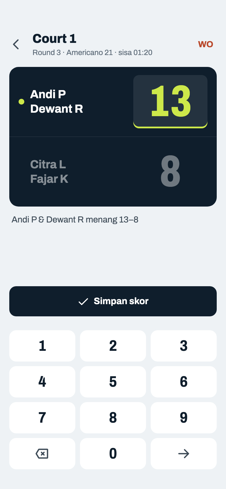

Komponen: `MabarAppBar`, `MabarButton`, `MabarTextButton`, `MabarIconButton`, `ScoreBoard / ScoreKeypad`

- Poin reli. Isi satu sisi, kotak lawan yang masih kosong terisi `total − x`; total boleh kurang dari 21 kalau match dihentikan lebih awal (07m). Kalimat "Isi salah satu, skor lawan terisi otomatis" dihapus.
- Kalimat hasil memakai pola yang sama dengan Race to dan Best of: nama pemenang + "menang" + skor pemenang–kalah ("menang 13–8"), bukan selisih (PATCH 3.8.1, B-15).

## 07h · Americano · batas total di keypad

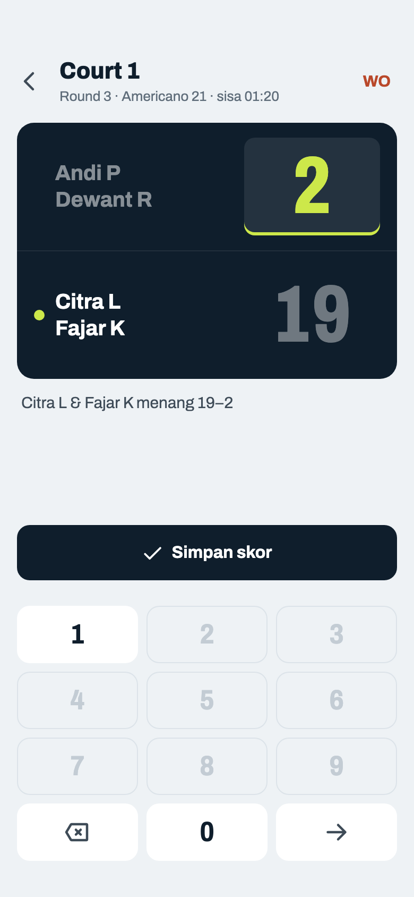

Komponen: `MabarAppBar`, `MabarButton`, `MabarTextButton`, `MabarIconButton`, `ScoreBoard / ScoreKeypad`

- Isi kotak tidak bisa melebihi total (21). Setelah mengetik "2", hanya 0 dan 1 yang masih aktif (20, 21); tombol lain mati. Dulu angka seperti 25 bisa diketik lalu ditolak dengan pesan.
- Sisi lawan langsung terisi total − x, jadi skor selalu sah selama hanya satu sisi diketik; tombol Simpan aktif.
- Kotak lawan yang diketik sendiri dipegang apa adanya: total kurang dari 21 sah kalau pemenang sudah 11 (07m), lebih dari 21 ditolak (07n).

## 07i · Mengubah skor tersimpan

Komponen: `MabarAppBar`, `MabarButton`, `MabarTextButton`, `MabarIconButton`, `ScoreBoard / ScoreKeypad`

- Skor tersimpan diisi otomatis, belum ada kotak aktif sampai diketuk. Tombol jadi "Perbarui skor".
- Selama belum ada kotak aktif semua angka dan ⌫ mati; ketuk salah satu kotak (atau →) untuk mulai mengubah (keputusan host 2026-10-22; ⌫ mati sejak PATCH 3.8.1).
- Match WO dibuka di sini juga: skor lama (kalau ada) terisi; menyimpan skor mengubahnya dari WO jadi selesai. Kedua kotak dikosongkan di match WO → "Perbarui skor" mati, tanpa "Kosongkan skor"; jalannya Hapus WO di sheet (07t, K3).
- Match Selesai: kedua kotak dikosongkan dengan ⌫ → tombol jadi "Kosongkan skor" (07p) kalau mode mengizinkan (PRD §17.3); round lama Mixed/Mexicano tetap "Perbarui skor" mati (07s).
- Best of dan Americano: skor tersimpan tidak diisi ulang otomatis; mengubah satu sisi membiarkan sisi lain (07n).

## 07j · Sheet · walkover

Komponen: `MabarAppBar`, `MabarButton`, `MabarTextButton`, `MabarIconButton`, `MabarGroup / MabarRow`, `MabarChip`, `ScoreBoard / ScoreKeypad`, `showMabarSheet`

- Nilai menang WO ikut format: Race to N → pemenang N game ("…menang WO, dapat 6 game"); Best of N dan Americano → rata-rata game/poin dari match yang dia mainkan sendiri, tapi tidak pernah di bawah skor menang terkecil = ⌊total ÷ 2⌋ + 1 (Americano 21 → 11, Americano 24 → 13, Best of 5 → 3, Best of 6 → 4), supaya "menang" WO tidak bernilai skor kalah seperti yang ditolak di Input Skor ("…dapat poin rata-rata mereka, minimal 11"). Rata-rata dibulatkan ke terdekat; belum pernah main → skor menang terkecil. Yang kalah WO 0. Menang/kalah ikut W–L–D dan Win %; selisih tidak berubah untuk kedua tim. Skor penuh hanya untuk Race to karena di sana pemenang memang selalu dapat N; di Best of dan Americano skor penuh adalah hasil maksimal, jadi menang WO malah lebih untung daripada main.
- Keterangan "Tetap main" di pilihan yang tidak dipilih dihapus. Kalimat "Pilih pasangan yang tidak bisa main…" diganti label pertanyaan.
- Alasan opsional, ketuk lagi untuk melepas (baru: melepas benar-benar menghapus alasan lama). Alasan tampil di baris Jadwal (06g).
- Simpan WO mati sampai satu pasangan dipilih. Membuka WO yang sudah ada: pilihan dan alasan terisi.
- Sheet dari match Belum atau Selesai (frame ini) tanpa "Hapus WO"; dari match WO ada "Hapus WO" di kanan kepala sheet (07t).

## 07k · Race to 6 · batas di keypad

Komponen: `MabarAppBar`, `MabarButton`, `MabarTextButton`, `MabarIconButton`, `ScoreBoard / ScoreKeypad`

- Isi satu kotak paling tinggi target (6), jadi tombol 7–9 mati. Kalau tidak ada angka lagi yang mungkin (satu digit sudah penuh), kursor pindah sendiri ke kotak lawan yang masih kosong.
- Kotak yang sudah penuh (tidak ada digit lagi yang bisa ditambahkan di belakangnya) menerima ketikan berikutnya sebagai pengganti isinya, begitu juga kotak yang baru dipilih. Jadi yang mati hanya angka di atas batas: Race to 6 berisi "4" → 7–9 mati (07b), Best of 5 berisi "3" → 6–9 mati (07e), Americano 21 berisi "13" → semua aktif (07g); "2" di Americano 21 belum penuh, jadi hanya 0 dan 1 (07h). Keputusan host 2026-10-22.
- Kombinasi baru dicek setelah dua kotak terisi: 6 sah atau tidak tergantung lawan (6–5 sah, 6–6 tidak; pesannya di 07d).
- Tombol sengaja tidak dimatikan berdasarkan isi kotak lawan. Contoh: host salah ketik 6–4 padahal 4–6; kalau angka dimatikan karena isi lawan, host harus mengubah kotak lawan dulu baru bisa mengoreksi.
- Race to 9: batasnya 9, jadi semua angka satu digit dan kotak langsung penuh.

## 07l · Input Skor · sisa waktu court

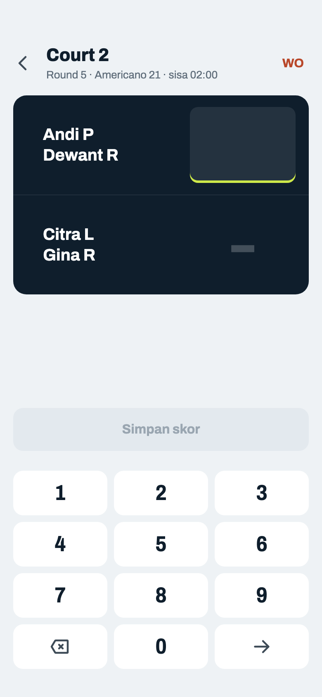

Komponen: `MabarAppBar`, `MabarButton`, `MabarTextButton`, `MabarIconButton`, `ScoreBoard / ScoreKeypad`

- Contoh court yang baru ditambah (06q). Subjudul menulis sisa court ini dengan format yang sama dengan strip: "Round 5 · Americano 21 · sisa 02:00"; 07a–07k dan 07m–07o memakai aturan yang sama.
- Hanya untuk match di round yang sedang berjalan (Mixed: round terakhir; Fixed: round yang dibuka), termasuk saat mengubah skornya (07i), selama turnamen belum diakhiri. Match di round yang sudah lewat: subjudul tanpa sisa. Sisa kurang dari satu durasi match: "sisa 00:12" clay; sudah lewat: "waktu habis" clay. Skor tetap bisa disimpan.

## 07m · Americano · berhenti lebih awal

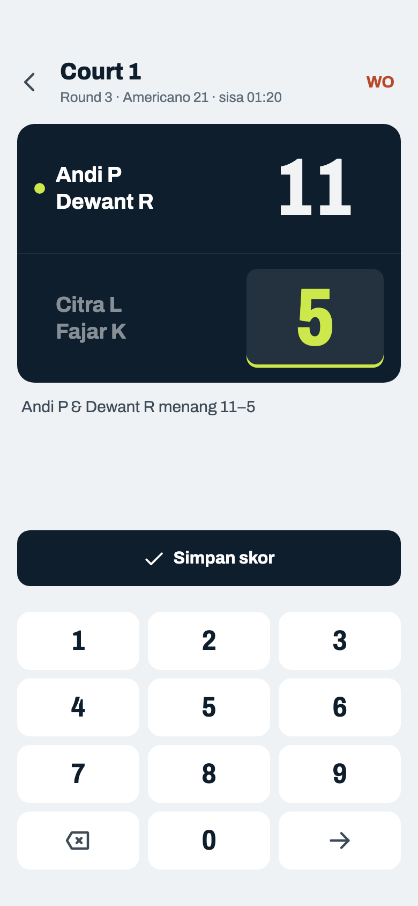

Komponen: `MabarAppBar`, `MabarButton`, `MabarTextButton`, `MabarIconButton`, `ScoreBoard / ScoreKeypad`

- Match boleh dihentikan begitu lawan tidak mungkin mengejar: pemenang sudah mencapai skor menang terkecil ⌊N ÷ 2⌋ + 1 (Americano 21 → 11, Americano 24 → 13, Best of 5 → 3, Best of 6 → 4). Total boleh kurang dari N, jadi yang kalah tidak dapat poin dari sisa yang tidak dimainkan (keputusan host 2026-10-26).
- Isi 11, kotak lawan terisi 10 otomatis; ketik 5 di kotak lawan → 11 tetap, tidak dihitung ulang jadi 16. Nilai otomatis hanya mengisi kotak yang kosong atau yang masih otomatis, dan ikut berubah selama sisi pertama diketik (1 → 20, 11 → 10).
- Best of 5 berhenti di 3–1 atau 3–0 berlaku sama.

## 07n · Americano · total lebih dari 21

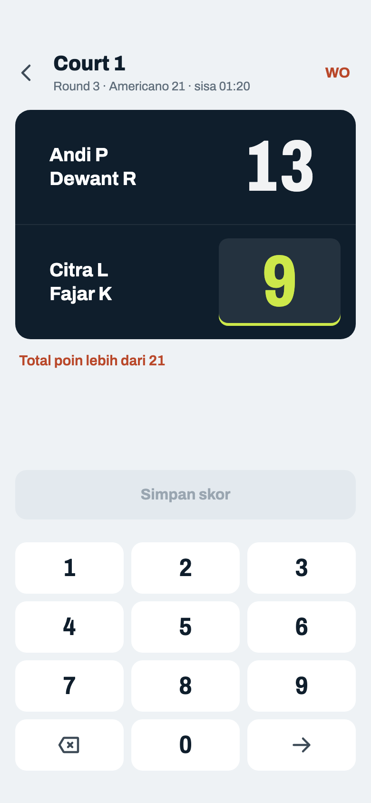

Komponen: `MabarAppBar`, `MabarButton`, `MabarTextButton`, `MabarIconButton`, `ScoreBoard / ScoreKeypad`

- Kedua sisi diketik sendiri dan jumlahnya lebih dari N: "Total poin lebih dari 21" (Best of 5: "Total game lebih dari 5"), Simpan mati. Terjadi saat mengoreksi salah satu sisi atau mengubah skor tersimpan (07i), karena sisi lain tidak dihitung ulang.
- Tombol tidak dimatikan karena isi lawan (07k), jadi 9 tetap bisa diketik; pesannya yang menolak.

## 07o · Best of 5 · belum ada pemenang

Komponen: `MabarAppBar`, `MabarButton`, `MabarTextButton`, `MabarIconButton`, `ScoreBoard / ScoreKeypad`

- Total kurang dari N dan belum ada yang mencapai skor menang terkecil: "Minimal skor pemenang 3", Simpan mati. Americano 21: 10–5 atau 5–5 → "Minimal skor pemenang 11".
- Seri hanya dengan total penuh (07f), jadi tetap hanya di N genap dan kolom W–L–D Klasemen tidak berubah.

## 07p · Mengubah skor · kedua kotak dikosongkan

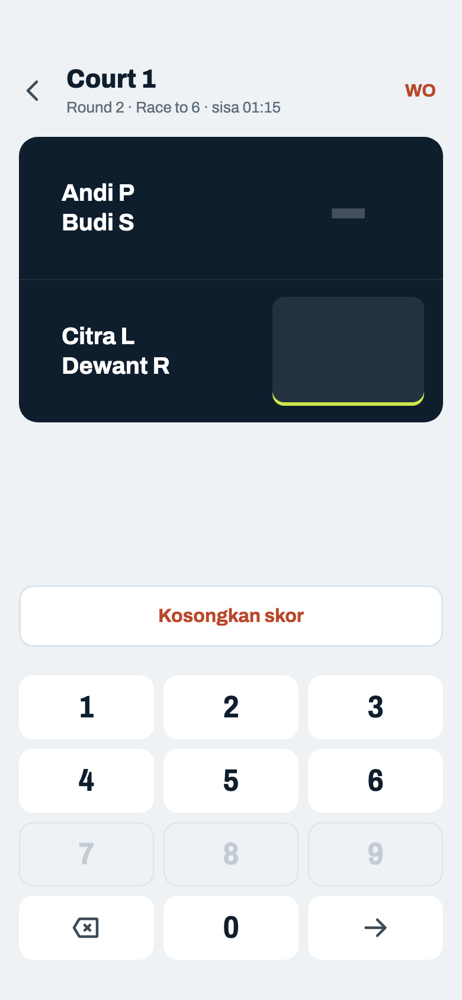

Komponen: `MabarAppBar`, `MabarButton`, `MabarTextButton`, `MabarIconButton`, `ScoreBoard / ScoreKeypad`

- Lanjutan 07i (R2 Court 1, 6–4 tersimpan): kotak atas diketuk lalu ⌫, → ke kotak bawah lalu ⌫. Kedua kotak kosong → "Perbarui skor" berubah jadi "Kosongkan skor": tombol sekunder bertinta clay (5,2:1 di card), aktif (keputusan 113, PRD §17.2).
- Hanya satu kotak kosong → "Perbarui skor" mati tanpa pesan (07d). Satu angka diketik lagi → kembali "Perbarui skor". Tanpa kalimat hasil di bawah papan.
- Best of dan Americano: mengosongkan satu kotak tidak mengisi atau mengosongkan kotak lain, karena skor tersimpan dihitung sebagai ketikan (07i).
- Hanya match Selesai di mode ubah, dan hanya kalau mode mengizinkan (PRD §17.3): Fixed dan Sparing Fixed semua round, sebelum dan sesudah diakhiri; Mixed, Sparing Mixed, dan Mexicano hanya round terakhir (round lama: 07s); fase grup selama bagan belum dibuat; gugur 07w/07x. Match Belum (Simpan skor) dan match WO (K3) tidak pernah menampilkannya.
- Ketuk → dialog 07q.

## 07q · Dialog · kosongkan skor

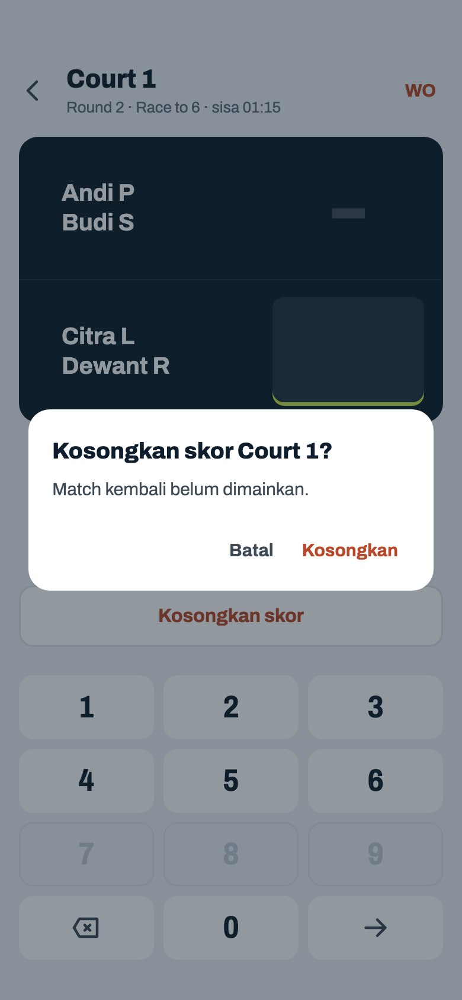

Komponen: `MabarAppBar`, `MabarButton`, `MabarTextButton`, `MabarIconButton`, `ScoreBoard / ScoreKeypad`, `showMabarSheet`, `showMabarConfirm`

- Judul = nama court match itu, sama dengan judul Input Skor; match gugur memakai kode match (07w). Isi = akibatnya saja (K4).
- Batal → kembali ke papan, kedua kotak tetap kosong, tidak ada yang tersimpan. Kosongkan → skor dibuang (tidak disimpan sebagai skor lama), match Belum, Input Skor tertutup ke Jadwal tanpa toast seperti Simpan skor. Tidak ada urungkan: skor diketik ulang.
- Semua turunan ikut dari match (K7, PRD §17.4): Klasemen, Sementara/Final, "Buat R4 · tunggu 1 match" (Mixed/Mexicano), kunci round Fixed (06aa, 06ab), "Tambah round" hilang, "Buat bagan · tunggu N match", bagan, poster, caption, Detail, live.

## 07r · Dialog · kosongkan skor setelah diakhiri

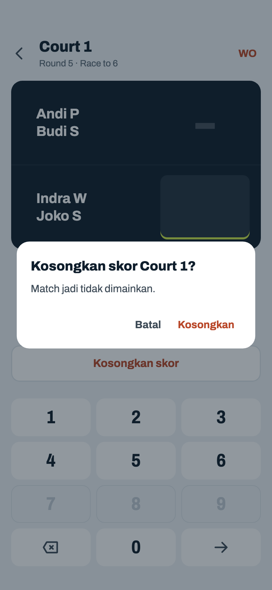

Komponen: `MabarAppBar`, `MabarButton`, `MabarTextButton`, `MabarIconButton`, `ScoreBoard / ScoreKeypad`, `showMabarSheet`, `showMabarConfirm`

- Turnamen Fixed 06c (diakhiri; R5 Court 1 Andi P · Budi S 6–5 Indra W · Joko S), kedua kotak dikosongkan seperti 07p. Subjudul tanpa sisa karena sudah diakhiri (07l).
- Isi "Match jadi tidak dimainkan.": turnamen yang diakhiri tidak punya match Belum (K6, U-1). Kosongkan → 06ac; status tetap Final. Mixed dan Mexicano: Lanjutkan turnamen mengembalikannya ke Belum seperti match tidak dimainkan lain. Fixed dan Grup + Gugur tidak bisa dilanjutkan, jadi match itu tetap tidak dimainkan.
- Batas per mode sama dengan sebelum diakhiri (PRD §17.3). Hapus WO tanpa skor lama setelah diakhiri memakai isi yang sama.

## 07s · Mixed · round lama · kedua kotak kosong

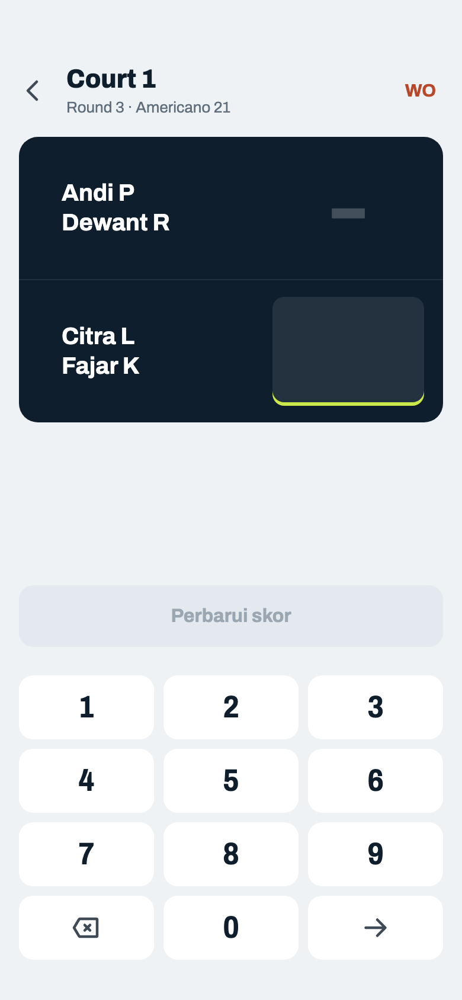

Komponen: `MabarAppBar`, `MabarButton`, `MabarTextButton`, `MabarIconButton`, `ScoreBoard / ScoreKeypad`

- Mixed R3 Court 1 (06f: Andi P · Dewant R 13–8 Citra L · Fajar K) dibuka setelah R4 dibuat. Bukan round terakhir, jadi tanpa "Kosongkan skor" (keputusan 114): kedua kotak dikosongkan → "Perbarui skor" mati seperti 3.8.1, tanpa teks baru (K5). Subjudul tanpa sisa: round lewat (07l).
- Skor round lama Mixed, Sparing Mixed, dan Mexicano hanya bisa diganti atau ditimpa WO. Satu-satunya jalan: R4 belum ada skor sama sekali → Batalkan R4 (06j), R3 jadi round terakhir lagi, lalu dikosongkan (PRD §17.3, keputusan 121 Q1).
- Sama untuk match WO di mode mana pun (jalannya Hapus WO, 07t; K3) dan match grup setelah Buat bagan (GU6).

## 07t · Sheet · walkover dari match WO · Hapus WO

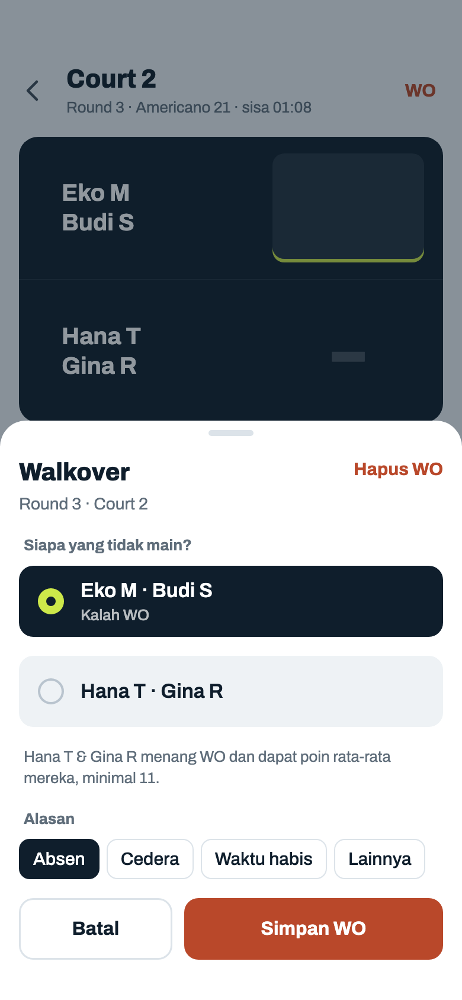

Komponen: `MabarAppBar`, `MabarButton`, `MabarTextButton`, `MabarIconButton`, `MabarGroup / MabarRow`, `MabarChip`, `ScoreBoard / ScoreKeypad`, `showMabarSheet`

- Mixed R3 Court 2 saat 06g: Eko M · Budi S WO · Absen, tanpa skor lama; R3 round terakhir. Di belakang = Input Skor match WO tanpa skor lama: kotak kosong, "Perbarui skor" mati (K3).
- "Hapus WO" = aksi teks clay di kanan kepala sheet (pola 08h, 12c). Hanya di sheet yang dibuka dari match WO dan kalau mode mengizinkan (PRD §17.3); sheet dari match Belum/Selesai tanpa "Hapus WO" (07j).
- Pilihan dan alasan WO tersimpan terisi (07j). "Hapus WO" berlaku untuk WO yang tersimpan, apa pun pilihan yang sedang diubah di sheet. Ketuk → dialog 07u.

## 07u · Dialog · hapus WO · tanpa skor lama

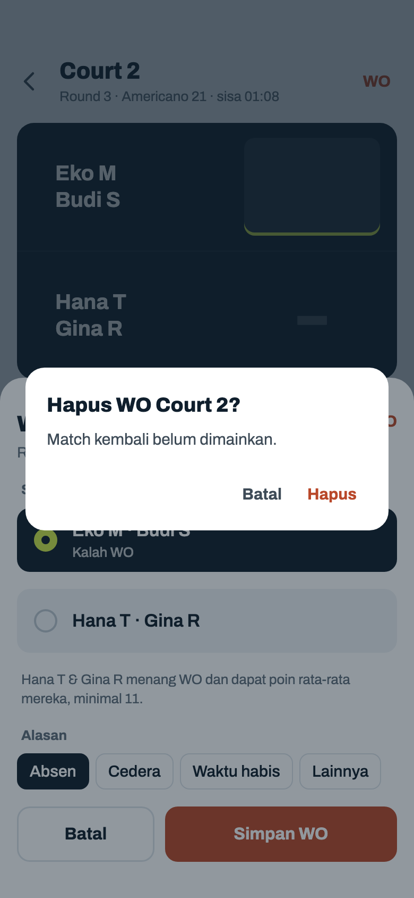

Komponen: `MabarAppBar`, `MabarButton`, `MabarTextButton`, `MabarIconButton`, `MabarGroup / MabarRow`, `MabarChip`, `ScoreBoard / ScoreKeypad`, `showMabarSheet`, `showMabarConfirm`

- Dialog di atas sheet 07t (pola 12e). Gugur memakai kode match ("Hapus WO SF2?") dan menambah baris susunan baru seperti 07w. Setelah diakhiri: "Match jadi tidak dimainkan." (07r).
- Hapus → pasangan WO dan alasannya dibuang, match Belum; sheet dan Input Skor tertutup ke Jadwal. Baris Court 2 tanpa tag WO, ikon tukar muncul di Court 2 (Mixed, §15), "Buat R4" jadi "Buat R4 · tunggu 1 match"; Batalkan R3 tetap tidak ada karena Court 1 sudah ada skor. Batal → kembali ke sheet.

## 07v · Dialog · hapus WO · skor lama 6–4

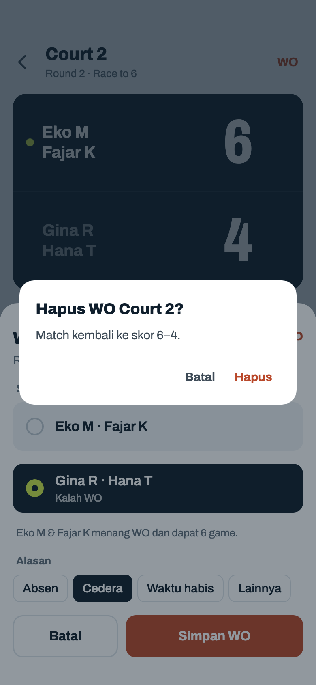

Komponen: `MabarAppBar`, `MabarButton`, `MabarTextButton`, `MabarIconButton`, `MabarGroup / MabarRow`, `MabarChip`, `ScoreBoard / ScoreKeypad`, `showMabarSheet`, `showMabarConfirm`

- Fixed R2 Court 2: Eko M · Fajar K 6–4 Gina R · Hana T tersimpan, lalu dijadikan WO (Gina R · Hana T, Cedera). Skor lama disimpan (4.4), jadi Input Skor di belakang terisi 6–4 seperti 07i. R2 sudah lengkap, jadi subjudul tanpa sisa (07l).
- Isi "Match kembali ke skor 6–4." urut sisi atas–bawah seperti papan. Hapus → match Selesai 6–4, alasan WO hilang dari baris Jadwal, nilai WO diganti skor itu; sheet dan Input Skor tertutup ke Jadwal.
- Sesudah kembali ke skor lama, skornya bisa dikosongkan dari Input Skor (07p) kalau mode mengizinkan (K3).

## 07w · Gugur · dialog kosongkan SF1 · susunan baru

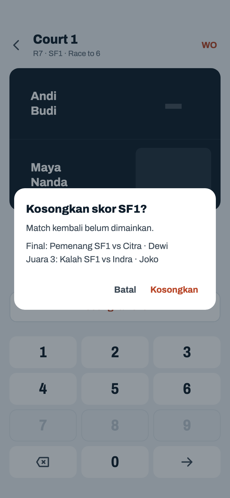

Komponen: `MabarAppBar`, `MabarButton`, `MabarTextButton`, `MabarIconButton`, `ScoreBoard / ScoreKeypad`, `showMabarSheet`, `showMabarConfirm`

- Contoh 17E, R8 masih Belum: SF1 Andi · Budi 6–4 Maya · Nanda, SF2 Indra · Joko 4–6 Citra · Dewi (21j sebelum Final diisi). Kedua kotak SF1 dikosongkan seperti 07p. Judul dialog memakai kode match (U-4); Input Skor tetap berjudul court.
- Match yang mengisi match lain (PF, SF) menambah susunan baru di bawah akibatnya, pola 21k. Final dan Juara 3 tidak mengisi match lain: "Kosongkan skor Final?" · "Match kembali belum dimainkan." tanpa baris susunan.
- Kosongkan → SF1 Belum, R7 jadi round berjalan lagi, R8 terkunci lagi; sisi Final dan Juara 3 kembali "Pemenang SF1" / "Kalah SF1" (KnockoutBracket.resolve), Final dan Juara 3 tidak bisa dibuka.

## 07x · Gugur · kosongkan SF1 ditolak · Final dan Juara 3 sudah ada skor

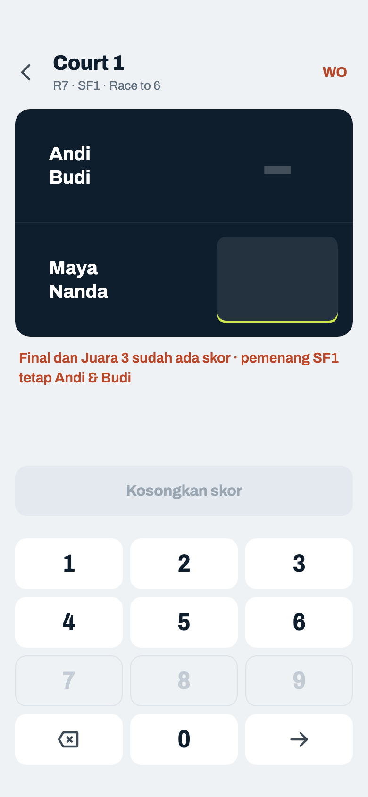

Komponen: `MabarAppBar`, `MabarButton`, `MabarTextButton`, `MabarIconButton`, `ScoreBoard / ScoreKeypad`

- Final 7–9 dan Juara 3 4–2 sudah tersimpan (21i, status Final). Kedua kotak SF1 dikosongkan → "Kosongkan skor" tampil tapi mati, pesan 21l menggantikan kalimat hasil (GU11, keputusan 114). Hanya Final yang sudah ada skor: "Final sudah ada skor · …" (21l).
- Jalannya (17E): kosongkan Final, lalu Juara 3; sesudah itu SF1 bisa diganti (dialog 21k) atau dikosongkan (07w). Aturan GU11 tidak berubah.
- Satu angka diketik lagi → pesan hilang, kembali aturan 21k–21m.
