# Klasemen

> Dihasilkan `tool/hifi_extract.py` dari `design/hifi.html`. Jangan diedit langsung.

Tabel rapat dengan angka rata kanan. Status ditulis di subjudul, bukan badge. Metode yang dipilih di sini juga dipakai Detail dan Bagikan.

## 09a · Mixed · Point % · dibuka pertama (Americano)

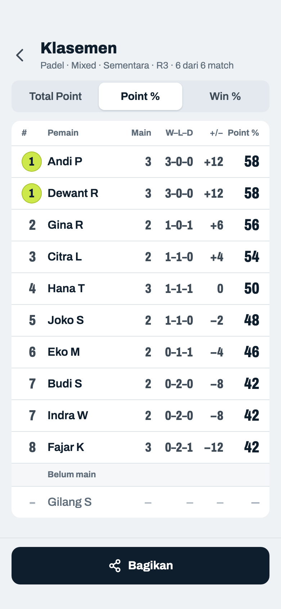

Komponen: `MabarAppBar`, `MabarButton`, `MabarIconButton`, `MabarActionBar`, `MabarSegmented`, `StandingTable`

- Americano (juga Mexicano) membuka Klasemen di Point %; Race to dan Best of di Win % (keputusan 123). Tab berurutan Total Point · Point % · Win % (keputusan 129, U-RP1). Pilihan host bertahan selama turnamen itu, tidak disimpan; turnamen berganti atau app dibuka ulang → kembali ke default.
- Point % = poin didapat ÷ poin dimainkan (didapat + kalah) dari match Selesai dan WO, dibulatkan tanpa desimal (,5 ke atas). Kolom menulis angka saja seperti Win % (09b); tanda % ada di judul kolom "Point %".
- Nomor dari angka bulat yang tampil, lalu selisih (keputusan 129, U-RP2): Budi dan Indra (20 ÷ 48) serta Fajar (30 ÷ 72) sama-sama 42; selisih −8 di atas −12, jadi Budi dan Indra #7, Fajar #8. Angka dan selisih sama → nomor sama, urut nama (Andi, Dewant #1).
- Data sama dengan 09i (Total Point) dan 09b (Win %). Hana 36 poin dari 3 match (#2 di Total Point) turun ke #4 karena 36 ÷ 72 = 50%; Gina 27 poin dari 2 match naik ke #2 (27 ÷ 48 = 56%).
- Kolom Main, W–L–D, +/−, grup "Belum main", bola peringkat 1, dan ketuk baris → Detail sama dengan 09i. Detail Andi dari tab ini: "Peringkat 1 · Point % · …" (10a).
- Hitungan (fixture `ranking_fixture.dart` set1, `logic.md` §20.8): Americano 24, tiap match total 24, jadi dimainkan = 24 × Main. Andi 42/72 → 58 · Dewant 42/72 → 58 · Gina 27/48 → 56 · Citra 26/48 → 54 · Hana 36/72 → 50 · Joko 23/48 → 48 · Eko 22/48 → 46 · Budi 20/48 → 42 · Indra 20/48 → 42 · Fajar 30/72 → 42.

## 09b · Mixed · Win %

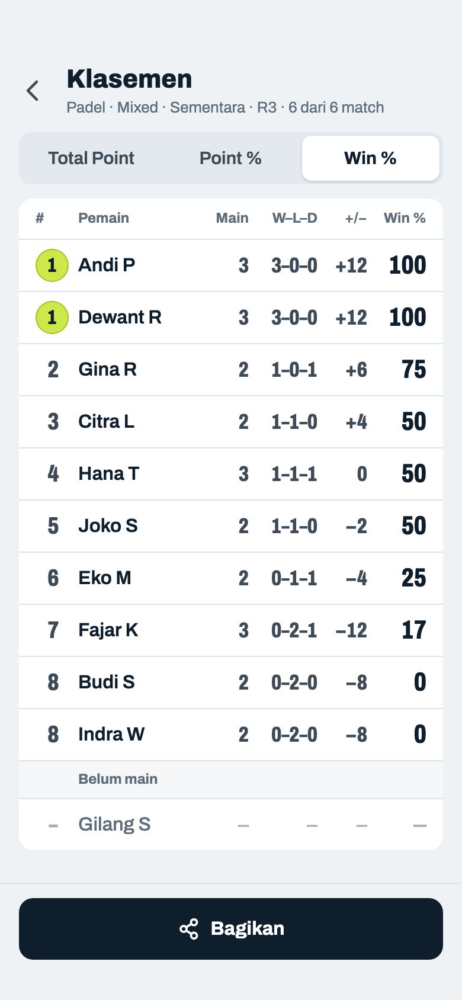

Komponen: `MabarAppBar`, `MabarButton`, `MabarIconButton`, `MabarActionBar`, `MabarSegmented`, `StandingTable`

- Kolom Main, W–L–D, dan +/− tetap di ketiga metode: ganti metode hanya mengubah urutan dan kolom terakhir. W–L–D juga yang menjelaskan Win %: seri dihitung setengah menang (1–1–1 → 50%).
- Win % dibulatkan tanpa desimal, di tabel maupun Detail (keputusan 128, B-18; 10e). Win % sama dipisah selisih, sama dengan Total Point: Citra +4 di atas Hana 0 dan Joko −2. Total Point tidak lagi jadi pemisah karena tidak tampil di tabel Win %.
- Metode saat Klasemen dibuka mengikuti format skor: Race to dan Best of → Win %, Americano dan Mexicano → Point % (keputusan 123; sebelum 3.9.0 Americano → Total Point). Pilihan host bertahan selama turnamen itu, tidak disimpan; turnamen berganti atau resume → kembali ke default formatnya.

## 09c · Fixed · final

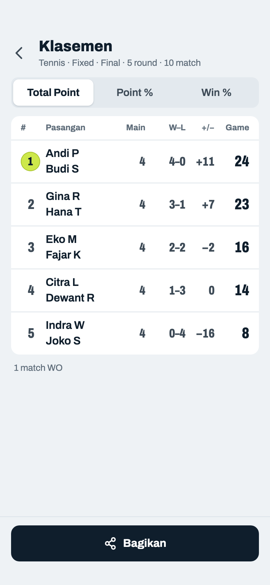

Komponen: `MabarAppBar`, `MabarButton`, `MabarIconButton`, `MabarActionBar`, `MabarSegmented`, `StandingTable`

- Fixed: satu baris per pasangan (dua nama ditumpuk), posisinya mengikuti anggota terbaik. Ketuk → Detail pasangan (10b).
- Judul ikon piala dan progress bar dihapus. "Final" kalau sudah diakhiri atau semua match selesai.
- Pemain sisa (jumlah ganjil) tampil sendiri di grup "Belum main".
- Race to 6 tidak pernah seri, jadi kolomnya W–L tanpa D.
- Gina · Hana menang WO di R2 dan dapat 6 game (Race to = skor penuh), jadi totalnya 23. Citra · Dewant yang kalah WO dapat 0.

## 09d · Mixed · Total Point · peringkat 1 & 2 beda

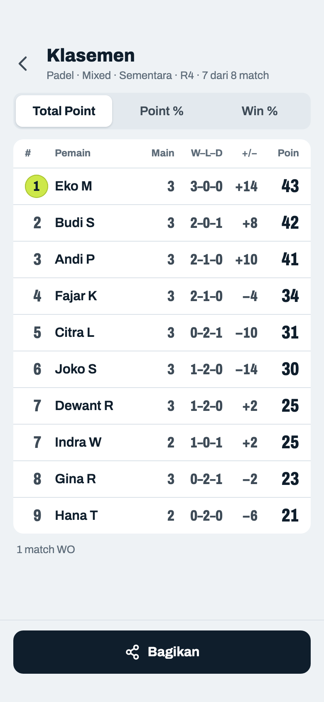

Komponen: `MabarAppBar`, `MabarButton`, `MabarIconButton`, `MabarActionBar`, `MabarSegmented`, `StandingTable`

- Tab Total Point dipilih host; Americano dibuka di Point % (09a).
- Hanya satu bola: Eko (43) di peringkat 1, Budi (42) di peringkat 2. Nomor 1 hanya dobel kalau poin dan selisihnya sama (09i). Dewant dan Indra sama-sama 25 poin +2 → berbagi nomor 7, Gina lanjut di 8.
- Contoh dihitung dari 7 match sungguhan R1–R4: satu seri (Budi–Indra vs Citra–Gina 12–12) dan satu WO. Budi dan Joko menang WO, jadi masing-masing dapat poin rata-rata dari match yang mereka mainkan: Budi (16 + 12) ÷ 2 = 14; Joko rata-ratanya 8,5, di bawah skor menang terkecil Americano 24 (13–11), jadi dapat 13. Tanpa aturan ini Budi hanya 28 poin dan turun ke peringkat 5 padahal tidak kalah sekali pun.

## 09e · Mixed · Win % · urutan berubah

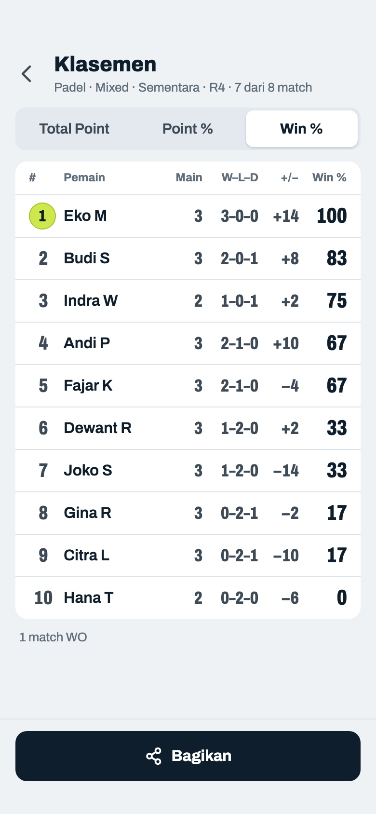

Komponen: `MabarAppBar`, `MabarButton`, `MabarIconButton`, `MabarActionBar`, `MabarSegmented`, `StandingTable`

- Data yang sama bisa memberi urutan berbeda: Indra naik dari 7 ke 3 (1–0–1 = 75%), Citra turun dari 5 ke 9, Andi dari 3 ke 4.
- Win % sama dipisah selisih: Andi dan Fajar sama-sama 67%, Andi di atas karena +10 vs −4.

## 09f · Mixed · Final (setelah diakhiri)

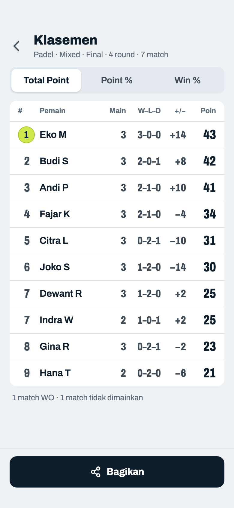

Komponen: `MabarAppBar`, `MabarButton`, `MabarIconButton`, `MabarActionBar`, `MabarSegmented`, `StandingTable`

- Tab Total Point dipilih host; Americano dibuka di Point % (09a).
- Mixed jadi Final kalau (a) sudah "Akhiri turnamen" (06e), atau (b) waktu booking semua court habis dan round terakhir sudah lengkap (06l), karena tidak ada lagi yang bisa dimainkan tanpa tindakan host. Di kode: `isFinished || (courtsAvailableAt(now).isEmpty && isRoundComplete(n))` — waktu habis menurut jam sungguhan.
- Subjudul memakai pola Final yang sama dengan Fixed (09c): jumlah round dan match yang dimainkan, bukan "R4 · 7 dari 8 match", karena progres round tidak bermakna lagi setelah selesai. Contoh untuk data 09a: "Padel · Mixed · Final · 3 round · 6 match".
- Match yang belum dimainkan saat Akhiri jadi "Tidak dimainkan" dan tidak dihitung (di sini R4 Andi–Hana vs Budi–Gina); jumlahnya ditulis di catatan bawah bersama WO.
- Kalau dilanjutkan atau ditambah jam lewat "Lanjutkan turnamen" (08c), status kembali Sementara dan subjudul kembali ke pola "R… · x dari y match". Waktu habis tapi round terakhir belum lengkap: tetap Sementara sampai skornya terisi atau diakhiri.
- Bagikan dari sini menulis "Klasemen akhir" di poster (11b, 11d).

## 09g · Fixed · pasangan diatur ulang

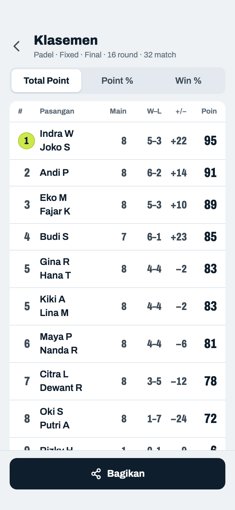

Komponen: `MabarAppBar`, `MabarButton`, `MabarIconButton`, `MabarActionBar`, `MabarSegmented`, `StandingTable`

- Data 04f–04h: R1–R14 round-robin, lalu R15–R16 dengan Andi P + Rizky H; Budi S pulang setelah R14.
- Pasangan yang selalu main bersama tetap satu baris (dua nama ditumpuk). Pemain yang pasangannya berubah, pemain yang tidak ikut lagi, dan pemain pengganti tampil sendiri dengan angkanya masing-masing (keputusan host 2026-11-03). Semua baris memakai nilai per pemain yang sama, jadi urutannya tetap sebanding.
- Budi S main 7 (tertinggal satu match) dan Rizky H baru 1: Total Point mereka tertinggal, Win % lebih adil. Itu konsekuensi yang sudah diterima host.
- Sama di Detail (10d), poster Bagikan (pasangan tetap satu baris; kalau barisnya campuran "Semua n" di catatan Lengkap dan baris fakta podium tanpa hitungan pasangan/pemain, 18l), caption, dan halaman live.

## 09h · Mixed · 30 pemain · nama panjang

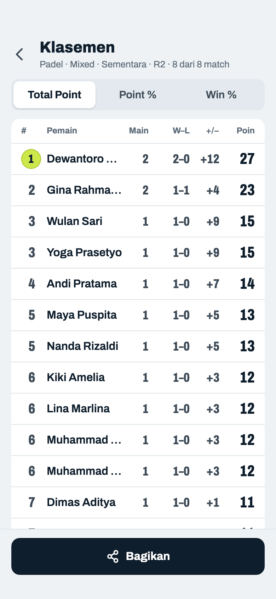

Komponen: `MabarAppBar`, `MabarButton`, `MabarIconButton`, `MabarActionBar`, `MabarSegmented`, `StandingTable`

- Tab Total Point dipilih host; Americano dibuka di Point % (09a).
- Nama ditulis seperti diketik host (tanpa disingkat). Kolom nama 108 pt: nama yang lebih panjang dipotong satu baris dengan elipsis, sama dengan baris pemain lain dan app sekarang (`StandingTable`, satu baris). "Muhammad Rifqi A" dan "Muhammad Rizky H" terpotong sama; nama lengkap ada di Detail (ketuk baris → judul Detail).
- Tabel lebih panjang dari layar: tabel digulir, app bar, pilihan metode, dan action bar tetap. Frame menampilkan bagian atas; 30 baris, tanpa "Belum main" (semua sudah main).
- Data (fixture): Padel · Mixed · Americano 21 (ganjil → W–L tanpa D, 09c), 30 pemain, 4 court. R1: Andi Pratama · Dewantoro Rahman 14–7 Budi Santoso · Christina Lestari; Eko Mulyadi · Fajar Kurniawan 11–10 Gina Rahmawati · Hana Tanjung; Indra Wijaya · Joko Susilo 9–12 Kiki Amelia · Lina Marlina; Maya Puspita · Nanda Rizaldi 13–8 Oki Setiawan · Putri Anggraini. R2: Muhammad Rizky H · Muhammad Rifqi A 12–9 Sari Dewi · Tono Budiman; Umar Faruq · Vina Kartika 6–15 Wulan Sari · Yoga Prasetyo; Zaki Maulana · Bayu Saputra 10–11 Dimas Aditya · Galih Permana; Rina Kusuma · Hendra Gunawan 8–13 Dewantoro Rahman · Gina Rahmawati.
- Nomor rapat dari poin lalu selisih (09i): Dewantoro 27 (2 match), Gina 23, lalu nomor sama urut nama. Jumlah W = jumlah L = 16 (8 match × 2 pemain menang).

## 09i · Mixed · Total Point · nomor sama

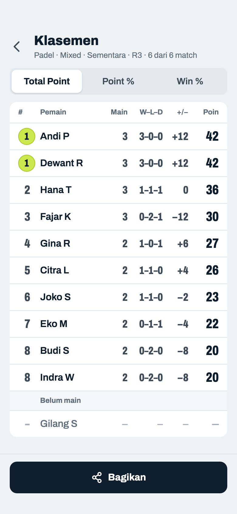

Komponen: `MabarAppBar`, `MabarButton`, `MabarIconButton`, `MabarActionBar`, `MabarSegmented`, `StandingTable`

- Data 09a, setelah host mengetuk tab Total Point.
- Poin sama dipisah selisih (kolom +/−). Poin dan selisih sama → nomor sama, nomor berikutnya melanjutkan (1, 1, 2 … 8, 8); yang bernomor sama urut nama. Head-to-head tidak dipakai lagi: alasan urutan harus terbaca dari angka di tabel (keputusan host 2026-11-02).
- Kolom +/− = selisih poin (atau game): yang dimenangkan dikurangi yang kalah, dijumlah lintas match. Menang/kalah WO tidak mengubah selisih. Ada di ketiga metode, sama dengan baris poster (11a).
- Kolom Main = jumlah match yang sudah dimainkan (selesai + WO, sama dengan W + L + D). Mixed bisa berbeda antar pemain (pemain telat, istirahat), jadi kelihatan kenapa Total Point-nya tertinggal.
- Kolom W–L–D = win–loss–draw (menang–kalah–seri), singkatan Inggris seperti Win % dan Total Point. Seri tidak lagi ditulis kecil di bawah nama, jadi tinggi semua baris sama. Kolom D hanya ada kalau format skornya bisa seri (Americano total genap, Best of genap); Race to dan format ganjil cukup W–L (09c), supaya tidak ada kolom yang isinya selalu 0.
- Subjudul: olahraga · mode · status · round · match, sama urutannya dengan Detail ("Peringkat 1 · Total Point · Padel · Mixed · Americano 24"; Detail menambah metode dan format skor).
- Medali emas/perak/perunggu dihapus; peringkat 1 diberi bola. Baris bisa diketuk → Detail.
- "Belum main" = pemain tanpa match selesai/WO (pemain baru, sisa ganjil di Fixed). Pemain yang keluar tetap tampil tanpa tanda. Catatan "n match WO" di bawah tabel hanya kalau ada WO (09d).
- Baru: Mixed disebut "Final" hanya setelah diakhiri atau saat waktu booking habis dengan round terakhir lengkap (09f). Sekarang Mixed jadi FINAL tiap round lengkap padahal round masih bisa dibuat.
- Contoh dihitung dari 6 match sungguhan (Americano 24, total genap jadi bisa seri): Hana–Gina vs Eko–Fajar 12–12.

## 09j · Mixed · Point % · jumlah main beda

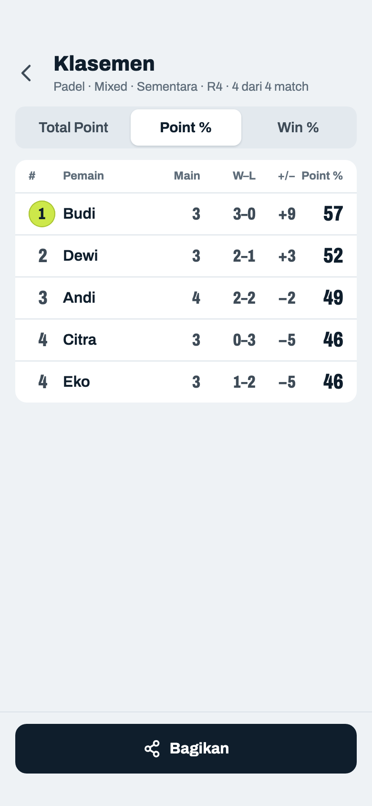

Komponen: `MabarAppBar`, `MabarButton`, `MabarIconButton`, `MabarActionBar`, `MabarSegmented`, `StandingTable`

- Data 18A (PRD §18.4, fixture `point_percent_fixture`): Padel · Mixed · Americano 21, 5 pemain, 1 court. R1 Andi · Budi 12–9 Citra · Dewi · R2 Andi · Citra 10–11 Budi · Eko · R3 Andi · Eko 8–13 Budi · Dewi · R4 Andi · Dewi 11–10 Citra · Eko. Istirahat R1 Eko, R2 Dewi, R3 Citra, R4 Budi.
- Andi main 4, yang lain 3. Point %: Budi 36/63 → 57 #1, Dewi 33/63 → 52 #2, Andi 41/84 → 49 #3; Citra dan Eko 29/63 → 46 dengan selisih −5 → nomor sama #4, urut nama.
- Tab lain, data sama: Total Point Andi 41 #1 (main sekali lebih banyak, padahal 2–2 dan −2), Budi 36 #2, Dewi 33 #3, Citra dan Eko 29 #4; Win % Budi 100 #1, Dewi 67 #2, Andi 50 #3, Eko 33 #4, Citra 0 #5.
- Americano 21 ganjil → W–L tanpa D. Jumlah Main 16 = 4 match × 4 pemain; W 8 = L 8; poin didapat 168 = 4 × 21 × 2.

## 09k · Fixed · Race to · tab Point %

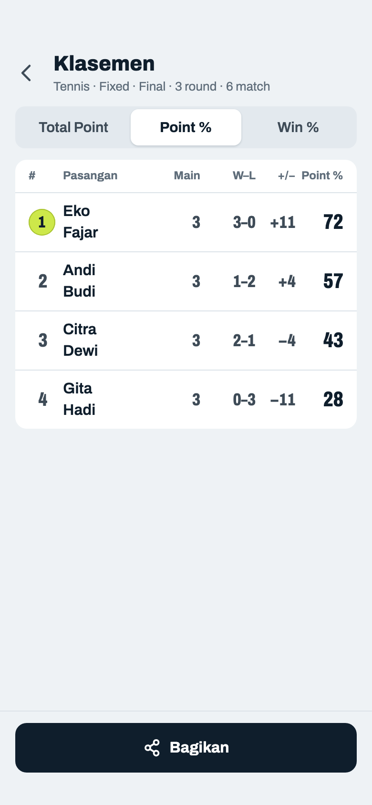

Komponen: `MabarAppBar`, `MabarButton`, `MabarIconButton`, `MabarActionBar`, `MabarSegmented`, `StandingTable`

- Race to dan Best of dibuka di Win % (keputusan 122–123); frame ini setelah host mengetuk Point %. Satuannya game: game didapat ÷ game dimainkan.
- Data 18B (PRD §18.4): R1 Andi · Budi 5–6 Citra · Dewi, Eko · Fajar 6–2 Gita · Hadi · R2 Andi · Budi 5–6 Eko · Fajar, Citra · Dewi 6–5 Gita · Hadi · R3 Andi · Budi 6–0 Gita · Hadi, Citra · Dewi 0–6 Eko · Fajar.
- Andi · Budi (1–2) 16/28 → 57 di atas Citra · Dewi (2–1) 12/28 → 43; di Win % urutannya terbalik (Citra · Dewi #2, Andi · Budi #3). Kolom W–L tetap tampil, jadi kedua urutan terbaca dari tabel.
- Eko · Fajar 18/25 → 72, Gita · Hadi 7/25 → 28; game didapat 53. Jumlah main sama, jadi urutan Point % = Total Point (18, 16, 12, 7).

## 09l · Mixed · Point % · WO

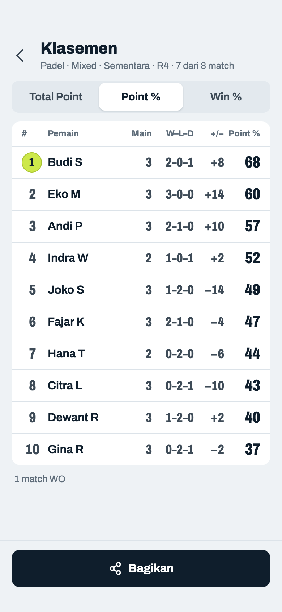

Komponen: `MabarAppBar`, `MabarButton`, `MabarIconButton`, `MabarActionBar`, `MabarSegmented`, `StandingTable`

- Data 09d (fixture `ranking_fixture.dart` set2), tab Point % = tab saat dibuka. WO dihitung sebagai skor "nilai WO – 0" (keputusan 125): Budi menang WO dengan nilai 14 → 42/62 → 68, #1 tanpa kalah; Joko nilai 13 → 30/61 → 49.
- Dewant dan Gina yang kalah WO: didapat 0, kalah 14 (rata-rata nilai WO Budi dan Joko, 13,5 → 14) → Dewant 25/62 → 40, Gina 23/62 → 37. Selisih tidak berubah oleh WO, jadi Dewant tetap +2 tapi di #9.
- Lainnya (Americano 24, tiap match total 24): Eko 43/72 → 60 · Andi 41/72 → 57 · Indra 25/48 → 52 · Fajar 34/72 → 47 · Hana 21/48 → 44 · Citra 31/72 → 43. Tidak ada angka kembar, jadi tidak ada nomor sama.
