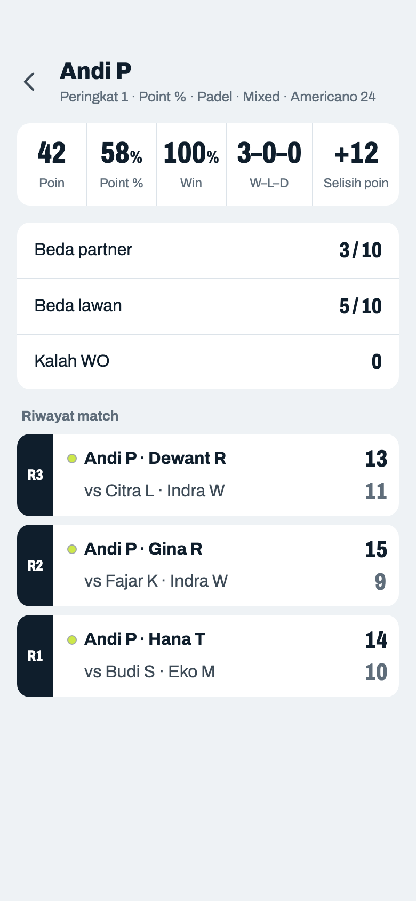
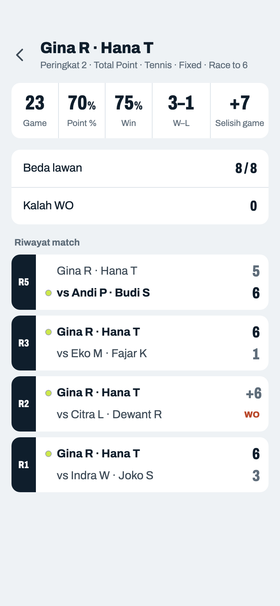
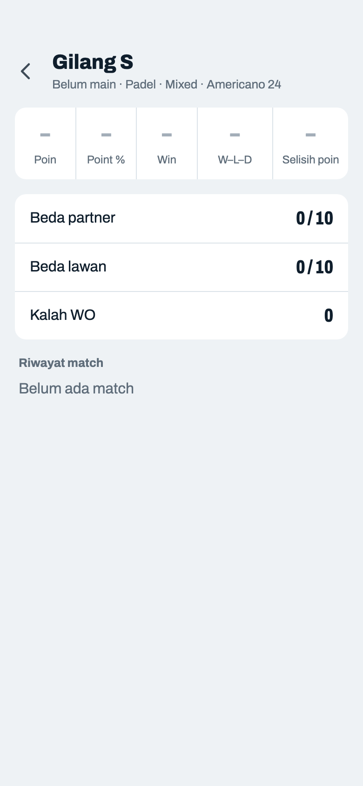
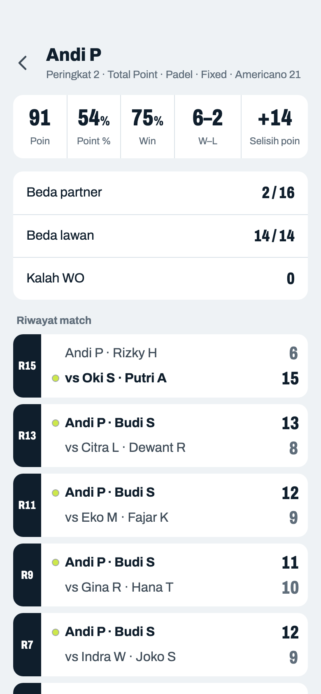
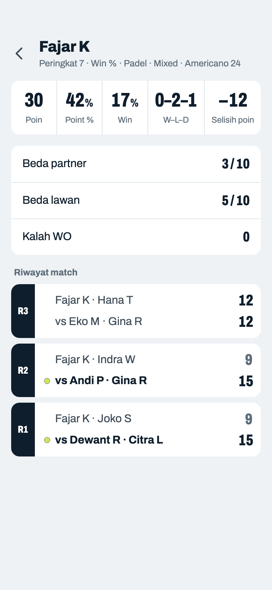

# Detail

> Dihasilkan `tool/hifi_extract.py` dari `design/hifi.html`. Jangan diedit langsung.

Satu baris angka menggantikan lima kotak statistik. Riwayat match memakai bentuk baris yang sama dengan Jadwal.

## 10a · Pemain · Mixed

Komponen: `MabarAppBar`, `MabarIconButton`, `MabarGroup / MabarRow`, `MatchScoreRow`, `StatLine`

- Avatar inisial bergradien dihapus. Subjudul: peringkat · metode · olahraga · mode · format skor. Angka dan metode mengikuti pilihan di Klasemen (09a Point % → "Peringkat 1 · Point %"; dari Total Point 09i → "Peringkat 1 · Total Point"; dari Win % → "Peringkat n · Win %", 10e). Kalau tidak muat di 390, olahraga yang dibuang dulu (PATCH 3.8.1, B-6). Belum main: "Belum main" tanpa metode (10c).
- Label statistik mengikuti format skor, bukan mode: "Poin" / "Selisih poin" untuk Americano, "Game" / "Selisih game" untuk Race to dan Best of; W–L–D hanya kalau format bisa seri, selain itu W–L (10b). Format di subjudul yang menjelaskan kenapa labelnya berbeda.
- Statline lima angka (sejak 3.9.0): Poin · Point % · Win · W–L–D · Selisih. Tiga angka pertama = tiga metode dalam urutan tab Klasemen. Point % dan Win tampil di semua tab, angka pemain tidak ikut tab (keputusan 129, U-RP5); bulat seperti tabel, "–" kalau belum main (10c). Andi 42 ÷ 72 = 58%.
- Label "Point %" (bukan "Point") supaya tidak terbaca salah ketik "Poin" di sebelahnya; sama dengan nama tab dan subjudul. Kolom flex 4 · 4 · 4 · 5 · 5 (W–L–D dan selisih lebih lebar), angka 28 pt, label 12 pt satu baris; "Selisih game" (10b) dan "100%" muat. Angka yang lebih lebar dari kolomnya (W–L–D dua digit, mis. "10–5–1") diperkecil, tidak dipotong. Urutan = urutan tab, label "Point %" (keputusan host 130).
- "Beda partner/lawan" dibanding semua pemain lain (termasuk yang keluar). "Kalah WO" tetap.
- Riwayat: terbaru di atas. Baru: Mixed menampilkan partner di tiap match. Baris atas selalu tim pemain ini, ditulis seperti Fixed (10b): nama sendiri dulu lalu partner ("Andi P · Dewant R"), lawan di baris bawah dengan "vs". Hasil: tebal + bola = menang, pudar = kalah, "Seri", "WO" (menang/kalah). Match kosong dan tidak dimainkan tidak masuk. Tidak bisa diketuk.

## 10b · Pasangan · Fixed

Komponen: `MabarAppBar`, `MabarIconButton`, `MabarGroup / MabarRow`, `MatchScoreRow`, `StatLine`

- Baru: judul berisi kedua nama pasangan. Sekarang hanya nama anggota pertama yang tampil dan anggota kedua tidak bisa dibuka.
- "Beda partner" disembunyikan di Fixed karena selalu 1.
- Pada riwayat Fixed, baris atas selalu pasangan ini (tebal kalau menang).
- Menang WO menulis tambahan game/poinnya dengan warna pudar ("+6"), supaya jumlah riwayat cocok dengan angka di atas: 5 + 6 + 6 + 6 = 23. Selisih tidak berubah (+7).
- Point % dalam game: didapat 23 (termasuk 6 dari WO) ÷ dimainkan 33 (kalah 6 + 1 + 0 + 3, kalah WO lawan 0) = 69,7 → 70%. Dibuka dari tab Total Point (09c), jadi subjudul "Total Point"; Point % tetap tampil.

## 10c · Belum ada match

Komponen: `MabarAppBar`, `MabarIconButton`, `MabarGroup / MabarRow`, `StatLine`

- Kotak info abu-abu diganti "Belum ada match" (tanpa kalimat kedua, PATCH 3.8.1, B-13); riwayat muncul setelah skor pertama pemain ini diisi. Pemain tidak ditemukan / tidak ada turnamen: teks tengah "Belum ada turnamen berjalan".
- Kelima angka statline "–", termasuk Point % (tidak ada pembagian dengan nol, PRD 18.1 RP5).

## 10d · Fixed · pasangan berubah

Komponen: `MabarAppBar`, `MabarIconButton`, `MabarGroup / MabarRow`, `MatchScoreRow`, `StatLine`

- Baris Klasemen per pemain di Fixed (09g) membuka Detail pemain itu saja, bukan pasangan: judul satu nama.
- "Beda partner" yang disembunyikan di Fixed (10b) muncul kalau partnernya lebih dari satu: 2 / 16 (pemain lain di turnamen, termasuk Rizky H). Beda lawan dibanding pemain lain selain partnernya sendiri: 17 − 1 − 2 = 14.
- Riwayat: baris atas tim sendiri dengan nama sendiri dulu, seperti Mixed (10a), jadi partner yang berbeda terbaca (R15 Andi P · Rizky H, R13 Andi P · Budi S).
- Point % dari riwayat: didapat 6 + 13 + 12 + 11 + 12 + 9 + 15 + 13 = 91, kalah 15 + 8 + 9 + 10 + 9 + 12 + 6 + 8 = 77; 91 ÷ 168 (8 match × 21) = 54,2 → 54%.

## 10e · Pemain · Mixed · Win % bukan bilangan bulat

Komponen: `MabarAppBar`, `MabarIconButton`, `MabarGroup / MabarRow`, `MatchScoreRow`, `StatLine`

- Data 09a/09b (Americano 24, 6 match): Fajar K 0–2–1, dibuka dari Klasemen Win % (09b, #7) → "Peringkat 7 · Win %". Win % = (0 + ½ seri) ÷ 3 = 16,67%.
- Statline menulis Win % dibulatkan tanpa desimal, "17%", sama dengan tabel 09b (app sekarang). Kolom statline tetap muat untuk "100%".
- Point % 30 ÷ 72 = 41,7 → 42% tetap tampil walau dibuka dari tab Win % (sama dengan baris Fajar di 09a).
- Poin 9 + 9 + 12 = 30, selisih −6 −6 + 0 = −12. Beda partner 3 / 10 (Joko S, Indra W, Hana T); beda lawan 5 / 10 (Dewant R, Citra L, Andi P, Gina R, Eko M; Gina dihitung sekali).
- Riwayat seri (R3 12–12): kedua baris tanpa bola dan tidak pudar, sama dengan baris seri di Jadwal.
