# Bagikan

> Dihasilkan `tool/hifi_extract.py` dari `design/hifi.html`. Jangan diedit langsung.

Kartu pratinjau, pilihan tema dan format, lalu dua gambar (Feed 1:1 dan Story 9:16) dibagikan lewat share sheet sistem dengan teks hasil sebagai caption.

## 11a · Ringkas · podium · tema lapangan · bernama

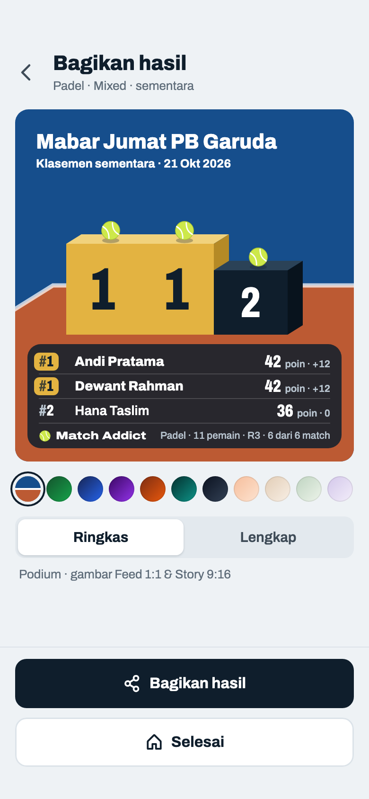

Komponen: `MabarAppBar`, `MabarButton`, `MabarIconButton`, `MabarActionBar`, `MabarGroup / MabarRow`, `MabarSegmented`, `SharePoster`, `PodiumPoster (PodiumScenePainter)`

- Ringkas = poster podium (keputusan host 60, 2026-11-12), menggantikan daftar 5 teratas + "+n pemain lainnya". Kartu pratinjau memakai ukuran gambar Feed di 358 × 372; rincian komponen di Komponen → `.podium`, semua varian di 18a–18t.
- Yang naik = tiga baris teratas Klasemen (keputusan 65). Data frame ini tetap (Americano 24, 11 pemain, R3 lengkap): Andi dan Dewant sama-sama #1 (42 · +12) → dua blok emas sama tinggi, dua lencana emas (keputusan 64); Hana #2. Fajar (#3) tidak naik karena nomornya beda dengan baris ketiga.
- Turnamen bernama: nama jadi judul, "Klasemen sementara · tanggal" di bawahnya, olahraga di depan baris fakta. Tanpa nama: 11c. Piala dan watermark raket tidak dipakai di podium; olahraga terbaca dari warna lantai.
- Nilai per baris = nilai metode + selisih dengan satuan: Total Point "42 poin · +12", Win % "100% · +19" (keputusan 63). Fakta Sementara "R3 · 6 dari 6 match" (pola subjudul Klasemen), Final "4 round · 8 match" (11d); Fixed menulis "pasangan"; WO ikut kalau ada.
- Deret tema di Ringkas: lapangan (bawaan, lantai ikut olahraga turnamen) + 10 gradien = 11 pilihan dalam satu baris, lingkaran 27 pt (keputusan 66). Deret yang sama dipakai di tab Lengkap (keputusan 76, 11b, 11e). Memilih gradien berlaku untuk kedua format (18b). Pilihan tema & format tidak disimpan.
- Keterangan di bawah tab: "Podium · gambar Feed 1:1 & Story 9:16".
- "Selesai" memindahkan turnamen ke slot terakhir lalu ke Beranda (stack di-reset), tanpa konfirmasi.
- Caption tidak berubah: baris pertama "🏆 {nama} · Padel"; tanpa nama "🏆 Match Addict · Padel".

## 11b · Lengkap · Fixed 20 pemain (10 pasangan) · tema peach

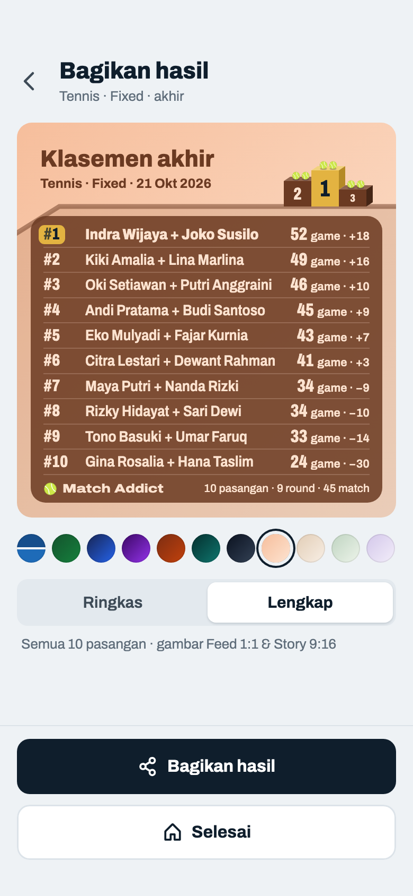

Komponen: `MabarAppBar`, `MabarButton`, `MabarIconButton`, `MabarActionBar`, `MabarGroup / MabarRow`, `MabarSegmented`, `SharePoster`

- Lengkap arah B "Podium mini" (keputusan 79): judul dan baris kecil di kiri, podium mini (angka di muka blok + bola, tanpa nama) berdiri di garis belakang di kanan judul, daftar semua baris di panel 86% di atas lantai. Rincian ukuran di Komponen → `.lk`.
- Fixed 20 pemain = 10 pasangan, round-robin 45 match (5 court, 9 round), metode Total Point (game). Pasangan selalu satu kolom, nama kedua anggota dipisah "+". Feed satu kolom menulis satuan: "52 game · +18" (keputusan 77).
- Kepadatan (keputusan 80): tinggi baris = ruang panel ÷ jumlah baris; huruf baris mengikuti tinggi baris, dibatasi ukuran panel podium. Di pratinjau 10 baris × 23,8 → batas (nama 14 = nama panel podium).
- Podium mini pasangan: dua bola per blok (keputusan 61). Tanpa nama turnamen: judul "Klasemen akhir", baris kecil "Tennis · Fixed · 21 Okt 2026", fakta "10 pasangan · 9 round · 45 match".
- Deret tema Lengkap = deret Ringkas (keputusan 76): lapangan (bawaan, lantai ikut olahraga) + 10 gradien, 11 lingkaran 27 pt. Gradien yang dipilih berlaku untuk kedua format; pilihan tidak disimpan. Peach: kepala, blok, dan panel memakai tinta tema; warna turunannya sama dengan poster podium.
- Pratinjau 358 × 372 memakai tata letak Feed (panel 13 dari kiri/kanan); gambar Feed dan Story di 11g.

## 11c · Gagal share · hasil disalin

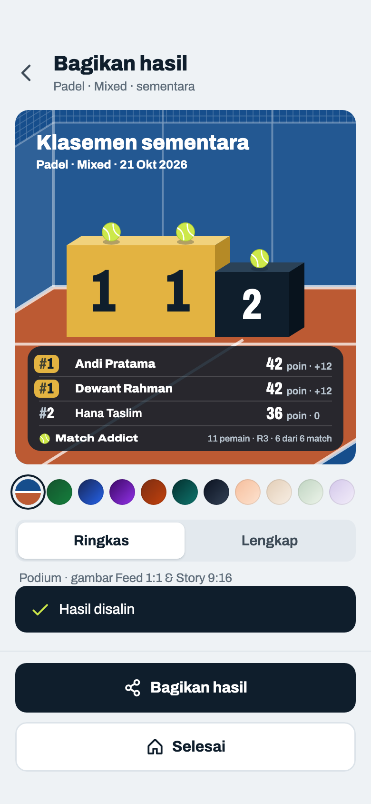

Komponen: `MabarAppBar`, `MabarButton`, `MabarIconButton`, `MabarActionBar`, `MabarGroup / MabarRow`, `MabarSegmented`, `MabarToast`, `SharePoster`, `PodiumPoster (PodiumScenePainter)`

- Saat merender dua poster, tombol mati dengan teks "Menyiapkan gambar…" (ketukan ganda diabaikan). Frame ini menggambar momen sesudahnya: tombol aktif lagi dan toast tampil (keputusan host 2026-10-22).
- Toast selalu 19 pt di atas action bar, seperti posisi bawaannya. Di sini action bar berisi dua tombol (161 pt), jadi bawah toast di 180 pt; posisi bawaan 118 pt untuk action bar satu tombol akan menutupi "Bagikan hasil" (keputusan host 2026-10-22).
- Kalau share sheet gagal (desktop/web tertentu), caption disalin ke clipboard dan muncul toast "Hasil disalin". Tidak ada tombol salin terpisah.
- Caption: semua baris peringkat; format Lengkap menambah "Hasil per Round". Baru: satuan "game"/"poin" mengikuti metode skor.
- Tanpa nama turnamen (data 11a): judul "Klasemen sementara", baris kecil "olahraga · mode · tanggal", baris fakta tanpa olahraga.

## 11d · Gambar Ringkas (podium) · Feed 1080×1080 dan Story 1080×1920 (skala 1:3) · nama 40 karakter

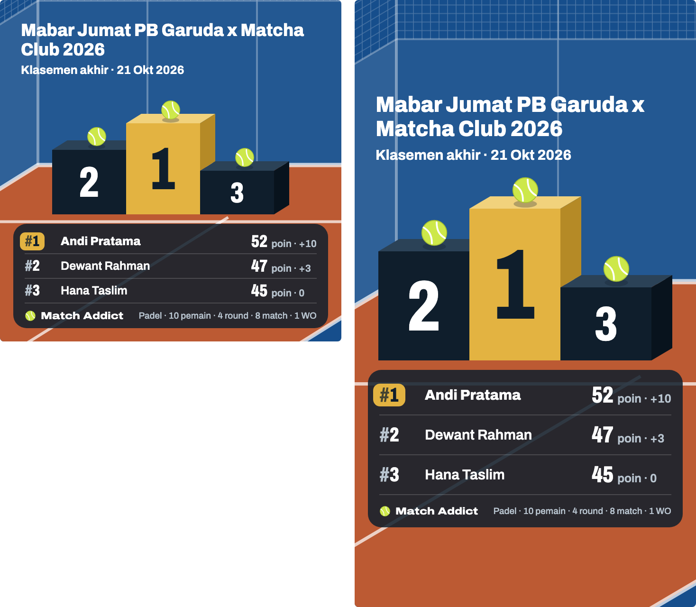

Komponen: `SharePoster`, `PodiumPoster (PodiumScenePainter)`

- Feed 360 × 360 dan Story 360 × 640, keduanya diekspor ×3. Story podium tidak memakai kanvas 203 × 360 poster Lengkap (11f); ukuran per target ada di Komponen → `.podium`.
- Nama terpanjang (40 karakter): dua baris dengan huruf 18,5 di Feed dan 23 di Story. Di Story blok turun dari 178 / 128 / 86 ke 160 / 115 / 77 supaya bola #1 berjarak 12 dari baris kecil (aturan batas tinggi); di Feed tinggi blok tetap.
- Satuan ditulis di Feed dan Story: "52 poin · +10" (keputusan 63); aturan lama "Story tanpa satuan" hanya untuk Lengkap.
- Baris fakta "Padel · 10 pemain · 4 round · 8 match · 1 WO" lebih lebar dari sisa baris kaki, jadi hurufnya dikecilkan dari 10,5 ke 9,3 sampai muat; fakta tidak pernah terpotong.
- Story: semua teks di antara 250 px atas dan bawah (arsiran = zona UI Instagram, tidak ikut ke gambar). Lantai menerus sampai tepi bawah.
- File: `match-addict-feed-1080x1080.png`, `match-addict-story-1080x1920.png`, dibagikan bersamaan lewat `Share.shareXFiles`.
- Render poster di test wajib memuat font Archivo (`loadHifiFonts()`), jangan percaya font Ahem.

## 11e · Lengkap · Mixed 20 pemain · tema lapangan · bernama

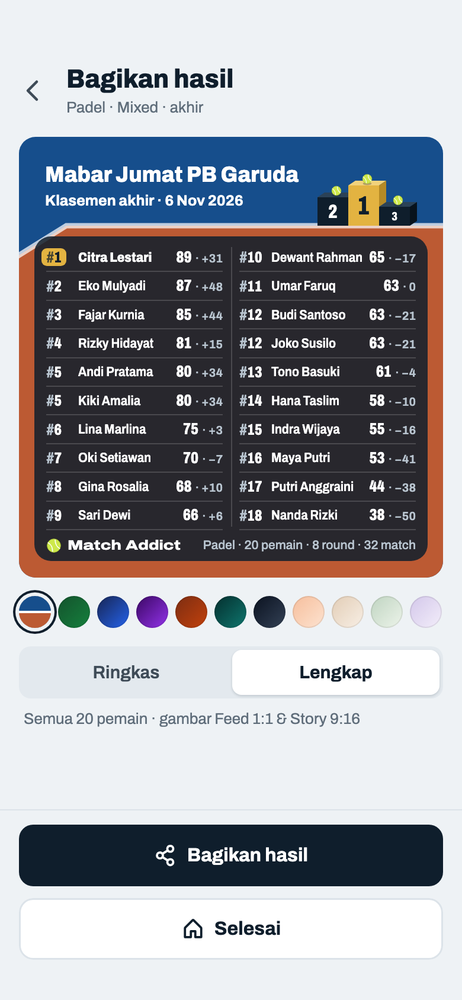

Komponen: `MabarAppBar`, `MabarButton`, `MabarIconButton`, `MabarActionBar`, `MabarGroup / MabarRow`, `MabarSegmented`, `SharePoster`

- Tema bawaan lapangan (keputusan 76): latar `court-deep`, lantai padel, garis putih 72%; tennis memakai lantai `court`.
- Feed: Mixed lebih dari 10 baris → dua kolom rata, ⌈n/2⌉ di kiri, urut ke bawah dulu (20 → 10–10), garis tipis di tengah. Dua kolom tanpa satuan: "89 · +31" (keputusan 77).
- Nomor dari Klasemen: kembar senomor (#5 Andi dan Kiki 80 · +34, #12 Budi dan Joko 63 · −21); Umar 63 · 0 di #11 di atas keduanya karena selisih. #1 lencana emas, digantung ke kiri.
- Nama di satu poster dikecilkan bersama sampai nama terpanjang muat, paling kecil ×0,82, sesudah itu elipsis per nama. Di sini ×0,94.
- Judul "Mabar Jumat PB Garuda" tidak muat di 22 di samping podium mini → 18,5, muat satu baris (keputusan 82).
- Data (juga 11f): Americano 21, 4 court × 8 round = 32 match, 8 pemain main 7 kali dan 12 main 6 kali. Jumlah poin 1344 = 32 × 42, jumlah selisih 0 (selisih = 2 × poin − 21 × match dimainkan). Menggantikan data lama 11e/11f yang selisihnya tidak berjumlah 0.

## 11f · Gambar Lengkap · Mixed 20 pemain · Feed dan Story (skala 1:3) · bernama

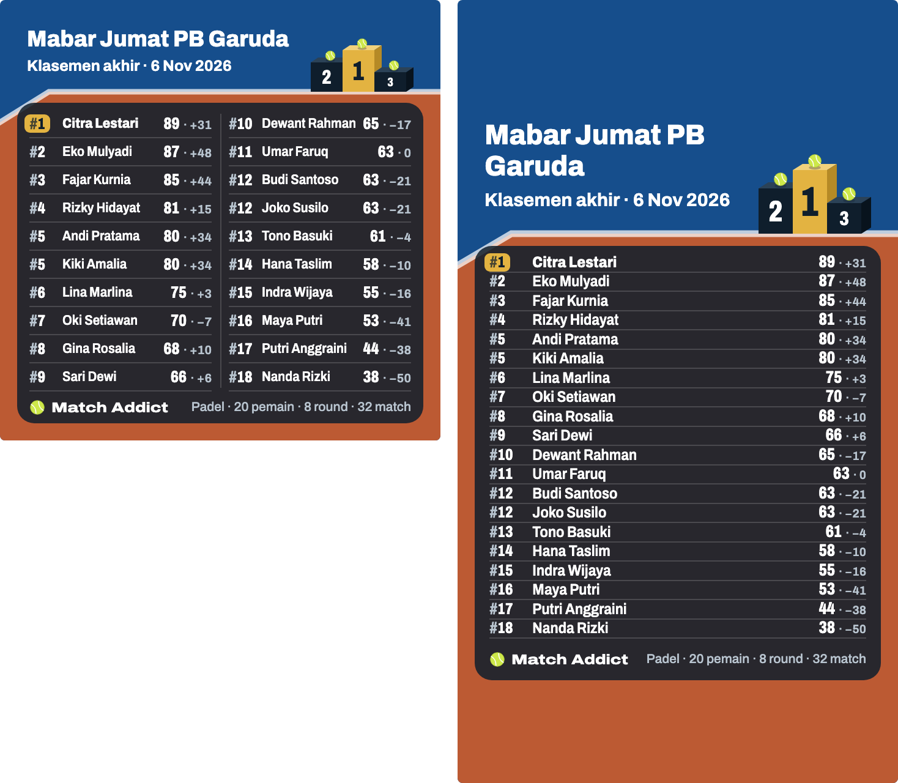

Komponen: `SharePoster`

- Feed 360 × 360 dan Story 360 × 640 (skala 1:3, diekspor ×3 → 1080 × 1080 dan 1080 × 1920), sama dengan poster podium; kanvas Story 203 × 360 tidak dipakai lagi.
- Feed = pratinjau 11e: dua kolom 10–10, baris 23.
- Story Mixed sampai 20 pemain satu kolom, tanpa satuan; di atas 20 dua kolom rata (keputusan 81, 11l). 20 baris × 15,75 → huruf ×0,93 (nama 12,5).
- Judul Story 27 tidak muat → 23, dua baris; baris kecil "Klasemen akhir · tanggal" tetap satu baris (keputusan 82). Podium mini Story lebih ramping (blok 28) supaya kolom judul lebar.
- Story: semua teks di antara 250 px atas dan bawah (arsiran = zona UI Instagram, tidak ikut ke gambar). Lantai menerus sampai tepi bawah.

## 11g · Gambar Lengkap · Fixed 10 pasangan · Feed dan Story (skala 1:3) · tema peach

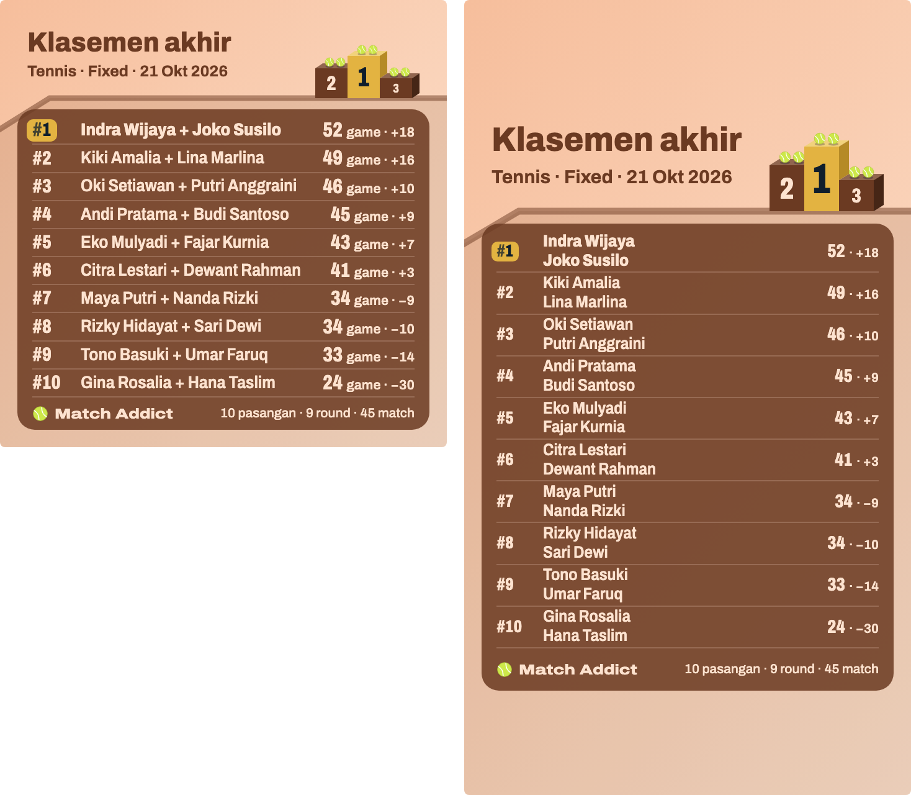

Komponen: `SharePoster`

- Feed = pratinjau 11b: satu kolom 10 baris dengan satuan, baris 22,6 → huruf ×1,03.
- Story menumpuk dua nama pasangan; satu pasangan = dua satuan baris, jadi 10 pasangan = 20 satuan × 16,8 → huruf ×0,99. Tanpa satuan.
- Pasangan Fixed tidak pernah dua kolom, juga di Story di atas 20 baris nama (keputusan 81; 15 pasangan di 11k).
- Tanpa nama turnamen: judul 27 muat satu baris di samping podium mini Story.

## 11h · Lengkap · Mixed 12 pemain · dua kolom 6–6

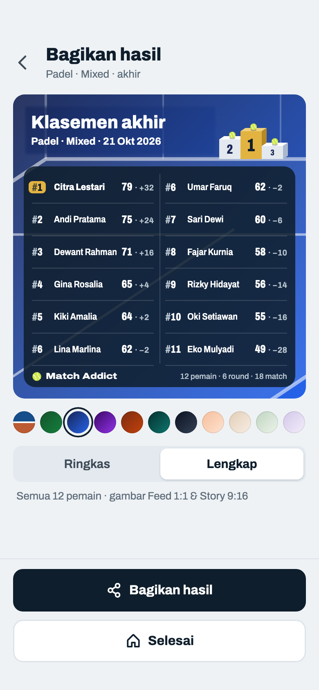

Komponen: `MabarAppBar`, `MabarButton`, `MabarIconButton`, `MabarActionBar`, `MabarGroup / MabarRow`, `MabarSegmented`, `SharePoster`

- 12 baris → dua kolom rata 6–6 (1–6 kiri, 7–12 kanan), bukan 10–2. Baris lebih tinggi daripada 20 pemain karena tetap membagi tinggi kartu yang sama.
- Data: Americano 21, 3 court × 6 round = 18 match, semua pemain main tiap round.

## 11i · Lengkap · Mixed 13 pemain (ganjil) · 7–6

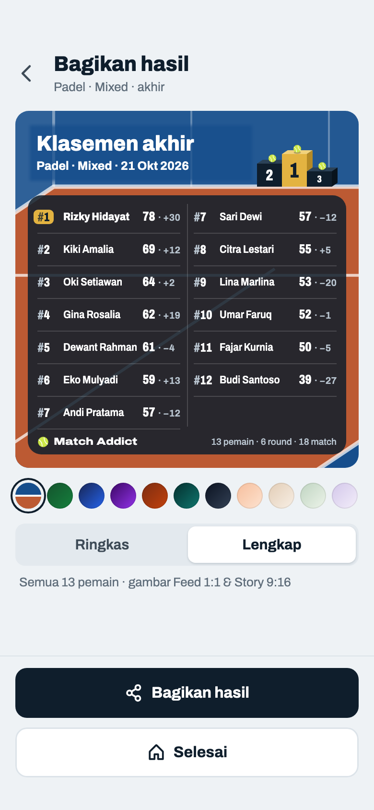

Komponen: `MabarAppBar`, `MabarButton`, `MabarIconButton`, `MabarActionBar`, `MabarGroup / MabarRow`, `MabarSegmented`, `SharePoster`

- Jumlah ganjil: kolom kiri dapat kelebihan satu (11 → 6–5, 13 → 7–6). Kedua kolom memakai tinggi baris yang sama (grid ⌈n/2⌉ baris), jadi baris kiri dan kanan sejajar dan slot terakhir kanan kosong, bukan baris kanan yang meregang.
- 7 dan 9 pemain (≤ 10 baris) tetap satu kolom, seperti Fixed 11b.
- Data: Americano 21, 3 court × 6 round = 18 match; tiap round 1 pemain istirahat, jadi ada yang main 5 dan 6 kali.

## 11j · Lengkap Mixed · semua jumlah ganjil 5–19 (skala 1:2)

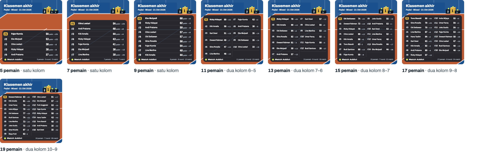

Komponen: `SharePoster`

- Sampai 10 baris satu kolom dengan "poin · selisih"; 11 ke atas dua kolom rata, kiri dapat kelebihan satu: 11 → 6–5, 13 → 7–6, 15 → 8–7, 17 → 9–8, 19 → 10–9.
- Baris kiri dan kanan selalu sejajar; slot terakhir di kanan kosong. Makin sedikit baris, makin tinggi tiap baris (tetap membagi tinggi kartu), jadi 5 pemain terlihat lega dan 19 pemain sama padatnya dengan 20.
- Nomor diberi "#" pudar di semua kartu dan gambar, supaya "#3" tidak tertukar dengan angka poin di ujung baris.
- Semua baris peringkat 1 diberi lencana emas `#E3B341` dengan tulisan tinta, dan namanya lebih tebal. Kalau ada dua #1 (statistik identik), keduanya dapat lencana.

## 11k · Gambar Lengkap · Fixed 30 pemain (15 pasangan) · Feed, Story (skala 1:3) dan pratinjau

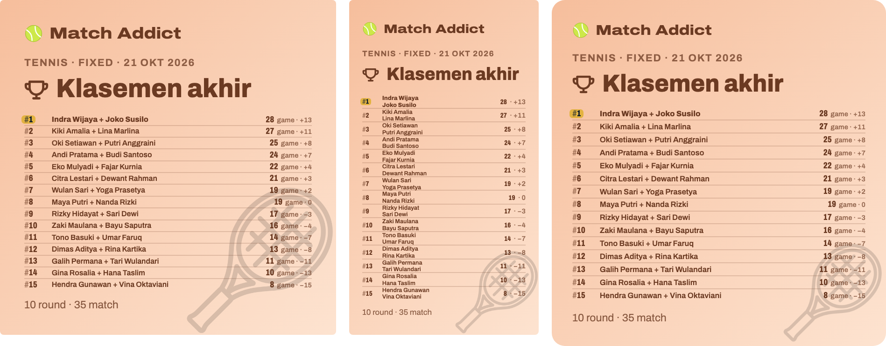

Komponen: `SharePoster`

- Pasangan selalu satu kolom: Feed dan pratinjau satu baris per pasangan dengan nama lengkap kedua anggota, Story menumpuk nama dua baris (30 baris nama).
- Lebih padat dari frame terpadat yang disetujui (satu kolom 10 baris di 11b/11g, 20 baris nama di Story 11g), jadi semua huruf baris dikecilkan sebanding: 15 pasangan → 10/15 di Feed dan pratinjau, 30 baris nama → 20/30 di Story. Wordmark, judul, dan kaki tetap.
- Data: Tennis Race to 6, 4 court, diakhiri setelah 10 round · 35 match (round-robin penuh 105 match).

## 11l · Gambar Lengkap · Mixed 30 pemain · Feed, Story (skala 1:3) dan pratinjau

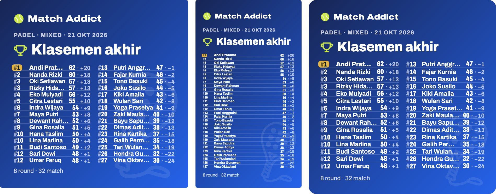

Komponen: `SharePoster`

- Feed dan pratinjau: dua kolom 15–15 di ukuran 11e/11f, tidak dikecilkan; 15 baris per kolom masih terbaca.
- Story: 30 baris satu kolom, semua huruf baris dikecilkan 20/30 (±6,3 pt di kanvas 203 pt, ±12 pt saat Story dibuka layar penuh di HP).
- Data: Americano 21, 4 court × 8 round = 32 match, tiap pemain main 4–5 kali.
