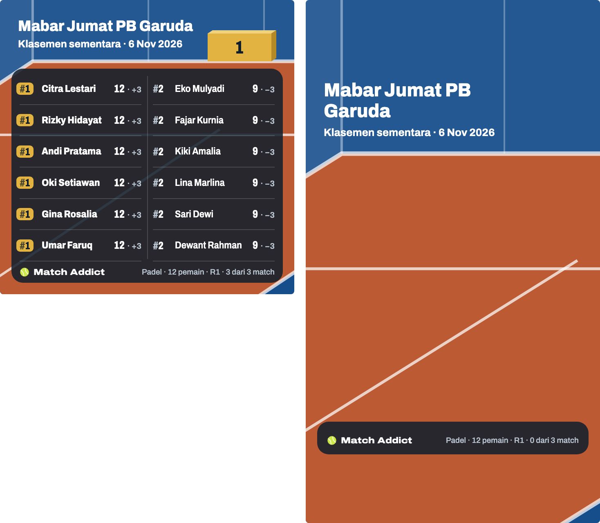

# Bagikan

> Dihasilkan `tool/hifi_extract.py` dari `design/hifi.html`. Jangan diedit langsung.

Kartu pratinjau, pilihan tema dan format, lalu dua gambar (Feed 1:1 dan Story 9:16) dibagikan lewat share sheet sistem dengan teks hasil sebagai caption.

## 11a · Ringkas · podium · tema lapangan · bernama

Komponen: `MabarAppBar`, `MabarButton`, `MabarIconButton`, `MabarActionBar`, `MabarGroup / MabarRow`, `MabarSegmented`, `SharePoster`, `PodiumPoster (PodiumScenePainter)`

- Ringkas = poster podium (keputusan host 60, 2026-11-12), menggantikan daftar 5 teratas + "+n pemain lainnya". Kartu pratinjau memakai ukuran gambar Feed di 358 × 372; rincian komponen di Komponen → `.podium`, semua varian di 18a–18t.
- Yang naik = tiga baris teratas Klasemen (keputusan 65). Data frame ini tetap (Americano 24, 11 pemain, R3 lengkap): Andi dan Dewant sama-sama #1 (42 · +12) → dua blok emas sama tinggi, dua lencana emas (keputusan 64); Hana #2. Fajar (#3) tidak naik karena nomornya beda dengan baris ketiga.
- Turnamen bernama: nama jadi judul, "Klasemen sementara · tanggal" di bawahnya, olahraga di depan baris fakta. Tanpa nama: 11c. Piala dan watermark raket tidak dipakai di podium; olahraga terbaca dari warna lantai.
- Nilai per baris = nilai metode + selisih dengan satuan: Total Point "42 poin · +12", Win % "100% · +19" (keputusan 63). Fakta Sementara "R3 · 6 dari 6 match" (pola subjudul Klasemen), Final "4 round · 8 match" (11d); Fixed menulis "pasangan"; WO ikut kalau ada.
- Deret tema di Ringkas: lapangan (bawaan, lantai ikut olahraga turnamen) + 10 gradien = 11 pilihan dalam satu baris, lingkaran 27 pt (keputusan 66). Deret yang sama dipakai di tab Lengkap (keputusan 76, 11b, 11e). Memilih gradien berlaku untuk kedua format (18b). Pilihan tema & format tidak disimpan.
- Keterangan di bawah tab: "Podium · gambar Feed 1:1 & Story 9:16".
- "Selesai" memindahkan turnamen ke slot terakhir lalu ke Beranda (stack di-reset), tanpa konfirmasi.
- Caption tidak berubah: baris pertama "🏆 {nama} · Padel"; tanpa nama "🏆 Match Addict · Padel".

## 11b · Lengkap · Fixed 20 pemain (10 pasangan) · tema peach

Komponen: `MabarAppBar`, `MabarButton`, `MabarIconButton`, `MabarActionBar`, `MabarGroup / MabarRow`, `MabarSegmented`, `SharePoster`

- Lengkap arah B "Podium mini" (keputusan 79): judul dan baris kecil di kiri, podium mini (angka di muka blok + bola, tanpa nama) berdiri di garis belakang di kanan judul, daftar semua baris di panel 86% di atas lantai. Rincian ukuran di Komponen → `.lk`.
- Fixed 20 pemain = 10 pasangan, round-robin 45 match (5 court, 9 round), metode Total Point (game). Pasangan selalu satu kolom, nama kedua anggota dipisah "+". Feed satu kolom menulis satuan: "52 game · +18" (keputusan 77).
- Kepadatan (keputusan 80): tinggi baris = ruang panel ÷ jumlah baris; huruf baris mengikuti tinggi baris, dibatasi ukuran panel podium. Di pratinjau 10 baris × 23,8 → skala 1,04 (batas); nama 12,5 = baris kecil kepala (keputusan 92).
- Podium mini pasangan: dua bola per blok (keputusan 61). Tanpa nama turnamen: judul "Klasemen akhir", baris kecil "Tennis · Fixed · 21 Okt 2026", fakta "10 pasangan · 9 round · 45 match".
- Deret tema Lengkap = deret Ringkas (keputusan 76): lapangan (bawaan, lantai ikut olahraga) + 10 gradien, 11 lingkaran 27 pt. Gradien yang dipilih berlaku untuk kedua format; pilihan tidak disimpan. Peach: kepala, blok, dan panel memakai tinta tema; warna turunannya sama dengan poster podium.
- Pratinjau 358 × 372 memakai tata letak Feed (panel 13 dari kiri/kanan); gambar Feed dan Story di 11g.

## 11c · Gagal share · hasil disalin

Komponen: `MabarAppBar`, `MabarButton`, `MabarIconButton`, `MabarActionBar`, `MabarGroup / MabarRow`, `MabarSegmented`, `MabarToast`, `SharePoster`, `PodiumPoster (PodiumScenePainter)`

- Saat merender dua poster, tombol mati dengan teks "Menyiapkan gambar…" (ketukan ganda diabaikan). Frame ini menggambar momen sesudahnya: tombol aktif lagi dan toast tampil (keputusan host 2026-10-22).
- Toast selalu 19 pt di atas action bar, seperti posisi bawaannya. Di sini action bar berisi dua tombol (161 pt), jadi bawah toast di 180 pt; posisi bawaan 118 pt untuk action bar satu tombol akan menutupi "Bagikan hasil" (keputusan host 2026-10-22).
- Kalau share sheet gagal (desktop/web tertentu), caption disalin ke clipboard dan muncul toast "Hasil disalin". Tidak ada tombol salin terpisah.
- Caption: semua baris peringkat; format Lengkap menambah "Hasil per Round". Baru: satuan "game"/"poin" mengikuti metode skor.
- Tanpa nama turnamen (data 11a): judul "Klasemen sementara", baris kecil "olahraga · mode · tanggal", baris fakta tanpa olahraga.

## 11d · Gambar Ringkas (podium) · Feed 1080×1080 dan Story 1080×1920 (skala 1:3) · nama 40 karakter

Komponen: `SharePoster`, `PodiumPoster (PodiumScenePainter)`

- Feed 360 × 360 dan Story 360 × 640, keduanya diekspor ×3. Story podium tidak memakai kanvas 203 × 360 poster Lengkap (11f); ukuran per target ada di Komponen → `.podium`.
- Nama terpanjang (40 karakter): dua baris dengan huruf 18,5 di Feed dan 23 di Story. Di Story blok turun dari 178 / 128 / 86 ke 160 / 115 / 77 supaya bola #1 berjarak 12 dari baris kecil (aturan batas tinggi); di Feed tinggi blok tetap.
- Satuan ditulis di Feed dan Story: "52 poin · +10" (keputusan 63); aturan lama "Story tanpa satuan" hanya untuk Lengkap.
- Baris fakta "Padel · 10 pemain · 4 round · 8 match · 1 WO" muat di sisa baris kaki pada 9,5 (kaki satu tingkat lebih kecil sejak keputusan 92). Fakta yang lebih lebar dikecilkan per 0,1 sampai muat, tidak pernah terpotong.
- Story: semua teks di antara 250 px atas dan bawah (arsiran = zona UI Instagram, tidak ikut ke gambar). Lantai menerus sampai tepi bawah.
- File: `match-addict-feed-1080x1080.png`, `match-addict-story-1080x1920.png`, dibagikan bersamaan lewat `Share.shareXFiles`.
- Render poster di test wajib memuat font Archivo (`loadHifiFonts()`), jangan percaya font Ahem.

## 11e · Lengkap · Mixed 20 pemain · tema lapangan · bernama

Komponen: `MabarAppBar`, `MabarButton`, `MabarIconButton`, `MabarActionBar`, `MabarGroup / MabarRow`, `MabarSegmented`, `SharePoster`

- Tema bawaan lapangan (keputusan 76): latar `court-deep`, lantai padel, garis putih 72%; tennis memakai lantai `court`.
- Feed: Mixed lebih dari 10 baris → dua kolom rata, ⌈n/2⌉ di kiri, urut ke bawah dulu (20 → 10–10), garis tipis di tengah. Dua kolom tanpa satuan: "89 · +31" (keputusan 77).
- Nomor dari Klasemen: kembar senomor (#5 Andi dan Kiki 80 · +34, #12 Budi dan Joko 63 · −21); Umar 63 · 0 di #11 di atas keduanya karena selisih. #1 lencana emas, digantung ke kiri.
- Nama di satu poster dikecilkan bersama sampai nama terpanjang muat, paling kecil ×0,82, sesudah itu elipsis per nama. Di sini ×0,94.
- Judul "Mabar Jumat PB Garuda" tidak muat di 22 di samping podium mini → 18,5, muat satu baris (keputusan 82).
- Data (juga 11f): Americano 21, 4 court × 8 round = 32 match, 8 pemain main 7 kali dan 12 main 6 kali. Jumlah poin 1344 = 32 × 42, jumlah selisih 0 (selisih = 2 × poin − 21 × match dimainkan). Menggantikan data lama 11e/11f yang selisihnya tidak berjumlah 0.

## 11f · Gambar Lengkap · Mixed 20 pemain · Feed dan Story (skala 1:3) · bernama

Komponen: `SharePoster`

- Feed 360 × 360 dan Story 360 × 640 (skala 1:3, diekspor ×3 → 1080 × 1080 dan 1080 × 1920), sama dengan poster podium; kanvas Story 203 × 360 tidak dipakai lagi.
- Feed = pratinjau 11e: dua kolom 10–10, baris 23.
- Story Mixed sampai 20 pemain satu kolom, tanpa satuan; di atas 20 dua kolom rata (keputusan 81, 11l). 20 baris × 15,75 → huruf ×0,93 (nama 12,5).
- Judul Story 27 tidak muat → 23, dua baris; baris kecil "Klasemen akhir · tanggal" tetap satu baris (keputusan 82). Podium mini Story lebih ramping (blok 28) supaya kolom judul lebar.
- Story: semua teks di antara 250 px atas dan bawah (arsiran = zona UI Instagram, tidak ikut ke gambar). Lantai menerus sampai tepi bawah.

## 11g · Gambar Lengkap · Fixed 10 pasangan · Feed dan Story (skala 1:3) · tema peach

Komponen: `SharePoster`

- Feed = pratinjau 11b: satu kolom 10 baris dengan satuan, baris 22,6 → huruf ×1,03.
- Story menumpuk dua nama pasangan; satu pasangan = dua satuan baris, jadi 10 pasangan = 20 satuan × 16,8 → huruf ×0,99. Tanpa satuan.
- Pasangan Fixed tidak pernah dua kolom, juga di Story di atas 20 baris nama (keputusan 81; 15 pasangan di 11k).
- Tanpa nama turnamen: judul 27 muat satu baris di samping podium mini Story.

## 11h · Lengkap · Mixed 12 pemain · dua kolom 6–6 · tema biru

Komponen: `MabarAppBar`, `MabarButton`, `MabarIconButton`, `MabarActionBar`, `MabarGroup / MabarRow`, `MabarSegmented`, `SharePoster`

- Arah B di tema gradien gelap (biru): latar gradien, lantai putih 10%, garis lapangan putih 55%, muka blok `#E3E9EE` dengan angka warna awal gradien `#172554`; blok #1 tetap emas. Panel, teks, dan kontras sama dengan tema lapangan (`tokens.json` → `posterPodium.gradientThemes`).
- 12 baris → dua kolom rata 6–6 (1–6 kiri, 7–12 kanan). 6 baris per kolom: ruang 238 ÷ 6 = 39,67 (batas baris dua kolom 40, keputusan 92), skala 1; panel mengisi ruang sampai atas paling tinggi (88), tanpa celah di bawah kepala.
- Kembar senomor: Lina dan Umar 62 · −2 sama-sama #6, Sari berikutnya #7 (nomor rapat). Podium mini 2 · 1 · 3 = Andi, Citra, Dewant, tanpa nama.
- Nama dikecilkan bersama ×0,94 sampai nama terpanjang muat di kolom dua kolom yang sempit.
- Data (keputusan 78, menggantikan data lama yang selisihnya berjumlah +4): Americano 21, 3 court × 6 round = 18 match, semua 12 pemain main 6 kali. Jumlah poin 756 = 18 × 42; selisih = 2 × poin − 126, jumlahnya 0.

## 11i · Lengkap · Mixed 13 pemain (ganjil) · 7–6

Komponen: `MabarAppBar`, `MabarButton`, `MabarIconButton`, `MabarActionBar`, `MabarGroup / MabarRow`, `MabarSegmented`, `SharePoster`

- Jumlah ganjil: kolom kiri dapat kelebihan satu (13 → 7–6). Satu grid 7 baris (⌈13 ÷ 2⌉) diisi turun dulu, jadi baris kiri dan kanan sejajar dan slot kanan bawah kosong.
- 7 baris per kolom: 238 ÷ 7 = 34 (di bawah batas 40, keputusan 92), skala 1, panel mulai di 88. Tema lapangan padel (bawaan).
- Nilai metode dulu, selisih hanya pemisah: Gina 62 · +19 (main 5 kali) di #4, di bawah Oki 64 · +2. Andi dan Sari 57 · −12 sama-sama #7.
- Data (sama dengan kartu 13 pemain di 11j): Americano 21, 3 court × 6 round = 18 match; tiap round 1 pemain istirahat → 7 pemain main 6 kali, 6 main 5 kali (72 = 7 × 6 + 6 × 5). Jumlah poin 756 = 18 × 42; selisih = 2 × poin − 21 × match, jumlahnya 0.

## 11j · Lengkap Mixed · semua jumlah ganjil 5–19 (skala 1:2)

Komponen: `SharePoster`

- Sampai 10 baris satu kolom dengan satuan ("54 poin · +24"); 11 ke atas dua kolom rata tanpa satuan, kiri dapat kelebihan satu: 11 → 6–5, 13 → 7–6, 15 → 8–7, 17 → 9–8, 19 → 10–9. Baris kiri dan kanan selalu sejajar; slot terakhir kanan kosong.
- Kepadatan dari tinggi baris (keputusan 80), ruang kartu 238: 5 dan 7 baris → batas 30, skala 1,04, panel memendek; 9 baris → 26,44, skala 1,04; dua kolom 6 / 7 / 8 / 9 baris per kolom → 39,67 / 34 / 29,75 / 26,44, skala 1 (batas 40, keputusan 92), panel mulai di 88; 19 (10 per kolom) → 23,8, skala 1.
- Nama dikecilkan bersama: ×0,94 di 11, 13, 15, dan 17 pemain, ×0,86 di 19 pemain; kartu lain ×1. Kolom nilai selebar nilai terlebar se-poster (keputusan 92).
- Podium mini ikut aturan podium (keputusan 64, 65): 5 pemain #1, #2, #3, #3 dan 19 pemain #1, #2, #3, #3 → empat anak tangga selebar 21, dua #3 sama tinggi; kepala bergeser ke kanan 124. Kartu lain tiga anak tangga.
- Data Americano 21, semua kartu jumlah selisih 0 dan jumlah poin = 42 × match: 5 = 1 court × 5 round (5 match, semua main 4) · 7 = 1 × 7 (7 match, semua main 4) · 9 = 2 × 6 (12 match, main 5–6) · 11 = 2 × 6 (12 match, main 4–5) · 13 = 3 × 6 (18 match, main 5–6) · 15 = 3 × 7 (21 match, main 5–6) · 17 = 4 × 6 (24 match, main 5–6) · 19 = 4 × 7 (28 match, main 5–6).

## 11k · Gambar Lengkap · Fixed 30 pemain (15 pasangan) · Feed, Story (skala 1:3) dan pratinjau

Komponen: `SharePoster`

- Pasangan Fixed selalu satu kolom (keputusan 81). Feed dan pratinjau satu baris per pasangan "Nama + Nama"; Story menumpuk dua nama (`.prow.duo`), jadi 15 pasangan = 30 satuan baris.
- Kepadatan (keputusan 80): Feed 226 ÷ 15 = 15,06 → skala 0,684; pratinjau 238 ÷ 15 = 15,86 → 0,72; Story 336 ÷ 30 = 11,2 → 0,658 (nama 8,9 pt = 27 px di gambar 1080). Wordmark, judul, baris kecil, dan fakta tidak ikut mengecil.
- Tema lapangan tennis: lantai `court` `#1E6BB8`. Podium mini pasangan: dua bola per blok (8, Story 10).
- Race to → Win % (keputusan 21); Feed tanpa kata satuan: "100% · +20". Nilai metode dulu: Dewant + Umar 80% · +9 (4 dari 5) di #3, di atas Citra + Eko 67% · +10. Andi + Kiki dan Wulan + Agus 60% · +4 sama-sama #5; empat pasangan 60% dipisah selisih.
- Data: Tennis Race to 6, 4 court, diakhiri setelah 10 round = 40 match (round-robin penuh 105). 5 pasangan main 6 kali, 10 main 5 kali (80 = 5 × 6 + 10 × 5); total menang 40, jumlah selisih game 0.

## 11l · Gambar Lengkap · Mixed 30 pemain · Feed, Story (skala 1:3) dan pratinjau

Komponen: `SharePoster`

- Feed dan pratinjau dua kolom 15–15. Story lebih dari 20 pemain juga dua kolom 15–15 (keputusan 81), ukuran dua kolom sama dengan Feed; menggantikan Story satu kolom 30 baris.
- Bernama: "Liga Akhir Tahun Padel Kemang" tidak muat satu baris di 22 → 18,5, dua baris (Story 27 → 23, dua baris; keputusan 82). Garis belakang ikut turun: 96 (Story 191).
- Kepadatan: Feed 209 ÷ 15 = 13,93 → skala 0,773; pratinjau 221 ÷ 15 = 14,73 → 0,818; Story 315 ÷ 15 = 21 → skala 1 (batas 30). Nama Story ×0,86 di kolom sempit ("Teguh Wicaksono").
- Banyak kembar, nomor rapat sampai #20 untuk 30 pemain: Gina, Agus, Teguh 48 · +12 bertiga #7; Nanda, Vina, Bayu 43 · +2 bertiga #9. Maya 60 · +36 (main 4) di #2 di bawah Indra 63 · +21 (main 5): Total Point dulu.
- Data: Americano 21, 4 court × 8 round = 32 match; 16 dari 30 pemain main tiap round → 8 pemain main 5 kali, 22 main 4 kali (128 = 8 × 5 + 22 × 4). Jumlah poin 1344 = 32 × 42; jumlah selisih 0.

## 11m · Gambar Lengkap · podium mini kasus khusus · lebih dari empat di #1 (Feed) dan belum ada match (Story)

Komponen: `SharePoster`

- Podium mini ikut podium Ringkas (keputusan 85). Feed: lebih dari empat di #1 (keputusan 68) → satu blok emas lebar 3 × 26 = 78, tinggi #1 34, angka "1", tanpa bola; kolom judul tetap 118 seperti tiga anak tangga. Story memakai 3 × 28 = 84, tinggi 52.
- Daftar Lengkap tetap semua baris: enam #1 berlencana emas, enam #2. 12 baris → dua kolom 6–6, ruang 230 ÷ 6 = 38,33 (batas 40, keputusan 92).
- Story: belum ada match selesai (keputusan 69) → lapangan tanpa blok (lantai memakai kedalaman podium mini Story 8:5). Panel hanya wordmark + fakta "R1 · 0 dari 3 match", seperti 18t. Kolom judul tetap selebar tiga anak tangga (126), jadi judul tidak bergeser setelah match pertama selesai. Feed memakai aturan yang sama.
- Baris kecil "Klasemen sementara · 6 Nov 2026" lebih lebar dari kolom judul Story → 15 dikecilkan per 0,5 sampai 13 (keputusan 84). Judul dua baris di 23.
- Data (sama dengan 18s/18t): Americano 21, 12 pemain, 3 court. Feed: R1 tiga skor 12–9 → enam pemain 12 · +3 (#1), enam 9 · −3 (#2), jumlah selisih 0. Story: R1 belum ada skor.
