# Bagikan

> Dihasilkan `tool/hifi_extract.py` dari `design/hifi.html`. Jangan diedit langsung.

Kartu pratinjau, pilihan tema dan format, lalu dua gambar (Feed 1:1 dan Story 9:16) dibagikan lewat share sheet sistem dengan teks hasil sebagai caption.

## 11a · Ringkas · podium · tema lapangan · bernama

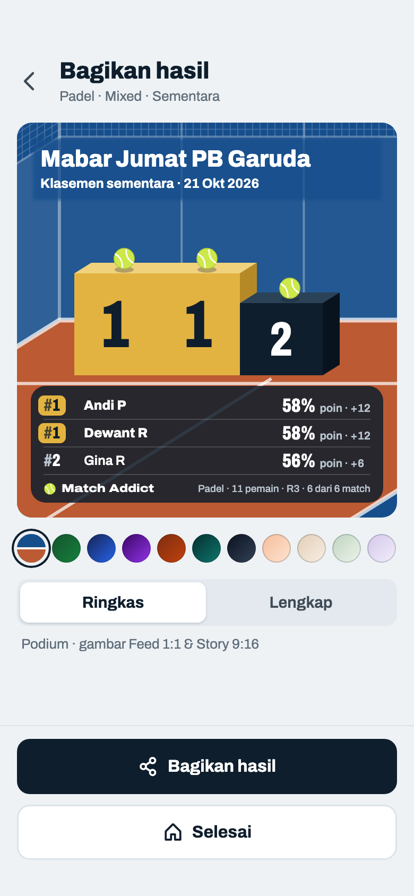

Komponen: `MabarAppBar`, `MabarButton`, `MabarIconButton`, `MabarActionBar`, `MabarGroup / MabarRow`, `MabarSegmented`, `SharePoster`, `PodiumPoster (PodiumScenePainter)`

- Ringkas = poster podium (keputusan host 60, 2026-11-12), menggantikan daftar 5 teratas + "+n pemain lainnya". Kartu pratinjau memakai ukuran gambar Feed di 358 × 372; rincian komponen di Komponen → `.podium`, semua varian di 18a–18t.
- Yang naik = tiga baris teratas Klasemen (keputusan 65). Data frame ini = Klasemen 09a (Americano 24, 11 pemain, R3 lengkap, nama sama: Andi P, Dewant R, Gina R). Poster mengikuti tab yang dipilih di Klasemen; 09a dibuka di Point % (default Americano, keputusan 123): Andi dan Dewant sama-sama #1 (58% · +12) → dua blok emas sama tinggi, dua lencana emas (keputusan 64); Gina #2 (56% · +6). Citra (#3, 54%) tidak naik karena nomornya beda dengan baris ketiga.
- Dari tab Total Point (09i) podium berbentuk sama: Andi, Dewant #1 "42 poin · +12", Hana #2 "36 poin · 0". Dari tab Win % (09b) nilai "100% · +12".
- Turnamen bernama: nama jadi judul, "Klasemen sementara · tanggal" di bawahnya, olahraga di depan baris fakta. Tanpa nama: 11c. Piala dan watermark raket tidak dipakai di podium; olahraga terbaca dari warna lantai.
- Nilai per baris = nilai metode + selisih dengan satuan: Total Point "42 poin · +12", Win % "100% · +19" (keputusan 63), Point % "58% poin · +12" (Race to/Best of "57% game · +9"; U-RP3). Ringkas selalu bersatuan, Feed dan Story (11o). Fakta Sementara "R3 · 6 dari 6 match" (pola subjudul Klasemen), Final "4 round · 8 match" (11d); Fixed menulis "pasangan"; WO ikut kalau ada.
- Deret tema di Ringkas: lapangan (bawaan, lantai ikut olahraga turnamen) + 10 gradien = 11 pilihan dalam satu baris, lingkaran 27 pt (keputusan 66). Deret yang sama dipakai di tab Lengkap (keputusan 76, 11b, 11e). Memilih gradien berlaku untuk kedua format (18b). Pilihan tema & format tidak disimpan.
- Keterangan di bawah tab: "Podium · gambar Feed 1:1 & Story 9:16".
- "Selesai" memindahkan turnamen ke slot terakhir lalu ke Beranda (stack di-reset), tanpa konfirmasi.
- Caption: baris pertama "🏆 {nama} · Padel"; tanpa nama "🏆 Match Addict · Padel". Baris peringkat ikut tab yang sama dengan poster. Tab Point % menulis Point % di tempat Win % (U-RP3): "1. Andi P — 42 poin · 58% poin (3-0-0, +12 poin)", "1. Dewant R — 42 poin · 58% poin (3-0-0, +12 poin)", "2. Gina R — 27 poin · 56% poin (1-0-1, +6 poin)", … lalu "Belum main: Gilang S". Tab Total Point dan Win % sama dengan 3.8.1.

## 11b · Lengkap · Fixed 20 pemain (10 pasangan) · tema peach

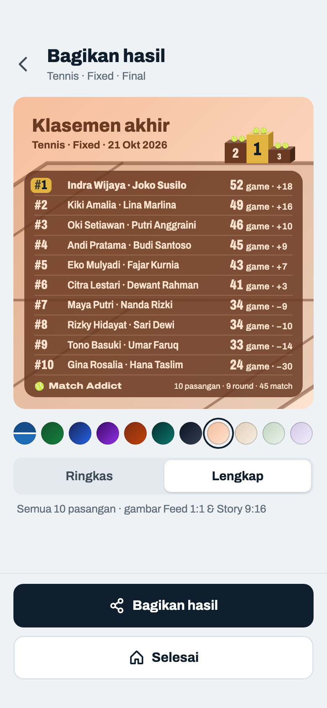

Komponen: `MabarAppBar`, `MabarButton`, `MabarIconButton`, `MabarActionBar`, `MabarGroup / MabarRow`, `MabarSegmented`, `SharePoster`

- Lengkap arah B "Podium mini" (keputusan 79): judul dan baris kecil di kiri, podium mini (angka di muka blok + bola, tanpa nama) berdiri di garis belakang di kanan judul, daftar semua baris di panel 86% di atas lantai. Rincian ukuran di Komponen → `.lk`.
- Fixed 20 pemain = 10 pasangan, round-robin 45 match (5 court, 9 round), metode Total Point (game). Pasangan selalu satu kolom, nama pasangan satu baris "Indra Wijaya · Joko Susilo" (keputusan 148, pemisah " · " sama dengan Jadwal dan Klasemen). Feed satu kolom menulis satuan: "52 game · +18" (keputusan 77).
- Kepadatan (keputusan 80): tinggi baris = ruang panel ÷ jumlah baris; huruf baris mengikuti tinggi baris, dibatasi ukuran panel podium. Di pratinjau 10 baris × 23,8 → skala 1,04 (batas); nama 12,5 = baris kecil kepala (keputusan 92).
- Podium mini pasangan: dua bola per blok (keputusan 61). Tanpa nama turnamen: judul "Klasemen akhir", baris kecil "Tennis · Fixed · 21 Okt 2026", fakta "10 pasangan · 9 round · 45 match".
- Deret tema Lengkap = deret Ringkas (keputusan 76): lapangan (bawaan, lantai ikut olahraga) + 10 gradien, 11 lingkaran 27 pt. Gradien yang dipilih berlaku untuk kedua format; pilihan tidak disimpan. Peach: kepala, blok, dan panel memakai tinta tema; warna turunannya sama dengan poster podium.
- Pratinjau 358 × 372 memakai tata letak Feed (panel 13 dari kiri/kanan); gambar Feed dan Story di 11g.

## 11c · Gagal share · gambar diunduh · hasil disalin

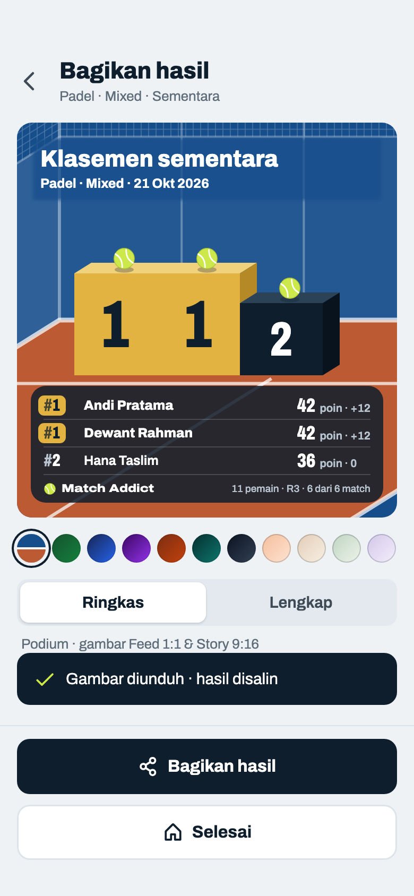

Komponen: `MabarAppBar`, `MabarButton`, `MabarIconButton`, `MabarActionBar`, `MabarGroup / MabarRow`, `MabarSegmented`, `MabarToast`, `SharePoster`, `PodiumPoster (PodiumScenePainter)`

- Saat merender dua poster, tombol mati dengan teks "Menyiapkan gambar…" (ketukan ganda diabaikan). Frame ini menggambar momen sesudahnya: tombol aktif lagi dan toast tampil (keputusan host 2026-10-22).
- Toast selalu 19 pt di atas action bar, seperti posisi bawaannya. Di sini action bar berisi dua tombol (161 pt), jadi bawah toast di 180 pt; posisi bawaan 118 pt untuk action bar satu tombol akan menutupi "Bagikan hasil" (keputusan host 2026-10-22).
- Share sheet sistem gagal atau tidak ada (desktop, browser tertentu): kedua PNG diunduh dengan nama yang sudah ada (`match-addict-feed-1080x1080.png`, `match-addict-story-1080x1920.png`), caption disalin ke clipboard, toast "Gambar diunduh · hasil disalin" (keputusan 117, mengganti aturan 2026-10-22 yang hanya menyalin caption). Tidak ada tombol baru; tetap tanpa tombol salin terpisah.
- Share sheet ditutup tanpa memilih aplikasi bukan gagal: tidak ada unduhan dan tidak ada toast. Gambar gagal dibuat → hanya caption disalin + "Hasil disalin" (11n).
- Android/iOS app: share sheet sistem selalu ada. Kalau tetap gagal, perilaku frame ini hanya kalau gambar bisa disimpan tanpa izin atau dependensi baru (dicek tech lead); selain itu 11n.
- Caption: semua baris peringkat; format Lengkap menambah "Hasil per Round". Baru: satuan "game"/"poin" mengikuti metode skor.
- Tanpa nama turnamen (data 11a, tab Point %): judul "Klasemen sementara", baris kecil "olahraga · mode · tanggal", baris fakta tanpa olahraga.

## 11d · Gambar Ringkas (podium) · Feed 1080×1080 dan Story 1080×1920 (skala 1:3) · nama 40 karakter

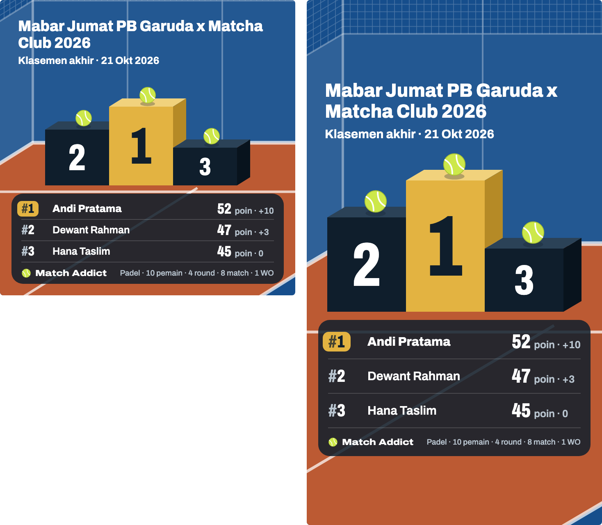

Komponen: `SharePoster`, `PodiumPoster (PodiumScenePainter)`

- Feed 360 × 360 dan Story 360 × 640, keduanya diekspor ×3. Story podium tidak memakai kanvas 203 × 360 poster Lengkap (11f); ukuran per target ada di Komponen → `.podium`.
- Nama terpanjang (40 karakter): dua baris dengan huruf 18,5 di Feed dan 23 di Story. Di Story blok turun dari 178 / 128 / 86 ke 160 / 115 / 77 supaya bola #1 berjarak 12 dari baris kecil (aturan batas tinggi); di Feed tinggi blok tetap.
- Satuan ditulis di Feed dan Story: "52 poin · +10" (keputusan 63); aturan lama "Story tanpa satuan" hanya untuk Lengkap.
- Baris fakta "Padel · 10 pemain · 4 round · 8 match · 1 WO" muat di sisa baris kaki pada 9,5 (kaki satu tingkat lebih kecil sejak keputusan 92). Fakta yang lebih lebar dikecilkan per 0,1 sampai muat, tidak pernah terpotong.
- Story: semua teks di antara 250 px atas dan bawah (arsiran = zona UI Instagram, tidak ikut ke gambar). Lantai menerus sampai tepi bawah.
- File: `match-addict-feed-1080x1080.png`, `match-addict-story-1080x1920.png`, dibagikan bersamaan lewat `Share.shareXFiles`.
- Render poster di test wajib memuat font Archivo (`loadHifiFonts()`), jangan percaya font Ahem.
- Digambar dari tab Total Point yang dipilih di Klasemen; Americano dibuka di Point % (keputusan 123), bentuk Point % di 11o–11q.

## 11e · Lengkap · Mixed 20 pemain · tema lapangan · bernama

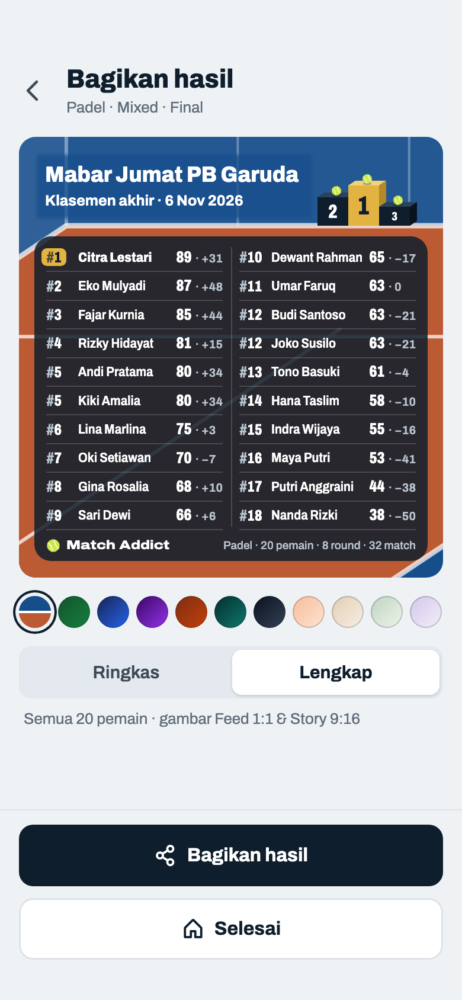

Komponen: `MabarAppBar`, `MabarButton`, `MabarIconButton`, `MabarActionBar`, `MabarGroup / MabarRow`, `MabarSegmented`, `SharePoster`

- Tema bawaan lapangan (keputusan 76): latar `court-deep`, lantai padel, garis putih 72%; tennis memakai lantai `court`.
- Feed: Mixed lebih dari 10 baris → dua kolom rata, ⌈n/2⌉ di kiri, urut ke bawah dulu (20 → 10–10), garis tipis di tengah. Dua kolom tanpa satuan: "89 · +31" (keputusan 77).
- Nomor dari Klasemen: kembar senomor (#5 Andi dan Kiki 80 · +34, #12 Budi dan Joko 63 · −21); Umar 63 · 0 di #11 di atas keduanya karena selisih. #1 lencana emas, digantung ke kiri.
- Nama di satu poster dikecilkan bersama sampai nama terpanjang muat, paling kecil ×0,82, sesudah itu elipsis per nama. Di sini ×0,94.
- Judul "Mabar Jumat PB Garuda" tidak muat di 22 di samping podium mini → 18,5, muat satu baris (keputusan 82).
- Data (juga 11f): Americano 21, 4 court × 8 round = 32 match, 8 pemain main 7 kali dan 12 main 6 kali. Jumlah poin 1344 = 32 × 42, jumlah selisih 0 (selisih = 2 × poin − 21 × match dimainkan). Menggantikan data lama 11e/11f yang selisihnya tidak berjumlah 0.
- Digambar dari tab Total Point yang dipilih di Klasemen; Americano dibuka di Point % (keputusan 123), bentuk Point % di 11o–11q.

## 11f · Gambar Lengkap · Mixed 20 pemain · Feed dan Story (skala 1:3) · bernama

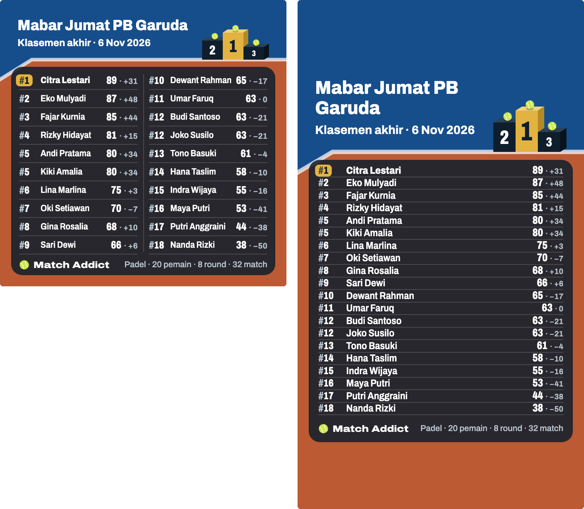

Komponen: `SharePoster`

- Feed 360 × 360 dan Story 360 × 640 (skala 1:3, diekspor ×3 → 1080 × 1080 dan 1080 × 1920), sama dengan poster podium; kanvas Story 203 × 360 tidak dipakai lagi.
- Feed = pratinjau 11e: dua kolom 10–10, baris 23.
- Story Mixed sampai 20 pemain satu kolom, tanpa satuan; di atas 20 dua kolom rata (keputusan 81, 11l). 20 baris × 15,75 → huruf ×0,93 (nama 12,5).
- Judul Story 27 tidak muat → 23, dua baris; baris kecil "Klasemen akhir · tanggal" tetap satu baris (keputusan 82). Podium mini Story lebih ramping (blok 28) supaya kolom judul lebar.
- Story: semua teks di antara 250 px atas dan bawah (arsiran = zona UI Instagram, tidak ikut ke gambar). Lantai menerus sampai tepi bawah.
- Digambar dari tab Total Point yang dipilih di Klasemen; Americano dibuka di Point % (keputusan 123), bentuk Point % di 11o–11q.

## 11g · Gambar Lengkap · Fixed 10 pasangan · Feed dan Story (skala 1:3) · tema peach

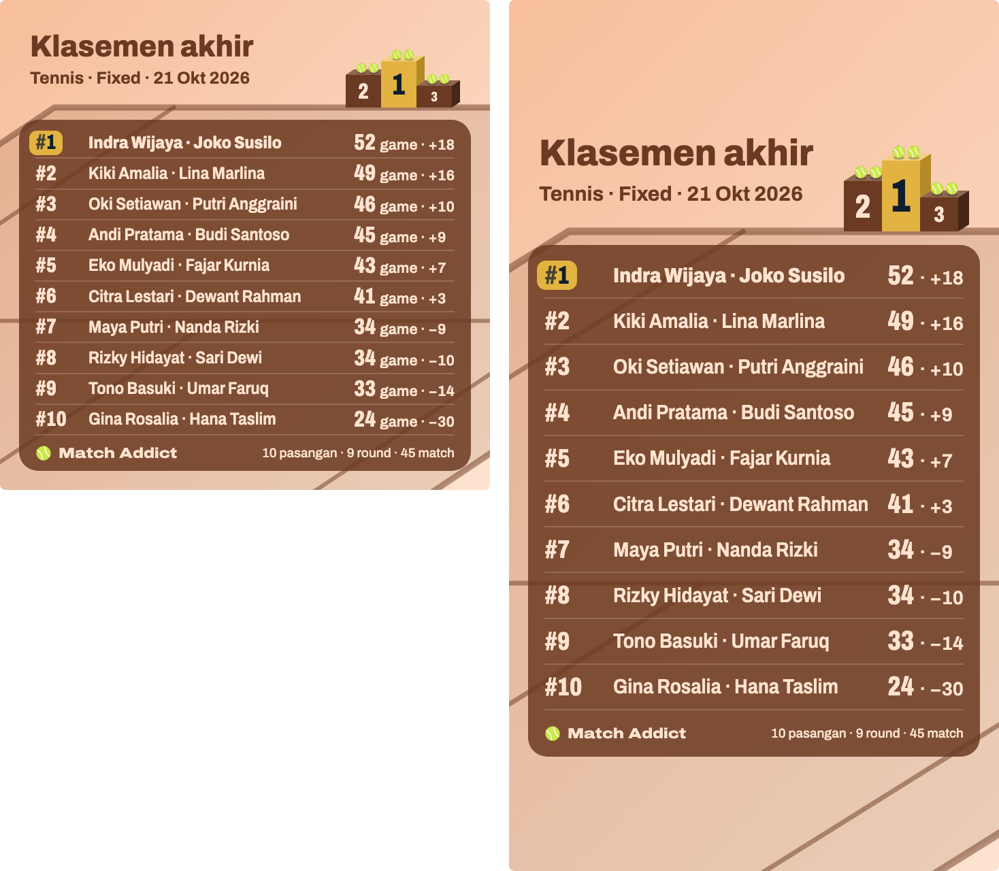

Komponen: `SharePoster`

- Feed = pratinjau 11b: satu kolom 10 baris dengan satuan, baris 22,6 → huruf ×1,03.
- Story: nama pasangan satu baris seperti Feed (keputusan 148, menggantikan dua nama ditumpuk), satu pasangan = satu satuan: 336 ÷ 10 = 33,6 → batas skala 1,33 (nama 15 = batas, nilai 20). Tanpa satuan. Semua nama utuh.
- Pasangan Fixed tidak pernah dua kolom, juga Story 15 pasangan (11k) dan 16 pasangan (11s) (keputusan 81).
- Tanpa nama turnamen: judul 27 muat satu baris di samping podium mini Story.

## 11h · Lengkap · Mixed 12 pemain · dua kolom 6–6 · tema biru

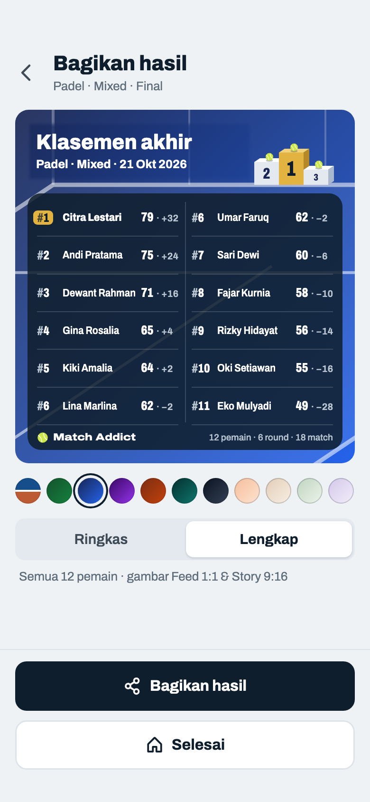

Komponen: `MabarAppBar`, `MabarButton`, `MabarIconButton`, `MabarActionBar`, `MabarGroup / MabarRow`, `MabarSegmented`, `SharePoster`

- Arah B di tema gradien gelap (biru): latar gradien, lantai putih 10%, garis lapangan putih 55%, muka blok `#E3E9EE` dengan angka warna awal gradien `#172554`; blok #1 tetap emas. Panel, teks, dan kontras sama dengan tema lapangan (`tokens.json` → `posterPodium.gradientThemes`).
- 12 baris → dua kolom rata 6–6 (1–6 kiri, 7–12 kanan). 6 baris per kolom: ruang 238 ÷ 6 = 39,67 (batas baris dua kolom 40, keputusan 92), skala 1; panel mengisi ruang sampai atas paling tinggi (88), tanpa celah di bawah kepala.
- Kembar senomor: Lina dan Umar 62 · −2 sama-sama #6, Sari berikutnya #7 (nomor rapat). Podium mini 2 · 1 · 3 = Andi, Citra, Dewant, tanpa nama.
- Nama dikecilkan bersama ×0,94 sampai nama terpanjang muat di kolom dua kolom yang sempit.
- Data (keputusan 78, menggantikan data lama yang selisihnya berjumlah +4): Americano 21, 3 court × 6 round = 18 match, semua 12 pemain main 6 kali. Jumlah poin 756 = 18 × 42; selisih = 2 × poin − 126, jumlahnya 0.
- Digambar dari tab Total Point yang dipilih di Klasemen; Americano dibuka di Point % (keputusan 123), bentuk Point % di 11o–11q.

## 11i · Lengkap · Mixed 13 pemain (ganjil) · 7–6

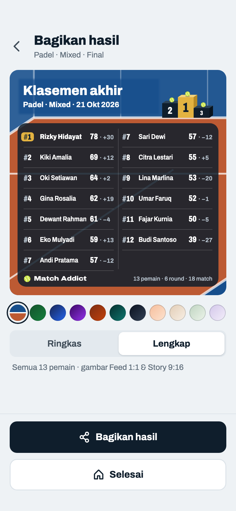

Komponen: `MabarAppBar`, `MabarButton`, `MabarIconButton`, `MabarActionBar`, `MabarGroup / MabarRow`, `MabarSegmented`, `SharePoster`

- Jumlah ganjil: kolom kiri dapat kelebihan satu (13 → 7–6). Satu grid 7 baris (⌈13 ÷ 2⌉) diisi turun dulu, jadi baris kiri dan kanan sejajar dan slot kanan bawah kosong.
- 7 baris per kolom: 238 ÷ 7 = 34 (di bawah batas 40, keputusan 92), skala 1, panel mulai di 88. Tema lapangan padel (bawaan).
- Nilai metode dulu, selisih hanya pemisah: Gina 62 · +19 (main 5 kali) di #4, di bawah Oki 64 · +2. Andi dan Sari 57 · −12 sama-sama #7.
- Data (sama dengan kartu 13 pemain di 11j): Americano 21, 3 court × 6 round = 18 match; tiap round 1 pemain istirahat → 7 pemain main 6 kali, 6 main 5 kali (72 = 7 × 6 + 6 × 5). Jumlah poin 756 = 18 × 42; selisih = 2 × poin − 21 × match, jumlahnya 0.
- Digambar dari tab Total Point yang dipilih di Klasemen; Americano dibuka di Point % (keputusan 123), bentuk Point % di 11o–11q.

## 11j · Lengkap Mixed · semua jumlah ganjil 5–19 (skala 1:2)

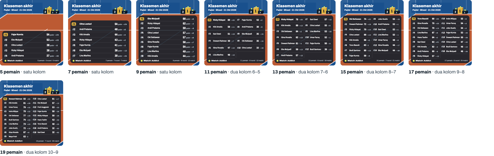

Komponen: `SharePoster`

- Sampai 10 baris satu kolom dengan satuan ("54 poin · +24"); 11 ke atas dua kolom rata tanpa satuan, kiri dapat kelebihan satu: 11 → 6–5, 13 → 7–6, 15 → 8–7, 17 → 9–8, 19 → 10–9. Baris kiri dan kanan selalu sejajar; slot terakhir kanan kosong.
- Kepadatan dari tinggi baris (keputusan 80), ruang kartu 238: 5 dan 7 baris → batas 30, skala 1,04, panel memendek; 9 baris → 26,44, skala 1,04; dua kolom 6 / 7 / 8 / 9 baris per kolom → 39,67 / 34 / 29,75 / 26,44, skala 1 (batas 40, keputusan 92), panel mulai di 88; 19 (10 per kolom) → 23,8, skala 1.
- Nama dikecilkan bersama: ×0,94 di 11, 13, 15, dan 17 pemain, ×0,86 di 19 pemain; kartu lain ×1. Kolom nilai selebar nilai terlebar se-poster (keputusan 92).
- Podium mini ikut aturan podium (keputusan 64, 65): 5 pemain #1, #2, #3, #3 dan 19 pemain #1, #2, #3, #3 → empat anak tangga selebar 21, dua #3 sama tinggi; kepala bergeser ke kanan 124. Kartu lain tiga anak tangga.
- Data Americano 21, semua kartu jumlah selisih 0 dan jumlah poin = 42 × match: 5 = 1 court × 5 round (5 match, semua main 4) · 7 = 1 × 7 (7 match, semua main 4) · 9 = 2 × 6 (12 match, main 5–6) · 11 = 2 × 6 (12 match, main 4–5) · 13 = 3 × 6 (18 match, main 5–6) · 15 = 3 × 7 (21 match, main 5–6) · 17 = 4 × 6 (24 match, main 5–6) · 19 = 4 × 7 (28 match, main 5–6).
- Digambar dari tab Total Point yang dipilih di Klasemen; Americano dibuka di Point % (keputusan 123), bentuk Point % di 11o–11q.

## 11k · Gambar Lengkap · Fixed 30 pemain (15 pasangan) · Feed, Story (skala 1:3) dan pratinjau

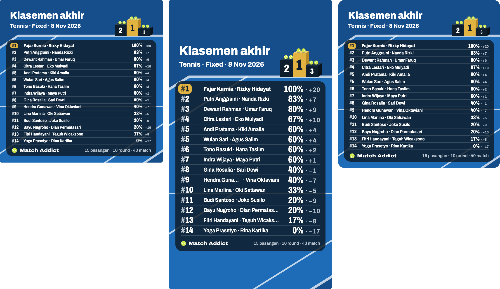

Komponen: `SharePoster`

- Pasangan Fixed selalu satu kolom (keputusan 81). Feed, Story, dan pratinjau satu baris per pasangan "Nama · Nama" (keputusan 148), jadi 15 pasangan = 15 satuan baris.
- Kepadatan (keputusan 80): Feed 226 ÷ 15 = 15,06 → skala 0,684; pratinjau 238 ÷ 15 = 15,86 → 0,72; Story 336 ÷ 15 = 22,4 → 1,318; nama terpanjang tidak muat di kolom nama 167 → semua nama ×0,82 (12,3 pt = 37 px di gambar 1080, sampai 3.9.x 27 px), lalu elipsis per nama: "Hendra Guna… · Vina Oktaviani" (Vina utuh, Hendra memakai sisanya), "Bayu Nugroho · Dian Permatas…", "Fitri Handayani · Teguh Wicaks…". Wordmark, judul, baris kecil, dan fakta tidak ikut mengecil.
- Tema lapangan tennis: lantai `court` `#1E6BB8`. Podium mini pasangan: dua bola per blok (8, Story 10).
- Race to → Win % (keputusan 21); Feed tanpa kata satuan: "100% · +20". Nilai metode dulu: Dewant · Umar 80% · +9 (4 dari 5) di #3, di atas Citra · Eko 67% · +10. Andi · Kiki dan Wulan · Agus 60% · +4 sama-sama #5; empat pasangan 60% dipisah selisih.
- Data: Tennis Race to 6, 4 court, diakhiri setelah 10 round = 40 match (round-robin penuh 105). 5 pasangan main 6 kali, 10 main 5 kali (80 = 5 × 6 + 10 × 5); total menang 40, jumlah selisih game 0.

## 11s · Gambar Lengkap · Fixed 32 pemain (16 pasangan) · Feed dan Story (skala 1:3) · batas pemain

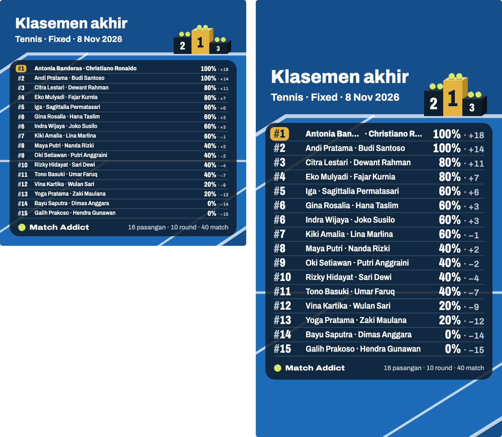

Komponen: `SharePoster`

- Batas 32 pemain (keputusan 142); dua frame ekstrem poster 32 (keputusan 147, Q-B1), pasangannya 13x. Aturan kolom tidak berubah: pasangan Fixed selalu satu kolom, juga Story 16 pasangan (keputusan 81).
- Nama pasangan satu baris "A · B" (keputusan 148), satu satuan baris per pasangan juga di Story. Kepadatan (keputusan 80): Feed 226 ÷ 16 = 14,13 → skala 0,642 (nama 8,7 pt = 26 px di gambar 1080); Story 336 ÷ 16 = 21 → skala 1,235. Sampai 3.9.x Story menumpuk dua nama: 15 pasangan = 30 satuan, skala 0,658.
- Tidak muat (keputusan 148): nama di satu poster dikecilkan bersama dulu (Lengkap sampai ×0,82, keputusan 92), sesudah itu tiap nama dipotong sendiri dengan elipsis "…" menurut lebar terukur. Jatah tiap nama = (lebar kolom nama − lebar " · ") ÷ 2; nama yang lebih pendek dari jatahnya utuh dan sisanya dipakai nama lain. Terukur: Feed semua nama utuh di ×1 (kolom nama 238). Story ×0,82 (nama 12,3), kolom nama 176, jatah 84 → #1 "Antonia Ban… · Christiano R…"; #5 "Iga · Sagittalia Permatasari" muat utuh: Iga jauh di bawah jatahnya, jadi Sagittalia memakai sisanya. Nilai tidak pernah terpotong.
- Race to → Win % (keputusan 21); Lengkap Feed satu kolom tanpa kata satuan untuk Win %: "100% · +18" (seperti 11k). Gina · Hana dan Indra · Joko 60% · +3 sama-sama #6, Kiki · Lina #7.
- Data: Tennis Race to 6, 4 court, diakhiri setelah 10 round = 40 match (round-robin penuh 120). 8 pasangan main dan 8 istirahat tiap round, semua main 5 kali (80 = 16 × 5); menang 5 + 5 + 4 + 4 + 3 × 4 + 2 × 4 + 1 + 1 + 0 + 0 = 40, jumlah selisih game 0. Tema lapangan tennis dan podium mini sama dengan 11k.

## 11l · Gambar Lengkap · Mixed 30 pemain · Feed, Story (skala 1:3) dan pratinjau

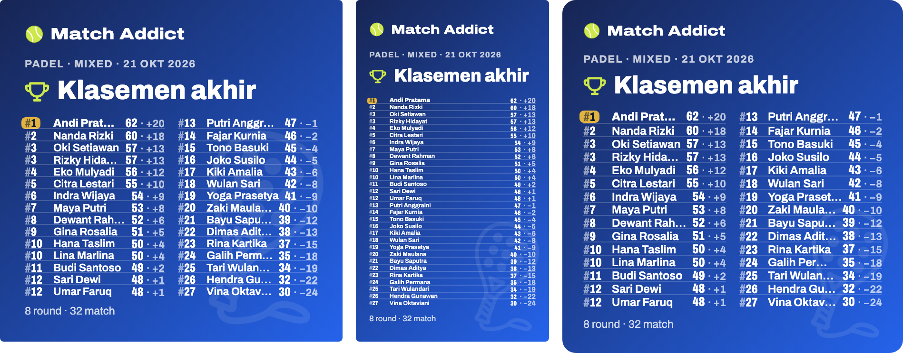

Komponen: `SharePoster`

- Feed dan pratinjau dua kolom 15–15. Story lebih dari 20 pemain juga dua kolom 15–15 (keputusan 81), ukuran dua kolom sama dengan Feed; menggantikan Story satu kolom 30 baris.
- Bernama: "Liga Akhir Tahun Padel Kemang" tidak muat satu baris di 22 → 18,5, dua baris (Story 27 → 23, dua baris; keputusan 82). Garis belakang ikut turun: 96 (Story 191).
- Kepadatan: Feed 209 ÷ 15 = 13,93 → skala 0,773; pratinjau 221 ÷ 15 = 14,73 → 0,818; Story 315 ÷ 15 = 21 → skala 1 (batas 30). Nama Story ×0,86 di kolom sempit ("Teguh Wicaksono").
- Banyak kembar, nomor rapat sampai #20 untuk 30 pemain: Gina, Agus, Teguh 48 · +12 bertiga #7; Nanda, Vina, Bayu 43 · +2 bertiga #9. Maya 60 · +36 (main 4) di #2 di bawah Indra 63 · +21 (main 5): Total Point dulu.
- Data: Americano 21, 4 court × 8 round = 32 match; 16 dari 30 pemain main tiap round → 8 pemain main 5 kali, 22 main 4 kali (128 = 8 × 5 + 22 × 4). Jumlah poin 1344 = 32 × 42; jumlah selisih 0.
- Digambar dari tab Total Point yang dipilih di Klasemen; Americano dibuka di Point % (keputusan 123), bentuk Point % di 11o–11q.

## 11m · Gambar Lengkap · podium mini kasus khusus · lebih dari empat di #1 (Feed) dan belum ada match (Story)

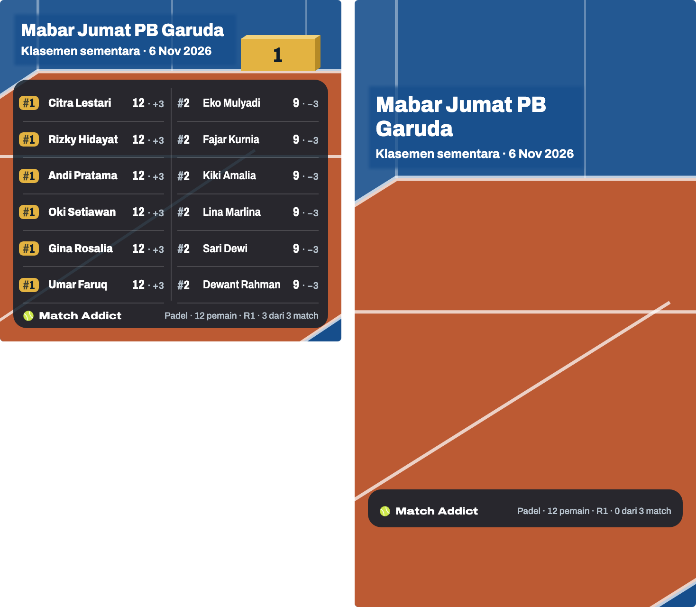

Komponen: `SharePoster`

- Podium mini ikut podium Ringkas (keputusan 85). Feed: lebih dari empat di #1 (keputusan 68) → satu blok emas lebar 3 × 26 = 78, tinggi #1 34, angka "1", tanpa bola; kolom judul tetap 118 seperti tiga anak tangga. Story memakai 3 × 28 = 84, tinggi 52.
- Daftar Lengkap tetap semua baris: enam #1 berlencana emas, enam #2. 12 baris → dua kolom 6–6, ruang 230 ÷ 6 = 38,33 (batas 40, keputusan 92).
- Story: belum ada match selesai (keputusan 69) → lapangan tanpa blok (lantai memakai kedalaman podium mini Story 8:5). Panel hanya wordmark + fakta "R1 · 0 dari 3 match", seperti 18t. Kolom judul tetap selebar tiga anak tangga (126), jadi judul tidak bergeser setelah match pertama selesai. Feed memakai aturan yang sama.
- Baris kecil "Klasemen sementara · 6 Nov 2026" lebih lebar dari kolom judul Story → 15 dikecilkan per 0,5 sampai 13 (keputusan 84). Judul dua baris di 23.
- Data (sama dengan 18s/18t): Americano 21, 12 pemain, 3 court. Feed: R1 tiga skor 12–9 → enam pemain 12 · +3 (#1), enam 9 · −3 (#2), jumlah selisih 0. Story: R1 belum ada skor.
- Digambar dari tab Total Point yang dipilih di Klasemen; Americano dibuka di Point % (keputusan 123), bentuk Point % di 11o–11q.

## 11n · Gambar gagal dibuat · hasil disalin

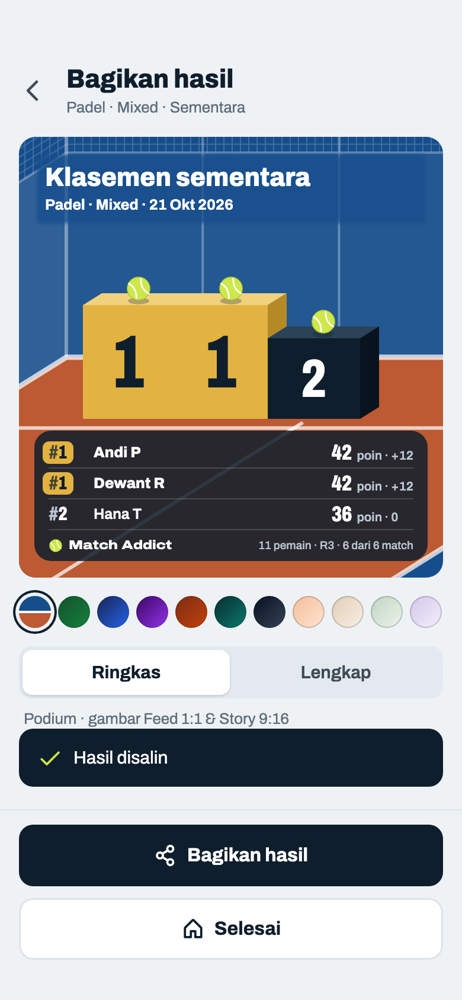

Komponen: `MabarAppBar`, `MabarButton`, `MabarIconButton`, `MabarActionBar`, `MabarGroup / MabarRow`, `MabarSegmented`, `MabarToast`, `SharePoster`, `PodiumPoster (PodiumScenePainter)`

- Dua poster gagal di-render (gambar tidak jadi): tidak ada yang diunduh dan share sheet tidak dibuka; caption disalin ke clipboard + toast "Hasil disalin" (keputusan 117, PRD 17.10 B-10). Latar = 11c persis; hanya teks toast yang beda.
- Toast 19 pt di atas action bar dua tombol (bawah 180 pt), sama dengan 11c.
- Android/iOS app yang tidak bisa menyimpan gambar tanpa izin atau dependensi baru: share sheet gagal → frame ini juga.

## 11r · Caption lebih dari 1024 karakter · hasil lengkap disalin

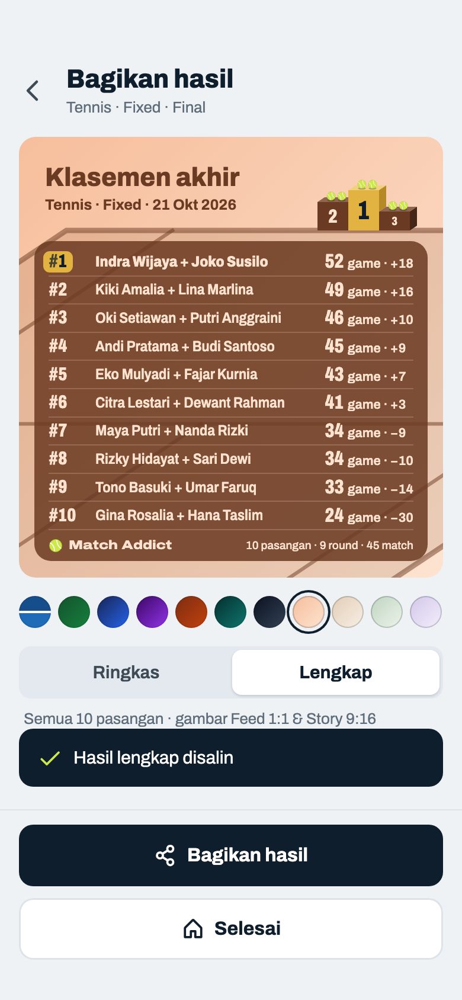

Komponen: `MabarAppBar`, `MabarButton`, `MabarIconButton`, `MabarActionBar`, `MabarGroup / MabarRow`, `MabarSegmented`, `MabarToast`, `SharePoster`

- Share sheet berhasil dibuka, tapi caption lebih dari 1024 karakter: WhatsApp memotong caption gambar tepat di situ (keputusan 134, PRD 5.9). Gambar dikirim dengan caption yang muat: tanpa "Hasil per Round"; kalau Klasemen saja masih lebih dari 1024, hanya baris 🏆 + tanggal + baris ringkasan. Teks lengkap disalin ke clipboard sebelum share sheet dibuka, untuk ditempel sebagai pesan kedua.
- Setelah share sheet kembali: toast "Hasil lengkap disalin" 19 pt di atas action bar dua tombol (bawah 180 pt), sama dengan 11c. Caption yang muat 1024 → tidak berubah, tanpa toast.
- Latar = 11b persis (Lengkap Fixed 10 pasangan, 45 match); hanya toast yang beda. Ringkas yang lebih dari 1024 (Klasemen panjang) memakai toast yang sama.
- Gagal share (11c) dan gambar gagal dibuat (11n) tetap menyalin teks lengkap dengan toast-nya masing-masing.

## 11o · Gambar Ringkas · Point % · Feed dan Story (skala 1:3) · data 18A

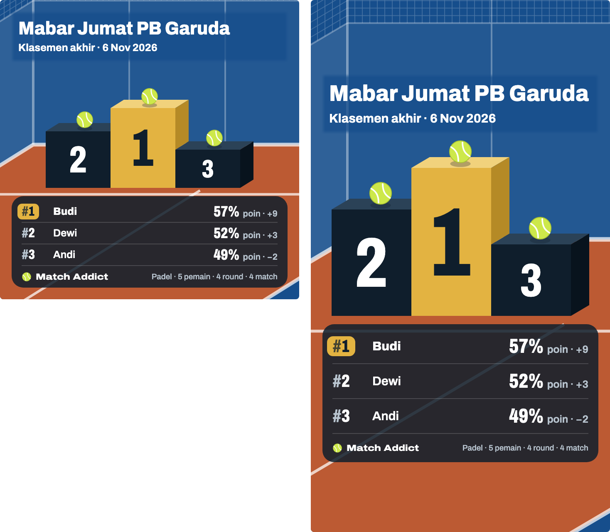

Komponen: `SharePoster`, `PodiumPoster (PodiumScenePainter)`

- Poster mengikuti tab yang dipilih di Klasemen; Americano dibuka di Point % (keputusan 123). Ringkas selalu bersatuan, juga di Story: "57%" + "poin · +9" (U-RP3). Race to/Best of menulis "57% game · +9".
- Data contoh 18A (PRD 18.3, `logic.md` §20.8): Padel Mixed, Americano 21, 5 pemain, 1 court, R1–R4 lalu diakhiri. Budi 36 ÷ 63 → 57 · +9 #1; Dewi 33 ÷ 63 → 52 · +3 #2; Andi 41 ÷ 84 → 49 · −2 #3 (main 4 kali). Citra dan Eko 46 · −5 #4 tidak naik.
- Dari tab Total Point podium jadi Andi 41 · Budi 36 · Dewi 33; dari tab Win % Budi · Dewi · Andi. Podium dan nomor dari angka bulat yang tampil (18.2).
- Tiga anak tangga 2 · 1 · 3 seperti 18c; nama turnamen dan tanggal sama dengan 18c, jadi kepala dan lantai sama, hanya panel yang beda.
- Muat: kolom nilai selebar "57%", keterangan "poin · +9"; nama tetap 12,5 (Story 15), tidak dikecilkan. Nilai tidak pernah terpotong.
- Caption tab Point %: "1. Budi — 36 poin · 57% poin (3-0, +9 poin)", "2. Dewi — 33 poin · 52% poin (2-1, +3 poin)", "3. Andi — 41 poin · 49% poin (2-2, -2 poin)", "4. Citra — 29 poin · 46% poin (0-3, -5 poin)", "4. Eko — 29 poin · 46% poin (1-2, -5 poin)". Americano 21 tidak bisa seri, jadi tanpa D; selisih negatif memakai tanda minus caption yang sudah ada.

## 11p · Gambar Lengkap · Point % · Feed satu kolom dan Story (skala 1:3) · data 18A

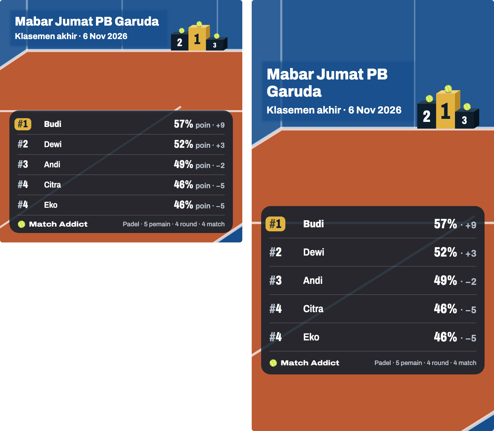

Komponen: `SharePoster`

- Lengkap menulis satuan hanya di Feed dan kartu satu kolom: "57%" + "poin · +9"; Story tanpa satuan: "57% · +9" (U-RP3, keputusan 77). Tanda % selalu ada di nilai, seperti Win % (11k), jadi Point % tidak terbaca sebagai Total Point.
- Data 18A sama dengan 11o, lima baris: Budi 57 · +9 #1, Dewi 52 · +3 #2, Andi 49 · −2 #3, Citra dan Eko 46 · −5 #4 (angka dan selisih sama → nomor sama, urut nama).
- Kepadatan (keputusan 80): Feed ruang 230 ÷ 5 = 46 → batas baris 30, skala 1,04, panel memendek; Story ruang 315 ÷ 5 = 63 → batas 42, skala 1,33. Kolom nilai selebar "57%"; nama tidak dikecilkan.
- Podium mini 2 · 1 · 3 = Dewi, Budi, Andi (angka + bola, tanpa nama). Kepala dan lantai = 11f (nama turnamen sama).
- Story lebih dari 20 pemain dua kolom (11l) memakai ukuran dua kolom Feed, jadi nilai di sana seperti 11q: "63% · +32".

## 11q · Lengkap · Point % · Mixed 12 pemain · dua kolom 6–6 · tema biru

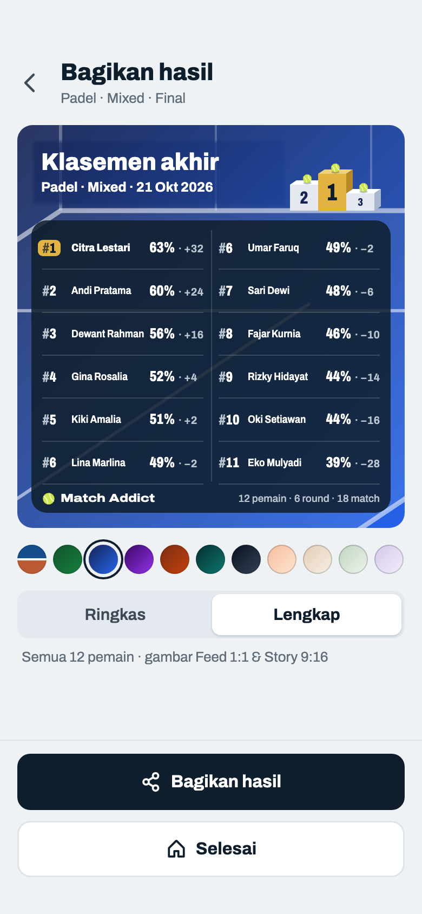

Komponen: `MabarAppBar`, `MabarButton`, `MabarIconButton`, `MabarActionBar`, `MabarGroup / MabarRow`, `MabarSegmented`, `SharePoster`

- Dua kolom tanpa satuan: "63% · +32" (U-RP3); tanda % tetap di nilai, seperti Win % "100% · +20" (11k).
- Data = 11h dari tab Point %: Americano 21, 18 match, semua 12 pemain main 6 kali, jadi dimainkan 6 × 21 = 126 per pemain dan Point % = poin ÷ 126. Citra 79 → 63, Andi 75 → 60, Dewant 71 → 56, Gina 65 → 52, Kiki 64 → 51, Lina dan Umar 62 → 49 (#6), Sari 60 → 48, Fajar 58 → 46, Rizky 56 → 44, Oki 55 → 44, Eko 49 → 39.
- Rizky dan Oki sama-sama 44 setelah dibulatkan → nomor dipisah selisih: Rizky −14 #9, Oki −16 #10 (18.2). Jumlah main sama, jadi urutan dan podium mini sama dengan 11h (Andi, Citra, Dewant).
- Muat (keputusan 92): 6 baris per kolom 39,67 (batas 40), skala 1; kolom nilai selebar "63%" (lebih lebar dari "79" di 11h), nama dikecilkan bersama sampai ×0,82 (11h ×0,94), semua nama tetap utuh. Nilai tidak terpotong.
- Uji lebar "%" di poster dua kolom yang ada: 11e, 11f, 11i, 11j (11–19), 11l semua turun ke ×0,82; di 11j 19 pemain ("Dewant Rahman") dan Story 11l 30 pemain ("Hendra Gunawan", "Dian Permatasari", "Teguh Wicaksono") nama terpanjang jadi elipsis per nama (keputusan 92). Sama dengan Win % "100%" di Mixed dua kolom.
