# Sparing

> Dihasilkan `tool/hifi_extract.py` dari `design/hifi.html`. Jangan diedit langsung.

Dua klub bertanding (PRD §13, keputusan host 19, 2026-11-04). Tahap 1: layar inti. Klub pertama selalu baris atas setiap match, dan skor klub (`.clubscore`) menulis klubnya dengan urutan yang sama, jadi posisi baris sudah menunjukkan klubnya. Contoh: PB Garuda 8 pemain vs Matcha Club 6, Padel, Race to 6, 15 mnt, 2 court × 2 jam. Jadwal dan klasemen Fixed = contoh PRD 13A–13C dalam susunan generator (diverifikasi tech lead, 2026-11-04).

## 13a · Pemain · Sparing · kosong

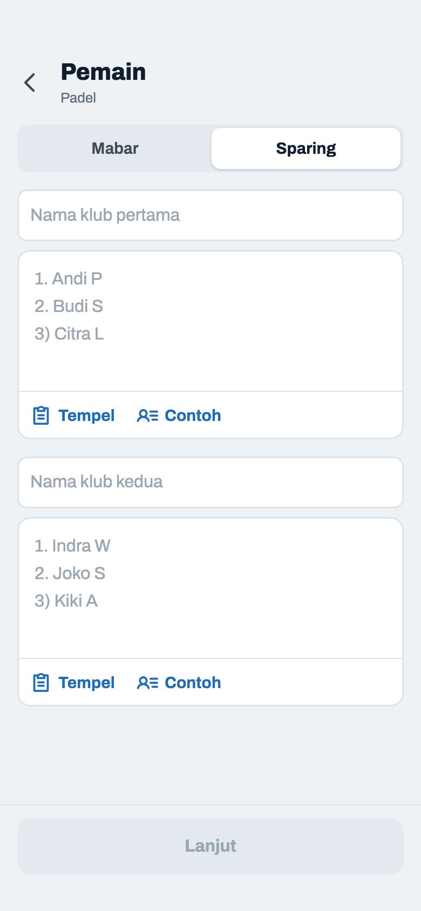

Komponen: `MabarAppBar`, `MabarButton`, `MabarTextButton`, `MabarIconButton`, `MabarActionBar`, `MabarSegmented`, `MabarField`, `NameListField`

- Sparing dipilih di layar Pemain (K4). Dua blok berurutan, masing-masing kotak nama klub (sama dengan kotak Nama turnamen) lalu kotak nama pemain dengan toolbar dan parser yang sama dengan Mabar (02a), termasuk buang duplikat di dalam satu klub.
- Blok atas = klub pertama: klub ini selalu sisi atas match di semua layar (S4). Urutan tidak bisa ditukar setelah jadwal dibuat.
- Nama klub wajib, maks 20 karakter (ketikan ke-21 tidak masuk, tanpa penghitung), spasi awal/akhir dibuang. Kotak nama klub tanpa label: placeholder "Nama klub pertama" / "Nama klub kedua".
- Contoh (hanya saat kotak itu kosong) mengisi nama contoh yang berbeda per blok: klub pertama 8 nama (Andi … Hadi), klub kedua 6 nama (Indra … Nanda), supaya contoh tidak pernah membuat nama yang sama di dua klub. Nama klub tidak ikut diisi.
- Tidak autofocus, sama dengan 02a. Lanjut mati sampai semua syarat terpenuhi; catatan baru muncul setelah blok itu diisi (13d–13g).

## 13b · Pemain · Sparing · terisi · siap lanjut

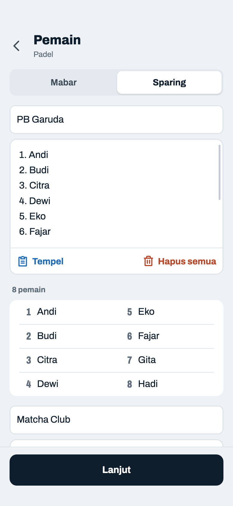

Komponen: `MabarAppBar`, `MabarButton`, `MabarTextButton`, `MabarIconButton`, `MabarActionBar`, `MabarGroup / MabarRow`, `MabarSegmented`, `MabarField`, `NameListField`, `RosterPreview`

- Garuda 8 + Matcha 6 = 14 pemain → Lanjut aktif (AC-S1). Jumlah ditulis sekali per klub di label daftarnya; tombol cukup "Lanjut" seperti Mabar.
- Dua blok lebih panjang dari satu layar, jadi halaman di-scroll (app bar dan action bar tetap); bawahnya di 13c.
- Daftar bernomor per klub (`.roster`, sama dengan 02b), urut ke bawah dulu, mulai 1 di tiap klub.
- Syarat Lanjut: kedua nama klub terisi dan berbeda (tidak peka huruf besar), tiap klub minimal 2 pemain, total 4–30, tidak ada nama pemain di dua klub (K6, K8).

## 13c · Pemain · Sparing · digulir ke bawah

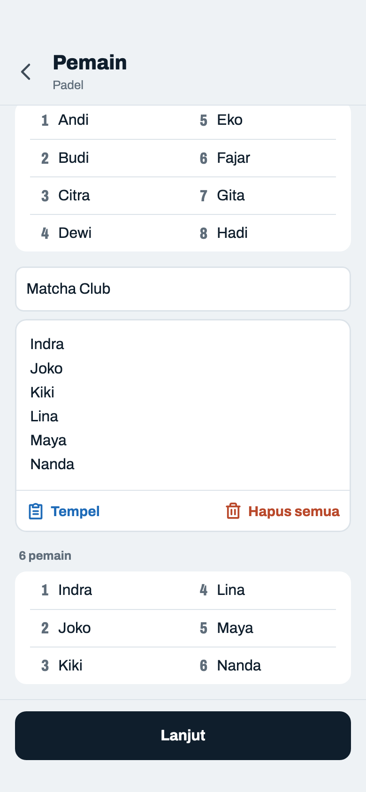

Komponen: `MabarAppBar`, `MabarButton`, `MabarTextButton`, `MabarIconButton`, `MabarActionBar`, `MabarGroup / MabarRow`, `MabarSegmented`, `MabarField`, `NameListField`, `RosterPreview`

- Keadaan sama dengan 13b, digulir sampai bawah: blok klub kedua dan daftarnya.
- 6 nama pas 6 baris kotak teks, jadi tanpa garis scroll di dalam kotak.
- Lanjut → Atur turnamen (13h–13j) dengan olahraga, dua klub, dan anggotanya. Kembali dari Atur turnamen membuka layar ini dengan isian utuh.

## 13d · Pemain · klub kedua baru 1 pemain

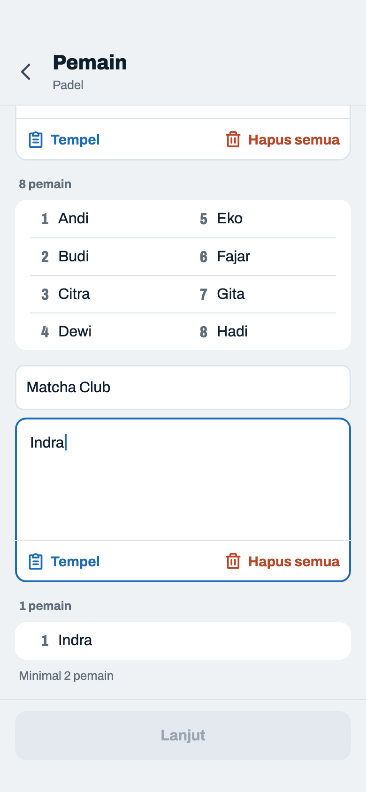

Komponen: `MabarAppBar`, `MabarButton`, `MabarTextButton`, `MabarIconButton`, `MabarActionBar`, `MabarGroup / MabarRow`, `MabarSegmented`, `MabarField`, `NameListField`, `RosterPreview`

- Contoh PRD: Matcha hanya Indra → Lanjut mati (AC-S1). Kurang dari 2 di satu klub bukan error (host masih mengetik), jadi catatannya abu-abu seperti "Minimal 4 pemain" di 02c.
- Catatan jumlah ada di bawah daftar klub itu, catatan nama klub di bawah kotak nama klub (13e, 13f). Total tetap minimal 4: dua klub × 2.

## 13e · Pemain · nama klub kosong

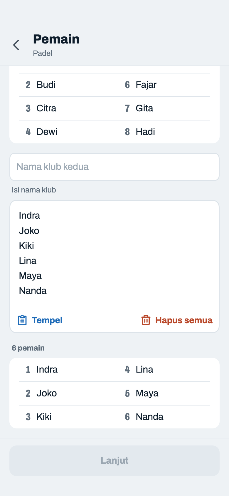

Komponen: `MabarAppBar`, `MabarButton`, `MabarTextButton`, `MabarIconButton`, `MabarActionBar`, `MabarGroup / MabarRow`, `MabarSegmented`, `MabarField`, `NameListField`, `RosterPreview`

- Nama klub kosong → Lanjut mati (AC-S2). Catatan abu-abu "Isi nama klub" di bawah kotaknya hanya kalau blok itu sudah berisi pemain; blok yang masih kosong seluruhnya tanpa catatan (13a).
- Spasi saja dihitung kosong.

## 13f · Pemain · nama klub sama

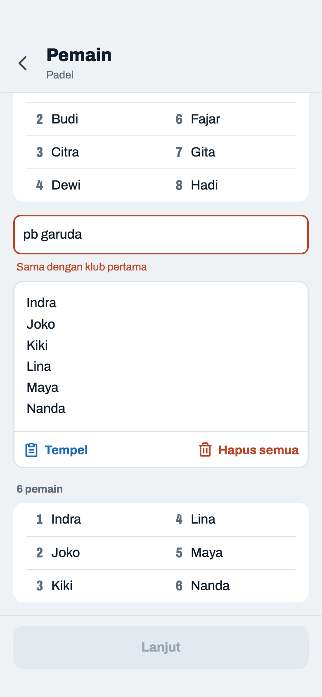

Komponen: `MabarAppBar`, `MabarButton`, `MabarTextButton`, `MabarIconButton`, `MabarActionBar`, `MabarGroup / MabarRow`, `MabarSegmented`, `MabarField`, `NameListField`, `RosterPreview`

- "PB Garuda" dan "pb garuda" dianggap sama (tidak peka huruf besar, spasi dipangkas) → Lanjut mati (AC-S2).
- Ini salah isi, bukan sedang mengetik: tepi kotak dan catatannya clay, seperti "Maksimal 30 pemain" di 02d. Pesan selalu di kotak klub kedua, karena klub pertama yang diisi duluan.

## 13g · Pemain · pemain di dua klub

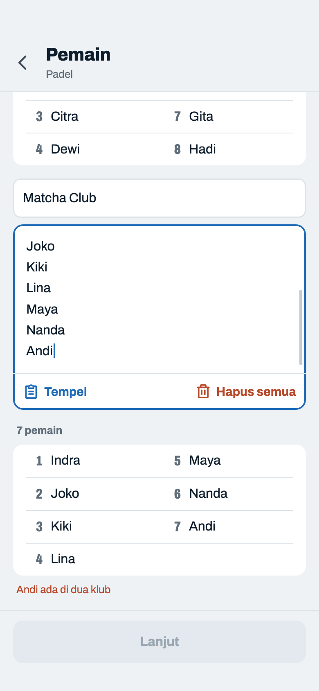

Komponen: `MabarAppBar`, `MabarButton`, `MabarTextButton`, `MabarIconButton`, `MabarActionBar`, `MabarGroup / MabarRow`, `MabarSegmented`, `MabarField`, `NameListField`, `RosterPreview`

- Nama yang sama (tidak peka huruf besar) di dua klub → Lanjut mati, pesan clay menyebut namanya (AC-S2). Pesan ini boleh karena mencegah salah langkah (Prinsip "Tanpa Petunjuk").
- Pesan di bawah daftar klub kedua. Lebih dari satu nama: "Andi, Budi ada di dua klub"; lebih dari tiga: "Andi, Budi, Citra +2 ada di dua klub". Daftarnya tidak ikut diwarnai, sama dengan 02d.
- Kotak teks sedang diketik di baris ke-7, jadi isinya bergulir: baris pertama (Indra) di atas kotak.
- Duplikat di dalam satu klub tetap dibuang diam-diam dengan catatan "Duplikat dibuang: …" seperti 02b; itu bukan error.

## 13h · Atur turnamen · Fixed sparing

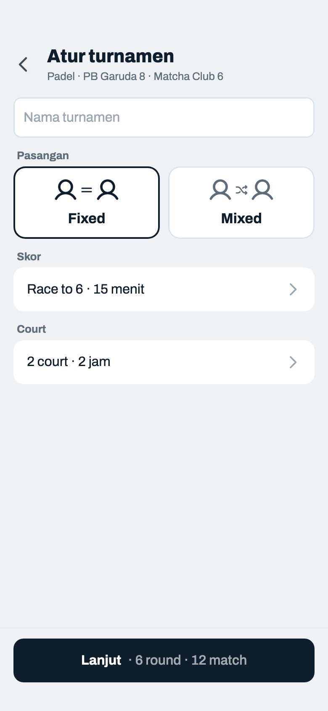

Komponen: `MabarAppBar`, `MabarButton`, `MabarIconButton`, `MabarActionBar`, `MabarGroup / MabarRow`, `MabarField`, `ModePicker`

- Layar sama dengan 03a, tapi kartu mode hanya Fixed dan Mixed (`.modes` dua kolom, kartu yang sama dengan 03a): Sparing tidak menawarkan Mexicano (keputusan host 27). Subjudul dan estimasi ikut sparing. Format, durasi, court, dan nama turnamen tetap dipilih di sini (sheet 03d, 03g); nama turnamen terpisah dari nama klub (K8).
- Subjudul: olahraga · klub pertama + jumlah pemainnya · klub kedua + jumlahnya.
- Estimasi Fixed sparing dihitung dari jadwal, bukan dari jam booking: 4 × 3 pasangan = 12 match, court aktif min(2, 4, 3) = 2, round = ⌈12 ÷ 2⌉ = 6 (contoh 13A). Karena jadwalnya pasti, tombol tanpa "±" (Fixed biasa 03a tetap "±6 round · 12 match" dari booking).
- Court aktif lebih sedikit dari jumlah court → tombol ditambah "· n court" (14g, 13j). Jadwal lebih panjang dari booking terpendek: 14f.
- Pengaturan terakhir di HP (03q) juga berlaku di sini; kalau terakhir Mexicano, mode terisi Mixed (asumsi, menunggu host).
- Lanjut → Pasangan per klub (14a–14e).

## 13i · Atur turnamen · Mixed sparing

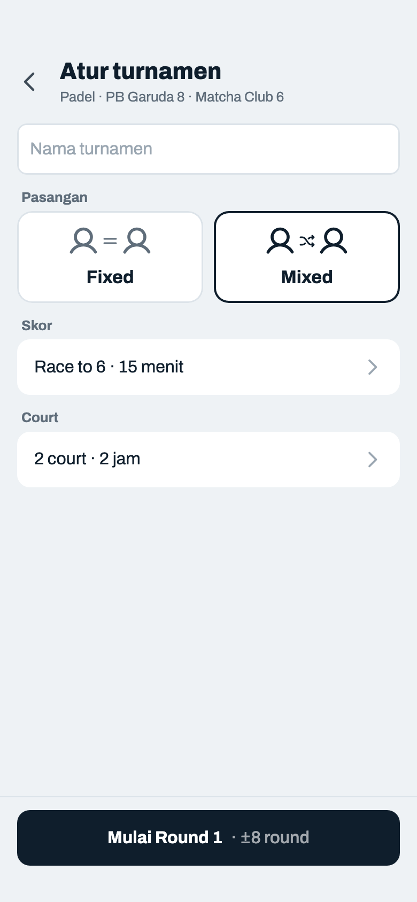

Komponen: `MabarAppBar`, `MabarButton`, `MabarIconButton`, `MabarActionBar`, `MabarGroup / MabarRow`, `MabarField`, `ModePicker`

- Mixed: estimasi sama dengan 03b (booking terpendek ÷ durasi = 2 jam ÷ 15 menit = ±8 round). Court aktif min(2, ⌊8 ÷ 2⌋, ⌊6 ÷ 2⌋) = 2 = semua court, jadi tanpa tambahan (contoh 13B).
- Mulai Round 1 → Jadwal Mixed + R1, lalu sheet Cara kerja Mixed versi sparing (15k).

## 13j · Atur turnamen · Mixed sparing · court lebih dari yang terpakai

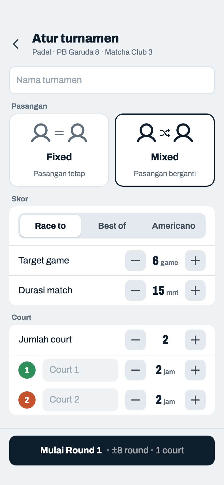

Komponen: `MabarAppBar`, `MabarButton`, `MabarIconButton`, `MabarActionBar`, `MabarGroup / MabarRow`, `MabarField`, `ModePicker`

- Matcha 3 pemain: court aktif min(2, 4, ⌊3 ÷ 2⌋) = 1 (AC-S10). Tombol menulis jumlah court yang terpakai; court yang tidak aktif = court bernomor terakhir (Court 2), tetap boleh dipesan dan dipakai begitu pemainnya cukup (Kelola pemain).
- Tidak ada peringatan atau catatan di baris Court: akibatnya cukup terbaca dari tombol.

## 13k · Jadwal Fixed sparing · round berjalan

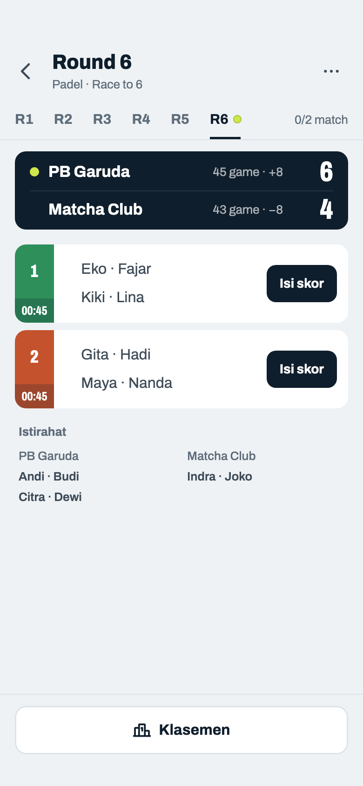

Komponen: `MabarAppBar`, `MabarButton`, `MabarIconButton`, `MabarActionBar`, `MabarGroup / MabarRow`, `MabarGroupHeader`, `RoundTabs`, `MatchScoreRow`, `RestingList`, `ClubScore`

- Contoh 13A: Garuda 4 pasangan, Matcha 3, 2 court; 12 match dalam 6 round (susunan generator), R1–R5 sudah terisi (hasil 13C). Tiap pasangan Garuda 3 match, Matcha 4; tiap pasangan bertemu tiap pasangan klub lain tepat sekali, tidak pernah sesama klub.
- Skor klub (`.clubscore`) paling atas: PB Garuda 6 – 4 Matcha Club, sama dengan Klasemen 13n. Barisnya berurutan sama dengan baris match: klub pertama di atas, jadi tiap baris atas match = pasangan PB Garuda tanpa label tambahan (S4, AC-S7). Bola = klub yang unggul; seri → bola di kedua baris.
- Di kanan nama klub: Total Point klub · selisih (pemisah kalau match menang sama, K2); satuan ikut format ("game" di Race to, "poin" di Americano).
- Istirahat bisa beberapa pasangan per round, dari kedua klub (R6: Andi · Budi, Citra · Dewi | Indra · Joko): kolom kiri klub pertama, kanan klub kedua, nama klub di atas kolomnya. Klub tanpa yang istirahat di round itu: kolomnya tetap ada dengan "–".
- Hitung mundur 00:45 = booking 2 jam − 75 menit (5 round × 15 mnt) sejak turnamen dimulai. Round dibuka berurutan, menu ⋯ dan Akhiri sama dengan 06a–06e.

## 13l · Jadwal Fixed sparing · semua match terisi

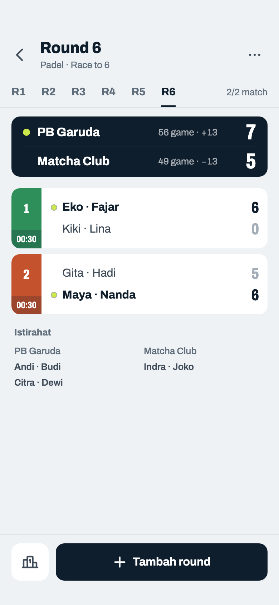

Komponen: `MabarAppBar`, `MabarButton`, `MabarIconButton`, `MabarActionBar`, `MabarGroup / MabarRow`, `MabarGroupHeader`, `RoundTabs`, `MatchScoreRow`, `RestingList`, `ClubScore`

- R6 diisi: Eko · Fajar 6–0 Kiki · Lina, Gita · Hadi 5–6 Maya · Nanda. Skor klub akhir 7 – 5 (Matcha: 4 menang + 1 WO di R3, Citra · Dewi absen), Total Point 56 – 49 (Matcha 43 game + 6 nilai WO Race to 6), selisih +13 / −13 (AC-S14, AC-S15).
- Klub kedua yang menang tetap di baris bawah; bola pemenang dan angka tebal pindah ke baris itu, sama dengan baris match biasa. Pasangan WO juga tetap di sisi klubnya (R3: Citra · Dewi di atas dengan "WO · Absen").
- Action bar sama dengan 06v: Klasemen jadi ikon, "Tambah round" → sheet round tambahan per satuan KPK(4, 3) = 12 match (K5; sheet 14n). Sisa booking 00:30 = 2 round, jadi sheetnya akan menulis "lewat booking 01:00" (AC-S18).
- Skor klub Final di Klasemen (13o) sampai round tambahan dibuat.

## 13m · Jadwal Mixed sparing · round berjalan

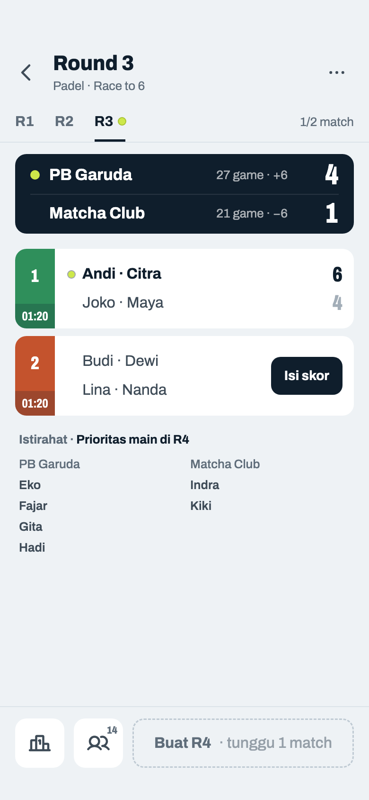

Komponen: `MabarAppBar`, `MabarButton`, `MabarIconButton`, `MabarActionBar`, `MabarGroup / MabarRow`, `MabarGroupHeader`, `RoundTabs`, `MatchScoreRow`, `RestingList`, `ClubScore`

- Contoh 13B: Garuda 8, Matcha 6, 2 court. Tiap match = 2 pemain klub pertama (baris atas, berpasangan) vs 2 pemain klub kedua. Slot per round: 4 Garuda + 4 Matcha, jadi 4 Garuda dan 2 Matcha istirahat.
- Susunan generator (2026-11-04; dulu contoh designer): R1 Eko · Gita 6–4 Nanda · Kiki, Citra · Fajar 3–6 Maya · Joko. R2 Budi · Andi 6–2 Lina · Kiki, Dewi · Hadi 6–5 Nanda · Indra. R3 Fajar · Eko 6–4 Joko · Indra, Citra · Gita vs Lina · Maya belum. Skor contoh designer: skor klub 4 – 1, Total Point 27 – 21. Prioritas R4 (generator): Andi, Budi, Dewi, Hadi · Kiki, Nanda.
- Istirahat di round terakhir dipisah per klub dengan prioritas masing-masing (`priorityOrder` per klub, slot klub itu): semua yang istirahat kebagian slot R4, jadi hanya daftar "Prioritas main di R4". Kalau yang istirahat di satu klub lebih banyak dari slotnya, klub itu mendapat daftar kedua "Istirahat lagi di R4" dengan dua kolom yang sama (seperti 06o); kolom klub yang semua kebagian berisi "–". Daftar ini sama persis dengan hasil Buat R4 (AC-S11).
- Fairness per klub: selisih main antar pemain satu klub ≤ 1. Setelah R3 Garuda 2·2·2·2·1·1·1·1 (R3 sedang dimainkan dihitung), Matcha 2 semua; antar klub boleh beda (K1).
- Pemain (14) → Kelola pemain per klub (15l). Tombol bawah, Batalkan Rn, menu ⋯, Kelola court sama dengan 06f–06t.

## 13n · Klasemen sparing · Fixed · Sementara

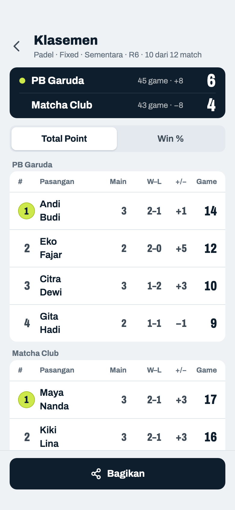

Komponen: `MabarAppBar`, `MabarButton`, `MabarIconButton`, `MabarActionBar`, `MabarGroup / MabarRow`, `MabarSegmented`, `StandingTable`, `ClubScore`

- Skor klub di atas tabel dan tetap di tempat saat tabel digulir (seperti tab metode). Klub menang = match menang (seri ½, WO = menang untuk klub lawan); sama → Total Point klub; masih sama → Seri (K2). Skor klub tidak ikut metode: Total Point / Win % hanya mengurutkan tabel.
- Tabel per klub, masing-masing bernomor mulai #1 (K3): jumlah main antar klub berbeda (Garuda 2–3, Matcha 3–4), jadi satu tabel gabungan menguntungkan klub kecil. Label klub di atas tabelnya; kolom dan aturan nomor sama dengan 09c.
- Data 13C setelah R5 (10 dari 12 match): 6 – 4, Total Point 45 – 43, selisih +8 / −8 (AC-S14). Main Garuda 3·3·2·2, Matcha 4·3·3: Eko · Fajar 12 dari 2 match di atas Citra · Dewi 10 dari 3. Maya · Nanda 17 termasuk 6 nilai WO R3. "1 match WO" di bawah tabel terakhir.
- Isinya lebih panjang dari layar: tabel Matcha berlanjut di bawah action bar (bagian bawahnya di 13o). Ketuk baris → Detail (14v, 14w).

## 13o · Klasemen sparing · Fixed · Final · digulir ke bawah

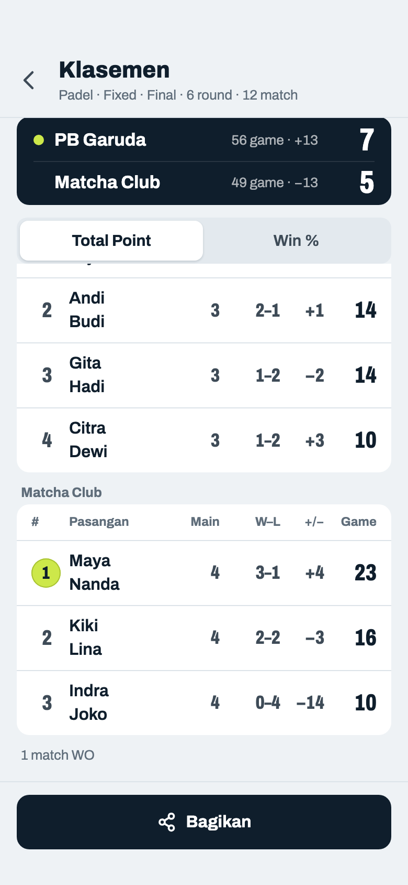

Komponen: `MabarAppBar`, `MabarButton`, `MabarIconButton`, `MabarActionBar`, `MabarGroup / MabarRow`, `MabarSegmented`, `StandingTable`, `ClubScore`

- Final: semua 12 match terisi (atau diakhiri), sama dengan 4.6. PB Garuda 7 – 5 Matcha Club, Total Point 56 – 49, selisih +13 / −13 (AC-S14).
- Digulir sampai bawah; skor klub dan tab metode tetap di atas, tabel PB Garuda bergeser ke bawah app bar.
- PB Garuda: #1 Eko · Fajar 18 (+11) · #2 Andi · Budi 14 (+1) · #3 Gita · Hadi 14 (−2) · #4 Citra · Dewi 10 (+3). Matcha Club: #1 Maya · Nanda 23 (+4, 3 menang termasuk 1 WO) · #2 Kiki · Lina 16 (−3) · #3 Indra · Joko 10 (−14) (13.6, AC-S17).
- Maya · Nanda 23 = 17 game + 6 nilai WO; WO tidak mengubah selisih. Catatan "1 match WO" di bawah tabel terakhir, seperti 09c.

## 13p · Klasemen sparing · Fixed · Final · Win %

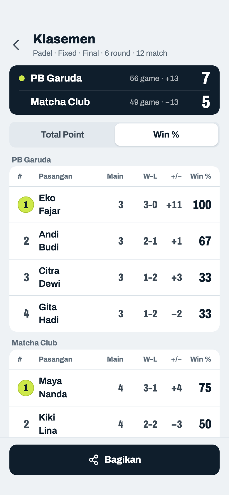

Komponen: `MabarAppBar`, `MabarButton`, `MabarIconButton`, `MabarActionBar`, `MabarGroup / MabarRow`, `MabarSegmented`, `StandingTable`, `ClubScore`

- Ganti metode hanya mengubah urutan dan kolom terakhir tabel; skor klub dan Total Point klub di atas tidak berubah.
- Win % data 13C: PB Garuda #1 Eko · Fajar 100 · #2 Andi · Budi 67 · #3 Citra · Dewi 33 (+3) · #4 Gita · Hadi 33 (−2); Matcha Club #1 Maya · Nanda 75 · #2 Kiki · Lina 50 · #3 Indra · Joko 0 (AC-S17).
- Posisi gulir paling atas (tabel Matcha berlanjut di bawah action bar).

## 13q · Bagikan sparing · Ringkas · podium skor klub

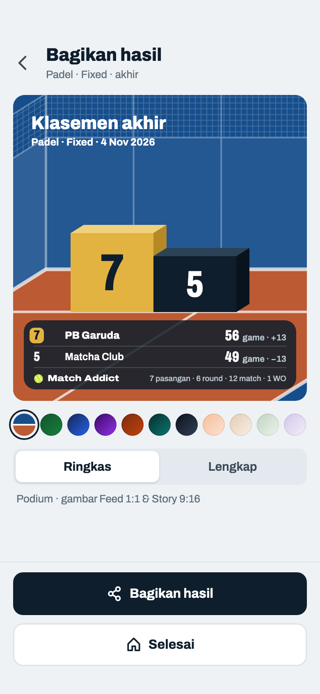

Komponen: `MabarAppBar`, `MabarButton`, `MabarIconButton`, `MabarActionBar`, `MabarGroup / MabarRow`, `MabarSegmented`, `SharePoster`, `PodiumPoster (PodiumScenePainter)`

- Ringkas sparing = podium skor klub (keputusan host 62, 2026-11-12): dua blok, angka di muka blok = skor klub (match menang, seri ½). Tanpa bola dan tanpa daftar pemain; perorangan hanya di Lengkap (13s). Menggantikan "3 teratas tiap klub".
- Klub pertama selalu blok kiri dan baris atas panel (S4). Klub yang unggul (K2: match menang → Total Point klub) emas dan setinggi #1, klub lain setinggi #2. Klub kedua unggul: 18n; Seri: 18o; skor ½: 18p.
- Panel: lencana kiri menulis skor klub tanpa "#", lalu nama klub dan Total Point klub · selisih ("56 game · +13"). Fakta "7 pasangan · 6 round · 12 match · 1 WO"; Mixed sparing menulis "14 pemain".
- Sama untuk Fixed dan Mixed sparing. Tanpa nama turnamen: judul "Klasemen akhir", baris kecil "olahraga · mode · tanggal"; bernama: seperti 11a. Deret tema dan keterangan seperti 11a.
- Caption (Ringkas; Lengkap menambah "Hasil per Round"): `🏆 PB Garuda 7–5 Matcha Club · Padel` `4 November 2026` `Klasemen Akhir · PB Garuda` `1. Eko + Fajar — 18 game · 100.0% (3-0, +11 game)` `2. Andi + Budi — 14 game · 66.7% (2-1, +1 game)` `3. Gita + Hadi — 14 game · 33.3% (1-2, -2 game)` `4. Citra + Dewi — 10 game · 33.3% (1-2, +3 game)` `Klasemen Akhir · Matcha Club` `1. Maya + Nanda — 23 game · 75.0% (3-1, +4 game)` `2. Kiki + Lina — 16 game · 50.0% (2-2, -3 game)` `3. Indra + Joko — 10 game · 0.0% (0-4, -14 game)` `6 round · 12 match · 1 WO · 4 Nov 2026`
- Caption: baris pertama skor klub menggantikan "🏆 {nama} · Padel"; turnamen bernama → nama di baris kedua sebelum tanggal ("Mabar Jumat"). Seri: "🏆 PB Garuda 6½–5½ Matcha Club" atau "… 6–6 … · Seri" kalau Total Point juga sama.

## 13r · Gambar Ringkas (podium) · Fixed sparing · Feed dan Story (skala 1:3)

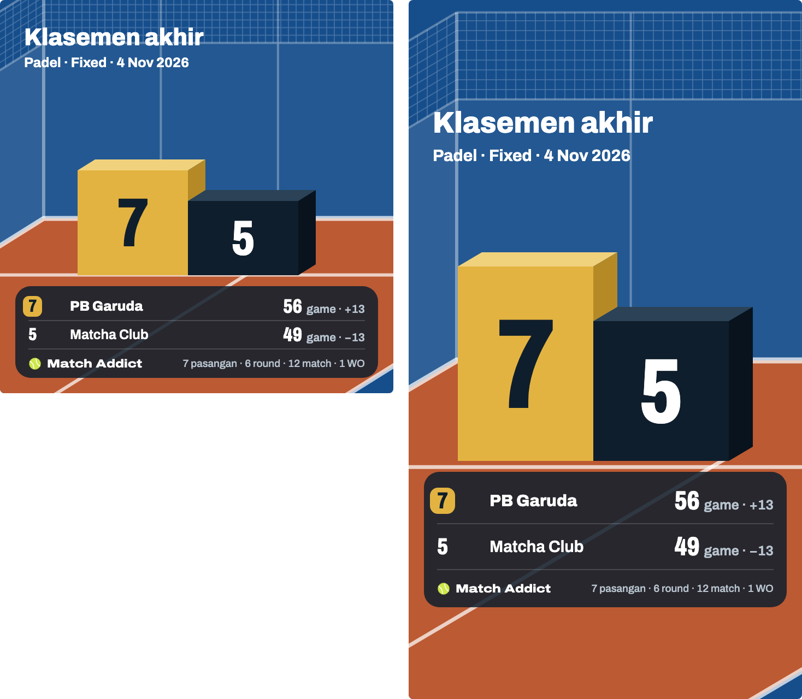

Komponen: `SharePoster`, `PodiumPoster (PodiumScenePainter)`

- Isi sama dengan 13q (data 13C Final, tema lapangan, tanpa nama): PB Garuda 7 – 5 Matcha Club.
- Blok memakai tinggi tunggal dan lebar dua anak tangga: Feed 96 dan 68, lebar 101; Story 178 dan 128, lebar 124. Angka di muka blok 0,656 × tinggi blok.
- Baris panel tunggal (Feed 26, Story 42); lencana skor klub seukuran nomor (16, Story 21).
- Ukuran skor klub dan label klub poster Lengkap (`.pscore`, `.pclub`) tidak berubah: 13t dan Cakupan → "Gambar poster sparing".
- File dan cara berbagi sama dengan 11d.

## 13s · Bagikan sparing · Lengkap · Fixed 4 + 3 pasangan

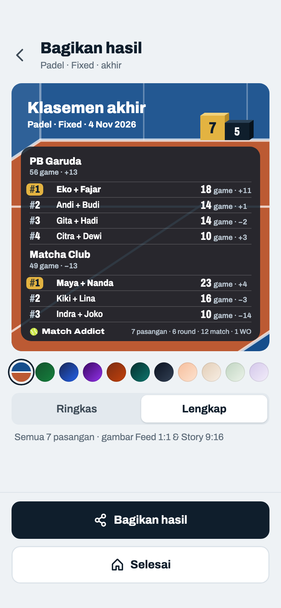

Komponen: `MabarAppBar`, `MabarButton`, `MabarIconButton`, `MabarActionBar`, `MabarGroup / MabarRow`, `MabarSegmented`, `SharePoster`

- Keadaan sama dengan 13q (data 13C Final, tema lapangan bawaan); hanya format diganti ke Lengkap. Lengkap arah B "Podium mini" (keputusan 79) seperti 11b; ukuran di Komponen → `.lk`.
- Podium mini sparing (keputusan 62, 83): dua blok skor klub tanpa bola dan tanpa nama; klub pertama selalu blok kiri. Klub yang unggul (K2: match menang → Total Point klub) emas setinggi #1 (34), klub lain setinggi #2 (24); lebar blok 34 (dua anak tangga), angka 22 / 16. Klub kedua unggul → blok emas di kanan; Seri → dua blok emas setinggi #1 (pola 18n, 18o). Skor 0 – 0 (belum ada match selesai, keputusan 72, 85): lapangan tanpa blok, tanpa frame sendiri.
- Panel per klub: kepala klub `.lclub` = nama klub + Total Point klub · selisih ("56 game · +13"), tanpa angka skor (keputusan 83); lalu pasangan klub itu, nomor mulai 1 di tiap klub, #1 tiap klub lencana emas. Pasangan selalu satu kolom, klub pertama di atas. Feed satu kolom menulis satuan ("18 game · +11").
- Kepadatan (keputusan 80): kepala klub = 2 satuan baris. 7 pasangan + 2 kepala × 2 = 11 satuan; ruang 238 ÷ 11 = 21,6 per baris → s 0,98 (nama 12,5 = batas baris kecil kepala, keputusan 92; nilai 15,7). Kepala klub: nama 800 w95 = ukuran nama × 1,06; baris kedua = ukuran sisa, warna teks kedua.
- Fakta "7 pasangan · 6 round · 12 match · 1 WO" (sama dengan 13q). Keterangan "Semua 7 pasangan" (jumlah kedua klub). Caption seperti 13q, Lengkap menambah "Hasil per Round".

## 13t · Gambar Lengkap · Fixed sparing 4 + 3 pasangan · Feed dan Story (skala 1:3)

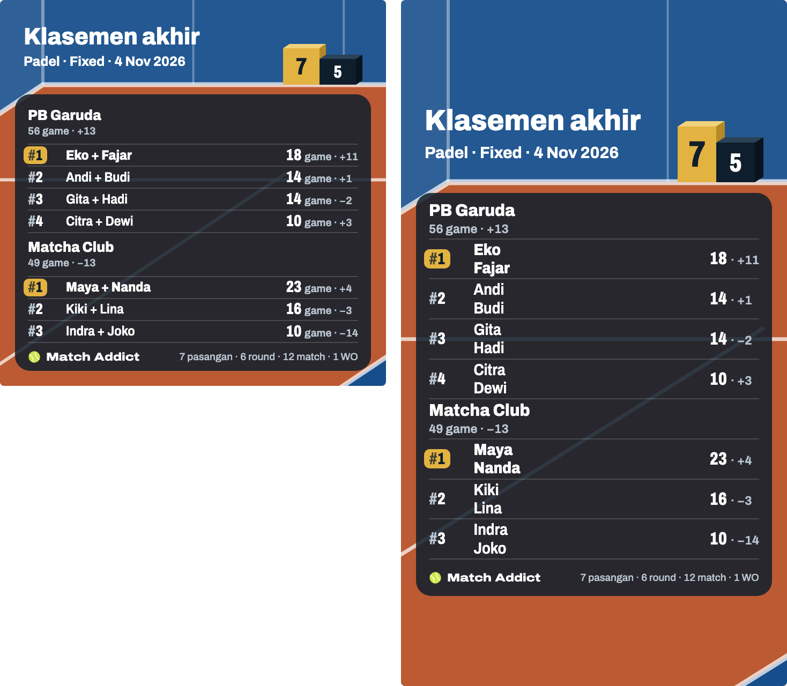

Komponen: `SharePoster`

- Isi sama dengan 13s. Feed: 11 satuan, ruang 226 ÷ 11 = 20,5 → s 0,93 (nama 12,5 = batas baris kecil kepala, keputusan 92; nilai 14,9), satuan ditulis.
- Story: nama pasangan ditumpuk (`.prow.duo`, 2 satuan): 7 × 2 + 2 kepala × 2 = 18 satuan; ruang 336 ÷ 18 = 18,7 → s 1,10 (nama 14,8, nilai 16,5), tanpa satuan ("18 · +11"). Podium mini Story lebar 36, tinggi 52 / 37, angka 34 / 24.
- Kepala, podium, dan panel di luar zona aman Story 250 px (84 pt atas dan bawah).
- File dan cara berbagi sama dengan 11d.

## 13u · Bagikan sparing · Lengkap · Mixed 8 + 6 pemain · tema peach

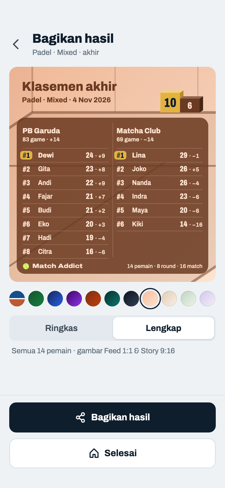

Komponen: `MabarAppBar`, `MabarButton`, `MabarIconButton`, `MabarActionBar`, `MabarGroup / MabarRow`, `MabarSegmented`, `SharePoster`

- Mixed sparing di pratinjau dan Feed selalu dua kolom per klub: kiri klub pertama, kanan klub kedua, tiap kolom diawali kepala klubnya; satu kolom tidak pernah berisi dua klub. Baris kiri dan kanan sejajar; kolom klub yang lebih kecil menyisakan slot kosong di bawah (di sini dua).
- Kepadatan (keputusan 80): satuan per kolom = kepala 2 + pemain klub terbesar = 10; ruang 238 ÷ 10 = 23,8 → batas skala 1,0 (nama 12, nilai 13,5). Dua kolom tanpa satuan ("24 · +9").
- Podium mini 10 – 6: angka "10" dua karakter tetap 22 (lebar 34 cukup), "6" 16. Kepala klub tanpa angka skor (keputusan 83).
- Data 15s: PB Garuda 10 – 6 Matcha Club, Total Point 83 – 69, selisih +14 / −14; Fajar 21 (+7) di atas Budi 21 (+2), Joko 26 (+5) di atas Nanda 26 (−4). Fakta "14 pemain · 8 round · 16 match"; keterangan "Semua 14 pemain".
- Tema peach: kepala, blok, dan panel memakai tinta tema; warna turunan sama dengan 11b.

## 13v · Gambar Lengkap · Mixed sparing 8 + 6 pemain · Feed dan Story (skala 1:3)

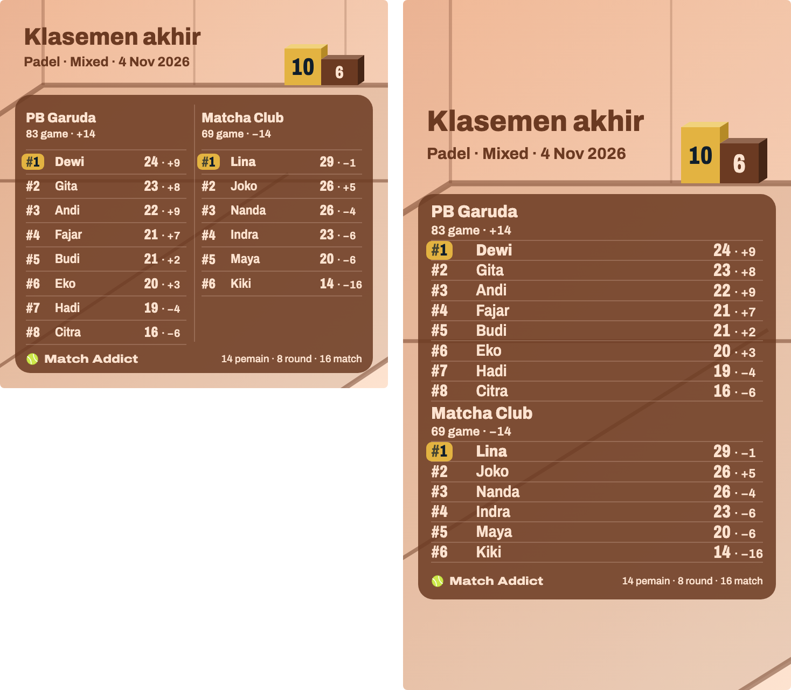

Komponen: `SharePoster`

- Feed: dua kolom per klub seperti 13u; ruang 226 ÷ 10 = 22,6 → s 1,0.
- Story: 14 pemain ≤ 20 → satu kolom (keputusan 81): klub pertama lalu klub kedua, masing-masing diawali kepala klub. 14 + 2 kepala × 2 = 18 satuan; ruang 336 ÷ 18 = 18,7 → s 1,10 (nama 14,8, nilai 16,5).
- Podium mini Story: angka "10" = 23 (dibatasi lebar blok 36), "6" = 24 (dibatasi tinggi 37).
- File dan cara berbagi sama dengan 11d.

## 13w · Gambar Lengkap · Mixed sparing 16 + 14 pemain · Feed, Story (skala 1:3) dan pratinjau

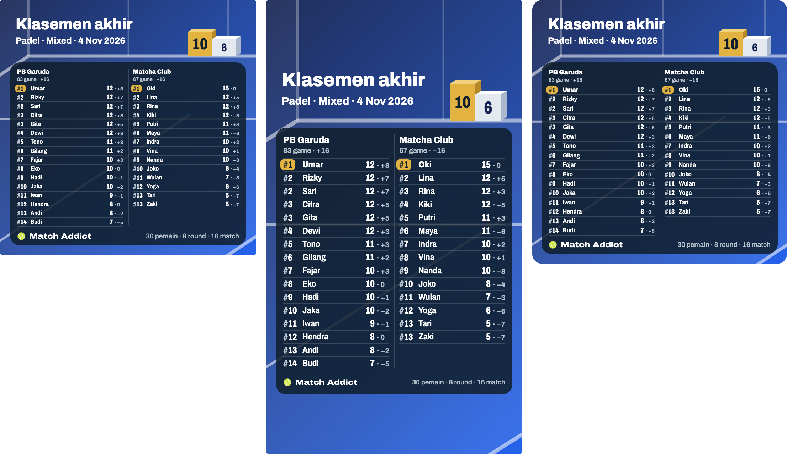

Komponen: `SharePoster`

- Terpadat: PB Garuda 16 + Matcha Club 14 = 30 pemain, lanjutan 15d sampai R8 (2 court, waktu habis), 8 round · 16 match, tiap Garuda main 2, Matcha 2–3. Susunan = generator (`SparingMixed.generateRound`, `Random(1)`, seed 0x5eed, id g01–g16 / m01–m14 urut daftar 04e). Skor contoh designer, R1–R3 cocok dengan 15d (28 – 20, 4 – 1): R1 6–3, 4–6 · R2 6–4, 6–2 · R3 6–5, 3–6 · R4 6–2, 5–6 · R5 6–4, 6–1 · R6 2–6, 6–3 · R7 6–4, 4–6 · R8 6–3, 5–6. Klasemen dari `RankingCalculator` + `standingEntries`: PB Garuda 10 – 6, Total Point 83 – 67, selisih +16 / −16.
- Feed dan pratinjau: dua kolom per klub, satuan per kolom = kepala 2 + 16 = 18. Feed 226 ÷ 18 = 12,6 → s 0,70 (nama 8,4, nilai 9,4, sisa 7,0); pratinjau 238 ÷ 18 = 13,2 → s 0,73 (nama 8,8). Kolom Matcha Club menyisakan dua slot kosong.
- Story: 30 pemain > 20 → dua kolom (keputusan 81), dibagi per klub seperti Feed, bukan ⌈n/2⌉. 336 ÷ 18 = 18,7 → batas skala Story dua kolom 1,0 (nama 12, nilai 13,5).
- Poin dan selisih sama → nomor sama, nomor berikutnya melanjutkan: Rizky, Sari #2 · Citra, Gita #3 · Tari, Zaki #13.
- Tema biru (gradien gelap): blok klub lain terang dengan angka warna awal gradien, panel tinta; warna sama dengan podium gradien gelap (18*).
