# Sparing · Fixed

> Dihasilkan `tool/hifi_extract.py` dari `design/hifi.html`. Jangan diedit langsung.

Alur Fixed sparing di HP host, setelah layar inti 13a–13q. Contoh tetap PB Garuda 8 (4 pasangan) vs Matcha Club 6 (3 pasangan), Padel, Race to 6, 15 mnt, 2 court × 2 jam; jadwal = susunan generator (R1 G1–M1, G2–M2 · R2 G3–M3, G4–M1 · R3 G1–M2, G2–M3 · R4 G3–M1, G4–M2 · R5 G1–M3, G2–M1 · R6 G3–M2, G4–M3), skor = contoh 13C (WO di R3). Ukuran lain (8 / 4 di 3 court, 16 / 14 di 4 court, round tambahan R7–R12) juga dari generator.

## 14a · Pasangan sparing · Acak

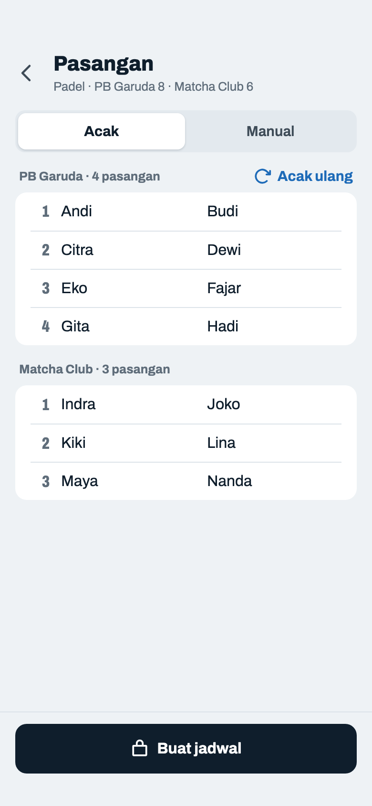

Komponen: `MabarAppBar`, `MabarButton`, `MabarTextButton`, `MabarIconButton`, `MabarActionBar`, `MabarGroup / MabarRow`, `MabarGroupHeader`, `MabarSegmented`, `PairList`

- Pasangan diacak di dalam klub masing-masing (S2); satu daftar per klub, klub pertama di atas, nomor mulai 1 di tiap klub. Label daftar = nama klub · jumlah pasangan.
- "Acak ulang" (satu untuk kedua klub) mengacak ulang keduanya. Di frame ini hasil acaknya sama dengan G1–G4 / M1–M3 contoh 13A supaya jadwal di frame berikutnya cocok.
- Buat jadwal → dialog 14d → Jadwal Fixed sparing (13k): p1 × p2 = 12 match, 6 round.

## 14b · Pasangan sparing · Manual · sedang memilih

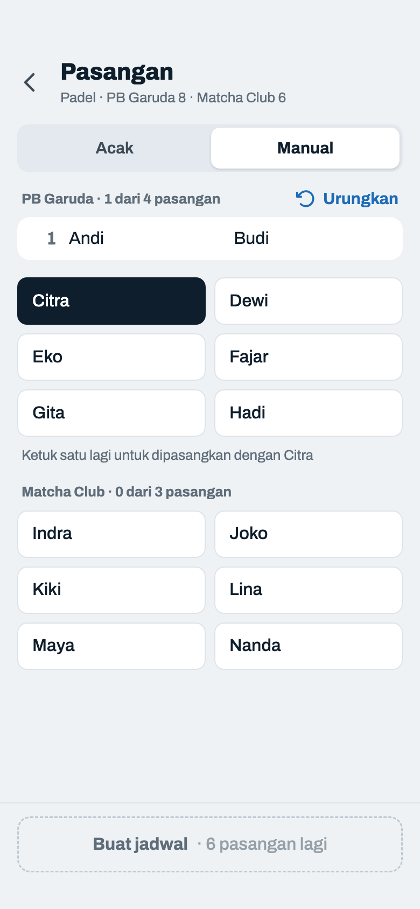

Komponen: `MabarAppBar`, `MabarButton`, `MabarTextButton`, `MabarIconButton`, `MabarActionBar`, `MabarGroup / MabarRow`, `MabarGroupHeader`, `MabarSegmented`, `PairList`, `MabarChip`

- Chip per klub, di bawah daftar pasangan klubnya (sama dengan 04b, tanpa label "belum berpasangan" terpisah: chip yang tersisa memang belum berpasangan). Pasangan yang jadi pindah ke daftar klubnya.
- Pasangan hanya dari sesama klub (AC-S4): Citra terpilih lalu mengetuk Indra tidak membentuk pasangan; pilihan pindah ke Indra dan catatan pindah ke bawah chip Matcha Club ("… dengan Indra"). Chip klub lain tidak dipudarkan, karena tetap bisa diketuk untuk memulai pilihan baru.
- Urungkan (satu, untuk kedua klub) melepas pasangan terakhir dan pilihan yang menggantung. Tombol menghitung pasangan yang belum jadi di kedua klub (3 + 3).

## 14c · Pasangan sparing · pemain ganjil di dua klub

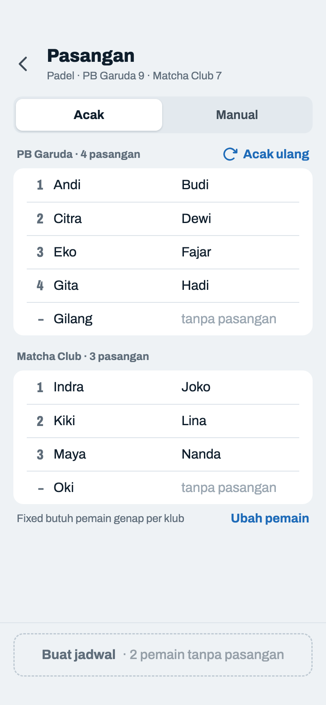

Komponen: `MabarAppBar`, `MabarButton`, `MabarTextButton`, `MabarIconButton`, `MabarActionBar`, `MabarGroup / MabarRow`, `MabarGroupHeader`, `MabarSegmented`, `PairList`

- Garuda 9 → 4 pasangan + Gilang; Matcha 7 → 3 pasangan + Oki (AC-S3). Sisa ditulis di klubnya sendiri (baris "–"); dua sisa beda klub tidak pernah dipasangkan, jadi paling banyak dua sisa.
- Perilaku tombol mengikuti Fixed biasa (04c, disetujui): Buat jadwal menunggu sampai jumlah pemain tiap klub genap, alasannya di tombol; "Ubah pemain" → layar Pemain dengan dua blok tetap terisi. Keputusan host 2026-11-04 (PRD K12).
- Hanya satu klub ganjil → satu baris sisa dan "· 1 pemain tanpa pasangan".

## 14d · Dialog · buat jadwal sparing

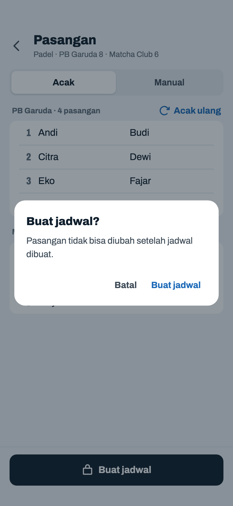

Komponen: `MabarAppBar`, `MabarButton`, `MabarTextButton`, `MabarIconButton`, `MabarActionBar`, `MabarGroup / MabarRow`, `MabarGroupHeader`, `MabarSegmented`, `PairList`, `showMabarSheet`, `showMabarConfirm`

- Latar = 14a. Dialog sama dengan 04d; tidak menyebut klub karena tidak ada akibat khusus sparing.

## 14e · Pasangan sparing · Manual · 30 pemain (terpadat)

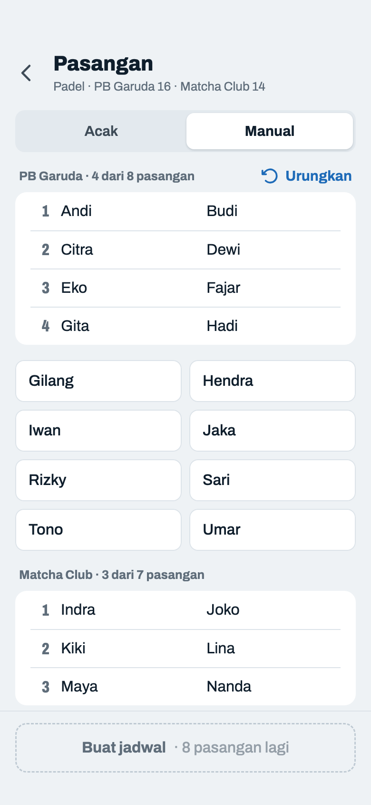

Komponen: `MabarAppBar`, `MabarButton`, `MabarTextButton`, `MabarIconButton`, `MabarActionBar`, `MabarGroup / MabarRow`, `MabarGroupHeader`, `MabarSegmented`, `PairList`, `MabarChip`

- Terpadat: 16 + 14 = 30 pemain (8 + 7 pasangan), setengah jalan. Halaman di-scroll seperti 04e; app bar dan action bar tetap. Frame di posisi gulir paling atas.
- Tanpa pilihan menggantung, catatan "Ketuk dua pemain satu klub…" ada di bawah chip klub terakhir; dengan pilihan, catatan pindah ke bawah chip klub pemain yang dipilih (14b).

## 14f · Atur turnamen · Fixed sparing lebih panjang dari booking

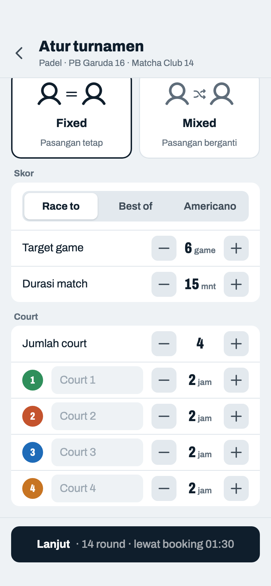

Komponen: `MabarAppBar`, `MabarButton`, `MabarIconButton`, `MabarActionBar`, `MabarGroup / MabarRow`, `MabarSegmented`, `MabarStepper`, `MabarField`, `ModePicker`, `CourtColorPicker`

- 16 / 14 pemain = 8 × 7 pasangan = 56 match, court aktif min(4, 8, 7) = 4, round = ⌈56 ÷ 4⌉ = 14 (generator). 14 round × 15 mnt = 3 j 30 m, booking terpendek 2 jam → lewat 01:30.
- Tidak mematikan tombol: jadwal Fixed sparing dibuat utuh dan host menghentikannya lewat Akhiri (match sisa "Tidak dimainkan"), sama dengan round tambahan yang lewat booking (06y). Format lewat booking jam:menit seperti 06y.
- Empat court: isi lebih panjang dari layar, frame digulir sampai bawah (seperti 03b).
- Kalau lewat booking, tombol hanya menulis round + kelebihannya: "Lanjut · 14 round · lewat booking 01:30" (284 pt, muat juga di HP 360 dp). Jumlah match dan court tidak ditulis; keduanya terlihat di Jadwal (keputusan host 2026-11-04, PRD K10). "Booking terpendek" = di antara court aktif; court yang tidak dapat match tidak membatasi jadwal.

## 14g · Atur turnamen · Fixed sparing · court lebih dari yang terpakai

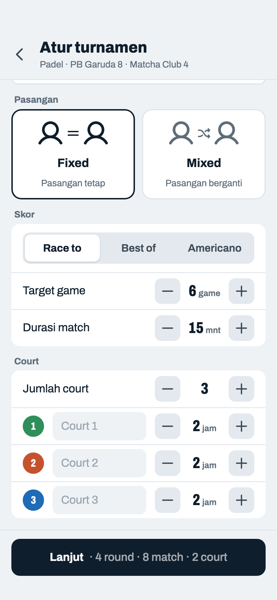

Komponen: `MabarAppBar`, `MabarButton`, `MabarIconButton`, `MabarActionBar`, `MabarGroup / MabarRow`, `MabarSegmented`, `MabarStepper`, `MabarField`, `ModePicker`, `CourtColorPicker`

- 8 / 4 pemain = 4 × 2 pasangan: court aktif min(3, 4, 2) = 2, 8 match, 4 round (AC-S6). Court 3 tidak pernah dapat match; tombol menulis "· 2 court", tanpa catatan di grup Court (sama dengan 13j).
- Court 3 tetap boleh dipesan (dan tetap ada di Tambah round), hanya tidak tampil di Jadwal (14m).

## 14h · Jadwal Fixed sparing · membuka round yang belum terbuka

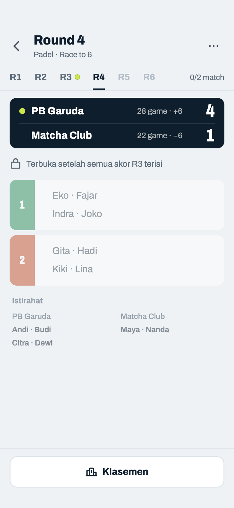

Komponen: `MabarAppBar`, `MabarButton`, `MabarIconButton`, `MabarActionBar`, `MabarGroup / MabarRow`, `MabarGroupHeader`, `RoundTabs`, `MatchScoreRow`, `RestingList`

- R3 sedang berjalan (Andi · Budi 6–4 Kiki · Lina sudah, Citra · Dewi vs Maya · Nanda belum); host membuka tab R4. Sama dengan 06b: gembok + baris pudar, tidak bisa diketuk, tanpa hitung mundur.
- Skor klub selalu menghitung semua match yang sudah terisi, bukan round yang dibuka: 4 – 1 (R1–R2 + satu match R3), Total Point 28 – 22.
- Lawan R4 (Eko · Fajar vs Indra · Joko, Gita · Hadi vs Kiki · Lina) dan Istirahat R4 dari generator.

## 14i · Jadwal Fixed sparing · round lewat dengan WO

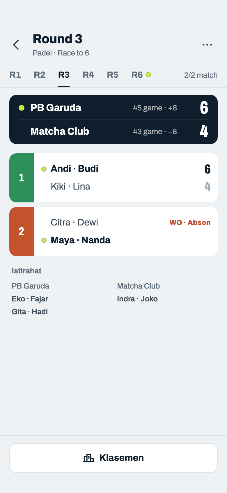

Komponen: `MabarAppBar`, `MabarButton`, `MabarIconButton`, `MabarActionBar`, `MabarGroup / MabarRow`, `MabarGroupHeader`, `RoundTabs`, `MatchScoreRow`, `RestingList`

- Keadaan 13k (R6 berjalan), host membuka tab R3. Round lewat: strip tanpa hitung mundur (06t).
- WO: Citra · Dewi absen → tetap di baris atas karena klubnya PB Garuda (S4); tag "WO · Absen" di baris mereka, bola pemenang di baris bawah (Maya · Nanda). Matcha Club +1 menang dan Maya · Nanda +6 game, selisih tidak berubah (AC-S15).
- Ketuk baris WO → Input Skor dengan sheet WO terisi (14r).

## 14j · Menu ⋯ · Fixed sparing

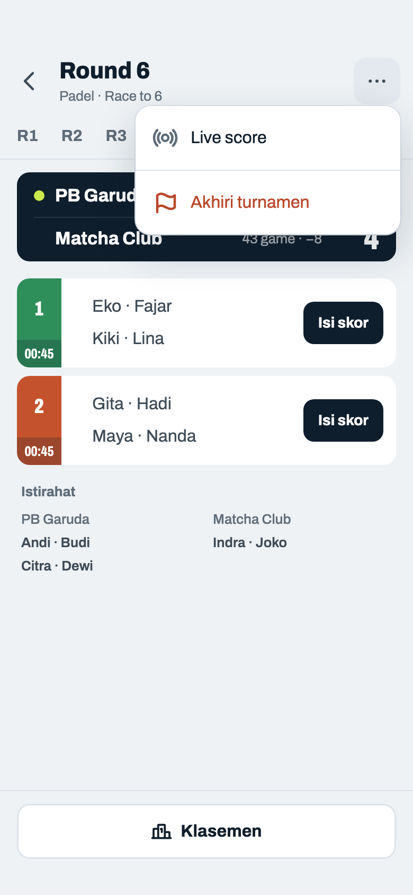

Komponen: `MabarAppBar`, `MabarButton`, `MabarIconButton`, `MabarActionBar`, `MabarGroup / MabarRow`, `MabarGroupHeader`, `RoundTabs`, `MatchScoreRow`, `RestingList`, `MabarMenu`

- Latar = 13k. Isi menu sama dengan Fixed biasa (06d): Live score, lalu Akhiri turnamen. Tidak ada item khusus sparing.

## 14k · Dialog · akhiri turnamen sparing

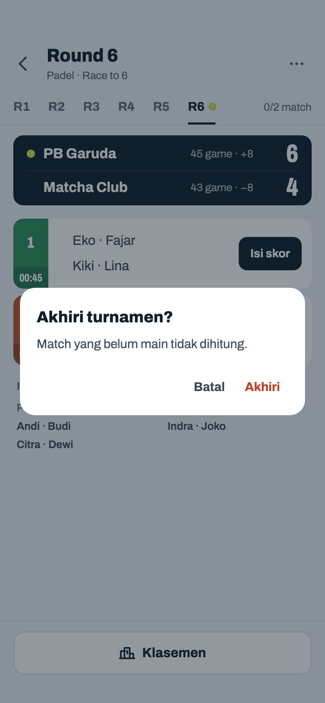

Komponen: `MabarAppBar`, `MabarButton`, `MabarTextButton`, `MabarIconButton`, `MabarActionBar`, `MabarGroup / MabarRow`, `MabarGroupHeader`, `RoundTabs`, `MatchScoreRow`, `RestingList`, `showMabarSheet`, `showMabarConfirm`

- Latar = 13k. Dialog sama dengan 06e: skor klub saat itu (6 – 4) jadi skor akhir, tanpa kalimat tambahan.

## 14l · Jadwal Fixed sparing · diakhiri

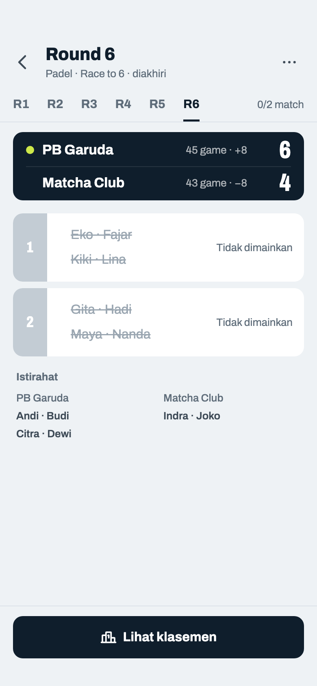

Komponen: `MabarAppBar`, `MabarButton`, `MabarIconButton`, `MabarActionBar`, `MabarGroup / MabarRow`, `MabarGroupHeader`, `RoundTabs`, `MatchScoreRow`, `RestingList`

- Diakhiri saat R6 (14k): dua match R6 "Tidak dimainkan", tanpa titik live dan hitung mundur, Lihat klasemen jadi tombol utama (06c). Fixed yang diakhiri tidak bisa dilanjutkan.
- Skor klub final 6 – 4, Total Point 45 – 43: Klasemen menulis "Final · 5 round · 10 match" dengan angka 13n. Bola tetap di klub yang unggul.
- Menu ⋯ tinggal Live score (12f).

## 14m · Jadwal Fixed sparing · Court 3 tanpa match

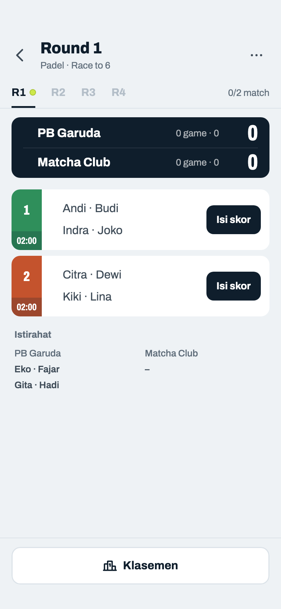

Komponen: `MabarAppBar`, `MabarButton`, `MabarIconButton`, `MabarActionBar`, `MabarGroup / MabarRow`, `MabarGroupHeader`, `RoundTabs`, `MatchScoreRow`, `RestingList`

- Konfigurasi 14g: 8 / 4 pemain, 3 court. Court aktif 2, jadi tiap round dua match di Court 1 dan 2; Court 3 tidak tampil di Jadwal sama sekali (tanpa baris kosong), di round mana pun (AC-S6). Jadwal generator: R1 G1–M1, G2–M2 · R2 G3–M1, G4–M2 · R3 G1–M2, G2–M1 · R4 G3–M2, G4–M1.
- Matcha Club hanya 2 pasangan dan keduanya main tiap round: kolom istirahatnya "–" (Garuda 2 match per pasangan, Matcha 4, K1).
- Sebelum ada match selesai skor klub 0 – 0 tanpa bola: bola baru muncul setelah ada hasil.

## 14n · Sheet · tambah round sparing

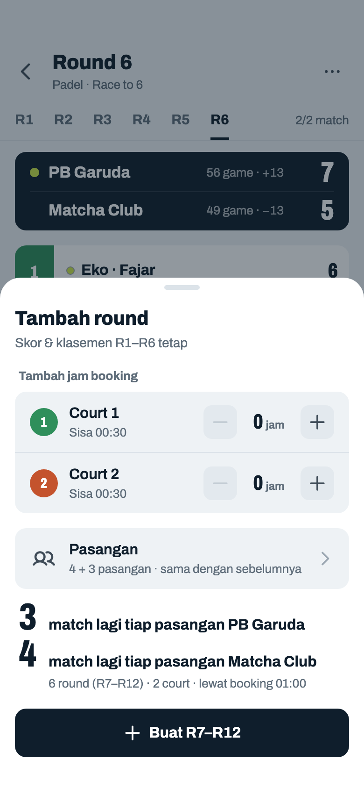

Komponen: `MabarAppBar`, `MabarButton`, `MabarIconButton`, `MabarActionBar`, `MabarGroup / MabarRow`, `MabarGroupHeader`, `MabarStepper`, `RoundTabs`, `MatchScoreRow`, `RestingList`, `showMabarSheet`, `CourtColorPicker`

- Latar = 13l. Satuan round tambahan = KPK(4, 3) = 12 match, supaya tiap pasangan satu klub dapat tambahan sama (K5): PB Garuda +3 tiap pasangan, Matcha Club +4. Sisa 00:30 = 2 round muat; satu satuan = 6 round (R7–R12), dibulatkan ke atas → "lewat booking 01:00" = (6 − 2) × 15 mnt (AC-S18).
- Ringkasan = pola 06w diulang per klub, klub pertama di atas: angka besar + "match lagi tiap pasangan PB Garuda" / "… Matcha Club" di satu baseline, karena tambahan per pasangan beda antar klub (K1). Baris rincian round · court · lewat booking ditulis sekali, sejajar label, di bawah klub terakhir. Klub dengan jumlah pasangan sama → satu baris tanpa nama klub, persis 06w.
- Jam ditambah → satuan bertambah kalau round yang muat melewati satuan pertama (6 round); 1 jam di kedua court = 6 round muat → tetap 1 satuan, tanpa "lewat booking".
- Lawan melanjutkan urutan jadwal awal (generator): R7 Andi · Budi vs Kiki · Lina, Citra · Dewi vs Maya · Nanda; R8 Eko · Fajar vs Indra · Joko, Gita · Hadi vs Kiki · Lina; … sesama klub tetap tidak pernah bertemu.
- Baris Pasangan → Atur pasangan per klub (14o). "4 + 3 pasangan" = PB Garuda + Matcha Club.

## 14o · Atur pasangan sparing · pengganti di satu klub

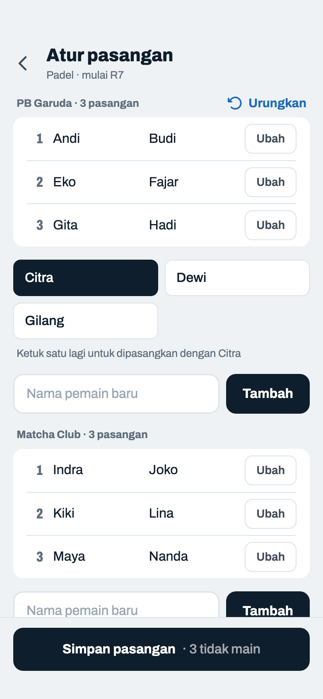

Komponen: `MabarAppBar`, `MabarButton`, `MabarTextButton`, `MabarIconButton`, `MabarRowAction`, `MabarActionBar`, `MabarGroup / MabarRow`, `MabarGroupHeader`, `MabarField`, `PairList`, `MabarChip`

- Dibuka dari baris Pasangan di 14n. Dewi pulang setelah R6, Gilang datang: Citra · Dewi diketuk "Ubah" (keduanya jadi chip PB Garuda), Gilang diketik di kotak PB Garuda + Tambah. Ketuk Citra lalu Gilang → Citra · Gilang mengisi tempat pasangan yang dipisah (G2), jadi lawan pasangan lain di R7–R12 tetap.
- Satu bagian per klub: daftar pasangan (Ubah), chip yang belum berpasangan, lalu kotak pemain baru. Pemain baru masuk klub bagian tempat ia diketik; tidak bisa pindah klub (K8). Pasangan hanya dari chip klub yang sama, sama dengan 14b.
- Urutan bagian: chip di atas kotak pemain baru, karena chip yang sedang dipasangkan lebih sering disentuh; tanpa chip, kotak langsung di bawah daftar. Nama baru tidak boleh sama dengan pemain mana pun di kedua klub; batas total 30.
- Jumlah pasangan klub boleh berubah; satuan round tambahan dihitung ulang dari jumlah baru (13.7). Tombol mati "· minimal 1 pasangan tiap klub" kalau satu klub tanpa pasangan.
- Bagian Matcha Club di bawah (digulir): di contoh 14p Nanda juga pulang dan Oki menggantikannya (Maya · Oki).

## 14p · Klasemen sparing · pasangan diatur ulang · pengganti belum main

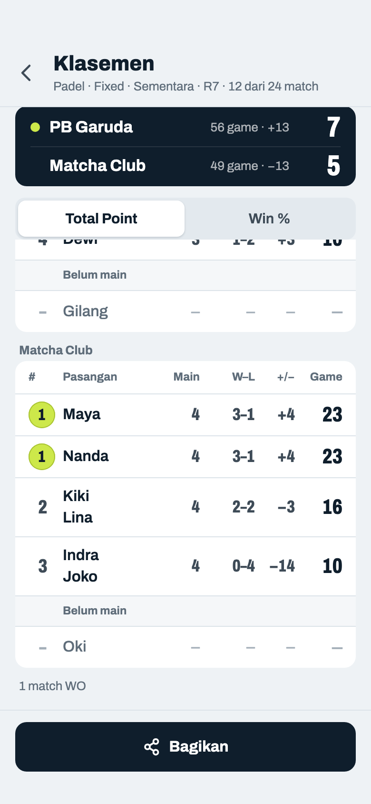

Komponen: `MabarAppBar`, `MabarButton`, `MabarIconButton`, `MabarActionBar`, `MabarGroup / MabarRow`, `MabarSegmented`, `StandingTable`

- Setelah Atur pasangan (14o) dan "Buat R7–R12", sebelum R7 diisi: PB Garuda Citra · Gilang menggantikan Citra · Dewi, Matcha Club Maya · Oki menggantikan Maya · Nanda. Status kembali Sementara, 12 dari 24 match.
- Klasemen campuran per klub, aturan 09g: pasangan yang selalu main bersama satu baris (dua nama), yang pasangannya berubah atau pulang tampil per pemain dengan angkanya sendiri. Citra dan Dewi sama 10 (+3) → nomor sama #4; Maya dan Nanda 23 (+4) → #1 berdua, dua-duanya berbola.
- "Belum main" per klub, di dalam tabel klubnya: pemain pengganti (Gilang, Oki) sampai match pertamanya terisi. Dewi dan Nanda yang pulang tetap tampil tanpa tanda.
- Skor klub tidak berubah oleh pergantian pasangan: 7 – 5 dari 12 match yang sudah terisi.
- Digulir sampai bawah: baris pasangan PB Garuda di atas tergulir ke bawah app bar; skor klub dan tab metode tetap.

## 14s · Klasemen sparing · klub kedua unggul

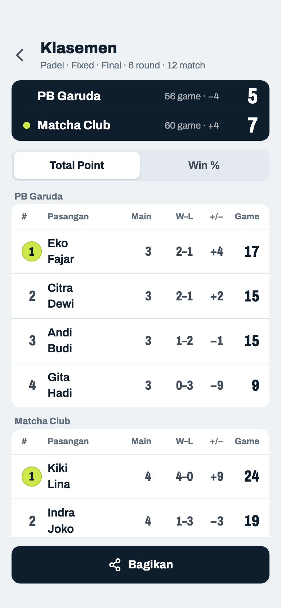

Komponen: `MabarAppBar`, `MabarButton`, `MabarIconButton`, `MabarActionBar`, `MabarGroup / MabarRow`, `MabarSegmented`, `StandingTable`

- Jadwal generator yang sama dengan skor lain (contoh designer, Race to 6): R1 6–4, 3–6 · R2 6–2, 4–6 · R3 5–6, 6–3 · R4 6–5, 2–6 · R5 4–6, 6–4 · R6 5–6, 3–6 (skor klub pertama dulu). Matcha Club 7 – 5, Total Point 56 – 60.
- Klub kedua yang unggul tetap di baris bawah (urutan sisi tidak pernah berubah, S4); bola pindah ke barisnya. Tabel tetap PB Garuda dulu.
- Matcha Club: Indra · Joko 19 game dari 1 menang di atas Maya · Nanda 17 dari 2 menang: Total Point memang mengurutkan dari game, Win % membaliknya.

## 14t · Klasemen sparing · Seri

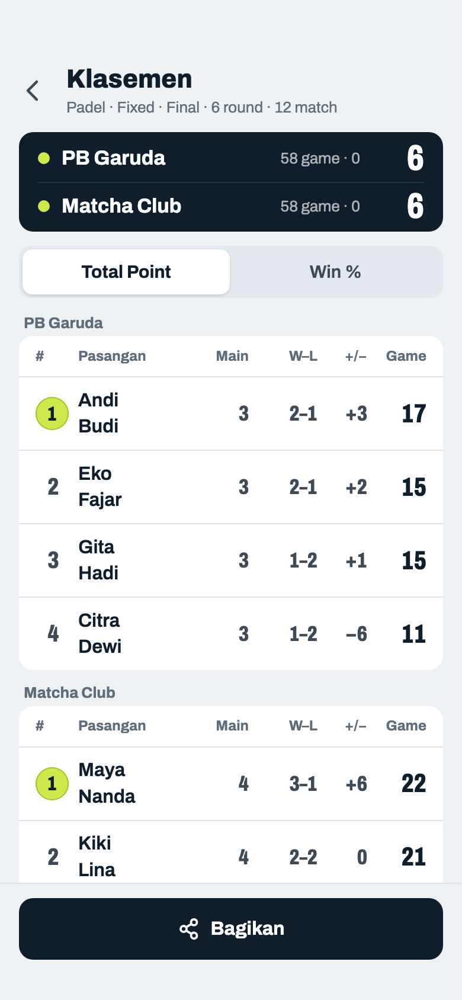

Komponen: `MabarAppBar`, `MabarButton`, `MabarIconButton`, `MabarActionBar`, `MabarGroup / MabarRow`, `MabarSegmented`, `StandingTable`

- Match menang 6 – 6 dan Total Point 58 – 58 → Seri (K2). Bola di kedua baris, sama dengan dua peringkat 1 yang bernomor sama di tabel. Kata "Seri" tidak ditulis di papan; subjudul tetap status turnamen.
- Match menang sama tapi Total Point beda (mis. 6 – 6, 50 – 48) → klub dengan Total Point lebih besar yang berbola, angkanya tetap 6 – 6.
- Skor contoh designer di jadwal generator: R1 6–4, 6–5 · R2 3–6, 6–2 · R3 5–6, 2–6 · R4 6–3, 4–6 · R5 6–4, 3–6 · R6 6–4, 5–6.
- Caption Seri: "🏆 PB Garuda 6–6 Matcha Club · Seri · Padel" (usulan; Bagikan tidak digambar di putaran ini).

## 14u · Klasemen sparing · match seri · 6½–5½

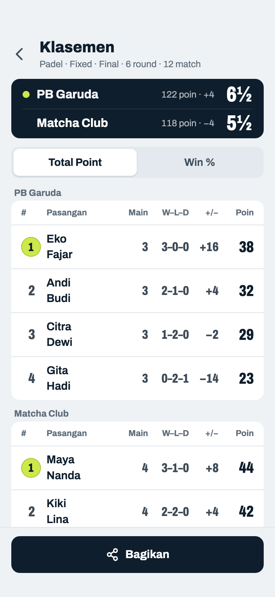

Komponen: `MabarAppBar`, `MabarButton`, `MabarIconButton`, `MabarActionBar`, `MabarGroup / MabarRow`, `MabarSegmented`, `StandingTable`

- Americano 20 (total genap, bisa seri): Gita · Hadi 10–10 Indra · Joko di R2 memberi ½ ke tiap klub → 6½ – 5½ (AC-S16). Kolom W–L–D karena formatnya bisa seri; satuan poin.
- Setengah ditulis dengan "½" di angka yang sama (bukan 6,5), lebar kolom angka tetap.
- Skor contoh designer: R1 12–8, 9–11 · R2 13–7, 10–10 · R3 11–9, 8–12 · R4 14–6, 7–13 · R5 9–11, 12–8 · R6 11–9, 6–14.

## 14q · Input Skor · Fixed sparing

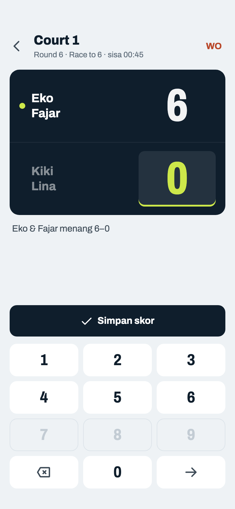

Komponen: `MabarAppBar`, `MabarButton`, `MabarTextButton`, `MabarIconButton`, `ScoreBoard / ScoreKeypad`

- Dari 13k, Court 1 R6. Papan sama dengan 07b: pasangan klub pertama selalu baris atas papan (S4), tanpa label klub, karena urutannya sama dengan baris Jadwal yang diketuk.
- Simpan → Jadwal (13l setelah Court 2 juga diisi); skor klub dan Total Point klub dihitung ulang langsung.

## 14r · Sheet · walkover sparing

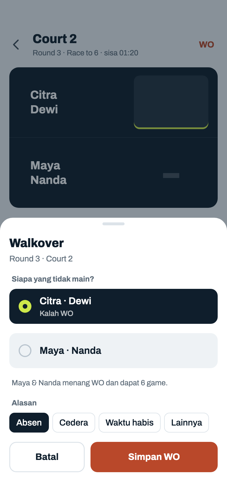

Komponen: `MabarAppBar`, `MabarButton`, `MabarTextButton`, `MabarIconButton`, `MabarGroup / MabarRow`, `MabarChip`, `ScoreBoard / ScoreKeypad`, `showMabarSheet`

- Saat R3 berjalan, Court 2 (Citra · Dewi vs Maya · Nanda, belum diisi), WO → sheet. Sama dengan 07j; urutan pilihan = urutan papan (klub pertama dulu).
- Race to 6: pemenang WO dapat 6 game; klub lawan dari pasangan WO dapat 1 menang, Total Point klubnya +6, selisih kedua klub tidak berubah (13.5, AC-S15). Hasilnya di Jadwal: 14i.

## 14v · Detail pasangan · klub pertama

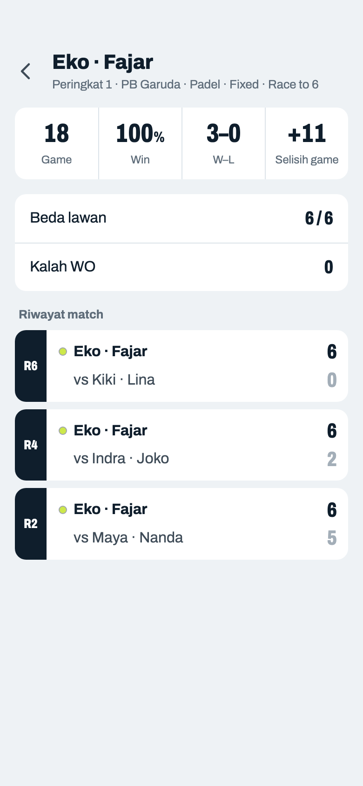

Komponen: `MabarAppBar`, `MabarIconButton`, `MabarGroup / MabarRow`, `MatchScoreRow`, `StatLine`

- Dari baris Klasemen 13o. Subjudul: peringkat di klubnya · nama klub · olahraga · mode · format (keputusan host 2026-11-04). Peringkat 1 = #1 PB Garuda, bukan peringkat gabungan.
- Beda lawan dihitung dari pemain klub lain saja (6 pemain Matcha Club), karena sesama klub tidak pernah jadi lawan: 6 / 6. "Beda partner" tetap disembunyikan selama pasangannya tidak berubah (10b).
- Riwayat terbaru di atas; baris atas = pasangan ini (tim sendiri), sama dengan 10b.

## 14w · Detail pasangan · klub kedua

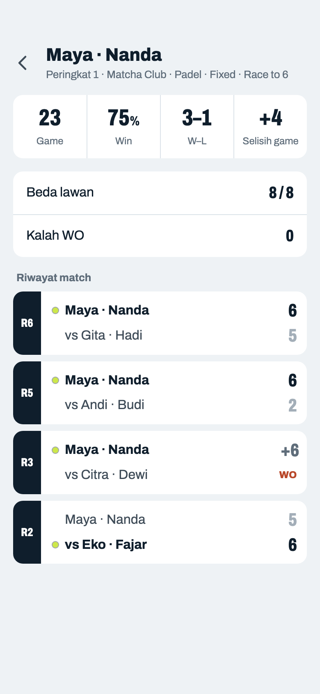

Komponen: `MabarAppBar`, `MabarIconButton`, `MabarGroup / MabarRow`, `MatchScoreRow`, `StatLine`

- Klub kedua: di riwayat pasangan ini tetap baris atas walau di Jadwal mereka baris bawah (keputusan host 2026-11-04): Detail dibaca dari sudut pasangan itu, klubnya ada di subjudul.
- Menang WO R3 menulis "+6" pudar, jadi jumlah riwayat cocok: 6 + 6 + 6 + 5 = 23 (10b). Selisih +4 tanpa WO.
- Beda lawan dari 8 pemain PB Garuda: 8 / 8.

## 14x · Beranda · turnamen sparing berjalan

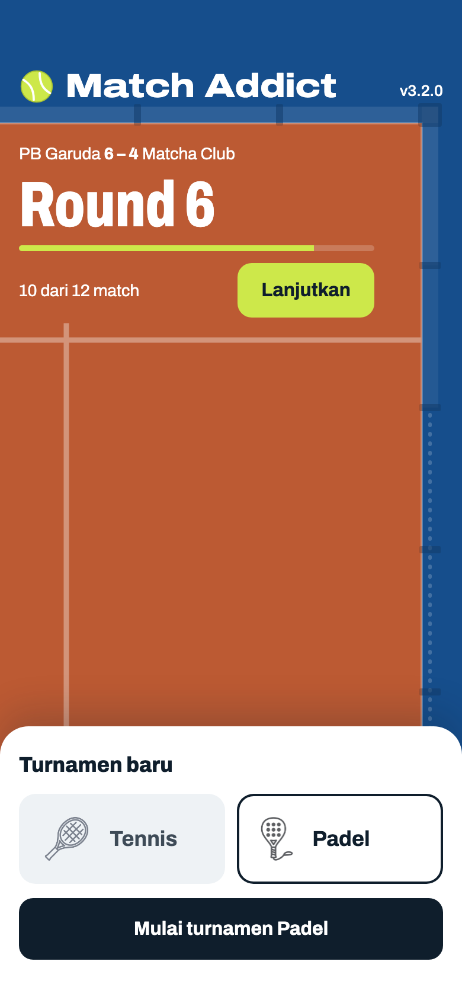

Komponen: `MabarButton`, `CourtBanner (CourtPainter)`, `HomePanel / SportPicker`

- Turnamen sparing tanpa nama: baris kecil di atas round = "klub pertama · skor klub · klub kedua" ("PB Garuda 6 – 4 Matcha Club"), menggantikan "olahraga · mode · n pemain"; skornya menggantikan "vs" (13.7), angka tebal. Sebelum ada hasil: "PB Garuda 0 – 0 Matcha Club". Satu baris, elipsis per nama klub kalau tidak muat.
- Info round sama dengan 01e: round = round pertama yang masih ada match kosong (R6), "10 dari 12 match", Lanjutkan → Jadwal (13k).
- Sparing bernama: nama turnamen tetap di baris kecil, skor klub di baris sendiri di bawahnya (belum digambar). Banner mengikuti olahraga turnamen (padel).

## 14y · Dialog · mulai turnamen baru saat sparing berjalan

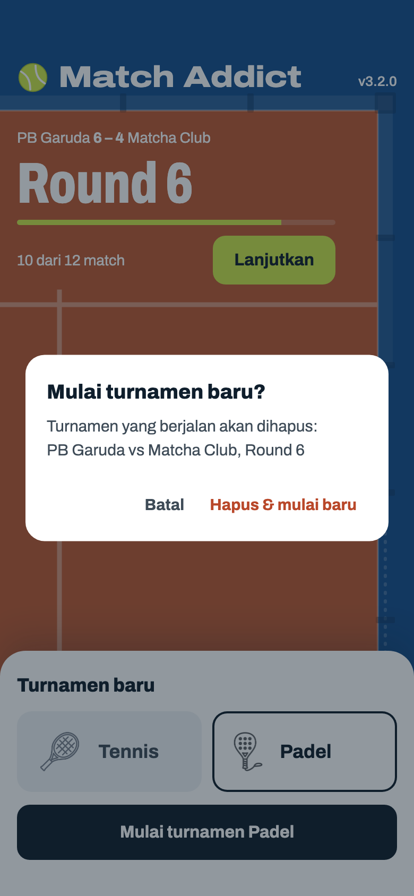

Komponen: `MabarButton`, `MabarTextButton`, `showMabarSheet`, `showMabarConfirm`, `CourtBanner (CourtPainter)`, `HomePanel / SportPicker`

- Latar = 14x. Dialog sama dengan 01h; turnamennya disebut "PB Garuda vs Matcha Club, Round 6" (tanpa skor: yang dihapus turnamennya).
