# Sparing · Mixed

> Dihasilkan `tool/hifi_extract.py` dari `design/hifi.html`. Jangan diedit langsung.

Alur Mixed sparing di HP host. Contoh 13B: PB Garuda 8 vs Matcha Club 6, Padel, Race to 6, 15 mnt, 2 court × 2 jam (19.00–21.00). Tiap round 4 Garuda + 4 Matcha main; susunan pasangan, yang istirahat, dan daftar prioritas = hasil generator (prioritas per klub). Skor contoh designer; skor klub dan klasemen dihitung dari skor itu. Data untuk fixture golden: semua susunan dari `tool/sparing_proto/lib/sparing_mixed.dart` (`SparingMixed.generateRound`, `courtUseNow`, `clubOrder`). Undian dipanggil langsung dengan `seed: 0x5eed` (nilai `drawSeed` itu sendiri, bukan FNV-1a dari id turnamen; fixture perlu id yang menghasilkan seed ini atau meng-override `drawSeed`). Susunan pasangan: `Random(1)` dipakai bersambung R1–R8 (13m, 15a–15k, 15o–15y; juga 8 / 3 di 15e/15m dan 16 / 14 di 15d, masing-masing `Random(1)` baru); Court 3 di 15o/15p `bestArrangement(…, Random(2))` setelah R4; pemain telat 15n: R1–R3 `Random(1)`, R4–R6 `Random(3)`, `late: {Oki}`. Id pemain: Garuda g01–g08, Matcha m01–m06 (Oki m07), urut daftar.

## 15a · Jadwal Mixed sparing · round lengkap · siap buat berikutnya

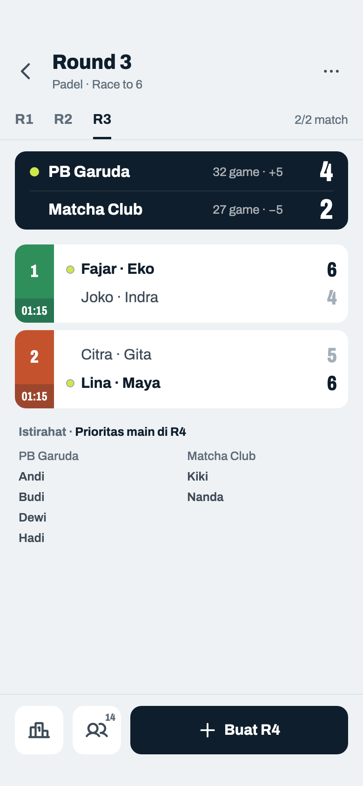

Komponen: `MabarAppBar`, `MabarButton`, `MabarIconButton`, `MabarActionBar`, `MabarGroup / MabarRow`, `MabarGroupHeader`, `RoundTabs`, `MatchScoreRow`, `RestingList`, `ClubScore`

- R3 lengkap (Fajar · Eko 6–4 Joko · Indra, Citra · Gita 5–6 Lina · Maya): Buat R4 aktif, sama dengan 06g. Skor klub 4 – 2, Total Point 32 – 27.
- Istirahat R3 per klub = prioritas R4 per klub (generator): PB Garuda Andi, Budi, Dewi, Hadi; Matcha Club Kiki, Nanda. Semua yang istirahat kebagian slot (4 per klub), jadi tanpa daftar kedua. Nama urut daftar pemain.

## 15b · Jadwal Mixed sparing · round baru · masih bisa dibatalkan

Komponen: `MabarAppBar`, `MabarButton`, `MabarIconButton`, `MabarActionBar`, `MabarGroup / MabarRow`, `MabarGroupHeader`, `RoundTabs`, `MatchScoreRow`, `RestingList`, `ClubScore`

- Hasil Buat R4 (generator) persis daftar prioritas 15a: Budi · Hadi vs Lina · Nanda, Andi · Dewi vs Indra · Kiki (AC-S11). Partner sesama klub, klub pertama baris atas.
- Batalkan R4 sama dengan 06h (round terakhir tanpa skor, bukan R1). Prioritas R5: Citra, Eko, Fajar, Gita · Joko, Maya.

## 15c · Dialog · batalkan round sparing

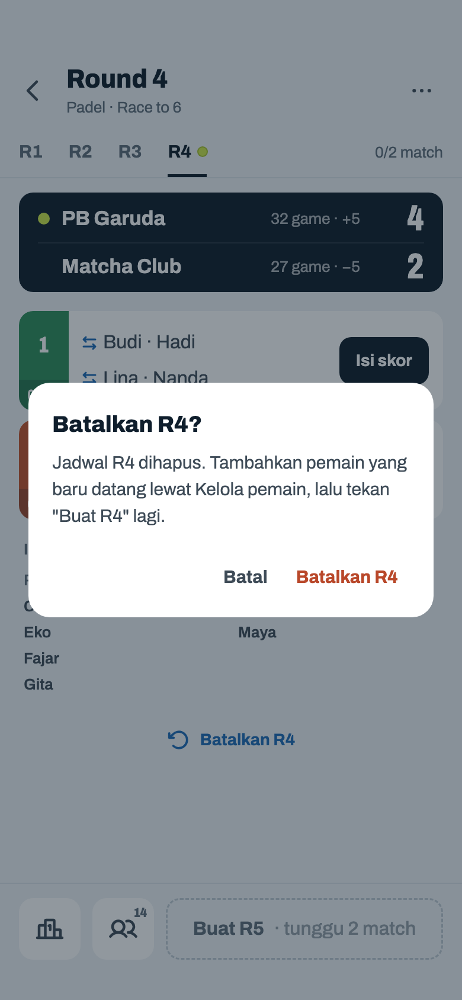

Komponen: `MabarAppBar`, `MabarButton`, `MabarTextButton`, `MabarIconButton`, `MabarActionBar`, `MabarGroup / MabarRow`, `MabarGroupHeader`, `RoundTabs`, `MatchScoreRow`, `RestingList`, `showMabarSheet`, `showMabarConfirm`, `ClubScore`

- Latar = 15b. Dialog sama dengan 06j; tidak ada akibat khusus sparing (skor klub tidak berubah karena R4 belum ada skor).

## 15d · Jadwal Mixed sparing · 30 pemain · istirahat lagi per klub

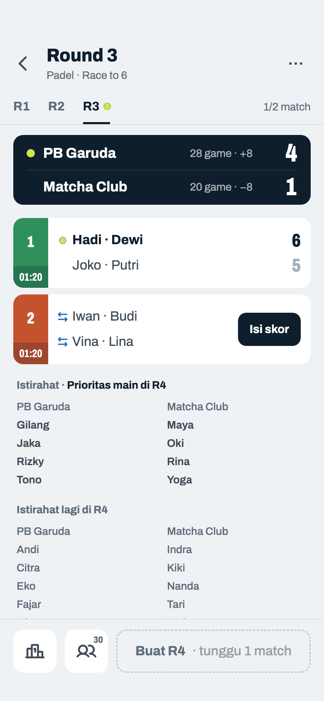

Komponen: `MabarAppBar`, `MabarButton`, `MabarIconButton`, `MabarActionBar`, `MabarGroup / MabarRow`, `MabarGroupHeader`, `RoundTabs`, `MatchScoreRow`, `RestingList`, `ClubScore`

- Terpadat: PB Garuda 16 + Matcha Club 14 = 30, 2 court: tiap round 4 main per klub, 12 Garuda dan 10 Matcha istirahat. Susunan R3 dan kedua daftar = generator.
- Yang istirahat lebih banyak dari slot R4 (4 per klub), jadi tiap klub dibagi dua seperti 06o: "Prioritas main di R4" (Gilang, Jaka, Rizky, Tono · Maya, Oki, Rina, Yoga) lalu "Istirahat lagi di R4" yang lebih pudar, dengan kolom klub yang sama. Klub yang semua kebagian slot: kolomnya di daftar kedua "–".
- Isi lebih panjang dari layar: daftar di-scroll, app bar, tab, dan action bar tetap. Skor R1–R2 contoh designer (4 – 1).

## 15e · Jadwal Mixed sparing · court lebih dari yang terpakai

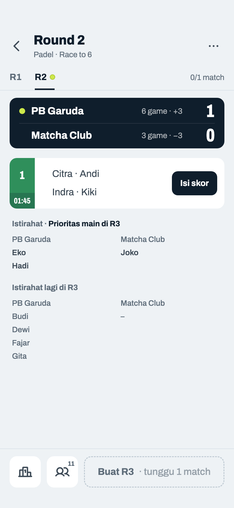

Komponen: `MabarAppBar`, `MabarButton`, `MabarIconButton`, `MabarActionBar`, `MabarGroup / MabarRow`, `MabarGroupHeader`, `RoundTabs`, `MatchScoreRow`, `RestingList`, `ClubScore`

- Konfigurasi 13j: PB Garuda 8 vs Matcha Club 3, 2 court. Court aktif min(2, 4, 1) = 1: tiap round satu match di Court 1; Court 2 tidak tampil di Jadwal (sama dengan 14m) dan sisa bookingnya hanya di Kelola court (AC-S10).
- Slot per klub 2: Garuda 6 istirahat (2 prioritas R3, 4 istirahat lagi), Matcha 1 istirahat (Joko, prioritas). R1 Gita · Fajar 6–3 Kiki · Joko; R2 dari generator.
- Court 2 dipakai lagi begitu Matcha Club punya 4 pemain aktif (Kelola pemain).

## 15f · Jadwal Mixed sparing · waktu habis · banyak round

Komponen: `MabarAppBar`, `MabarButton`, `MabarIconButton`, `MabarActionBar`, `MabarGroup / MabarRow`, `MabarGroupHeader`, `RoundTabs`, `MatchScoreRow`, `RestingList`, `ClubScore`

- Booking 2 jam habis setelah R8 (±8 round seperti estimasi 13i): sama dengan 06l, "Waktu habis" clay, kotak jam 00:00, Buat R9 diganti Tambah jam → 15j. R8 lengkap → Klasemen Final (15s).
- 8 tab tidak muat: baris tab digeser rapat kanan dengan tepi kiri dipudarkan (06n).
- Skor klub akhir 10 – 6, Total Point 83 – 69. Jumlah main setelah R8 (generator): tiap Garuda 4; Matcha Lina dan Nanda 6, empat lainnya 5 (AC-S8).

## 15g · Menu ⋯ · Mixed sparing

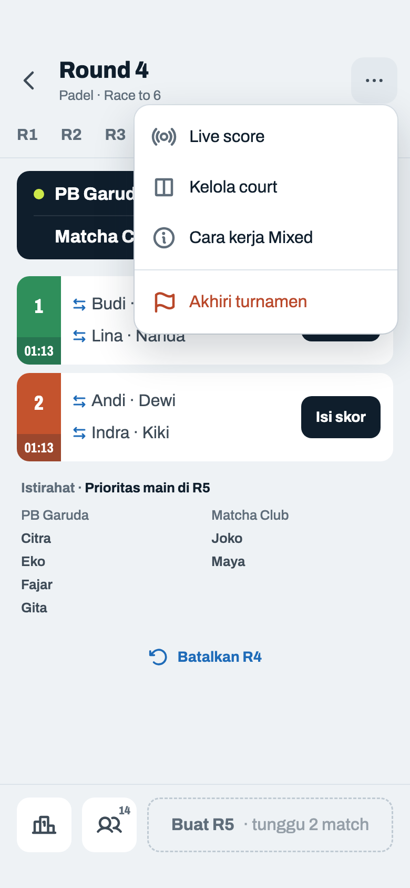

Komponen: `MabarAppBar`, `MabarButton`, `MabarIconButton`, `MabarActionBar`, `MabarGroup / MabarRow`, `MabarGroupHeader`, `RoundTabs`, `MatchScoreRow`, `RestingList`, `MabarMenu`, `ClubScore`

- Latar = 15b. Isi menu sama dengan 06i: Live score, Kelola court (15o), Cara kerja Mixed (15k), Akhiri turnamen (15h).

## 15h · Dialog · akhiri turnamen Mixed sparing

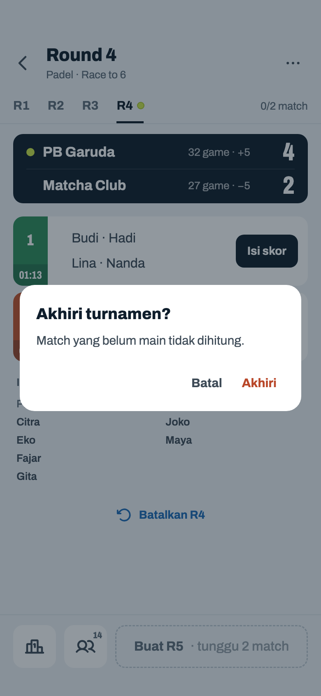

Komponen: `MabarAppBar`, `MabarButton`, `MabarTextButton`, `MabarIconButton`, `MabarActionBar`, `MabarGroup / MabarRow`, `MabarGroupHeader`, `RoundTabs`, `MatchScoreRow`, `RestingList`, `showMabarSheet`, `showMabarConfirm`, `ClubScore`

- Latar = 15b. Dialog sama dengan 06e.

## 15i · Jadwal Mixed sparing · diakhiri · bisa dilanjutkan

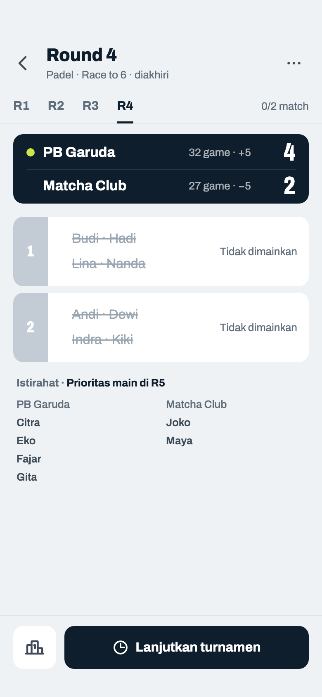

Komponen: `MabarAppBar`, `MabarButton`, `MabarIconButton`, `MabarActionBar`, `MabarGroup / MabarRow`, `MabarGroupHeader`, `RoundTabs`, `MatchScoreRow`, `RestingList`, `ClubScore`

- Diakhiri saat R4 (15h): R4 "Tidak dimainkan", skor klub akhir 4 – 2. Sama dengan 06m: tombol Pemain hilang, strip tanpa kotak jam, Lanjutkan turnamen → sheet (15j); menu ⋯ tinggal Live score dan Cara kerja Mixed.
- Setelah dilanjutkan, match R4 kembali bisa diisi dan Prioritas main di R5 tetap per klub.

## 15j · Sheet · lanjutkan turnamen sparing

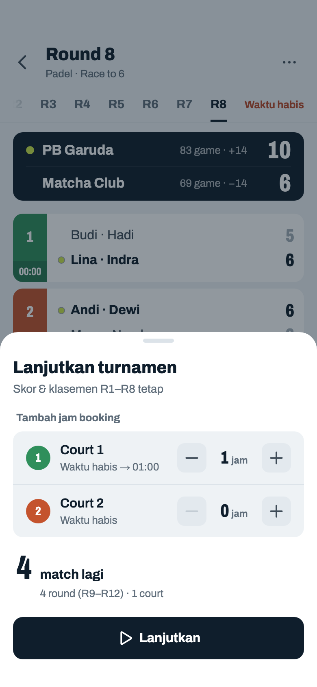

Komponen: `MabarAppBar`, `MabarButton`, `MabarIconButton`, `MabarActionBar`, `MabarGroup / MabarRow`, `MabarGroupHeader`, `MabarStepper`, `RoundTabs`, `MatchScoreRow`, `RestingList`, `showMabarSheet`, `CourtColorPicker`, `ClubScore`

- Latar = 15f. Sama dengan 08c. Court aktif dihitung ulang dengan rumus sparing (13.4): 1 court × min(1, ⌊8 ÷ 2⌋, ⌊6 ÷ 2⌋) = 1 match per round → 4 round = 4 match.
- Kalau Matcha Club membatasi (mis. 8 / 3: ⌊3 ÷ 2⌋ = 1), kalimatnya "maks 1 match per round (Matcha Club 3 pemain)"; klub yang membatasi disebut namanya.

## 15k · Sheet · cara kerja Mixed sparing

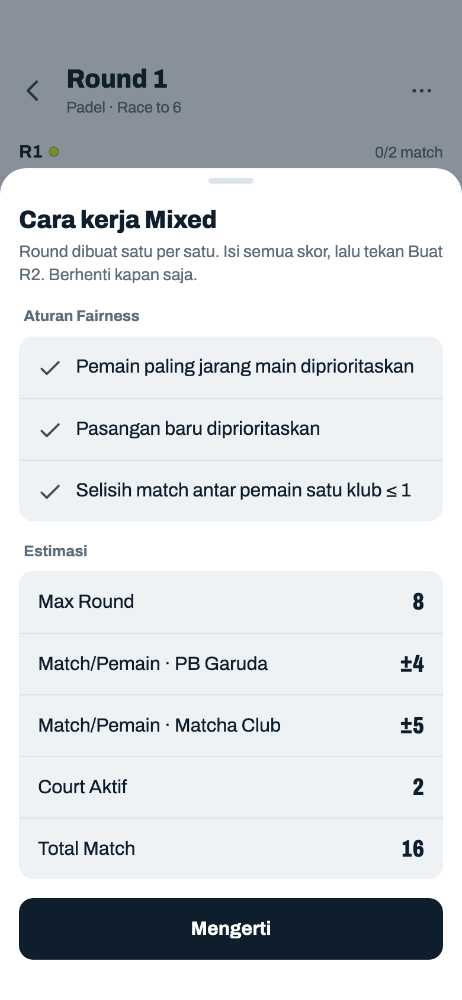

Komponen: `MabarAppBar`, `MabarButton`, `MabarIconButton`, `MabarActionBar`, `MabarGroup / MabarRow`, `MabarGroupHeader`, `RoundTabs`, `MatchScoreRow`, `RestingList`, `showMabarSheet`, `ClubScore`

- Muncul sekali saat R1 sparing dibuat, lalu lewat menu ⋯ (06k). Latar = R1 baru (generator): Eko · Gita vs Nanda · Kiki, Citra · Fajar vs Maya · Joko; prioritas R2 Andi, Budi, Dewi, Hadi · Indra, Lina.
- Aturan Fairness ketiga ditulis per klub ("… satu klub ≤ 1"), karena antar klub memang beda (K1). Kalimat lain tetap.
- Match/Pemain per klub (13.4): Total Match × 2 ÷ pemain klub, dibulatkan ke bawah: 16 × 2 ÷ 8 = 4, 16 × 2 ÷ 6 = 5,3 → ±5. Max Round dan Court Aktif sama dengan 13i (court aktif rumus sparing).

## 15l · Sheet · kelola pemain sparing · tambah ke klub

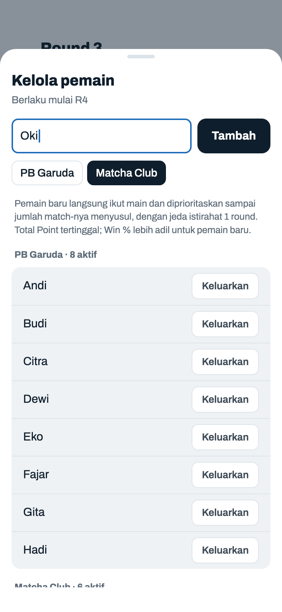

Komponen: `MabarAppBar`, `MabarButton`, `MabarIconButton`, `MabarRowAction`, `MabarActionBar`, `MabarGroup / MabarRow`, `MabarGroupHeader`, `MabarField`, `MabarChip`, `RoundTabs`, `MatchScoreRow`, `RestingList`, `showMabarSheet`, `ClubScore`

- Latar = 13m (R3 berjalan). Tambah wajib memilih klub (AC-S12): dua chip nama klub di bawah kotak nama, tanpa pilihan awal; Tambah mati sampai nama terisi dan satu klub dipilih. Oki → Matcha Club.
- Daftar per klub dengan label "klub · n aktif" (· n keluar kalau ada); nama dicek terhadap kedua klub ("Andi sudah ada di PB Garuda"). Kalimat penjelas sama dengan 08a.
- Pemain telat ikut aturan 3.4 per klub: Oki diprioritaskan dengan jeda k = max(2, slot klub ÷ istirahat klub + 1) = max(2, 4 ÷ 3 + 1) = 2 (15n). PB Garuda tidak terpengaruh.
- Sheet setinggi 92%, daftar digulir di dalam (08a).

## 15m · Kelola pemain sparing · klub tinggal 2 aktif

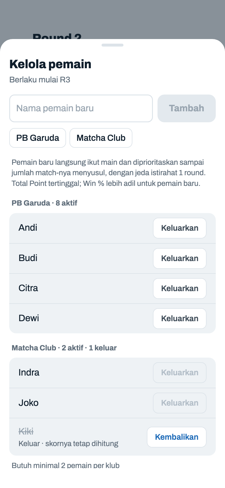

Komponen: `MabarAppBar`, `MabarButton`, `MabarIconButton`, `MabarRowAction`, `MabarActionBar`, `MabarGroup / MabarRow`, `MabarGroupHeader`, `MabarField`, `MabarChip`, `RoundTabs`, `MatchScoreRow`, `RestingList`, `showMabarSheet`, `ClubScore`

- Latar = 15e (8 / 3). Kiki keluar → Matcha Club tinggal Indra dan Joko: Keluarkan mati di klub itu, alasannya di bawah daftarnya ("Butuh minimal 2 pemain per klub", seperti 08b). PB Garuda tetap bisa dikeluarkan (minimal total 4 tetap berlaku).
- Kembalikan = ke klubnya sendiri (Kiki ke Matcha Club, AC-S12). Pemain tidak bisa pindah klub (K8).
- Daftar PB Garuda digulir: frame menampilkan 4 baris pertama.

## 15n · Jadwal Mixed sparing · pemain telat main

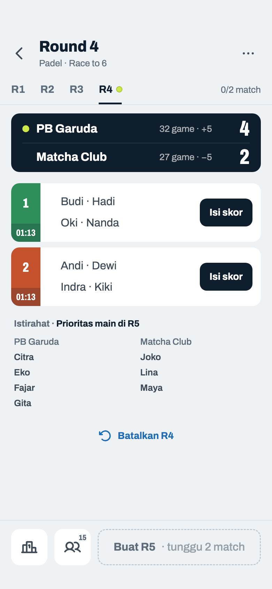

Komponen: `MabarAppBar`, `MabarButton`, `MabarIconButton`, `MabarActionBar`, `MabarGroup / MabarRow`, `MabarGroupHeader`, `RoundTabs`, `MatchScoreRow`, `RestingList`, `ClubScore`

- Oki ditambah ke Matcha Club setelah R3 (15l), lalu Buat R4 (generator): Oki langsung main (Oki · Nanda), karena paling sedikit main di klubnya. Matcha 7 aktif: slot 4, istirahat 3.
- Generator: Oki main R4 dan R5 (Maya · Oki), istirahat di R6 (jeda k = 2), sesuai 13.7. PB Garuda sama dengan 15b.
- Pemain (15) = aktif di kedua klub.

## 15o · Sheet · kelola court sparing · langsung main

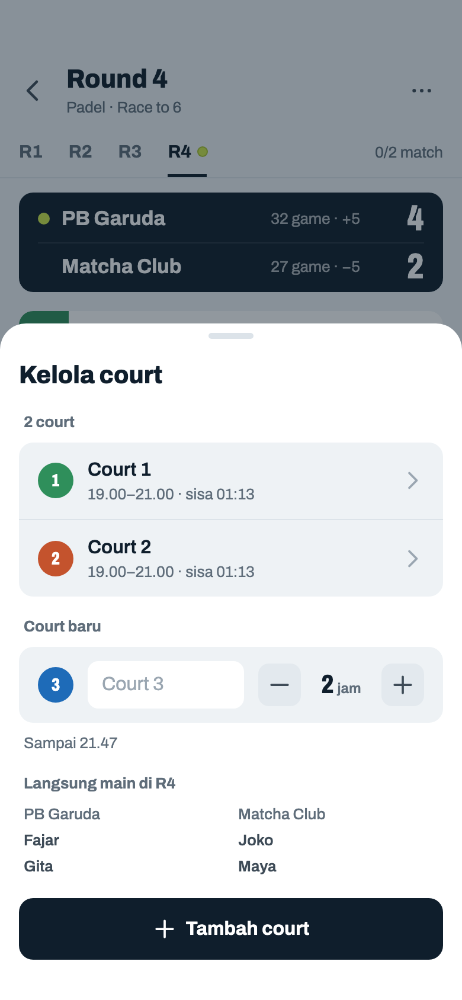

Komponen: `MabarAppBar`, `MabarButton`, `MabarIconButton`, `MabarActionBar`, `MabarGroup / MabarRow`, `MabarGroupHeader`, `MabarStepper`, `MabarField`, `RoundTabs`, `MatchScoreRow`, `RestingList`, `showMabarSheet`, `CourtColorPicker`, `ClubScore`

- Latar = 15b (R4 berjalan, 19.47). Court baru langsung dipakai kalau tiap klub punya ≥ 2 yang istirahat: 2 teratas prioritas tiap klub (generator: Fajar, Gita · Joko, Maya). "Langsung main di R4" memakai kolom klub yang sama dengan Istirahat (AC-S13).
- Satu klub kurang dari 2 yang istirahat → "Tambah court · mulai R5" (seperti 08f), court dipakai di round berikutnya.

## 15p · Jadwal Mixed sparing · court baru langsung main

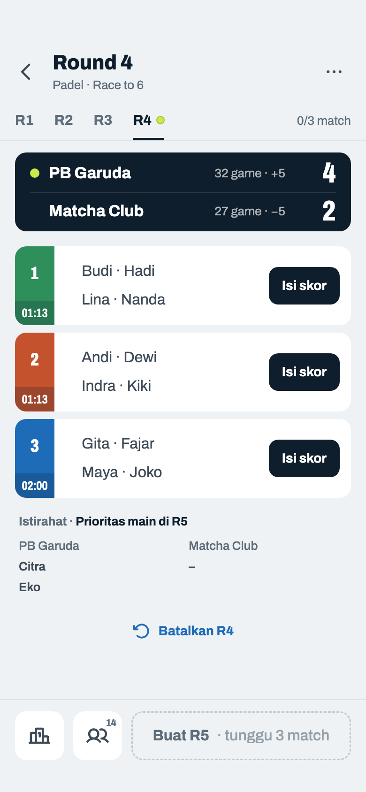

Komponen: `MabarAppBar`, `MabarButton`, `MabarIconButton`, `MabarActionBar`, `MabarGroup / MabarRow`, `MabarGroupHeader`, `RoundTabs`, `MatchScoreRow`, `RestingList`, `ClubScore`

- Setelah Tambah court (15o): Court 3 berisi Gita · Fajar vs Maya · Joko (generator), hitung mundur 02:00 dari saat ditambah. Semua 6 pemain Matcha main di R4, jadi kolomnya "–".
- R5 court aktif min(3, 4, 3) = 3: 3 match, semua 6 Matcha main; Garuda Citra dan Eko diprioritaskan (AC-S13).

## 15q · Input Skor · Mixed sparing

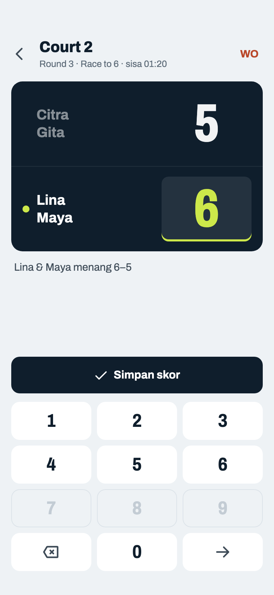

Komponen: `MabarAppBar`, `MabarButton`, `MabarTextButton`, `MabarIconButton`, `ScoreBoard / ScoreKeypad`

- Dari 13m, Court 2 R3. Sama dengan 07b; dua pemain klub pertama di baris atas papan, tanpa label klub (14q). Simpan → 15a.

## 15r · Sheet · walkover Mixed sparing · Americano

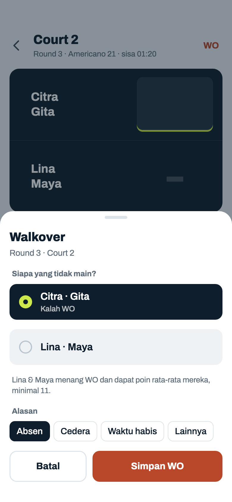

Komponen: `MabarAppBar`, `MabarButton`, `MabarTextButton`, `MabarIconButton`, `MabarGroup / MabarRow`, `MabarChip`, `ScoreBoard / ScoreKeypad`, `showMabarSheet`

- Turnamen contoh kedua dengan susunan generator yang sama tapi Americano 21 (R1 13–8, 9–12 · R2 14–7, 11–10 · R3 12–9). Citra · Gita absen di R3 Court 2. Sheet sama dengan 07j.
- Nilai WO pemain tetap 4.4: Lina rata-rata 7 → minimal 11, Maya rata-rata 12 → 12; masing-masing masuk Total Point-nya sendiri.
- Nilai WO klub (K11) = rata-rata nilai kedua pemenang, dibulatkan ,5 ke atas: (11 + 12) ÷ 2 = 11,5 → Matcha Club +12 Total Point klub dan +1 menang. Selisih kedua klub tidak berubah. Tidak ditulis di sheet; terlihat di Klasemen (15t).

## 15s · Klasemen Mixed sparing · Final

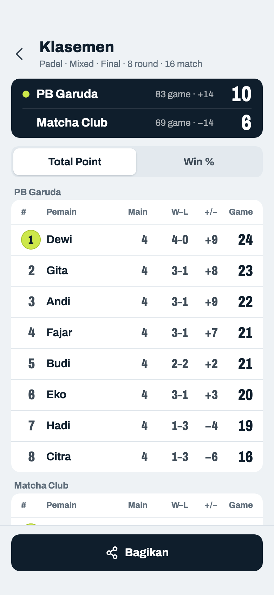

Komponen: `MabarAppBar`, `MabarButton`, `MabarIconButton`, `MabarActionBar`, `MabarGroup / MabarRow`, `MabarSegmented`, `StandingTable`, `ClubScore`

- Setelah 15f (waktu habis, R8 lengkap) → Final (4.6). Tabel pemain per klub, masing-masing mulai #1 (K3), kolom sama dengan 09a. Jumlah main sama di dalam klub (Garuda 4; Matcha 5–6), beda antar klub (K1).
- Fajar 21 (+7) di atas Budi 21 (+2); Joko 26 (+5) di atas Nanda 26 (−4): selisih memisahkan, sama dengan 09a.
- Isi lebih panjang dari layar (14 pemain): tabel Matcha berlanjut di bawah action bar. Ketuk baris → Detail (15u, 15v).

## 15t · Klasemen Mixed sparing · Americano · WO di skor klub

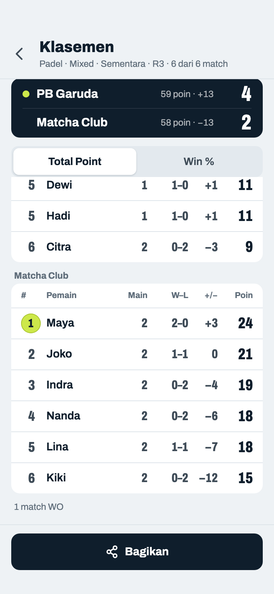

Komponen: `MabarAppBar`, `MabarButton`, `MabarIconButton`, `MabarActionBar`, `MabarGroup / MabarRow`, `MabarSegmented`, `StandingTable`, `ClubScore`

- Data 15r setelah WO disimpan. Skor klub 4 – 2 (Matcha: 1 menang + 1 WO). Total Point klub Matcha 58 = 46 poin main + 12 nilai WO klub (K11).
- Di tabel pemain tiap pemenang WO dapat nilainya sendiri: Maya 12 + 12 = 24, Lina 7 + 11 = 18 (4.4). Jumlah baris pemain tidak sama dengan Total Point klub, karena satu match = satu nilai untuk klub.
- Americano 21 (ganjil) tidak bisa seri: kolom W–L. Digulir sampai bawah.

## 15u · Detail pemain Mixed sparing · klub pertama

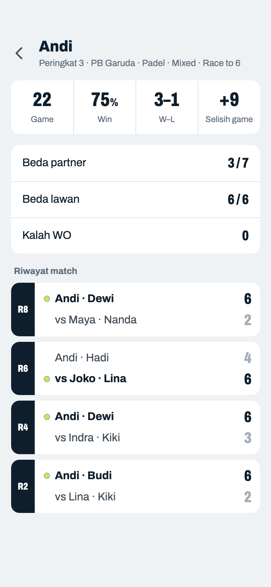

Komponen: `MabarAppBar`, `MabarIconButton`, `MabarGroup / MabarRow`, `MatchScoreRow`, `StatLine`

- Dari 15s. Sama dengan 10a; subjudul peringkat di klubnya · nama klub (K9). Riwayat: nama sendiri dulu lalu partner, lawan di bawah dengan "vs".
- Beda partner dari pemain klub sendiri (7 lainnya: 3 / 7), beda lawan dari pemain klub lain (6 / 6), karena sesama klub tidak pernah jadi lawan.

## 15v · Detail pemain Mixed sparing · klub kedua

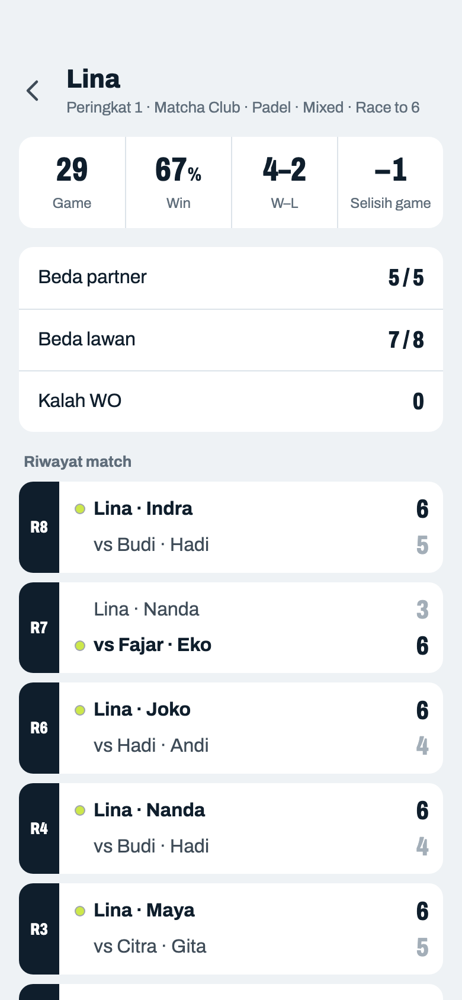

Komponen: `MabarAppBar`, `MabarIconButton`, `MabarGroup / MabarRow`, `MatchScoreRow`, `StatLine`

- Klub kedua: tim Lina tetap baris atas riwayat (K9), walau di Jadwal baris bawah. 6 match (R2–R4, R6–R8), riwayat digulir.
- #1 Matcha Club dengan 29 game dari 6 match: peringkat per klub, jadi tidak dibandingkan dengan Dewi (24 dari 4).

## 15w · Beranda · sparing bernama berjalan

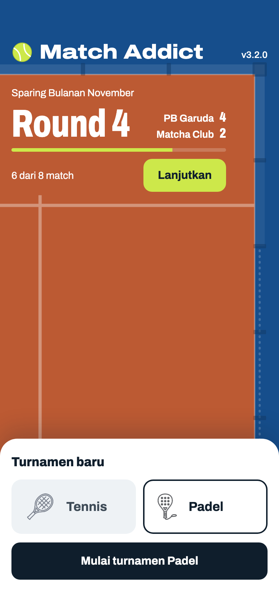

Komponen: `MabarButton`, `CourtBanner (CourtPainter)`, `HomePanel / SportPicker`

- Turnamen sparing bernama: nama tetap di baris kecil (01e); skor klub ditulis di samping "Round 4", rata kanan, dua baris dengan urutan sama seperti papan skor klub (klub pertama di atas). Tinggi info round tidak bertambah, jadi tetap di zona belakang padel di atas service line (baris tambahan di bawah nama menabraknya).
- Tanpa nama tetap 14x (skor menggantikan "vs" di baris kecil). Nama klub panjang dipotong elipsis di kolom skor; angka selalu utuh.
- Mixed: "6 dari 8 match" = round yang sudah dibuat (01e).

## 15x · Beranda · turnamen terakhir Mixed sparing

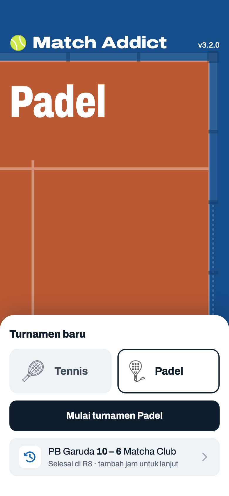

Komponen: `MabarButton`, `MabarGroup / MabarRow`, `CourtBanner (CourtPainter)`, `HomePanel / SportPicker`

- Turnamen terakhir Mixed sparing tanpa nama (15f): judul baris = "klub pertama · skor klub · klub kedua", sama dengan baris kecil banner 14x; subjudul tetap 01c. Ketuk → sheet Lanjutkan turnamen (15j, archived).
- Sparing bernama: judul baris = nama turnamen (01a), skor klub tidak ditulis karena satu baris tidak cukup untuk nama + skor.
- Fixed sparing yang selesai tidak tampil, sama dengan Fixed biasa.

## 15y · Dialog · mulai turnamen baru saat sparing bernama berjalan

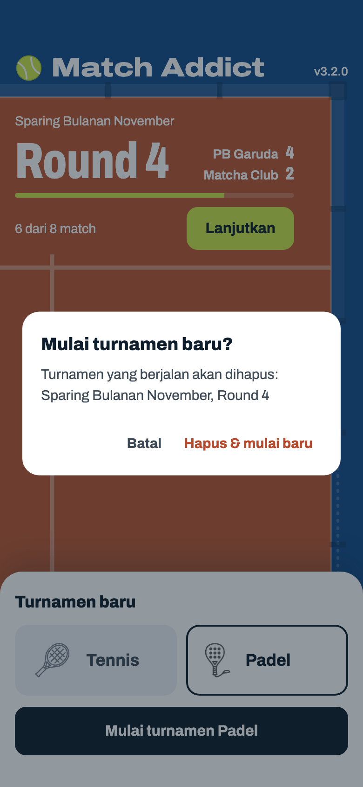

Komponen: `MabarButton`, `MabarTextButton`, `showMabarSheet`, `showMabarConfirm`, `CourtBanner (CourtPainter)`, `HomePanel / SportPicker`

- Latar = 15w. Dialog sama dengan 01h; turnamen bernama disebut dengan namanya (tanpa nama: "PB Garuda vs Matcha Club, Round 4", 14y).
