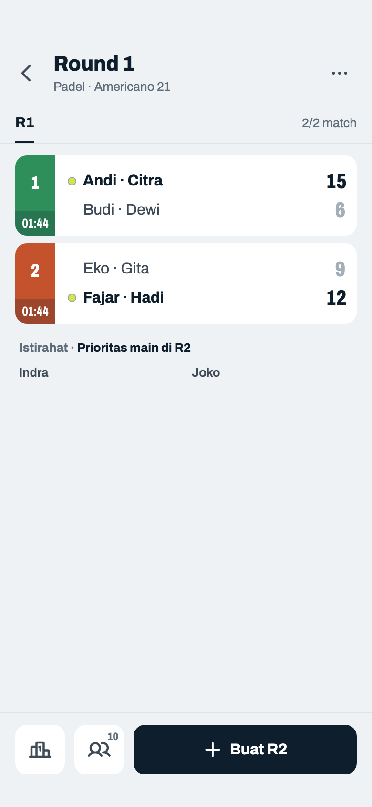
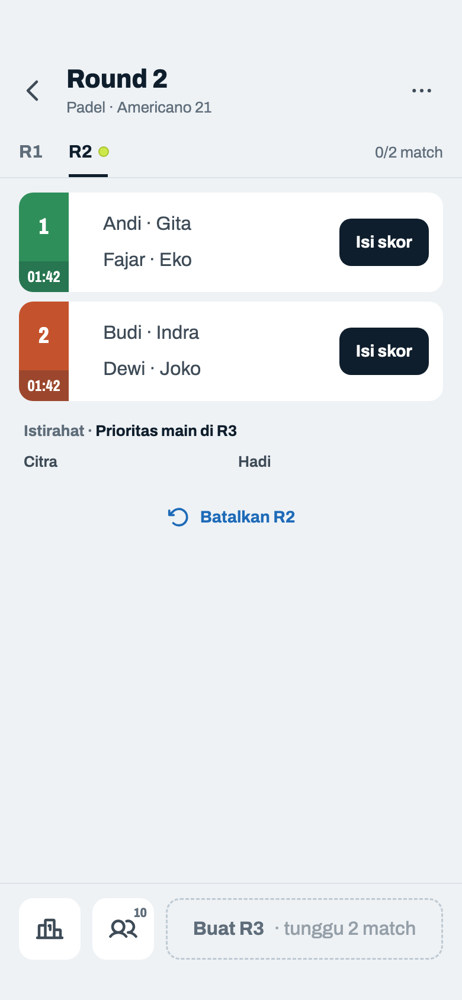
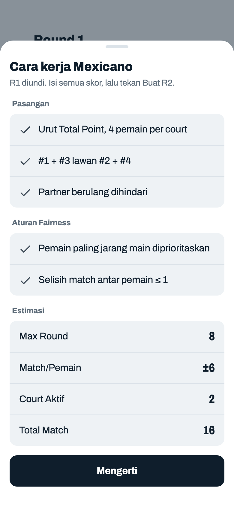
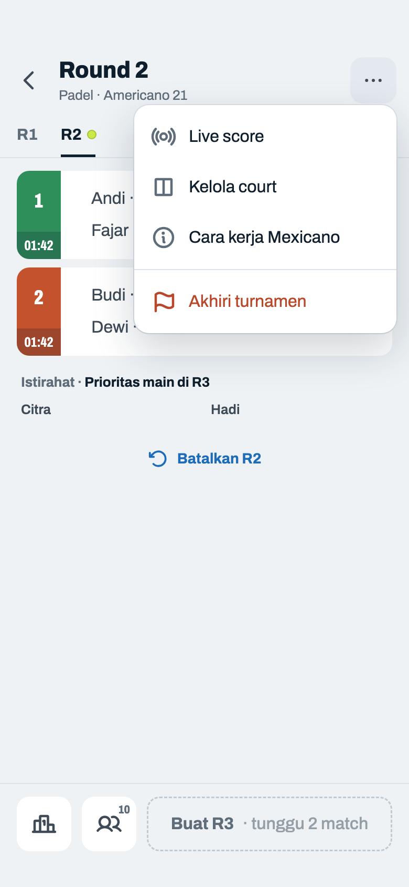
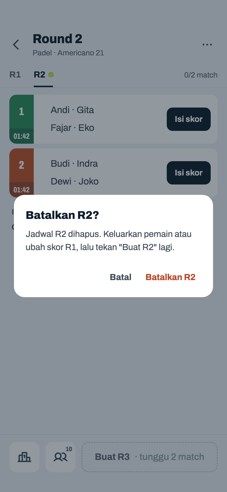
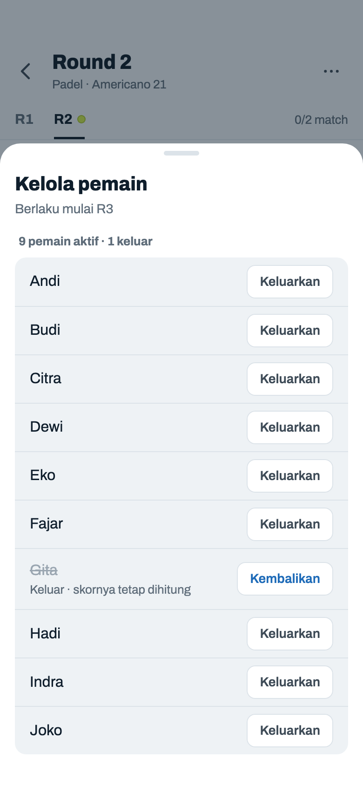
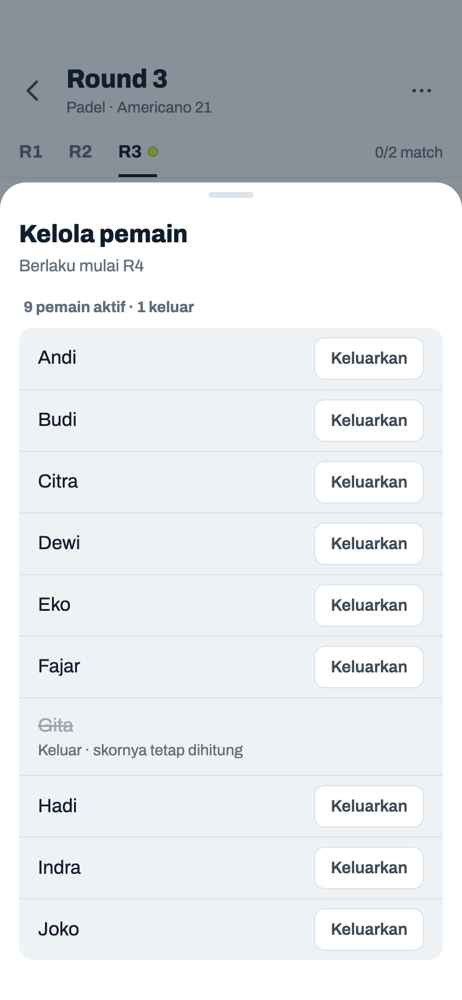

# Mexicano

> Dihasilkan `tool/hifi_extract.py` dari `design/hifi.html`. Jangan diedit langsung.

Mode ketiga (PRD §14, keputusan host 23–32, 2026-11-11): R1 diundi, round berikutnya pemain dikelompokkan berempat per court menurut Klasemen Total Point. Konfigurasi di 03c, 03e, 03q; Jadwal memakai layar dan kontrol Jadwal Mixed. Contoh: PRD 14B, Padel, Americano 21, 15 menit, 10 pemain, 2 court × 2 jam. Frame Mixed yang berlaku apa adanya untuk Mexicano didaftar di Cakupan.

## 16a · R1 lengkap · siap buat R2

Komponen: `MabarAppBar`, `MabarButton`, `MabarIconButton`, `MabarActionBar`, `MabarGroup / MabarRow`, `MabarGroupHeader`, `RoundTabs`, `MatchScoreRow`, `RestingList`

- Contoh PRD 14B: Padel, Americano 21, 15 menit, 10 pemain (Andi … Joko), 2 court × 2 jam. Undian R1 = urutan nama, jadi Indra dan Joko istirahat; yang main dikelompokkan berempat urut undian: Court 1 Andi, Budi, Citra, Dewi → 1 + 3 lawan 2 + 4.
- Layar dan kontrolnya = Jadwal Mixed (PRD 14.2, keputusan 25): tab, baris match, Istirahat, Klasemen, Pemain (n), Buat R(n+1), menu ⋯. Yang berbeda hanya siapa lawan siapa. Subjudul tidak menyebut mode, sama dengan Mixed ("Padel · Americano 21").
- Skor R1 = data test 14A: 15–6 dan 9–12. Klasemen setelah R1 (Total Point): Andi, Citra 15 (+9) · Fajar, Hadi 12 (+3) · Eko, Gita 9 (−3) · Budi, Dewi 6 (−9) · Indra, Joko belum main.
- R1 tidak bisa dibatalkan, sama dengan Mixed.

## 16b · R2 baru · pasangan dari Klasemen · ada yang istirahat

Komponen: `MabarAppBar`, `MabarButton`, `MabarIconButton`, `MabarActionBar`, `MabarGroup / MabarRow`, `MabarGroupHeader`, `RoundTabs`, `MatchScoreRow`, `RestingList`

- R2 = tabel 14B. Siapa main = prioritas main Mixed apa adanya: Indra, Joko (0 main) dulu, lalu urut undian R2 → Citra dan Hadi istirahat, walau Citra #1 di Klasemen.
- Yang main diurutkan Total Point → selisih → undian R2: Andi 15, Fajar 12, Gita 9, Eko 9, Budi 6, Dewi 6, Indra 0, Joko 0. Court 1 = empat teratas (Andi · Gita lawan Fajar · Eko), Court 2 = empat berikutnya. Kelompok teratas selalu di court bernomor terkecil yang dipakai.
- Di dalam tim nama posisi lebih kecil ditulis dulu; sisi atas = tim berisi posisi 1.
- "Istirahat · Prioritas main di R3" sudah pasti sebelum skor R2 masuk: siapa yang istirahat tidak tergantung skor, hanya lawannya (AC-M11).
- Batalkan R2: syarat sama dengan Mixed (06h); dialog 16e.

## 16c · Sheet · cara kerja Mexicano

Komponen: `MabarAppBar`, `MabarButton`, `MabarIconButton`, `MabarActionBar`, `MabarGroup / MabarRow`, `MabarGroupHeader`, `RoundTabs`, `MatchScoreRow`, `RestingList`, `showMabarSheet`

- Pengganti sheet Cara kerja Mixed (06k) untuk Mexicano; muncul otomatis sekali saat R1 dibuat, setelah itu lewat menu ⋯ (16d). Jenis info, satu tombol "Mengerti". Isinya menunggu persetujuan host (PRD 14.2).
- Isi = aturan PRD 14.3–14.5 apa adanya: urutan Total Point (lalu selisih, lalu undian), empat pemain per court berurutan, posisi 1 + 3 lawan 2 + 4, partner berulang dihindari di court itu. Aturan Fairness memakai dua kalimat Mixed yang tetap berlaku (keputusan 25); "Pasangan baru diprioritaskan" Mixed tidak dipakai karena pasangan ditentukan Klasemen.
- Estimasi sama dengan Mixed (rumus 06k): Max Round = 120 ÷ 15 = 8; Total Match = 8 × 2 = 16; Match/Pemain = ⌊16 × 4 ÷ 10⌋ = ±6; Court Aktif 2.
- Layar di belakangnya = R1 yang baru dibuat (pasangan R1 16a, belum ada skor).

## 16d · Menu ⋯ · Mexicano

Komponen: `MabarAppBar`, `MabarButton`, `MabarIconButton`, `MabarActionBar`, `MabarGroup / MabarRow`, `MabarGroupHeader`, `RoundTabs`, `MatchScoreRow`, `RestingList`, `MabarMenu`

- Isi sama dengan menu Mixed (06i): Live score (12b, 12c), Kelola court (08e–08k, sama dengan Mixed; pemain yang langsung main disusun dari urutan Mexicano saat itu), Cara kerja Mexicano (16c), Akhiri turnamen (06e).
- Layar di belakangnya = 16b.

## 16e · Dialog · batalkan R2 Mexicano

Komponen: `MabarAppBar`, `MabarButton`, `MabarTextButton`, `MabarIconButton`, `MabarActionBar`, `MabarGroup / MabarRow`, `MabarGroupHeader`, `RoundTabs`, `MatchScoreRow`, `RestingList`, `showMabarSheet`, `showMabarConfirm`

- Isi dialog Mixed (06j) menyuruh menambah pemain; di Mexicano pemain tidak bisa ditambah (keputusan 27), jadi isinya menyebut dua kegunaan Batalkan di Mexicano: pemain pulang sebelum round mulai, atau skor round sebelumnya baru dikoreksi (PRD 14.7). Teks menunggu persetujuan host.
- Batalkan lalu Buat R2 lagi tanpa perubahan → R2 yang sama persis (undian terkunci per round). Setelah dibatalkan layar pindah ke R1.

## 16f · Sheet · kelola pemain Mexicano · baru dikeluarkan

Komponen: `MabarAppBar`, `MabarButton`, `MabarIconButton`, `MabarRowAction`, `MabarActionBar`, `MabarGroup / MabarRow`, `MabarGroupHeader`, `RoundTabs`, `MatchScoreRow`, `RestingList`, `showMabarSheet`

- Kelola pemain tanpa kotak nama dan tombol Tambah: pemain tidak bisa ditambah di tengah turnamen Mexicano (keputusan 27, 28). Tanpa kalimat penjelas; daftarnya langsung di bawah judul.
- Gita dikeluarkan setelah R2 dibuat: match R2-nya tetap ada (bisa ditandai WO), skornya tetap dihitung. Selama R3 belum dibuat, "Kembalikan" ada untuk membetulkan salah ketuk (keputusan 29). Jumlah di tombol Pemain jadi 9.
- Keluarkan langsung tanpa konfirmasi, mati semua saat aktif 4 dengan catatan "Butuh minimal 4 pemain" (seperti 08b). Daftar urut daftar pemain awal.
- Layar di belakangnya = 16b; Istirahat R3 tetap Citra, Hadi (Gita sedang main di R2).

## 16g · Kelola pemain Mexicano · sudah melewatkan round

Komponen: `MabarAppBar`, `MabarButton`, `MabarIconButton`, `MabarRowAction`, `MabarActionBar`, `MabarGroup / MabarRow`, `MabarGroupHeader`, `RoundTabs`, `MatchScoreRow`, `RestingList`, `showMabarSheet`

- R3 sudah dibuat tanpa Gita → baris Gita tanpa aksi: tidak bisa kembali (keputusan 29, AC-M16). Nama dan skornya tetap di Klasemen.
- Data R3 (contoh designer, lanjutan 14B dengan Gita keluar): skor R2 Andi · Gita 12–9 Fajar · Eko, Budi · Indra 10–11 Dewi · Joko. Total Point setelah R2: Andi 27 (+12), Gita 21 (0), Fajar 21 (0), Eko 18 (−6), Dewi 17 (−8), Budi 16 (−10), Citra 15 (+9), Hadi 12 (+3), Joko 11 (+1), Indra 10 (−1); jumlah 168 = 4 match × 42.
- R3: Citra, Hadi, Indra, Joko (1 main) pasti main; dari Andi, Budi, Dewi, Eko, Fajar (2 main) undian R3 menaruh Budi terakhir → Budi istirahat. Urutan yang main: Andi, Fajar, Eko, Dewi | Citra, Hadi, Joko, Indra. Susunan 1 + 3 lawan 2 + 4 di kedua court tanpa partner berulang (beban 0).
- Batalkan R3 (belum ada skor) → R2 kembali jadi round terakhir, jadi Gita belum melewatkan round dan "Kembalikan" muncul lagi seperti 16f (bacaan designer atas PRD 14.7, menunggu host).
