# Tukar pemain (Mixed)

> Dihasilkan `tool/hifi_extract.py` dari `design/hifi.html`. Jangan diedit langsung.

Disetujui host 2026-11-12 (PRD §15, keputusan 48–57). Host mengganti satu pemain di match Belum round terakhir dengan satu pemain yang istirahat: ikon tukar di kolom bola baris match → sheet: pilih yang diganti, pilih yang masuk, Tukar. Titik masuk di menu ⋯ dan di Input Skor ditolak host (2026-11-12). Contoh PRD 15A/15B (Padel, Americano 21, 15 mnt, 2 court × 2 jam, 10 pemain), 15C (Sparing PB Garuda 8 vs Matcha Club 6, Race to 6), 06p (1 court), dan AC-T11/AC-T12 (R1, pemain dikeluarkan dan pemain baru). Mexicano dan Fixed tidak punya tukar.

## 17a · Jadwal · Mixed · ikon tukar di match Belum

Komponen: `MabarAppBar`, `MabarButton`, `MabarIconButton`, `MabarActionBar`, `MabarGroup / MabarRow`, `MabarGroupHeader`, `RoundTabs`, `MatchScoreRow`, `RestingList`

- Contoh PRD 15A: Mixed, Padel, Americano 21, 15 mnt, 2 court × 2 jam, 10 pemain. R3 Court 1 sudah 12–9, Court 2 Belum. Dewi minta istirahat.
- Titik masuk (keputusan host 2026-11-12; menu ⋯ dan Input Skor ditolak): ikon Phosphor Bold `arrows-left-right` 16 pt biru court di kolom bola, satu per tim. Bola dan ikon tidak pernah bertemu di satu baris karena ikon hanya ada di match tanpa skor/WO. Kolom tetap 7 pt dan ikon berpusat di titik bola, jadi nama tidak bergeser (nama panjang: 06u).
- Area ketuk per tim 44 × 42 pt, mulai dari tepi strip court, separuh tinggi baris (tim atas = separuh atas; gambar di Komponen `.bug`). Sisa baris tetap membuka Input Skor. Label aksesibilitas "Tukar pemain Dewi · Eko".
- Ikon hanya ada di match Belum round terakhir, Mixed atau Mixed sparing, belum diakhiri, di HP host, dan hanya di tim yang punya kandidat (T4; Sparing per klub, 17n). Tanpa ikon: tidak ada yang istirahat (17r), Mexicano (16b), Fixed (06a), diakhiri (06m), penonton live (12h), round lewat (06t).
- Ketuk ikon tim Dewi · Eko → sheet 17b.

## 17b · Sheet · tukar pemain · belum memilih

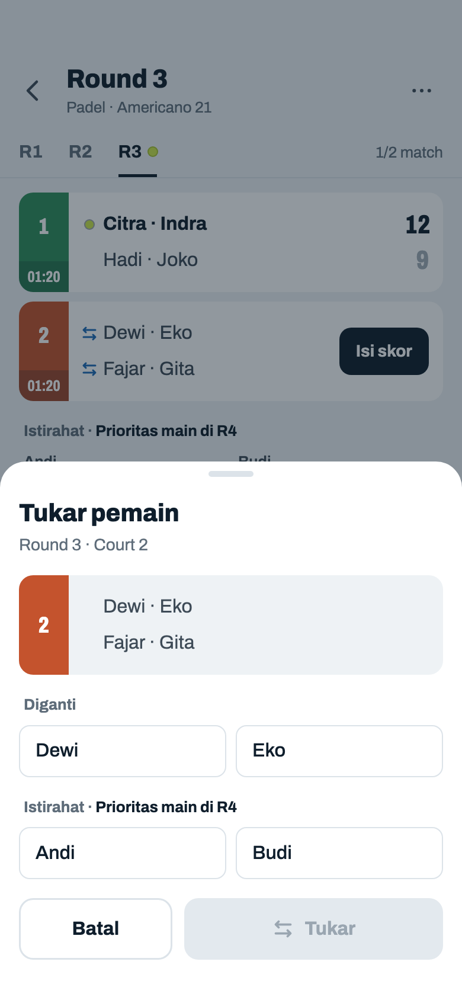

Komponen: `MabarAppBar`, `MabarButton`, `MabarIconButton`, `MabarActionBar`, `MabarGroup / MabarRow`, `MabarGroupHeader`, `MabarChip`, `RoundTabs`, `MatchScoreRow`, `RestingList`, `showMabarSheet`

- Judul "Tukar pemain", subjudul round · court (pola sheet WO 07j). Di bawahnya baris match apa adanya sebagai pratinjau: tanpa hitung mundur, tanpa ikon, tanpa Isi skor.
- "Diganti" = dua pemain tim yang ikonnya diketuk, urutan seperti di baris. Di bawahnya kandidat = seluruh daftar Istirahat round terakhir dengan label dan urutan yang sama dengan Jadwal ("Istirahat · Prioritas main di R4"; kalau ada juga "Istirahat lagi di R4", 17j). Semua chip dua kolom 44 pt (`.chips.cols`).
- Belum ada yang terpilih. Tukar mati sampai satu pemain Diganti dan satu kandidat terpilih (pola Simpan skor/WO). Batal, scrim, geser ke bawah, atau back menutup sheet tanpa perubahan apa pun (AC-T4).

## 17c · Sheet · tukar pemain · Dewi dipilih

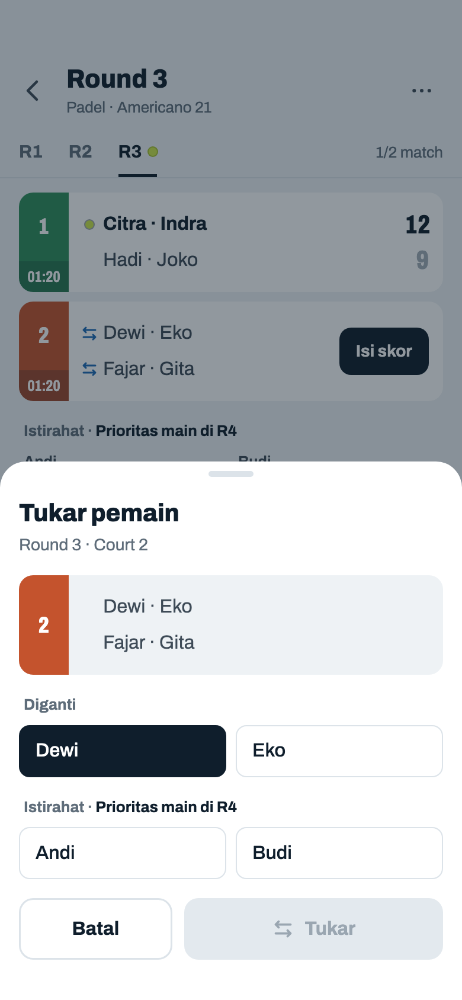

Komponen: `MabarAppBar`, `MabarButton`, `MabarIconButton`, `MabarActionBar`, `MabarGroup / MabarRow`, `MabarGroupHeader`, `MabarChip`, `RoundTabs`, `MatchScoreRow`, `RestingList`, `showMabarSheet`

- Ketuk chip = pilih; chip lain di grup yang sama = ganti pilihan; ketuk chip terpilih = lepas. Urutan memilih bebas (kandidat dulu juga boleh).
- Pratinjau baru berubah setelah dua-duanya terpilih; Tukar masih mati.

## 17d · Sheet · tukar pemain · Dewi dan Budi dipilih

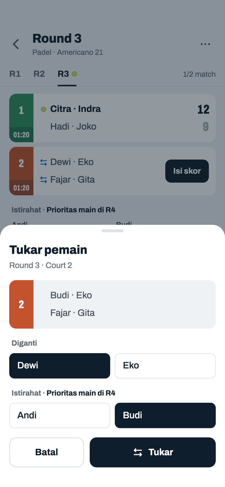

Komponen: `MabarAppBar`, `MabarButton`, `MabarIconButton`, `MabarActionBar`, `MabarGroup / MabarRow`, `MabarGroupHeader`, `MabarChip`, `RoundTabs`, `MatchScoreRow`, `RestingList`, `showMabarSheet`

- Pratinjau: Budi di tempat Dewi (posisi persis, partner Eko dan lawan tetap, T3).
- Tukar = satu perubahan turnamen, tanpa dialog: bisa dibalik dengan tukar lagi (T9), dan pratinjau sudah menunjukkan hasilnya. Sheet tertutup, kembali ke Jadwal tanpa toast (seperti Simpan skor, 07b) → 17e.

## 17e · Jadwal · setelah tukar Dewi ↔ Budi

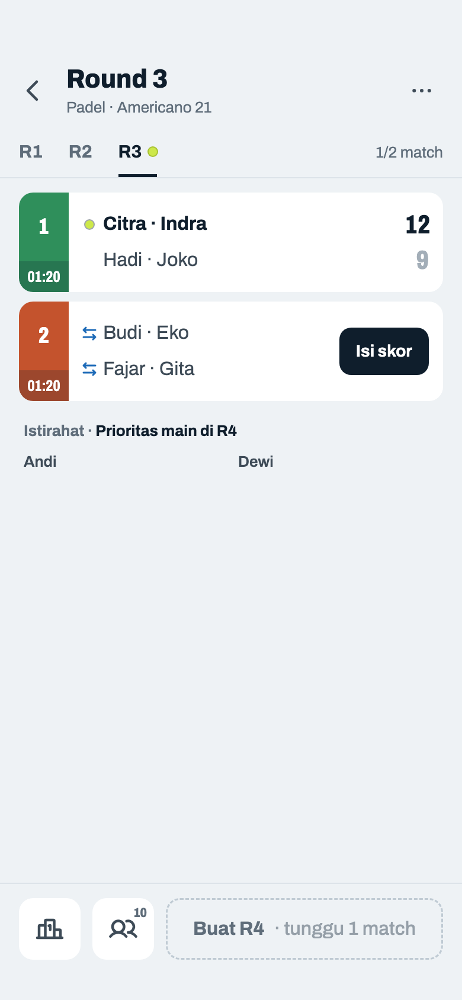

Komponen: `MabarAppBar`, `MabarButton`, `MabarIconButton`, `MabarActionBar`, `MabarGroup / MabarRow`, `MabarGroupHeader`, `RoundTabs`, `MatchScoreRow`, `RestingList`

- Hasil 15A (AC-T2, AC-T3): Court 2 Budi · Eko vs Fajar · Gita, id/court/nomor match tetap. Istirahat · Prioritas main di R4 = Andi, Dewi; tidak ada "Istirahat lagi". Buat R4 nanti mengistirahatkan Eko dan Budi.
- Ikon Court 2 tetap ada: match masih Belum dan Andi, Dewi kandidat. Tukar balik: ikon tim Budi · Eko → Budi → Dewi → Tukar; Jadwal kembali persis 17a (AC-T5).
- Tidak ada tanda "ditukar" di baris match, daftar Istirahat, Klasemen, Detail, poster, atau caption (AC-T15). Penonton live melihat perubahan ini lewat pembaruan biasa, tanpa ikon.

## 17f · Jadwal · dua match Belum · ikon di empat tim

Komponen: `MabarAppBar`, `MabarButton`, `MabarIconButton`, `MabarActionBar`, `MabarGroup / MabarRow`, `MabarGroupHeader`, `RoundTabs`, `MatchScoreRow`, `RestingList`

- Contoh PRD 15B: R3 belum ada skor, Citra baru datang dan belum siap. Tiap tim punya ikon sendiri; empat ikon + dua Isi skor + Batalkan R3 adalah keadaan terpadat di 2 court. 3 court sama polanya (15p).
- Ketuk ikon tim Citra · Indra → 17g.

## 17g · Sheet · tukar Citra ↔ Budi · Court 1

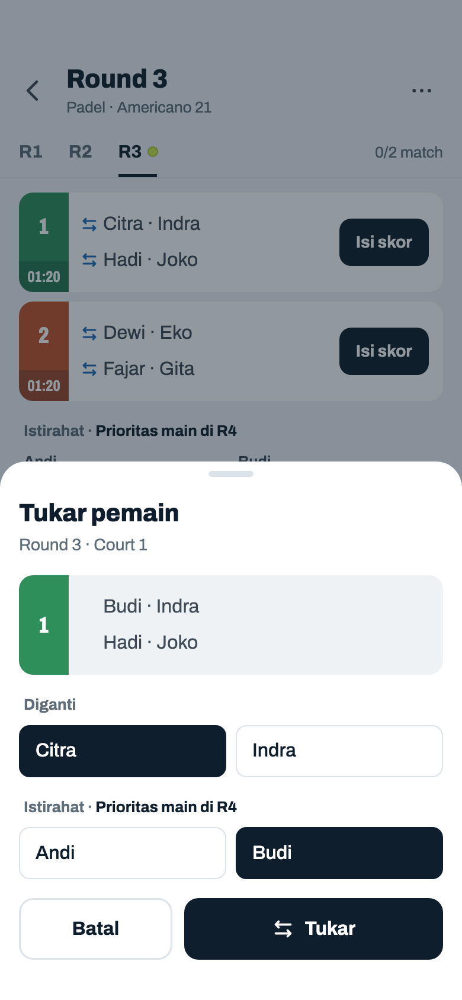

Komponen: `MabarAppBar`, `MabarButton`, `MabarIconButton`, `MabarActionBar`, `MabarGroup / MabarRow`, `MabarGroupHeader`, `MabarChip`, `RoundTabs`, `MatchScoreRow`, `RestingList`, `showMabarSheet`

- Subjudul ikut match yang ikonnya diketuk ("Round 3 · Court 1"). Citra dan Budi terpilih → pratinjau Budi · Indra vs Hadi · Joko.
- Tanpa peringatan walau selisih main jadi 2 (T7) dan Budi · Indra pernah berpasangan (T8). Tukar → 17h.

## 17h · Jadwal · setelah tukar · selisih main 2

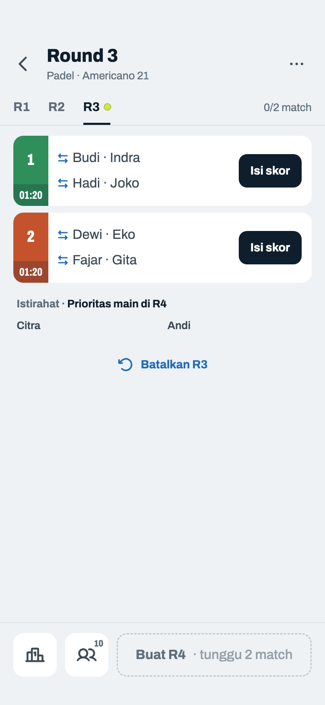

Komponen: `MabarAppBar`, `MabarButton`, `MabarIconButton`, `MabarActionBar`, `MabarGroup / MabarRow`, `MabarGroupHeader`, `RoundTabs`, `MatchScoreRow`, `RestingList`

- Hasil 15B: Court 1 Budi · Indra vs Hadi · Joko. Istirahat · Prioritas main di R4 = Citra, Andi (Citra lebih dulu, 1 main).
- Selisih jumlah main jadi 2 (Citra 1; Budi, Dewi, Eko, Fajar, Gita 3). Tidak ada peringatan di sheet atau di sini (T7); prioritas main memulihkan sendiri sampai R6 (tabel 15B).
- "Batalkan R3" tetap ada (R3 tanpa skor, bukan R1) → 17i.

## 17i · Dialog · batalkan round setelah tukar

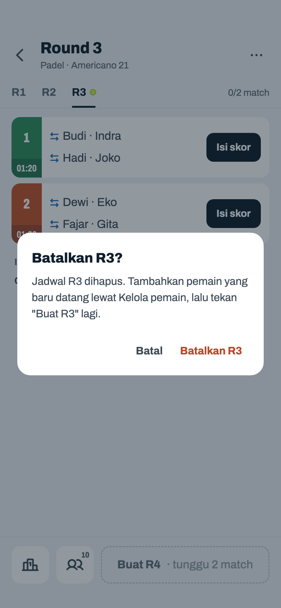

Komponen: `MabarAppBar`, `MabarButton`, `MabarTextButton`, `MabarIconButton`, `MabarActionBar`, `MabarGroup / MabarRow`, `MabarGroupHeader`, `RoundTabs`, `MatchScoreRow`, `RestingList`, `showMabarSheet`, `showMabarConfirm`

- Dialog sama persis dengan 06j, tanpa kalimat tentang tukar (keputusan 57). Tukar ikut terhapus bersama R3.
- Buat R3 lagi memilih siapa main dari riwayat R1–R2, jadi Andi dan Budi istirahat lagi dan Citra main; pasangan diacak ulang (AC-T9). Host menukar lagi kalau perlu.

## 17j · Sheet · tukar · kandidat dari Istirahat lagi

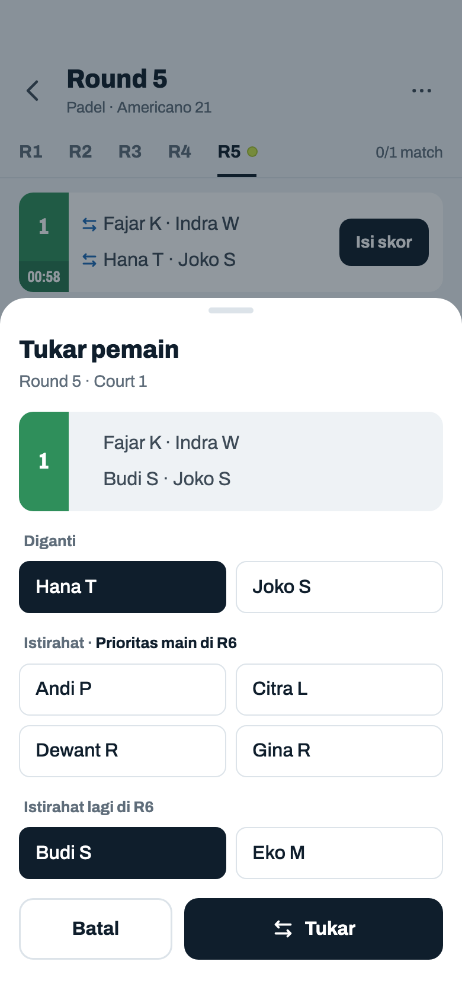

Komponen: `MabarAppBar`, `MabarButton`, `MabarIconButton`, `MabarActionBar`, `MabarGroup / MabarRow`, `MabarGroupHeader`, `MabarChip`, `RoundTabs`, `MatchScoreRow`, `RestingList`, `showMabarSheet`

- Latar = 06p (1 court, 10 pemain, R5) dengan ikon. Ikon tim Hana T · Joko S → Hana T diganti; kandidat dua grup dengan label yang sama dengan Jadwal. Daftar kedua juga bisa dipilih (keputusan 56): host yang tahu siapa siap main.
- Chip di kedua grup kandidat sama gayanya; bedanya hanya label. Satu pilihan untuk kedua grup: memilih Budi S melepas pilihan di grup atas.
- Setelah Tukar, Hana T masuk daftar Istirahat dan kedua daftar dihitung ulang dengan aturan yang sama dengan Buat R6 (T6).

## 17k · Jadwal Mixed sparing · ikon tukar

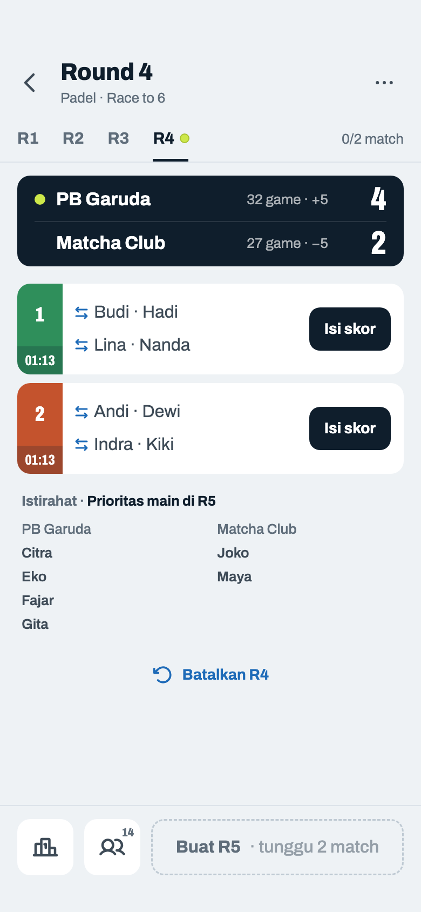

Komponen: `MabarAppBar`, `MabarButton`, `MabarIconButton`, `MabarActionBar`, `MabarGroup / MabarRow`, `MabarGroupHeader`, `RoundTabs`, `MatchScoreRow`, `RestingList`, `ClubScore`

- Latar = 15b (contoh 13B, hasil generator): PB Garuda 8 vs Matcha Club 6, 2 court, R4 belum ada skor, skor klub R1–R3 4 – 2 (Total Point 32 – 27). Kedua klub punya pemain istirahat, jadi keempat tim punya ikon.
- Ketuk ikon tim Indra · Kiki (Court 2) → 17l.

## 17l · Sheet · tukar Kiki ↔ Maya · hanya sesama klub

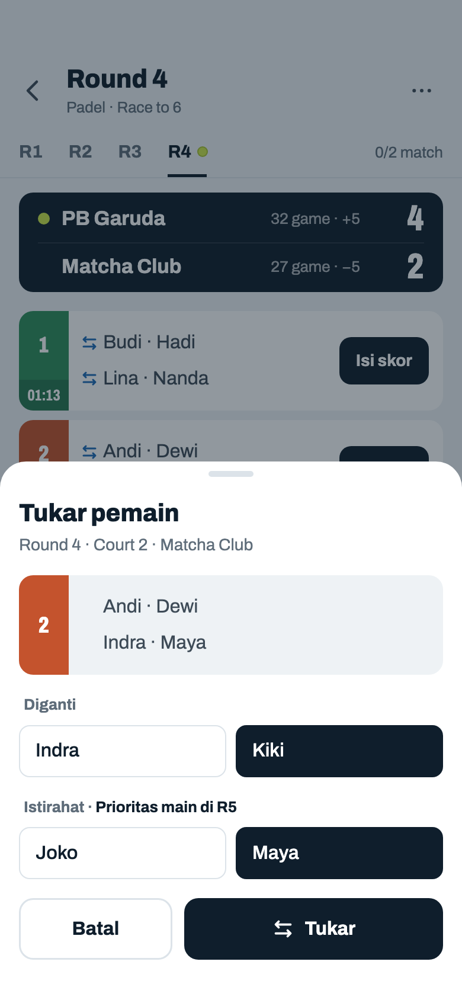

Komponen: `MabarAppBar`, `MabarButton`, `MabarIconButton`, `MabarActionBar`, `MabarGroup / MabarRow`, `MabarGroupHeader`, `MabarChip`, `RoundTabs`, `MatchScoreRow`, `RestingList`, `showMabarSheet`, `ClubScore`

- Sparing: kandidat hanya pemain istirahat klub tim itu (keputusan 51). Tim Indra · Kiki: Joko, Maya; tim Andi · Dewi akan mendapat Citra, Eko, Fajar, Gita (AC-T8). Partner selalu sesama klub, jadi satu sheet = satu klub; nama klub di subjudul, satu kali.
- Latar = 17k. Pratinjau Andi · Dewi vs Indra · Maya → Tukar → 17m.

## 17m · Jadwal Mixed sparing · setelah tukar Kiki ↔ Maya

Komponen: `MabarAppBar`, `MabarButton`, `MabarIconButton`, `MabarActionBar`, `MabarGroup / MabarRow`, `MabarGroupHeader`, `RoundTabs`, `MatchScoreRow`, `RestingList`, `ClubScore`

- Maya main di Court 2 menggantikan Kiki; Kiki masuk kolom Matcha Club (Joko, Kiki), kolom PB Garuda tidak berubah (Citra, Eko, Fajar, Gita). Skor klub tidak berubah (R4 belum ada skor).
- Urutan nama di kolom Matcha = urut daftar pemain, sama dengan 15a/15b; urutan prioritas R5 sebenarnya dihitung ulang generator (T6), fixture mengikuti generator.

## 17n · Jadwal Mixed sparing · klub tanpa pemain istirahat

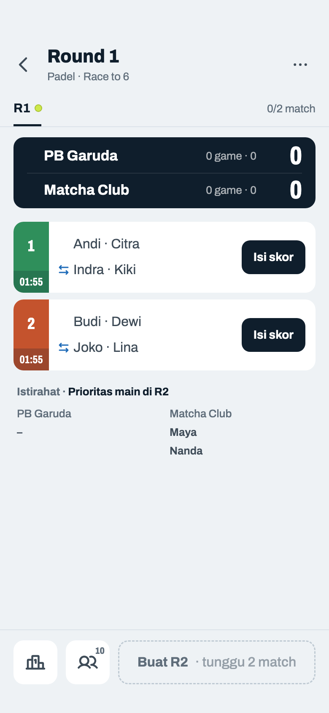

Komponen: `MabarAppBar`, `MabarButton`, `MabarIconButton`, `MabarActionBar`, `MabarGroup / MabarRow`, `MabarGroupHeader`, `RoundTabs`, `MatchScoreRow`, `RestingList`, `ClubScore`

- PB Garuda 4 / Matcha Club 6, 2 court (PRD 15C): semua pemain Garuda main tiap round, jadi tim Garuda tidak punya ikon (kolom bola kosong seperti match Belum biasa) dan tidak ada catatan di layar (AC-T8). Tim Matcha punya ikon; kandidatnya Maya, Nanda.
- Sama di round lain: 15p (Court 3 langsung main, Matcha tidak punya yang istirahat → tim Matcha tanpa ikon). Susunan R1 contoh designer.

## 17o · Jadwal · R1 · pemain dikeluarkan dan pemain baru

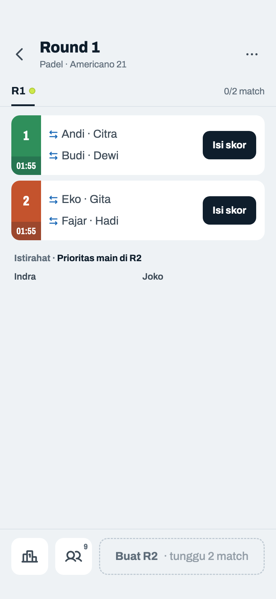

Komponen: `MabarAppBar`, `MabarButton`, `MabarIconButton`, `MabarActionBar`, `MabarGroup / MabarRow`, `MabarGroupHeader`, `RoundTabs`, `MatchScoreRow`, `RestingList`

- AC-T11 + AC-T12: 9 pemain, 2 court, R1 dibuat (Indra istirahat). Joko datang dan ditambah lewat Kelola pemain; Hadi tidak datang dan sudah dikeluarkan, tapi namanya masih di R1 Court 2. Pemain aktif 9.
- Tim Fajar · Hadi tetap punya ikon: pemain yang sudah dikeluarkan boleh ditukar keluar (keputusan 54). R1 tidak bisa dibatalkan, jadi tukar satu-satunya jalan selain WO.
- Ketuk ikon tim Fajar · Hadi → 17p.

## 17p · Sheet · tukar Hadi ↔ Joko · pemain baru masuk

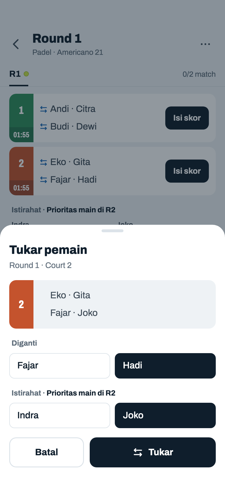

Komponen: `MabarAppBar`, `MabarButton`, `MabarIconButton`, `MabarActionBar`, `MabarGroup / MabarRow`, `MabarGroupHeader`, `MabarChip`, `RoundTabs`, `MatchScoreRow`, `RestingList`, `showMabarSheet`

- Chip Hadi tanpa penanda "Keluar", sama dengan baris Jadwal. Joko baru ditambah setelah R1 dibuat dan langsung ada di daftar Istirahat, jadi bisa dipilih tanpa penanda "baru" (keputusan 55).
- Urutan Indra, Joko = urutan daftar Istirahat di Jadwal (keduanya 0 main; undian R2).

## 17q · Jadwal · R1 setelah tukar pemain keluar

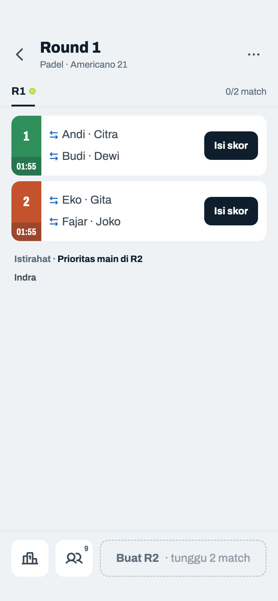

Komponen: `MabarAppBar`, `MabarButton`, `MabarIconButton`, `MabarActionBar`, `MabarGroup / MabarRow`, `MabarGroupHeader`, `RoundTabs`, `MatchScoreRow`, `RestingList`

- Joko main di R1 menggantikan Hadi, jadi Joko hadir sejak R1 dan bukan pemain telat. Hadi dicatat istirahat di R1 tapi tidak tampil karena tidak aktif (T5). Ikon tetap: Indra masih kandidat.
- Hadi dikembalikan sebelum Buat R2 → tidak masuk pemain telat dan tampil lagi di daftar Istirahat (AC-T11).

## 17r · Jadwal · tidak ada yang istirahat · tanpa ikon

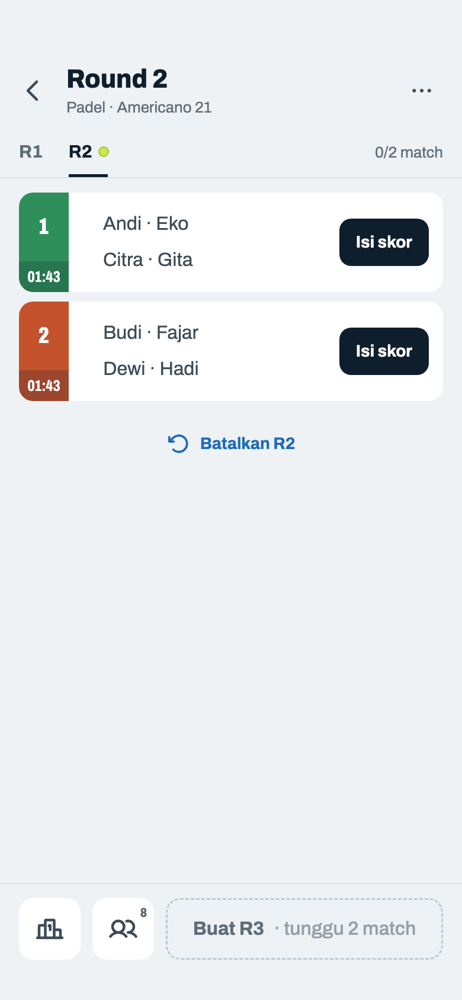

Komponen: `MabarAppBar`, `MabarButton`, `MabarIconButton`, `MabarActionBar`, `RoundTabs`, `MatchScoreRow`

- Mixed 8 pemain / 2 court, R2 belum ada skor: semua main, jadi tidak ada kandidat dan tidak ada ikon (AC-T1). Kolom bola kosong seperti biasa; tanpa daftar Istirahat (pola 08b). Baris tetap membuka Input Skor.
- Tanpa ikon juga: match yang sudah ada skor/WO (17a Court 1), round lewat, turnamen diakhiri, Mexicano, Fixed, dan halaman penonton live. Tab round lewat tidak pernah punya ikon karena hanya round terakhir yang bisa ditukar.
