# Poster podium

> Dihasilkan `tool/hifi_extract.py` dari `design/hifi.html`. Jangan diedit langsung.

Poster Ringkas sejak keputusan host 60–67 (2026-11-12): sudut lapangan, podium, satu bola per pemain, dan panel nama. Gambar digambar skala 1:3 (Feed 360 × 360, Story 360 × 640). Layar Bagikan dan gambar utamanya ada di 11a, 11c, 11d, 13q, 13r; bagian ini memuat varian lainnya.

## 18a · Layar Bagikan · Ringkas · Fixed tennis · tema lapangan

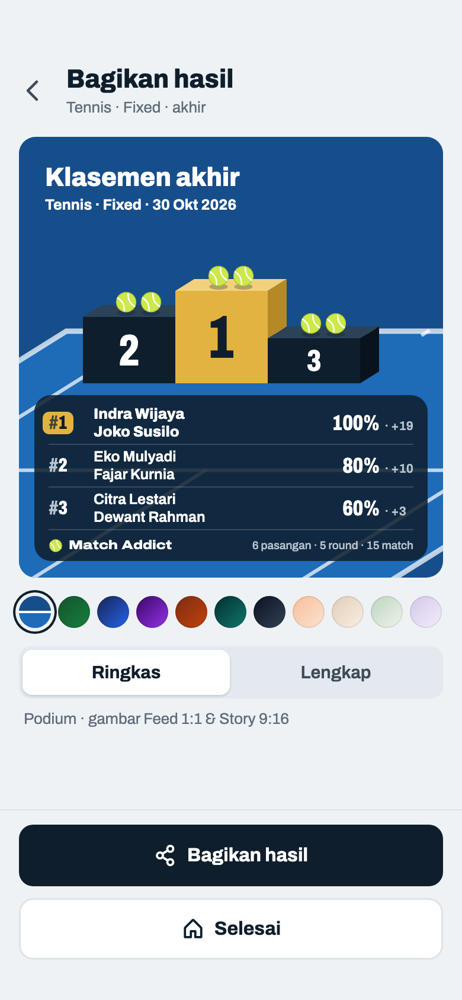

Komponen: `MabarAppBar`, `MabarButton`, `MabarIconButton`, `MabarActionBar`, `MabarGroup / MabarRow`, `MabarSegmented`, `SharePoster`, `PodiumPoster (PodiumScenePainter)`

- Tennis: lantai dan lingkaran tema lapangan biru `court`; lingkaran lapangan selalu mengikuti olahraga turnamen.
- Fixed: satu anak tangga = satu pasangan, dua bola per blok dan dua nama bertumpuk di panel (keputusan 61). Baris panel jadi 36 dan blok memakai tinggi pasangan 78 / 56 / 38.
- Race to 6 terbuka di Win % (keputusan 21): "100% · +19". Tanpa nama turnamen.

## 18b · Layar Bagikan · Ringkas · gradien nude dipilih

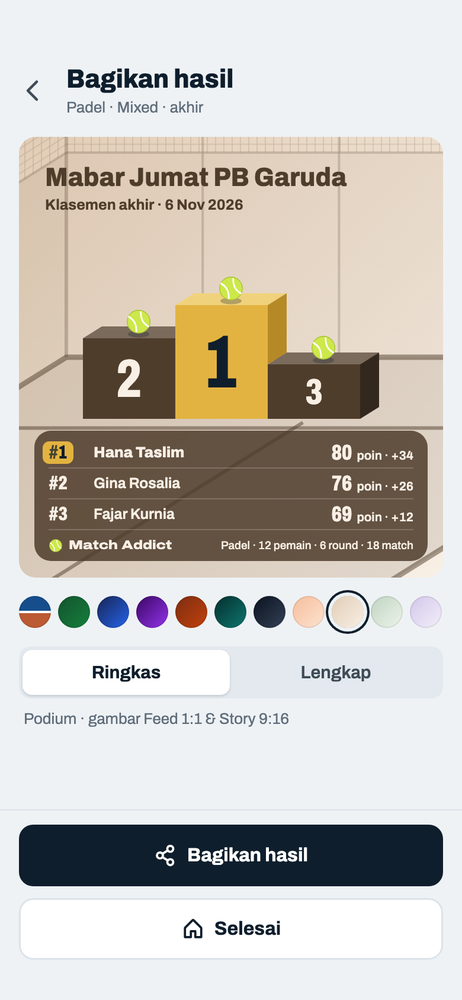

Komponen: `MabarAppBar`, `MabarButton`, `MabarIconButton`, `MabarActionBar`, `MabarGroup / MabarRow`, `MabarSegmented`, `SharePoster`, `PodiumPoster (PodiumScenePainter)`

- Gradien lama tetap bisa dipilih (keputusan 66). Lingkaran lapangan tetap di depan deret, tanpa cincin.
- Tema lembut: teks kepala, blok #2/#3, dan panel memakai tinta tema; teks panel memakai warna ujung terang gradien. #1 tetap emas.
- Pindah ke Lengkap dari sini: nude tetap terpilih (seperti 11b dengan peach).

## 18c · Gambar · utama · Mixed padel bernama · Feed dan Story

Komponen: `SharePoster`, `PodiumPoster (PodiumScenePainter)`

- Ilustrasi tidak memuat nama: angka di muka blok, satu bola per pemain di atasnya. Nama dan nilai di panel.
- Urutan slot 2 · 1 · 3. Feed: blok lebar 78, tinggi 96 / 68 / 46, baris panel 26. Story: lebar 96, tinggi 178 / 128 / 86, baris panel 42.
- Data: Padel Mixed, Americano 21, 12 pemain, 3 court × 6 round = 18 match, semua main 6 kali. Jumlah poin 756 = 18 × 21 × 2; selisih = 2 × poin − 126 (80 → +34, 76 → +26, 69 → +12); pemain keempat 68 · +10.
- Mexicano sama dengan Mixed (satu pemain per anak tangga); baris kecil tanpa nama menulis "Padel · Mexicano · tanggal".

## 18d · Gambar · tanpa nama turnamen

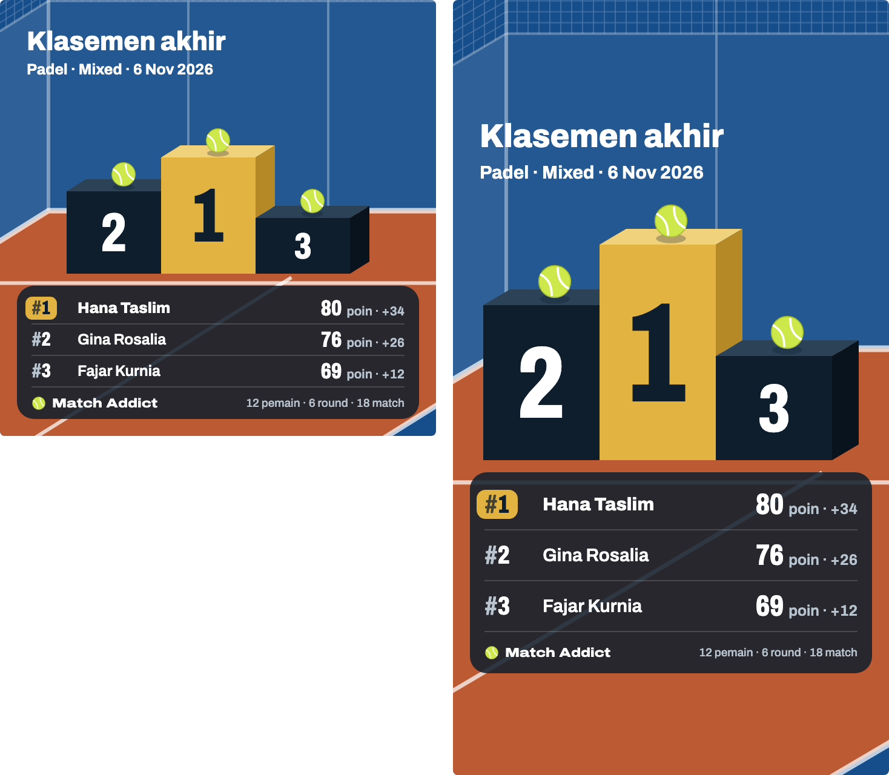

Komponen: `SharePoster`, `PodiumPoster (PodiumScenePainter)`

- Tanpa nama: judul "Klasemen akhir", baris kecil "olahraga · mode · tanggal", baris fakta tanpa olahraga. Selebihnya sama dengan 18c.

## 18e · Gambar · Fixed · pasangan · Win % · tennis

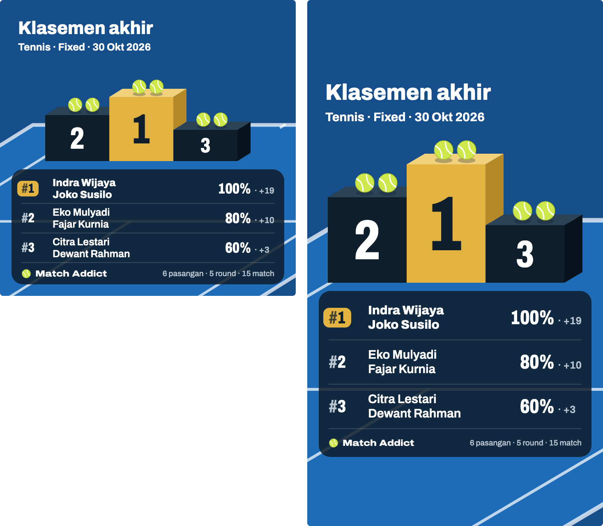

Komponen: `SharePoster`, `PodiumPoster (PodiumScenePainter)`

- Dua bola per blok (Feed 19, Story 26, jarak 2); dua nama bertumpuk di panel dan tiap nama memakai lebar penuh.
- Tinggi pasangan: Feed 78 / 56 / 38 dengan baris 36; Story 144 / 104 / 70 dengan baris 54.
- Data: Tennis, Race to 6, 6 pasangan round-robin 15 match (3 court × 5 round). Win %: 5–0, 4–1, 3–2.

## 18f · Gambar · kembar #1 #2 #2

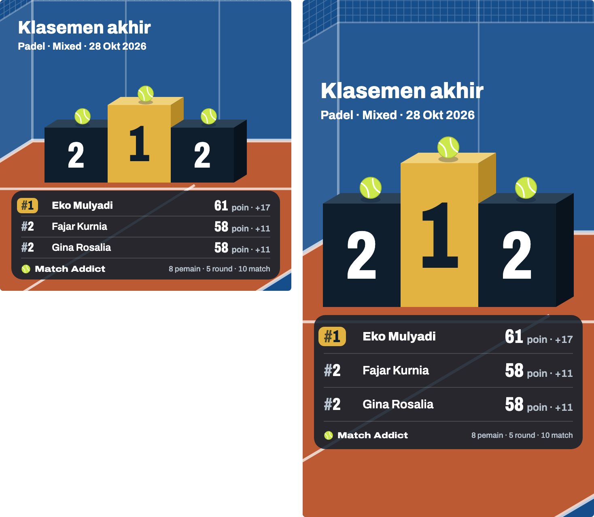

Komponen: `SharePoster`, `PodiumPoster (PodiumScenePainter)`

- Dua #2: blok kiri dan kanan sama tinggi (Feed 68, Story 128); panel menulis #2 dan #2 (keputusan 64).
- Data: Padel Mixed, Americano 21, 8 pemain, 2 court × 5 round = 10 match; selisih = 2 × poin − 105. Pemain berikutnya 55 · +5 bernomor #3 dan tidak naik.

## 18g · Gambar · kembar #1 #1 #2

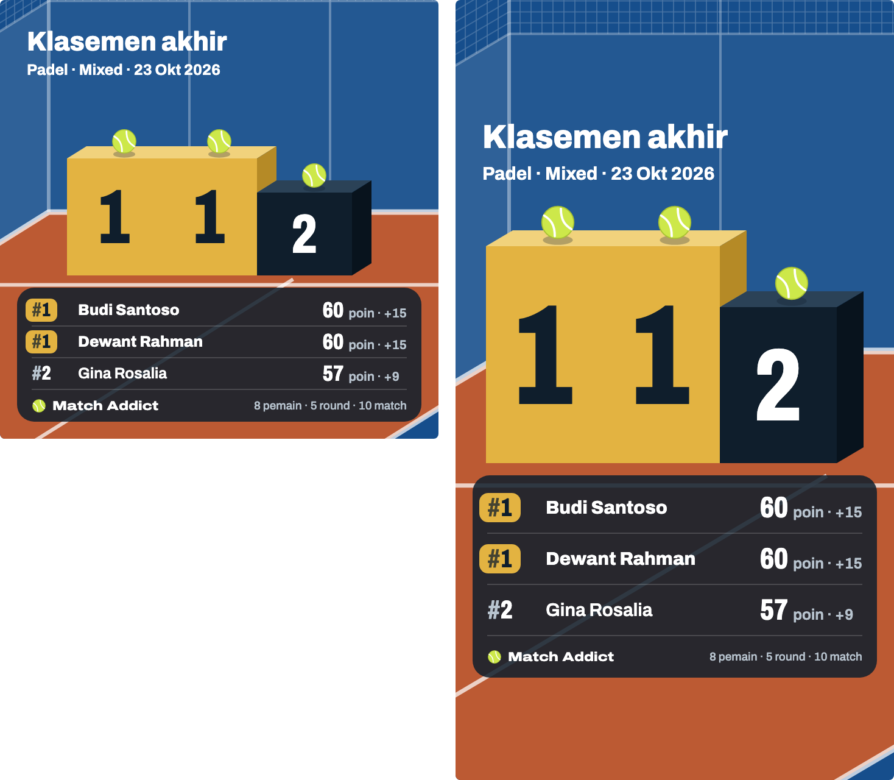

Komponen: `SharePoster`, `PodiumPoster (PodiumScenePainter)`

- Dua #1: dua blok emas sama tinggi, muka atasnya menyatu; dua lencana emas di panel. Urutan slot tetap 2 · 1 · 3, jadi #2 di kanan.
- Data: turnamen lain, format sama dengan 18f. Budi dan Dewant 60 · +15, Gina 57 · +9.

## 18h · Gambar · empat anak tangga · #1 #2 #3 #3

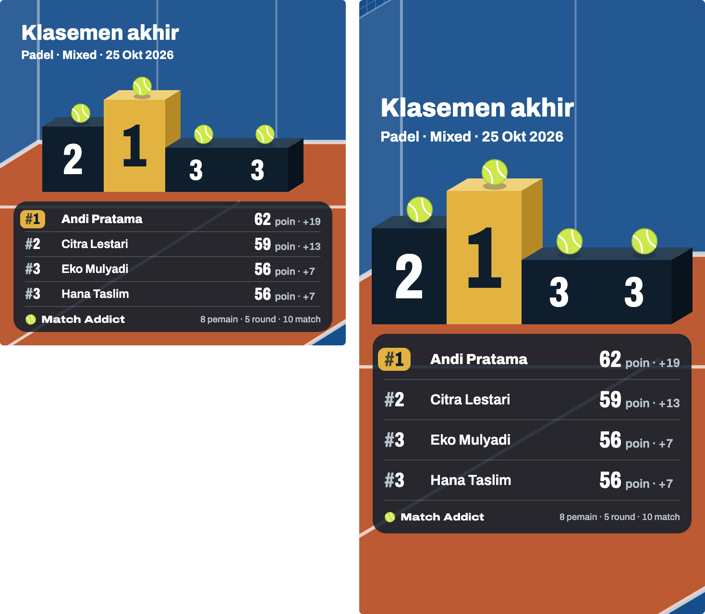

Komponen: `SharePoster`, `PodiumPoster (PodiumScenePainter)`

- Baris keempat senomor dengan baris ketiga, jadi ikut naik (keputusan 65). Urutan slot 2 · 1 · 3 · 4; dua #3 sama tinggi.
- Blok menyempit: Feed 64, Story 78. Panel empat baris; dasar blok ikut naik. Feed tetap 96 / 68 / 46; Story turun ke 139 / 100 / 67 (aturan batas tinggi).
- Data: 8 pemain, 10 match; 62 + 59 + 56 + 56 = 233, empat pemain lain 187 (52, 49, 45, 41); jumlah 420 = 10 × 21 × 2.

## 18i · Gambar · dipangkas · #1 #2 #3 #3 #3 → dua anak tangga

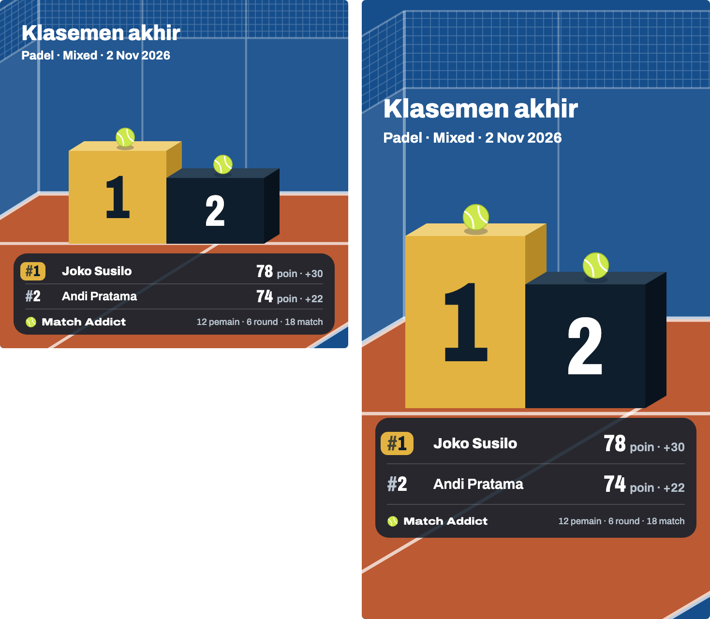

Komponen: `SharePoster`, `PodiumPoster (PodiumScenePainter)`

- Tiga pemain di #3 membuat podium jadi lima anak tangga, lebih dari empat → dipangkas ke kelompok nomor yang utuh: hanya #1 dan #2 (keputusan 65).
- Dua anak tangga: urutan 1 · 2, blok lebar 101 (Story 124), tanpa tempat kosong.
- Data: 12 pemain, 18 match; Joko 78 · +30, Andi 74 · +22, tiga pemain 67 · +8, tujuh lainnya 403 (jumlah 756).

## 18j · Gambar · hanya dua pasangan

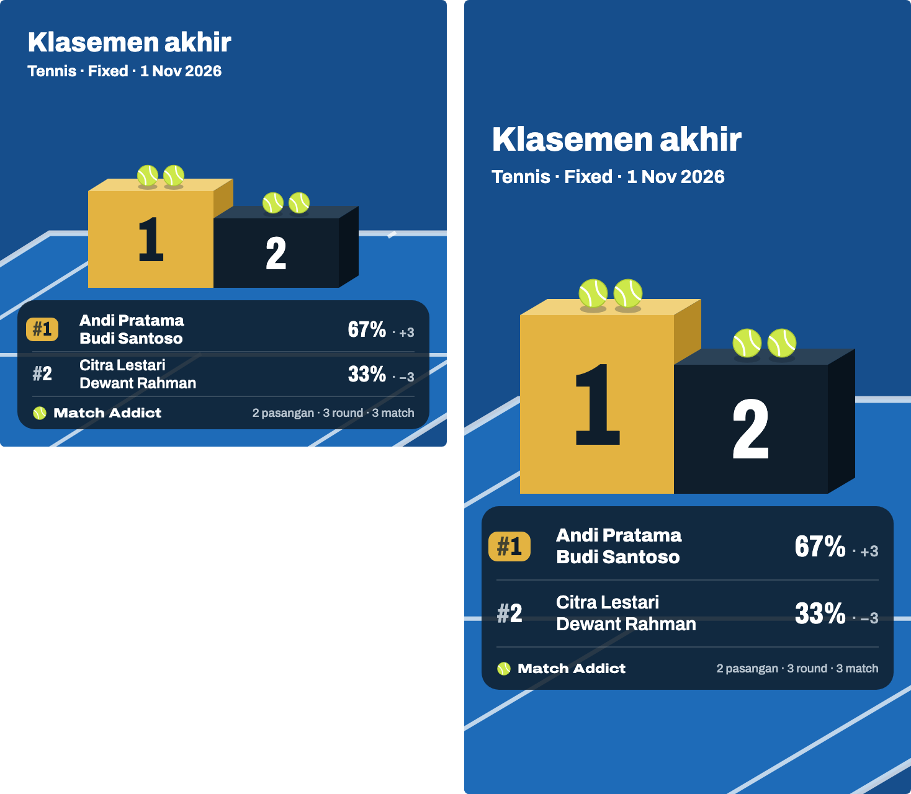

Komponen: `SharePoster`, `PodiumPoster (PodiumScenePainter)`

- Hanya dua baris bernomor → dua anak tangga, panel dua baris.
- Data: Tennis Fixed, Race to 6, 3 match (6–4, 3–6, 6–2): 2 dari 3 = 67%, game 15–12 = +3.

## 18k · Gambar · Sementara · R3

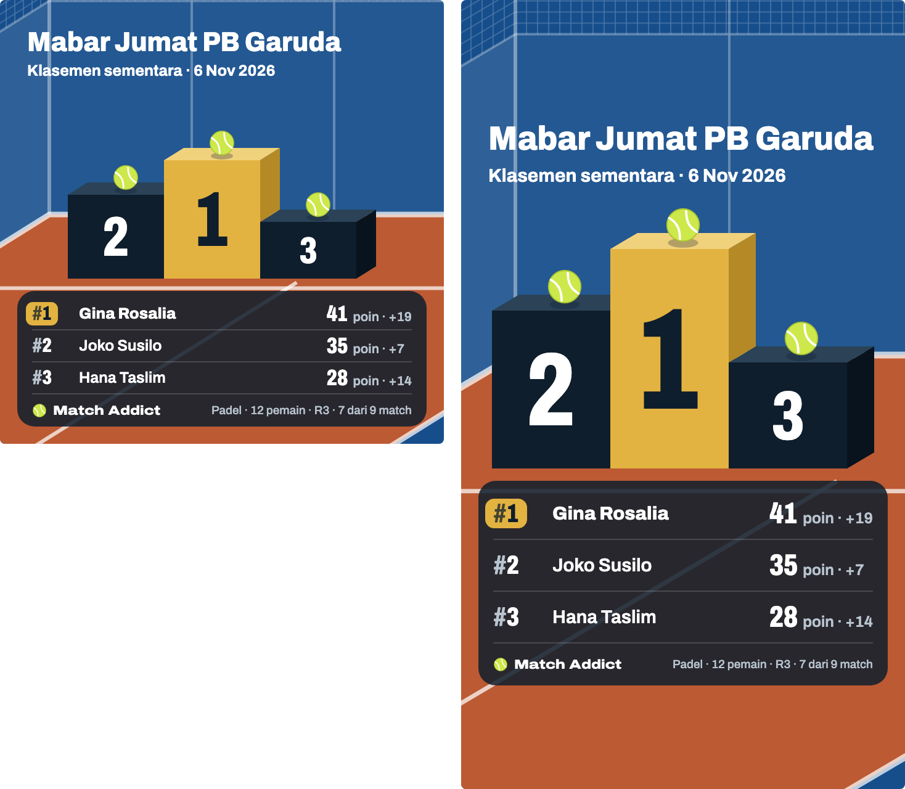

Komponen: `SharePoster`, `PodiumPoster (PodiumScenePainter)`

- Status terbaca dari baris kecil "Klasemen sementara · tanggal" dan fakta "R3 · 7 dari 9 match". Ilustrasi sama dengan Final; #1 tetap emas.
- Data: turnamen 18c saat R3 berjalan, 7 dari 9 match terisi. Gina dan Joko sudah main 3 kali, Hana 2 kali (28 · +14).

## 18l · Gambar · Fixed setelah pasangan diatur ulang · pasangan dan pemain bercampur

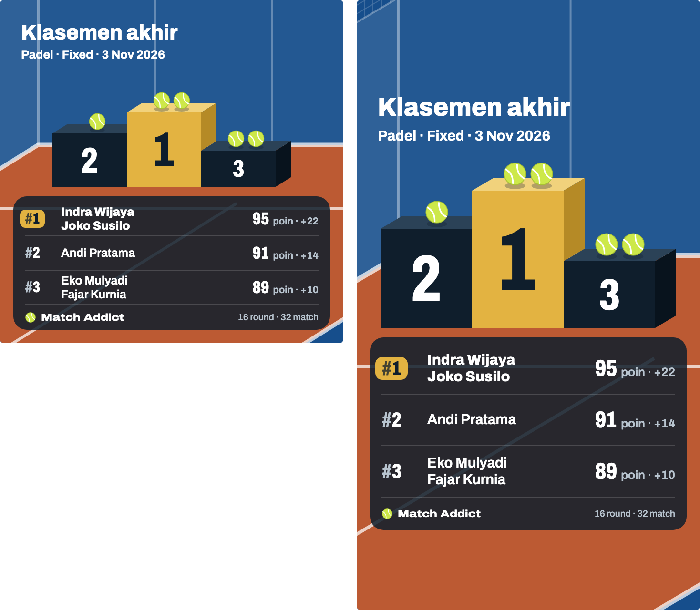

Komponen: `SharePoster`, `PodiumPoster (PodiumScenePainter)`

- Data 09g: #1 Indra + Joko, #2 Andi sendiri (pasangannya berubah), #3 Eko + Fajar. Blok pasangan dua bola, blok pemain tunggal satu bola.
- Ada baris berisi dua nama → semua baris memakai tinggi pasangan (Feed 36, Story 54) dan blok memakai tinggi pasangan; nama tunggal di tengah barisnya dengan huruf pasangan.
- Baris campuran: fakta tanpa hitungan pasangan/pemain ("16 round · 32 match"), sama dengan aturan "Semua n" di 09g.

## 18m · Gambar · nama sangat panjang · nama turnamen 40 karakter

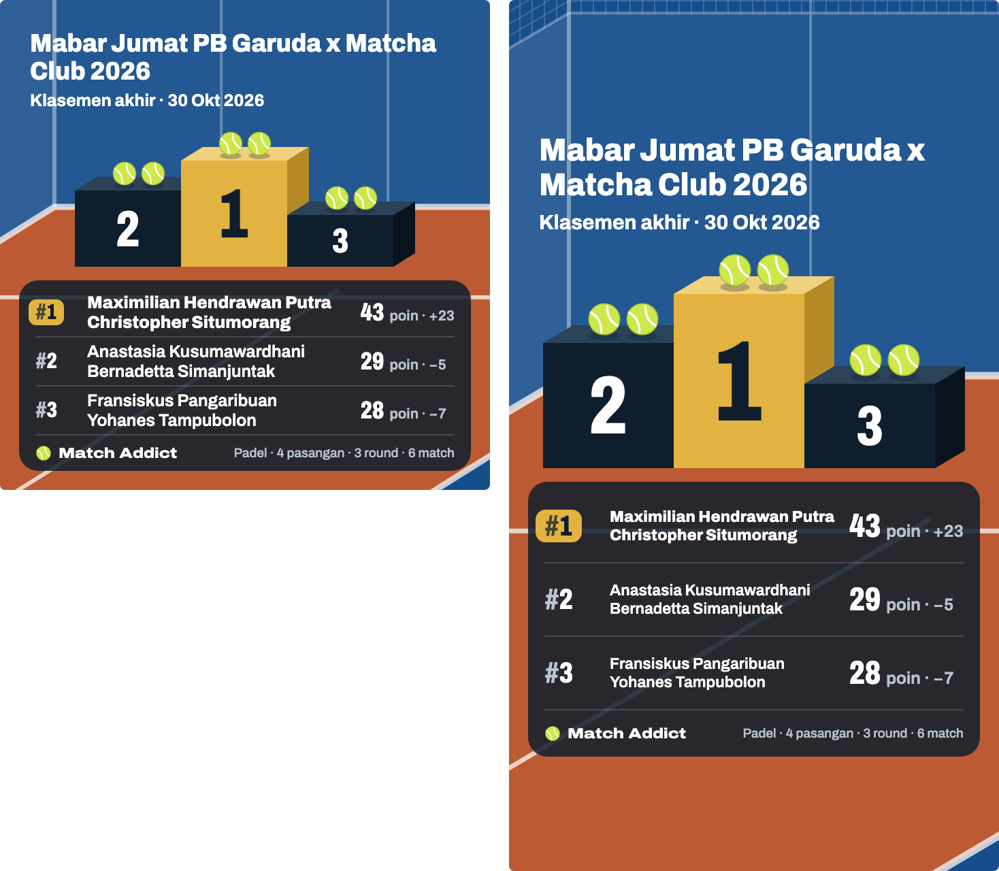

Komponen: `SharePoster`, `PodiumPoster (PodiumScenePainter)`

- Feed: keenam nama utuh di ukuran awal 12,5 (= baris kecil kepala, keputusan 92), termasuk yang 26 karakter.
- Story: nama 26 karakter tidak muat di 15, jadi semua nama di panel dikecilkan bersama ke 11,5 (batas bawah) dan tetap utuh. Lebih panjang lagi → elipsis per nama. Nilai tidak pernah terpotong.
- Nama turnamen 40 karakter (batasnya): dua baris, Feed 18,5 dan Story 23. Story: blok turun dari 144 / 104 / 70 ke 128 / 92 / 62.
- Data: Padel Fixed, Americano 21, 4 pasangan round-robin 6 match; selisih = 2 × poin − 63 (43 → +23, 29 → −5, 28 → −7).

## 18n · Gambar · Sparing · klub kedua unggul

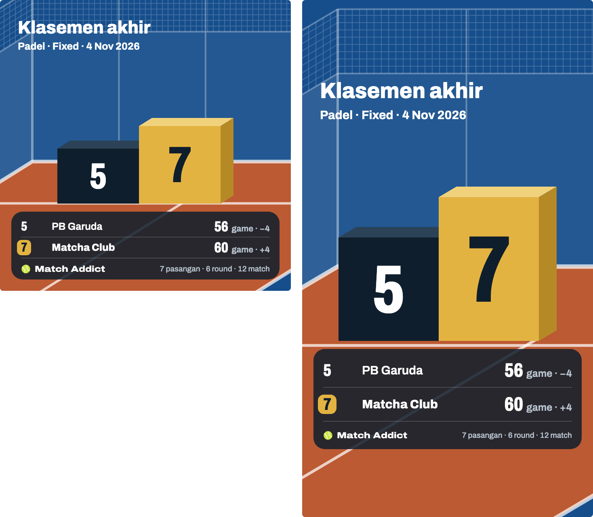

Komponen: `SharePoster`, `PodiumPoster (PodiumScenePainter)`

- Data 14s: PB Garuda 5 – 7 Matcha Club, Total Point 56 – 60. Klub pertama tetap blok kiri dan baris atas; emas, tinggi #1, dan lencana pindah ke klub kedua.
- Blok kiri lebih rendah dari tetangga kanannya, jadi tanpa muka samping.

## 18o · Gambar · Sparing · Seri

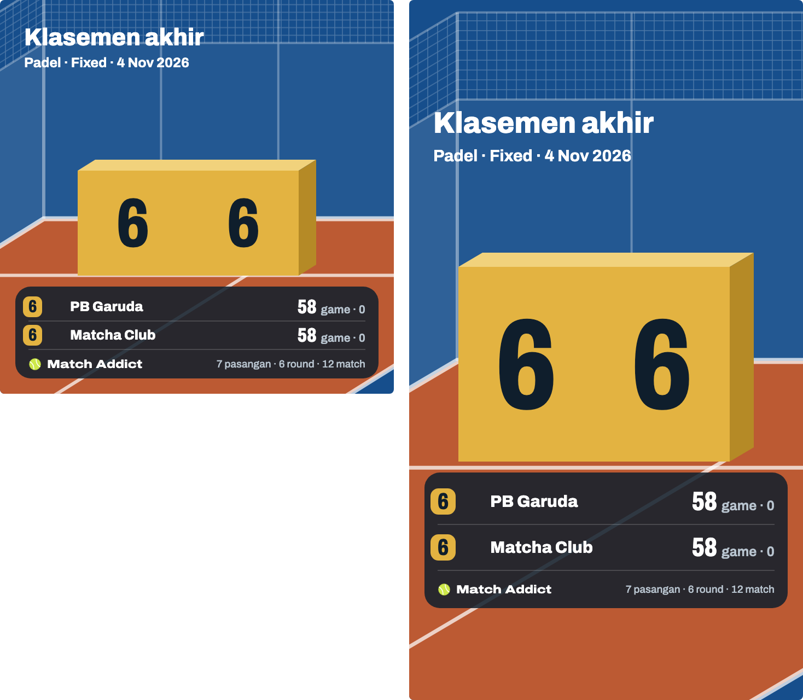

Komponen: `SharePoster`, `PodiumPoster (PodiumScenePainter)`

- Data 14t: match menang 6 – 6 dan Total Point 58 – 58 → Seri (K2). Dua blok emas sama tinggi, dua lencana emas; kata "Seri" tidak ditulis, sama dengan papan skor klub (14t).
- Match menang sama tetapi Total Point beda (mis. 6 – 6, 50 – 48): klub dengan Total Point lebih besar yang emas dan lebih tinggi, angkanya tetap 6 dan 6.

## 18p · Gambar · Sparing · match seri · 6½ – 5½

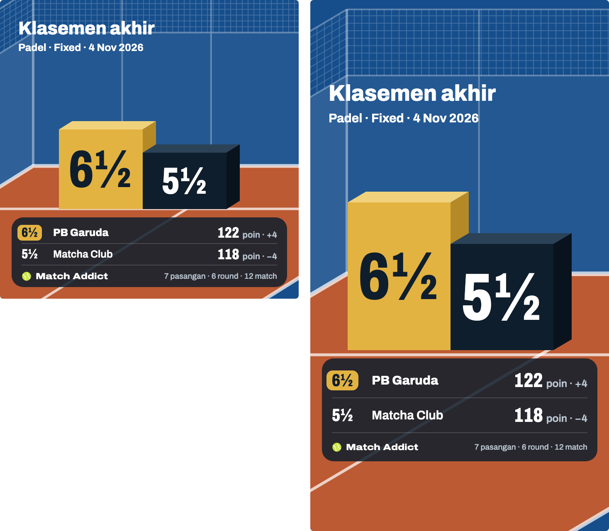

Komponen: `SharePoster`, `PodiumPoster (PodiumScenePainter)`

- Data 14u (Americano 20): setengah ditulis "6½" di muka blok dan di lencana. Angka lebih dari satu karakter dikecilkan sampai lebarnya ±70% lebar blok.

## 18q · Gambar · kombinasi kembar lain · Feed

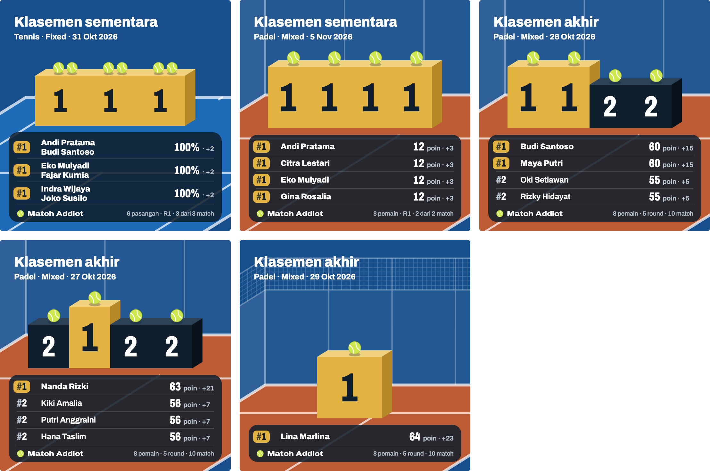

Komponen: `SharePoster`, `PodiumPoster (PodiumScenePainter)`

- Dari kiri: #1 #1 #1 (tiga pasangan, R1 Fixed) · #1 #1 #1 #1 · #1 #1 #2 #2 · #1 #2 #2 #2 · hanya #1. Semua mengikuti aturan yang sama: nomor menentukan tinggi dan warna, jumlah anak tangga menentukan lebar.
- Hanya #1: empat pemain di #2 membuat lima anak tangga → dipangkas ke kelompok utuh, tinggal #1 (keputusan 65). Satu blok selebar dua anak tangga (101).
- Data: #1 ×3 = Tennis Race to 6 setelah R1 dengan tiga skor 6–4; #1 ×4 = Americano 21 setelah R1 dengan dua skor 12–9; lainnya 8 pemain, 10 match (selisih = 2 × poin − 105); "hanya #1": Lina 64 · +23, empat pemain 53 · +1.

## 18r · Gambar · 12 tema · lapangan padel, lapangan tennis, lalu sepuluh gradien · Feed

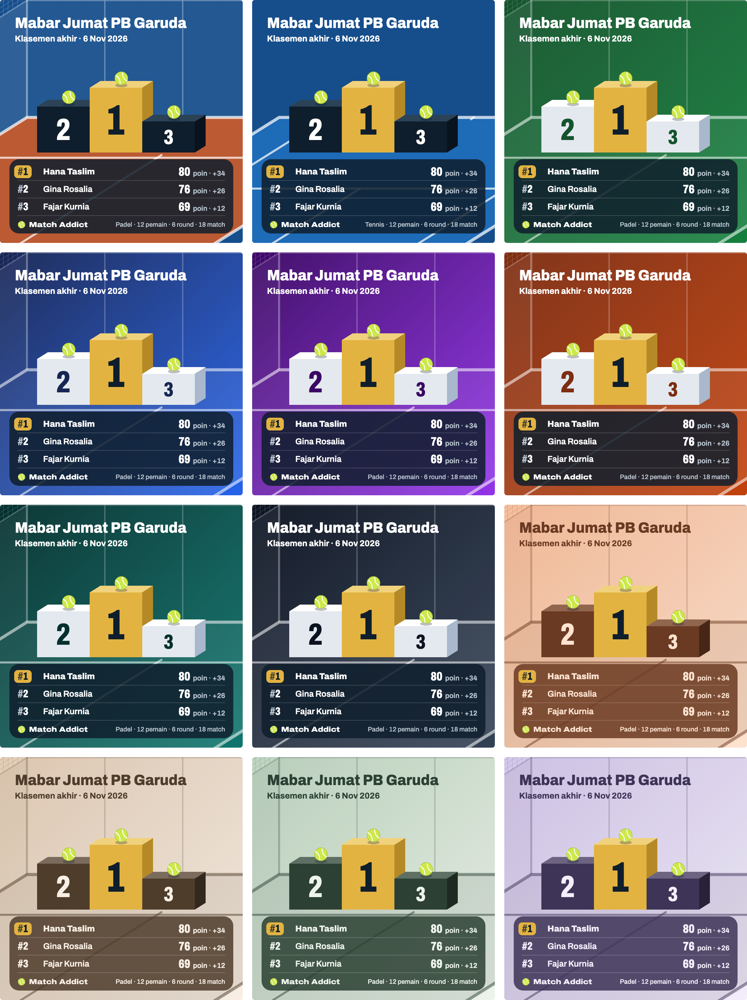

Komponen: `SharePoster`, `PodiumPoster (PodiumScenePainter)`

- Lapangan (bawaan): latar `court-deep`, lantai `padel` atau `court`, garis putih 72%, blok #2/#3 dan panel `ink`.
- Gradien gelap: lantai putih 10%, garis putih 55%, blok #2/#3 `#E3E9EE` dengan angka warna awal gradien, panel `ink`.
- Gradien lembut: lantai tinta tema 13%, garis tinta 50%, blok #2/#3 dan panel tinta tema, teks panel warna ujung terang gradien.
- Urutan: lapangan padel, lapangan tennis, hijau · biru, ungu, jingga · teal, malam, peach · nude, sage, lilac.
- Panel 86% di semua tema; kontras teks panel terburuk 5,3 (peach), angka lengkap di Komponen. Teks kepala: putih di lapangan 8,3; di gradien gelap paling rendah hijau 4,9 dan jingga 5,2 (diukur di titik paling terang yang dicapai judul); tinta tema di gradien lembut paling rendah peach 5,6.
- Emas di latar lembut hanya 1,2 : 1 sebagai bidang; #1 tetap terbaca dari tinggi, angka, dan tulisan tinta di atas emas.

## 18s · Feed + Story · lebih dari empat pemain di #1

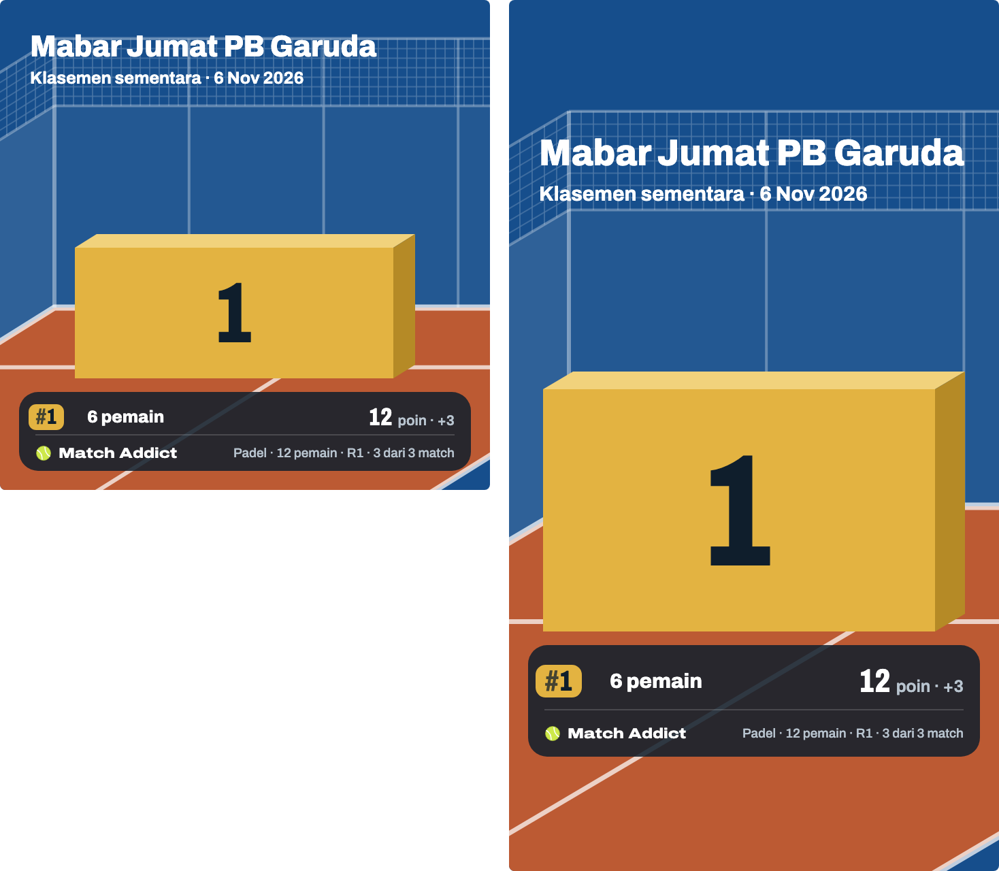

Komponen: `SharePoster`, `PodiumPoster (PodiumScenePainter)`

- Keputusan host 68 (2026-11-12). Aturan pangkas (keputusan 65) tidak menyisakan kelompok utuh kalau #1 sendiri berisi lebih dari empat: satu blok emas selebar tiga anak tangga, tanpa bola, dan satu baris panel "#1 · 6 pemain · 12 poin · +3" (Fixed: "6 pasangan").
- Contoh: Americano 21, 12 pemain, R1 dengan tiga skor 12–9 → enam pemain 12 · +3 di #1.

## 18t · Feed + Story · belum ada match selesai

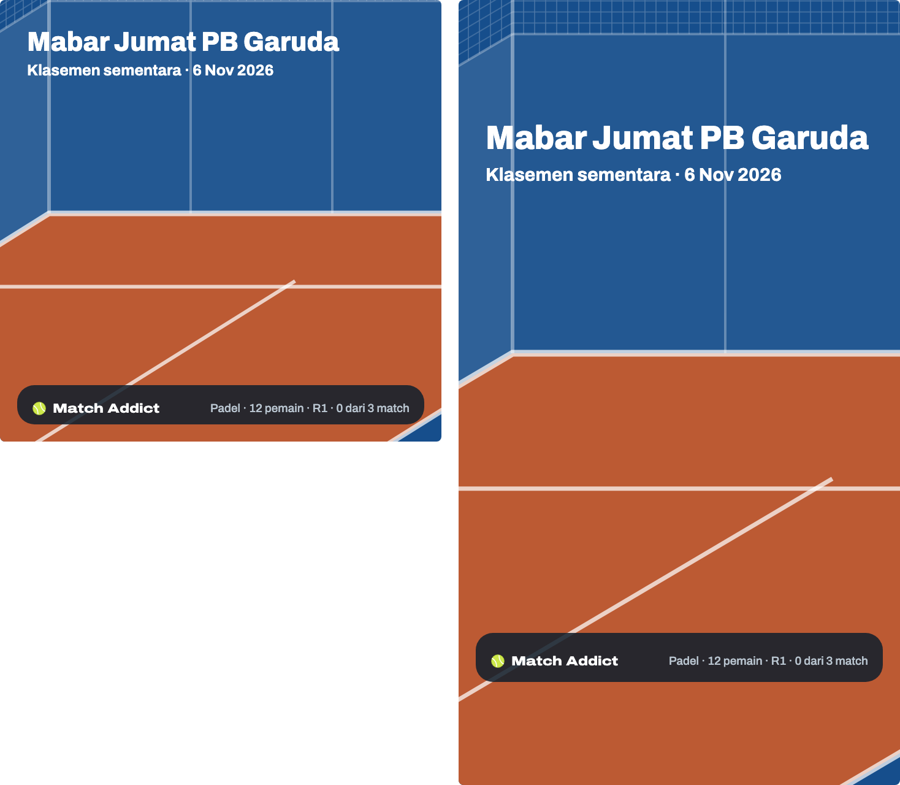

Komponen: `SharePoster`, `PodiumPoster (PodiumScenePainter)`

- Keputusan host 69 (2026-11-12). Semua pemain "Belum main", jadi tidak ada yang bernomor dan tidak ada yang naik: lapangan kosong tanpa blok; panel hanya wordmark dan baris fakta "R1 · 0 dari 3 match".
- Garis belakang lapangan di tempat yang sama dengan poster tiga baris (18c).
