# Grup + Gugur · persiapan

> Dihasilkan `tool/hifi_extract.py` dari `design/hifi.html`. Jangan diedit langsung.

Persiapan turnamen Grup + Gugur (PRD §16.1–16.2, keputusan 93–109, GU1–GU16; disetujui host 2026-11-17, keputusan 103). Hanya Fixed, mulai 12 pemain. Alur: Konfigurasi (format turnamen, jumlah grup, format fase grup, format per babak gugur + Perebutan juara 3, estimasi pasti) → Pasangan dibuka Manual → Grup (tempatkan tiap pasangan ke Grup A–D, Acak opsional) → dialog kunci → Jadwal fase grup (20). Contoh data: 16A (Padel, 16 pemain, 15 menit, 2 court × 2 jam, Race to 6; Semifinal Race to 6, juara 3 Race to 4, Final Race to 9), 16B (Tennis, 24 pemain, 20 menit, 2 court × 3 jam), PRD 16.4.

## 19a · Fixed · Round-robin · 16 pemain

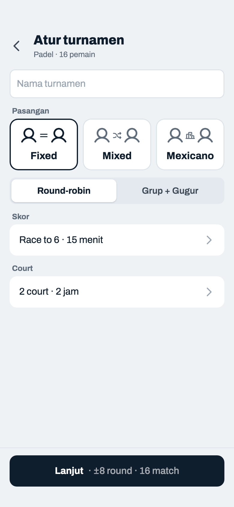

Komponen: `MabarAppBar`, `MabarButton`, `MabarIconButton`, `MabarActionBar`, `MabarGroup / MabarRow`, `MabarSegmented`, `MabarField`, `ModePicker`

- Pilihan format turnamen (`.seg` Round-robin / Group - Playoff, istilah GU1; label sejak 3.9.0, keputusan 127, ditulis persis dengan strip berspasi) muncul tepat di bawah kartu mode, hanya saat Fixed dipilih **dan** pemain ≥ 12 (6 pasangan, G2). Di bawah 12 pemain, Mixed, Mexicano, dan Sparing (GU14) segmented ini tidak ada, jadi 03a–03q dan 13h–13j tetap seperti sekarang (8 pemain).
- Tanpa label grup: dua pilihan sudah menjelaskan diri, seperti kartu mode. Default Round-robin; layar ini sama dengan 03a ditambah satu baris segmented, estimasi tetap ±round dari booking: 120 ÷ 15 = 8 round × 2 court = 16 match.
- Pindah ke Mixed/Mexicano menyembunyikan segmented; kembali ke Fixed memulihkan pilihan terakhir di layar itu (asumsi).

## 19b · Grup + Gugur dipilih · 2 grup · default

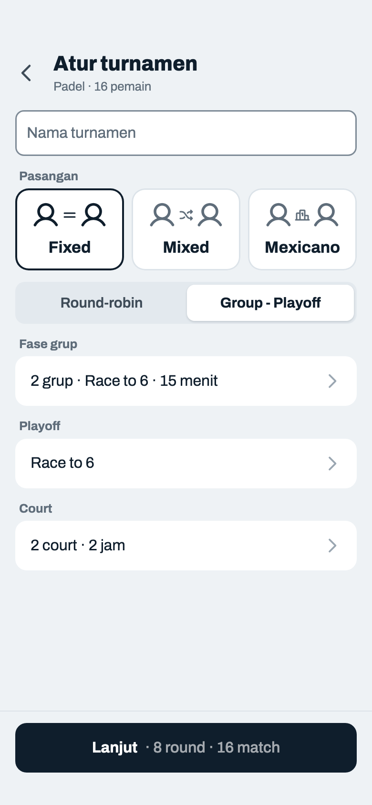

Komponen: `MabarAppBar`, `MabarButton`, `MabarIconButton`, `MabarActionBar`, `MabarGroup / MabarRow`, `MabarSegmented`, `MabarField`, `ModePicker`

- Grup + Gugur mengganti label "Skor" dengan dua baris nilai: **Fase grup** (jumlah grup · format grup · durasi) dan **Playoff** (format babak gugur). Ketuk → sheet 19c/19d dan 19e/19j. Layar tetap muat tanpa digulir (keputusan 33).
- Jumlah grup default 2. Format babak gugur default = format grup (GU9); selama host belum mengubah satu babak, babak itu ikut format grup (asumsi). Perebutan juara 3 default ada (keputusan 100), jadi baris Playoff tidak menulisnya; hanya kalau dimatikan baris menulis "tanpa Juara 3" (19g).
- Baris Playoff meringkas semua babak: sama semua → "Race to 6"; format sama, N beda → rentang "Race to 4–9" (pola "1–2 jam" di 03h); format beda → "Race to / Best of".
- Estimasi pasti (keputusan 19, PRD 16.2), tanpa "±": contoh 16A, 16 pemain = 8 pasangan → Grup A dan B masing-masing 4 pasangan, 6 match di Court 1 dan Court 2 → R1–R6; R7 SF1 + SF2; R8 Final + Perebutan juara 3. 8 round × 15 menit = 120 menit = booking, tidak lewat. Match: 6 + 6 + 2 + 1 + 1 = 16.
- Lanjut → Pasangan dibuka Manual (19m).

## 19c · Sheet Fase grup · 8 pasangan · hanya 2 grup

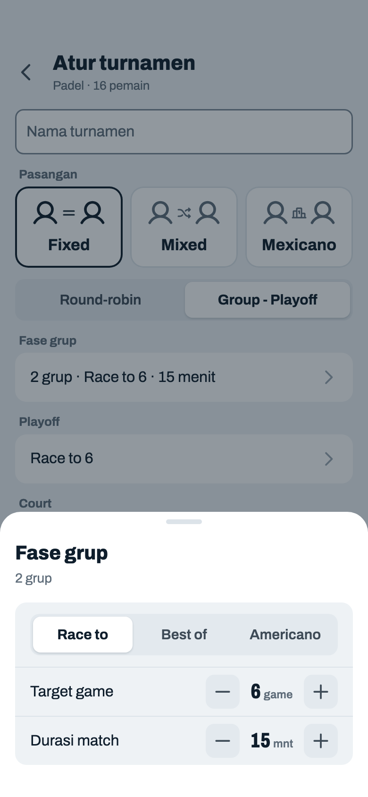

Komponen: `MabarAppBar`, `MabarButton`, `MabarIconButton`, `MabarActionBar`, `MabarGroup / MabarRow`, `MabarSegmented`, `MabarStepper`, `MabarField`, `showMabarSheet`, `ModePicker`

- Isi sheet = sheet Skor 03d apa adanya (format, angka, durasi) dengan judul "Fase grup". Jenis kelola: perubahan langsung berlaku di baris Fase grup dan estimasi.
- 8 pasangan (< 12) hanya bisa 2 grup, jadi pilihan jumlah grup tidak ditampilkan; jumlahnya ditulis sebagai subjudul fakta "2 grup", seperti "Americano" di 03e. 22 pemain (11 pasangan) sama.
- Durasi match satu untuk semua match, grup dan gugur (PRD 16.12: durasi per babak belum sekarang); karena itu durasi hanya ada di sheet ini dan di baris Fase grup.

## 19d · Sheet Fase grup · 12 pasangan · 4 grup

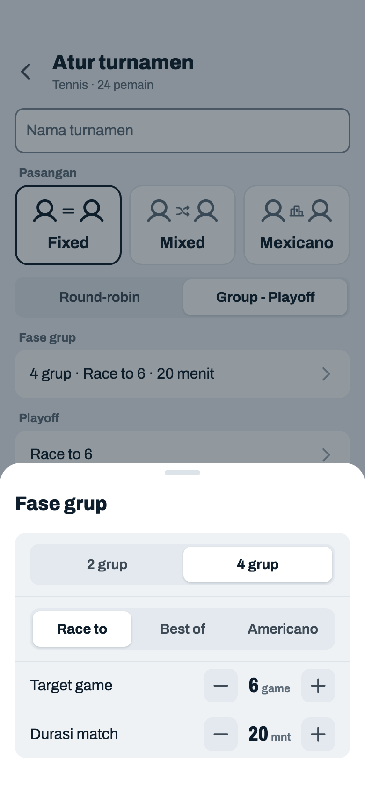

Komponen: `MabarAppBar`, `MabarButton`, `MabarIconButton`, `MabarActionBar`, `MabarGroup / MabarRow`, `MabarSegmented`, `MabarStepper`, `MabarField`, `showMabarSheet`, `ModePicker`

- Mulai 12 pasangan (24 pemain) baris pertama sheet = segmented "2 grup / 4 grup" (G2, keputusan 94). Tidak ada pilihan 3 grup atau lainnya.
- Ukuran grup ditetapkan app, tidak dipilih di sini: 12 / 4 = 3 + 3 + 3 + 3; 13 / 4 = 4 + 3 + 3 + 3; 15 / 4 = 4 + 4 + 4 + 3 (yang lebih besar huruf lebih awal, GU2). Terbaca di layar Grup (19r).
- Contoh 16B (Tennis, 20 menit, 2 court × 3 jam): 4 grup × 3 pasangan → Court 1 A/C bergantian, Court 2 B/D → R1–R6; R7–R8 Perempat final; R9 Semifinal; R10 Final + Perebutan juara 3. 10 × 20 = 200 menit > 180 → "lewat booking 00:20" (format 14f: round + kelebihan, tanpa jumlah match).
- Kembali ke 2 grup → 6 + 6 pasangan, estimasi ikut berubah.

## 19e · Sheet Playoff · 2 grup · format per babak

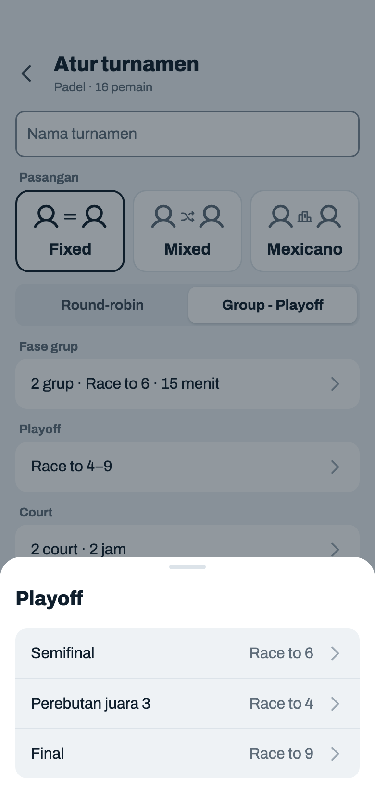

Komponen: `MabarAppBar`, `MabarButton`, `MabarIconButton`, `MabarActionBar`, `MabarGroup / MabarRow`, `MabarSegmented`, `MabarField`, `showMabarSheet`, `ModePicker`

- Satu baris per babak, urut main: (Perempat final), Semifinal, Perebutan juara 3, Final (keputusan 99, GU1). 2 grup → tiga baris; 4 grup → empat (19j). Ketuk baris → sheet babak di atasnya (19f, 19g).
- Contoh 16A: Semifinal Race to 6, Perebutan juara 3 Race to 4, Final Race to 9 → baris Playoff di layar "Race to 4–9".
- Sheet jenis kelola, tanpa footer. Format babak dan Perebutan juara 3 hanya diatur di sini; mengubahnya setelah jadwal dibuat ditunda ke 3.10.0 (keputusan 104, 120).

## 19f · Sheet Final · di atas sheet Playoff

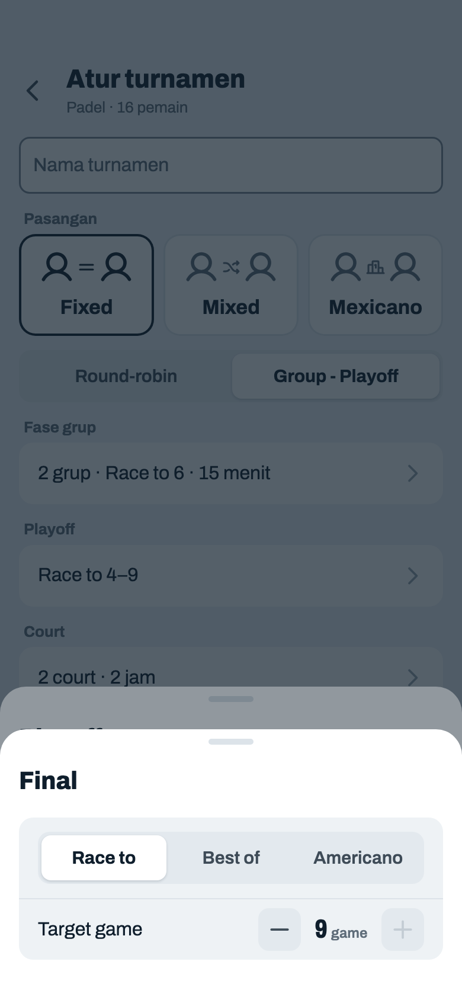

Komponen: `MabarAppBar`, `MabarButton`, `MabarIconButton`, `MabarActionBar`, `MabarGroup / MabarRow`, `MabarSegmented`, `MabarStepper`, `MabarField`, `showMabarSheet`, `ModePicker`

- Sheet babak = isi sheet Skor 03d tanpa durasi: segmented Race to / Best of / Americano + angka. Ditumpuk di atas sheet Playoff dengan scrim kedua, seperti sheet warna 03k. Tutup → kembali ke sheet Playoff dengan baris yang sudah berubah.
- Race to 9 = batas atas Race to (2–9), jadi + mati. Race to selalu menghasilkan pemenang, jadi semua N boleh.

## 19g · Sheet Perebutan juara 3 · Tidak ada

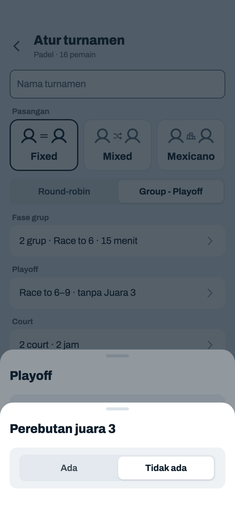

Komponen: `MabarAppBar`, `MabarButton`, `MabarIconButton`, `MabarActionBar`, `MabarGroup / MabarRow`, `MabarSegmented`, `MabarField`, `showMabarSheet`, `ModePicker`

- Sheet Perebutan juara 3 punya satu baris tambahan di atas: segmented "Ada / Tidak ada" (keputusan 100, default Ada). Tidak ada → format babak disembunyikan; Ada lagi → format terakhirnya (Race to 4) kembali.
- Baris di sheet Playoff menulis "Tidak ada"; baris Playoff di layar menulis "Race to 6–9 · tanpa Juara 3" (rentang hanya dari babak yang dimainkan).
- Estimasi: R7 SF1 + SF2, R8 Final saja → tetap 8 round, match 16 → 15. Dengan 1 court juara 3 menghemat satu round (16 → 15).
- Akibat di podium (tanpa juara 3 = dua pasangan #3, AC-G18) tidak ditulis di sini; terlihat di Klasemen dan Bagikan.

## 19h · Fase grup Best of 6 · babak gugur Best of 7

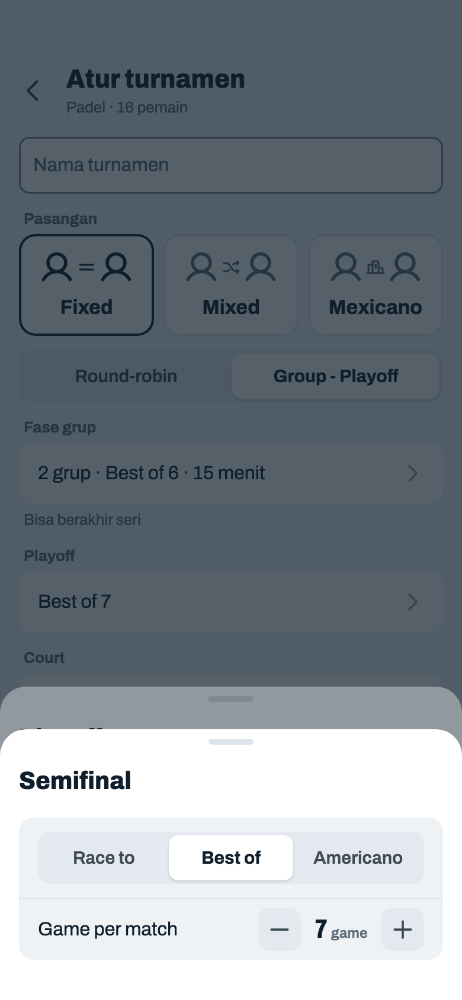

Komponen: `MabarAppBar`, `MabarButton`, `MabarIconButton`, `MabarActionBar`, `MabarGroup / MabarRow`, `MabarSegmented`, `MabarStepper`, `MabarField`, `showMabarSheet`, `ModePicker`

- Fase grup boleh N genap (Best of 6 bisa seri, catatan "Bisa berakhir seri" seperti 03f). Gugur tidak boleh seri (G10), jadi default babak = N + 1 = Best of 7 (GU9). Tanpa kalimat penjelas: akibatnya terbaca di angka.
- Di sheet babak, stepper Best of dan Americano melompat 2 (Best of 1, 3, … 15; Americano 3, 5, … 99): 7 → 5 atau 9. Angka genap yang diketik dinaikkan ke ganjil berikutnya (Americano 98 → 99 adalah batas).
- Race to tidak berubah (semua N boleh). Ganti segmented ke Best of / Americano dari Race to: N = default format (5 / 21), sudah ganjil.

## 19i · 4 grup · 24 pemain · lewat booking

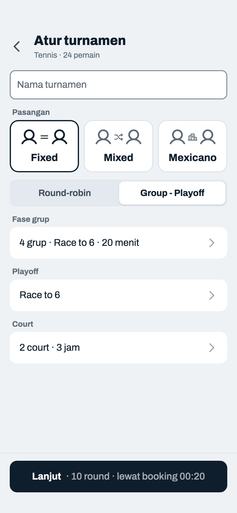

Komponen: `MabarAppBar`, `MabarButton`, `MabarIconButton`, `MabarActionBar`, `MabarGroup / MabarRow`, `MabarSegmented`, `MabarField`, `ModePicker`

- Contoh 16B (AC-G4): 24 pemain = 12 pasangan, 4 grup × 3. Fase grup R1–R6 (3 match per grup, dua grup bergantian per court), gugur R7–R10 → 10 round × 20 menit = 200 menit, booking terpendek 3 jam → lewat 00:20.
- Lewat booking tidak mematikan tombol, sama dengan Fixed sparing 14f: host menghentikan lewat Akhiri. Tombol menulis round + kelebihan saja; jumlah match (12 + 4 + 2 + 1 + 1 = 20) tidak ditulis.
- 22 pemain (11 pasangan) → sheet Fase grup tanpa pilihan 4 grup (19c); turnamen terakhir 4 grup lalu pemain turun di bawah 24 → terisi 2 grup (asumsi).

## 19j · Sheet Playoff · 4 grup

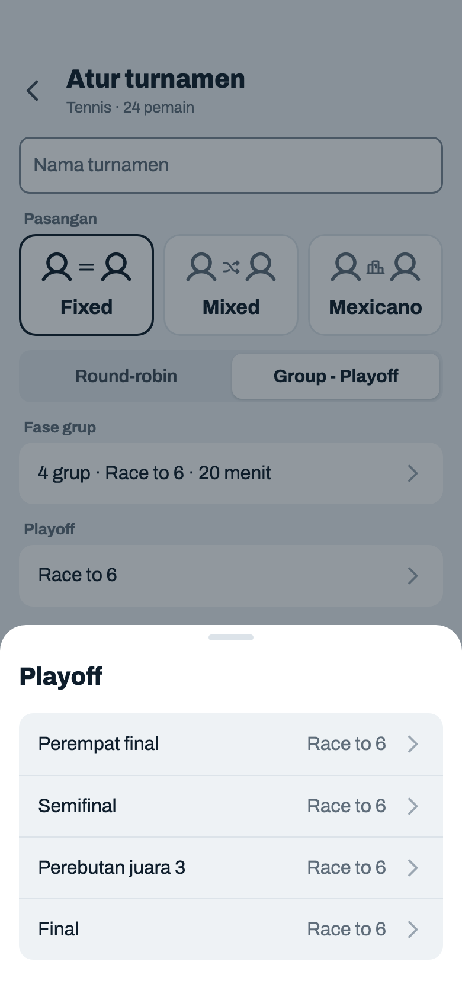

Komponen: `MabarAppBar`, `MabarButton`, `MabarIconButton`, `MabarActionBar`, `MabarGroup / MabarRow`, `MabarSegmented`, `MabarField`, `showMabarSheet`, `ModePicker`

- 4 grup menambah baris Perempat final di atas. Semua babak default = format grup (Race to 6).
- Pindah 4 → 2 grup menghilangkan baris Perempat final; format yang sudah diatur untuk babak lain tetap.

## 19k · 1 court · 16A · lewat booking 02:00

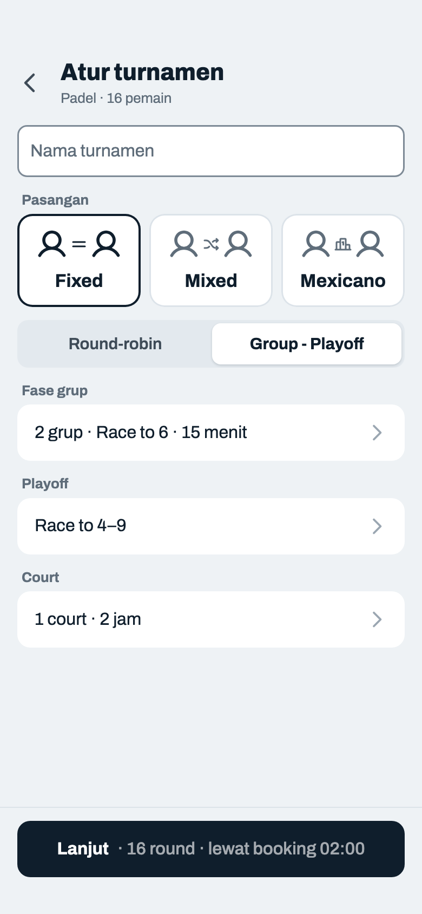

Komponen: `MabarAppBar`, `MabarButton`, `MabarIconButton`, `MabarActionBar`, `MabarGroup / MabarRow`, `MabarSegmented`, `MabarField`, `ModePicker`

- Varian 1 court contoh 16A (AC-G3): Court 1 bergantian A, B, A, B → fase grup R1–R12; R13 SF1, R14 SF2, R15 Perebutan juara 3, R16 Final (GU10: 1 court → juara 3 dulu). 16 round × 15 = 240 menit, booking 2 jam → lewat 02:00.
- Lebar tombol: "Lanjut · 16 round · lewat booking 02:00" muat di 358 pt (diukur, tanpa elipsis).

## 19l · Durasi tidak muat · tombol mati

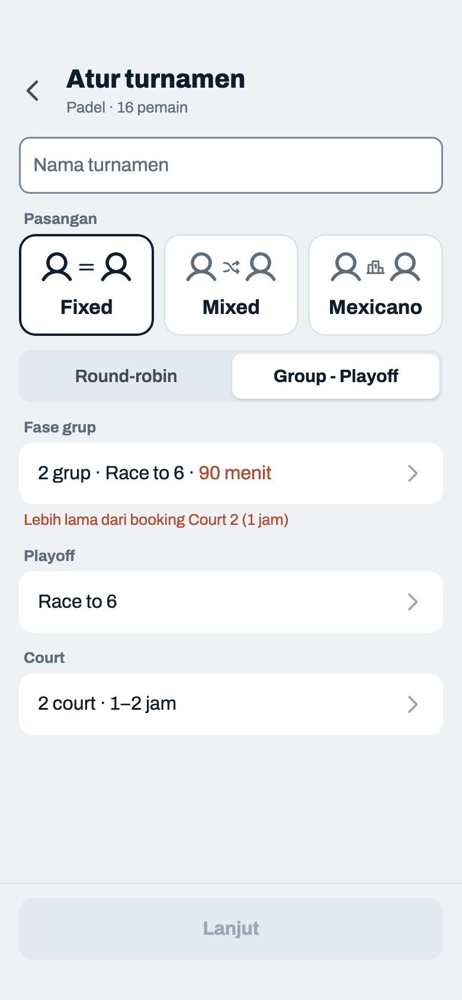

Komponen: `MabarAppBar`, `MabarButton`, `MabarIconButton`, `MabarActionBar`, `MabarGroup / MabarRow`, `MabarSegmented`, `MabarField`, `ModePicker`

- Aturan 03l berlaku sama (asumsi, PRD §16 tidak menyebutnya): booking terpendek ÷ durasi = 0 (60 ÷ 90) → durasi clay di baris Fase grup, catatan error di bawahnya menyebut court penyebab, tombol mati polos. Catatan yang sama di sheet Fase grup dan sheet Court.
- Catatan pindah ke bawah baris Fase grup karena durasi ada di sana (di round-robin di bawah baris Skor).

## 19m · Pasangan · Grup + Gugur · dibuka Manual · kosong

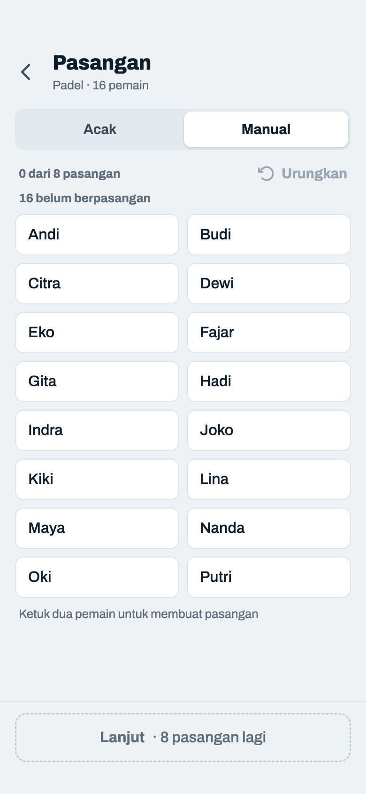

Komponen: `MabarAppBar`, `MabarButton`, `MabarTextButton`, `MabarIconButton`, `MabarActionBar`, `MabarGroup / MabarRow`, `MabarGroupHeader`, `MabarSegmented`, `MabarChip`

- Grup + Gugur membuka layar Pasangan dalam mode **Manual** (keputusan 95, G3), bukan Acak seperti round-robin (04a). Layar, chip, dan interaksi = 04b.
- Tombol "Lanjut" (tanpa ikon kunci) karena berikutnya layar Grup; kunci + dialog ada di "Buat jadwal" layar Grup (19y). Alasan tombol menunggu = "8 pasangan lagi" (pola 04b).
- Urungkan mati selama belum ada pasangan (04b) — digambar tinta pudar.

## 19n · Pasangan · Manual · sebagian · sedang memilih

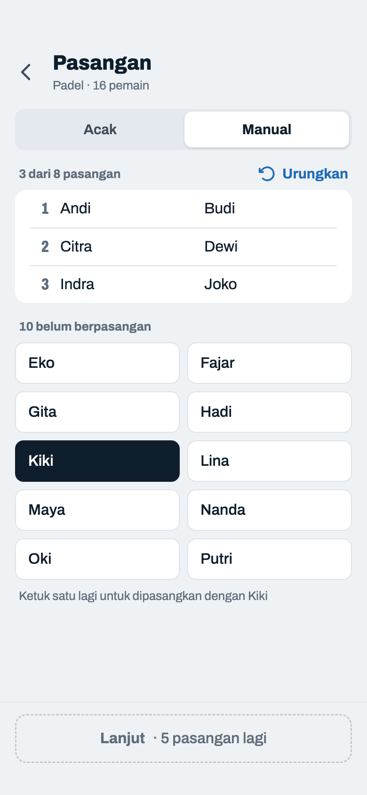

Komponen: `MabarAppBar`, `MabarButton`, `MabarTextButton`, `MabarIconButton`, `MabarActionBar`, `MabarGroup / MabarRow`, `MabarGroupHeader`, `MabarSegmented`, `PairList`, `MabarChip`

- Sama dengan 04b: ketuk dua pemain → baris baru di daftar atas. 3 pasangan jadi, 10 pemain tersisa, Kiki terpilih.

## 19o · Pasangan · Manual · lengkap

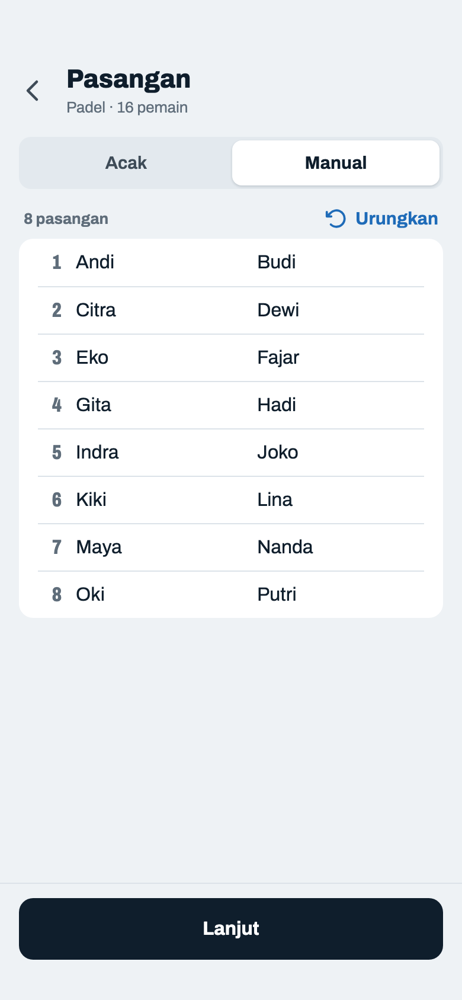

Komponen: `MabarAppBar`, `MabarButton`, `MabarTextButton`, `MabarIconButton`, `MabarActionBar`, `MabarGroup / MabarRow`, `MabarGroupHeader`, `MabarSegmented`, `PairList`

- Semua pemain berpasangan: label jadi jumlah saja ("8 pasangan", sama dengan 04a), chip dan catatan hilang, tombol aktif.
- Lanjut → Grup (19r). Kembali dari Grup ke sini: pasangan tetap. Pasangan diubah lalu Lanjut lagi → pasangan yang berubah keluar dari grupnya, yang lain tetap di grupnya (asumsi).

## 19p · Pasangan · Acak dipilih

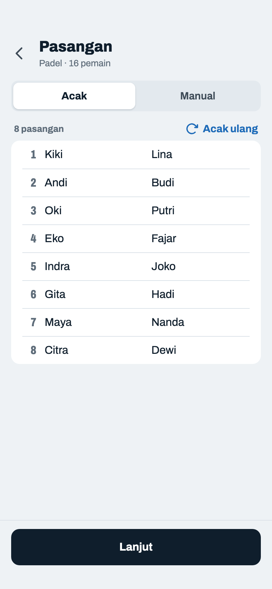

Komponen: `MabarAppBar`, `MabarButton`, `MabarTextButton`, `MabarIconButton`, `MabarActionBar`, `MabarGroup / MabarRow`, `MabarGroupHeader`, `MabarSegmented`, `PairList`

- Acak tetap bisa dipilih (G3). Sama dengan 04a; pindah ke Acak dengan pasangan manual yang sudah jadi → dialog "Buang N pasangan manual?" (04i), kembali ke Manual mengosongkan tanpa dialog (04b).

## 19q · Pasangan · 17 pemain · ganjil

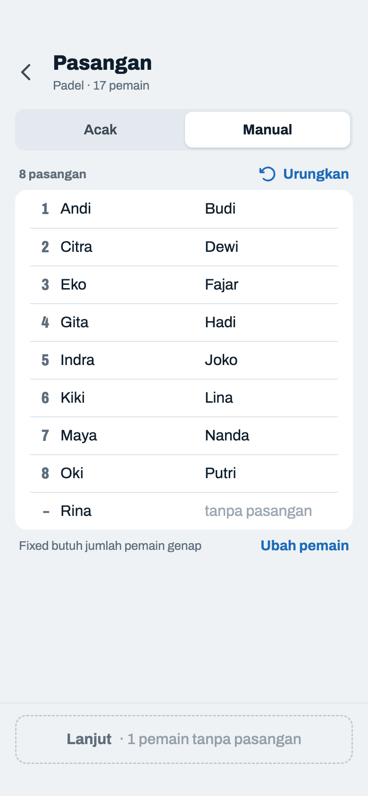

Komponen: `MabarAppBar`, `MabarButton`, `MabarTextButton`, `MabarIconButton`, `MabarActionBar`, `MabarGroup / MabarRow`, `MabarGroupHeader`, `MabarSegmented`, `PairList`

- Pemain ganjil tetap menahan tombol (G3, 04c): pemain terakhir jadi baris "–" begitu chip-nya tinggal satu. "Ubah pemain" → layar Pemain.
- 17 pemain = 8 pasangan + 1: Grup + Gugur tetap ditawarkan di Konfigurasi (8 pasangan ≥ 6).

## 19r · Grup · Manual · kosong · 2 grup

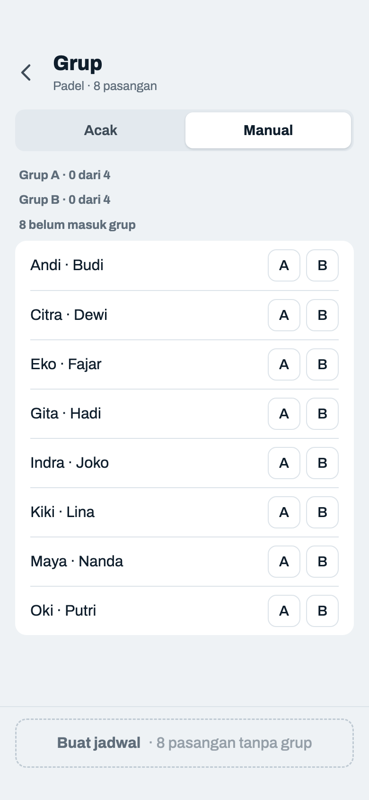

Komponen: `MabarAppBar`, `MabarButton`, `MabarIconButton`, `MabarActionBar`, `MabarGroup / MabarRow`, `MabarSegmented`, `PairList`, `MabarChip`

- Layar baru setelah Pasangan (PRD 16.2, G4). Dibuka Manual (keputusan 95); Acak opsional (GU2, 19u). Subjudul = olahraga · jumlah pasangan.
- Label tiap grup = ukuran yang ditetapkan app ("0 dari 4"): 8 / 2 = 4 + 4. Grup kosong hanya labelnya.
- Tiap baris pasangan punya chip huruf grup (`.chip` 40 × 40, jarak 8, area ketuk 48 × 52 setinggi baris; PATCH 3.8.1): ketuk "A" → pasangan pindah ke daftar Grup A, chip A gelap. Ketuk huruf lain → pindah grup; ketuk huruf yang sama → kembali ke "Tanpa grup". Tanpa Urungkan: tiap langkah dibalik dengan satu ketukan.
- Nama pasangan satu baris "Andi · Budi" (pola PRD), elipsis kalau terlalu panjang.

## 19s · Grup · Manual · sebagian

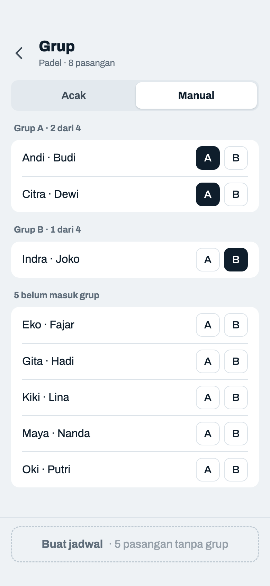

Komponen: `MabarAppBar`, `MabarButton`, `MabarIconButton`, `MabarActionBar`, `MabarGroup / MabarRow`, `MabarSegmented`, `PairList`, `MabarChip`

- Host menyebar pasangan kuat: Andi · Budi dan Citra · Dewi ke A, Indra · Joko ke B → "5 pasangan tanpa grup". Urutan di grup = urutan masuk; itu urutan round-robin grup (PRD 16.10).
- Baris yang masuk grup pindah ke daftar grupnya (seperti pasangan jadi di 04b), jadi tiap pasangan hanya di satu tempat.

## 19t · Grup · Manual · lengkap · 4 + 4

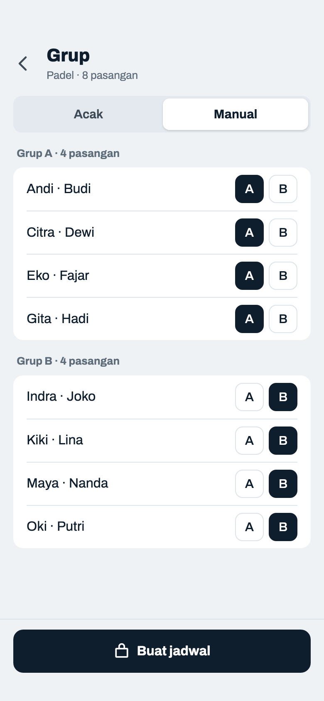

Komponen: `MabarAppBar`, `MabarButton`, `MabarIconButton`, `MabarActionBar`, `MabarGroup / MabarRow`, `MabarSegmented`, `PairList`, `MabarChip`

- Contoh 16A: Grup A = Andi · Budi, Citra · Dewi, Eko · Fajar, Gita · Hadi; Grup B = Indra · Joko, Kiki · Lina, Maya · Nanda, Oki · Putri. Label penuh = jumlah saja ("4 pasangan").
- Buat jadwal aktif hanya kalau semua pasangan punya grup dan ukuran tiap grup sama dengan yang ditetapkan (G4, AC-G2). Ikon kunci + dialog 19y, seperti 04a/04d.
- Chip tetap bisa diketuk: memindah pasangan dari grup penuh membuat grup lain kelebihan (19v) sampai ada yang dipindah balik.

## 19u · Grup · Acak dipilih

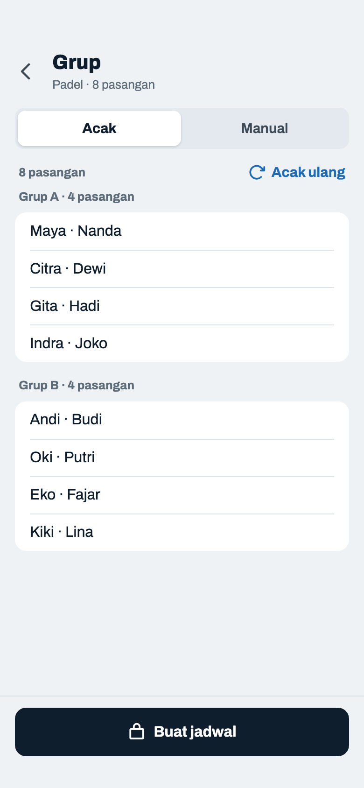

Komponen: `MabarAppBar`, `MabarButton`, `MabarTextButton`, `MabarIconButton`, `MabarActionBar`, `MabarGroup / MabarRow`, `MabarGroupHeader`, `MabarSegmented`, `PairList`

- Acak opsional (GU2): semua pasangan langsung terbagi, ukuran ikut yang ditetapkan. "Acak ulang" di label jumlah, seperti 04a. Baris tanpa chip (tidak bisa diketuk), tinggi 40 pt.
- Aturan pindah: ke Acak membuang hasil Manual dan kembali ke Manual mengosongkan semua grup, keduanya tanpa dialog (keputusan 103 dan 116; beda dengan Pasangan 04i).

## 19v · Grup · 7 pasangan · 5 + 2 · tidak valid

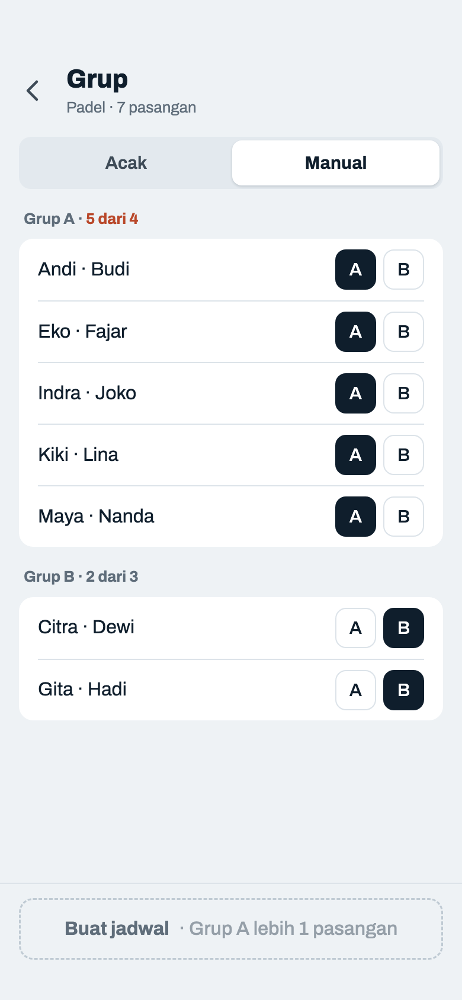

Komponen: `MabarAppBar`, `MabarButton`, `MabarIconButton`, `MabarActionBar`, `MabarGroup / MabarRow`, `MabarSegmented`, `PairList`, `MabarChip`

- Kasus PRD 16.4 / AC-G2: 7 pasangan → ukuran 4 + 3 (yang lebih besar Grup A, GU2). Host menaruh 5 di A dan 2 di B: semua punya grup, tapi Buat jadwal tetap menunggu.
- Angka grup yang kelebihan clay ("5 dari 4"); alasannya di tombol: "Grup A lebih 1 pasangan". Grup B "2 dari 3" tinta biasa (kurangnya akibat A kelebihan). Pindah satu pasangan dari A ke B → 4 + 3, tombol aktif.
- Urutan alasan di tombol: ada grup kelebihan → "Grup X lebih n pasangan" (grup pertama urut huruf); kalau tidak → "n pasangan tanpa grup". 3 + 4 juga ditolak: "Grup B lebih 1 pasangan" (B ditetapkan 3).

## 19w · Grup · 4 grup · 15 pasangan · sebagian (terpadat)

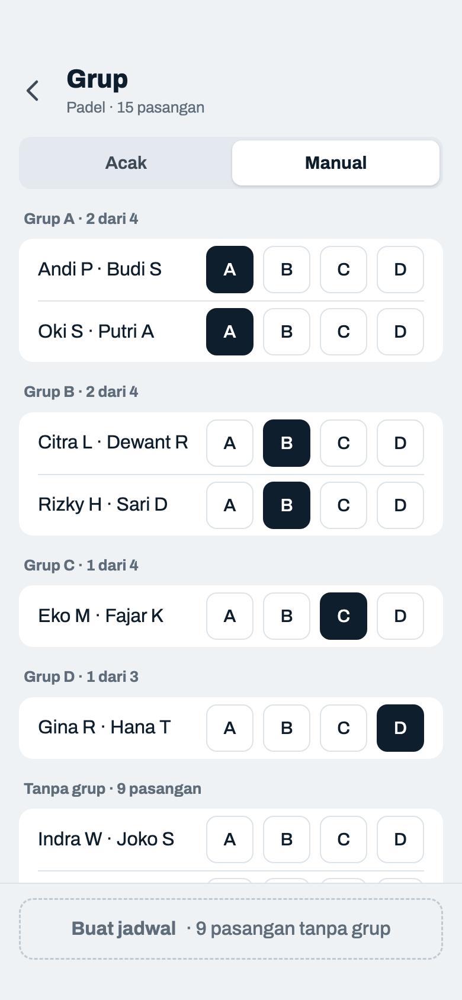

Komponen: `MabarAppBar`, `MabarButton`, `MabarIconButton`, `MabarActionBar`, `MabarGroup / MabarRow`, `MabarSegmented`, `PairList`, `MabarChip`

- Terpadat: 30 pemain = 15 pasangan, 4 grup → 4 + 4 + 4 + 3. Empat chip per baris (A–D); nama satu baris sisa ±150 pt, elipsis kalau lebih.
- Halaman digulir seperti 04e; app bar dan action bar tetap. Frame di posisi gulir paling atas.

## 19x · Grup · 4 grup · 13 pasangan · lengkap · digulir ke bawah

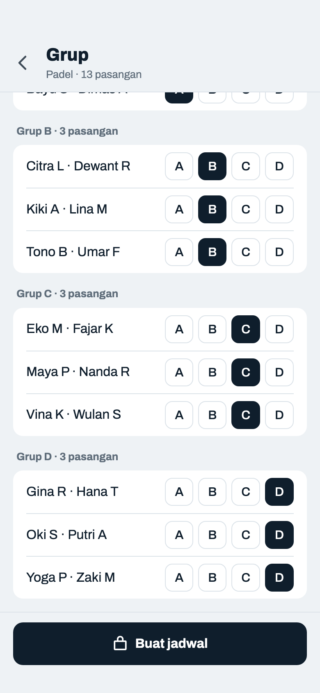

Komponen: `MabarAppBar`, `MabarButton`, `MabarIconButton`, `MabarActionBar`, `MabarGroup / MabarRow`, `MabarSegmented`, `PairList`, `MabarChip`

- 13 pasangan / 4 grup = 4 + 3 + 3 + 3 (AC-G2: hanya ini yang diterima). Posisi gulir paling bawah; app bar bergaris seperti layar Pemain yang digulir.
- Semua grup penuh → Buat jadwal aktif dengan ikon kunci → dialog 19y.

## 19y · Dialog · buat jadwal Grup + Gugur

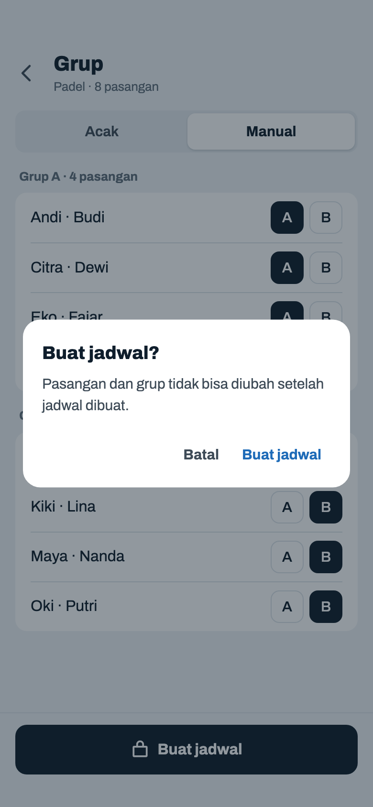

Komponen: `MabarAppBar`, `MabarButton`, `MabarTextButton`, `MabarIconButton`, `MabarActionBar`, `MabarGroup / MabarRow`, `MabarSegmented`, `PairList`, `MabarChip`, `showMabarSheet`, `showMabarConfirm`

- Dialog kunci seperti 04d (keputusan 1, G4): akibat di dialog, bukan di layar. Teks menyebut pasangan **dan** grup.
- Konfirmasi → Jadwal fase grup (kelompok 20): seluruh match grup dibuat sekaligus dengan court terkunci per grup. Batal → tetap di layar Grup.
