# Grup + Gugur · fase grup

> Dihasilkan `tool/hifi_extract.py` dari `design/hifi.html`. Jangan diedit langsung.

Fase grup Grup + Gugur (PRD §16.3–16.5, keputusan 93–102). Contoh utama 16A: Padel, Race to 6 (Win %), 15 mnt, 2 court × 2 jam, 16 pemain; Grup A di Court 1 (skor 16D-ii, dipakai bagan 16E), Grup B di Court 2 (16E). 4 grup + court lebih sedikit = 16B, court lebih banyak dari grup = 16C. Urutan match tiap grup = circle method generator round-robin.

## 20a · Jadwal fase grup · awal · 2 grup, 2 court

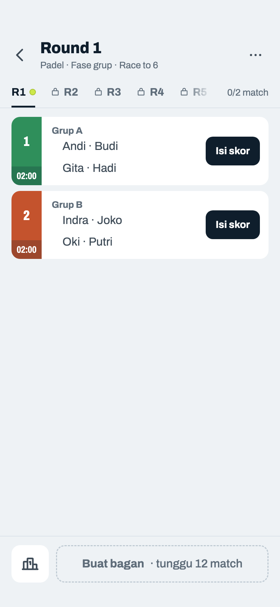

Komponen: `MabarAppBar`, `MabarButton`, `MabarIconButton`, `MabarActionBar`, `RoundTabs`, `MatchScoreRow`

- Contoh 16A: Padel, Race to 6, 15 mnt, 2 court × 2 jam (18.00–20.00), 16 pemain = 8 pasangan, Grup A (Andi · Budi, Citra · Dewi, Eko · Fajar, Gita · Hadi) di Court 1, Grup B (Indra · Joko, Kiki · Lina, Maya · Nanda, Oki · Putri) di Court 2 (GU3). Fase grup R1–R6, satu match per grup per round.
- Grup tiap match = label `.grp` "Grup A" di atas dua baris tim, di semua baris fase grup (GU5). Court strip, hitung mundur, tombol "Isi skor", dan ketuk baris sama dengan 06a.
- Subjudul: olahraga · "Fase grup" · format skor grup. Round bernomor terus lintas fase; tab round gugur belum ada sampai bagan dibuat (16.5).
- Tanpa baris Istirahat di fase grup (GU5), juga untuk grup ganjil yang punya bye.
- Urutan match di tiap grup = circle method generator round-robin (3.3): pasangan 1–4, 2–3, 1–3, 4–2, 1–2, 3–4. R1: Andi · Budi – Gita · Hadi, Indra · Joko – Oki · Putri.
- Menu ⋯ sama dengan 06d (Live score, Akhiri turnamen).
- 12 match grup Belum → "Buat bagan · tunggu 12 match" (20b).
- Tab "Bagan" ada sejak jadwal dibuat, paling kanan setelah R6 (keputusan 153); di sini tersembunyi di balik tepi kanan yang dipudarkan, terlihat setelah strip digeser (23s).

## 20b · Jadwal fase grup · sebagian terisi

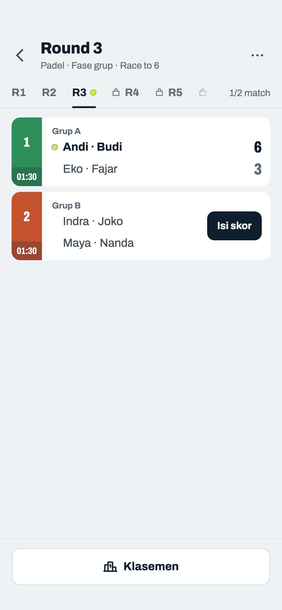

Komponen: `MabarAppBar`, `MabarButton`, `MabarIconButton`, `MabarActionBar`, `RoundTabs`, `MatchScoreRow`

- R1: Andi · Budi 4–6 Gita · Hadi, Indra · Joko 6–1 Oki · Putri. R2: Citra · Dewi 6–3 Eko · Fajar, Kiki · Lina 3–6 Maya · Nanda. R3 Court 1: Andi · Budi 6–3 Eko · Fajar; Court 2 belum. Klasemen saat ini: 20d (5 dari 12 match).
- Hitung mundur 01:30 = booking 2 jam − 2 round × 15 mnt, sama dengan 13k.
- Kunci round Fixed tetap berlaku (GU5): R4 terbuka setelah Court 2 R3 terisi (20c). Skor round sebelumnya tetap bisa diubah sampai bagan dibuat.
- Action bar fase grup selama ada match grup Belum (keputusan 119, §17.11): ikon Klasemen + tombol mati "Buat bagan · tunggu N match", pola 13m. N = match grup Belum di semua round grup, bukan hanya round berjalan: di sini 12 − 5 = 7. R3 Court 2 diisi → "tunggu 6 match"; 12 terisi → "Buat bagan" aktif (20e); satu dikosongkan lagi → "tunggu 1 match". Diakhiri (20q) dan penonton live: tanpa Buat bagan.
- Beda dengan Fixed 06v yang menyembunyikan "Tambah round": Tambah round opsional, Buat bagan langkah wajib.

## 20c · Jadwal fase grup · membuka round yang terkunci

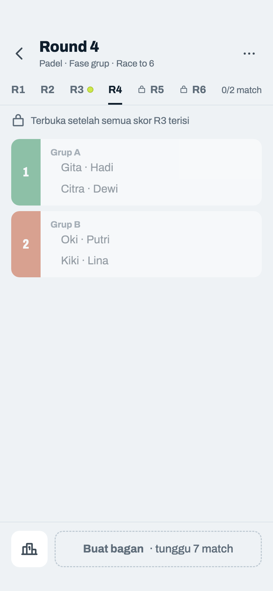

Komponen: `MabarAppBar`, `MabarButton`, `MabarIconButton`, `MabarActionBar`, `RoundTabs`, `MatchScoreRow`

- Latar data = 20b. Sama dengan 06b: tab ke depan bisa dibuka untuk melihat lawan, baris tidak bisa diketuk dan tanpa "Isi skor"; label grup ikut dipudarkan bersama barisnya.
- R4: Gita · Hadi – Citra · Dewi (Grup A, Court 1), Oki · Putri – Kiki · Lina (Grup B, Court 2).

## 20d · Klasemen grup · Sementara

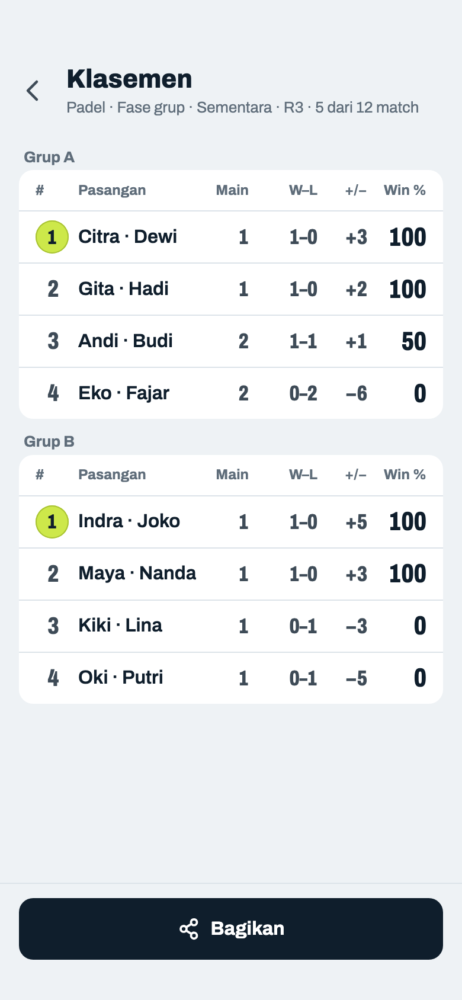

Komponen: `MabarAppBar`, `MabarButton`, `MabarIconButton`, `MabarActionBar`, `MabarGroup / MabarRow`, `StandingTable`

- Data 20b (5 dari 12 match). Satu tabel per grup, label "Grup A" di atasnya, nomor mulai 1 di tiap grup, kolom dan aturan nomor sama dengan 09c / 13n; hanya match grup itu yang dihitung (G7).
- Tanpa tab metode (Q1, GU8): metode = default format grup (Race to / Best of → Win %; Americano → Point % sejak 3.9.0, keputusan 129 U-RP6, sampai 3.8.x Total Point). Kolom terakhir "Win %" atau "Point %" (angka saja, seperti 09a). Yang tampil = yang dipakai untuk lolos: grup Americano lolos dari Point % → selisih (AC-RP13). Data contoh ini Race to 6, jadi tetap Win %.
- Subjudul: olahraga · "Fase grup" (sama dengan Jadwal) · status · round · match, pola 13n. Status tetap Sementara sampai Final terisi (16.8).
- Belum ada tanda lolos sebelum bagan dibuat (16.8). Ketuk baris → Detail pasangan. Bagikan sama dengan Klasemen lain.

## 20e · Jadwal fase grup · semua match terisi · Buat bagan

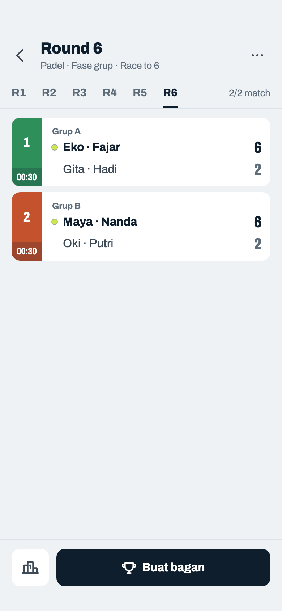

Komponen: `MabarAppBar`, `MabarButton`, `MabarIconButton`, `MabarActionBar`, `RoundTabs`, `MatchScoreRow`

- Semua 12 match grup Selesai/WO dan turnamen belum diakhiri (GU6, AC-G6): Klasemen pindah jadi ikon di kiri dan tombol utama "Buat bagan", pola 06v. Satu match grup masih Belum → tombol mati "Buat bagan · tunggu 1 match" (pola 20b, keputusan 119).
- Skor Grup A = 16D-ii: R4 Gita · Hadi 4–6 Citra · Dewi, R5 Andi · Budi 6–4 Citra · Dewi, R6 Eko · Fajar 6–2 Gita · Hadi. Grup B = 16E: R4 Oki · Putri 4–6 Kiki · Lina, R5 Indra · Joko 6–2 Kiki · Lina, R6 Maya · Nanda 6–2 Oki · Putri. Klasemen: 20f.
- Hitung mundur 00:30 = booking 2 jam − 6 round × 15 mnt (round lengkap, pola 13l).
- "Buat bagan": tidak ada pilihan host → langsung dialog 20g; ada seri yang harus dipilih host → sheet 20i dulu.
- Skor grup masih bisa diubah (07i) sampai dialog 20g dikonfirmasi; Klasemen dan slot di dialog ikut skor terakhir.

## 20f · Klasemen grup · semua terisi · nomor sama di #1

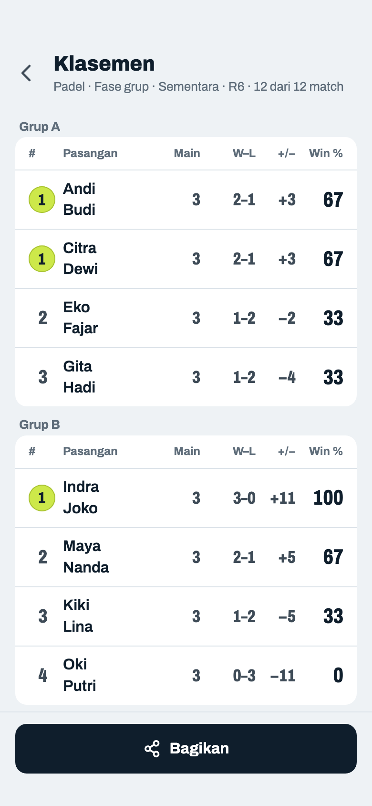

Komponen: `MabarAppBar`, `MabarButton`, `MabarIconButton`, `MabarActionBar`, `MabarGroup / MabarRow`, `StandingTable`

- Data 20e. Grup A = 16D-ii: Andi · Budi dan Citra · Dewi 67% +3 → nomor sama 1, 1 (aturan 4.3, keputusan 17), urut nama. Head-to-head tidak mengubah nomor tabel (G7).
- Keduanya lolos; urutan A1/A2 dari head-to-head (GU7): Andi · Budi menang 6–4 di R5 → A1 Andi · Budi, A2 Citra · Dewi. Hasilnya terbaca di dialog 20g, tidak di tabel.
- Grup B: B1 Indra · Joko, B2 Maya · Nanda (nomor 1 dan 2 sudah pasti).
- Seri di batas 2 vs 3 yang selesai lewat head-to-head (16D-i: nomor 1, 2, 2, 3) tampil sama: tabel apa adanya, A2 tertulis di dialog.
- Status Sementara walau semua match grup terisi: turnamen belum selesai sampai Final (16.8).

## 20g · Dialog · buat bagan · 2 grup

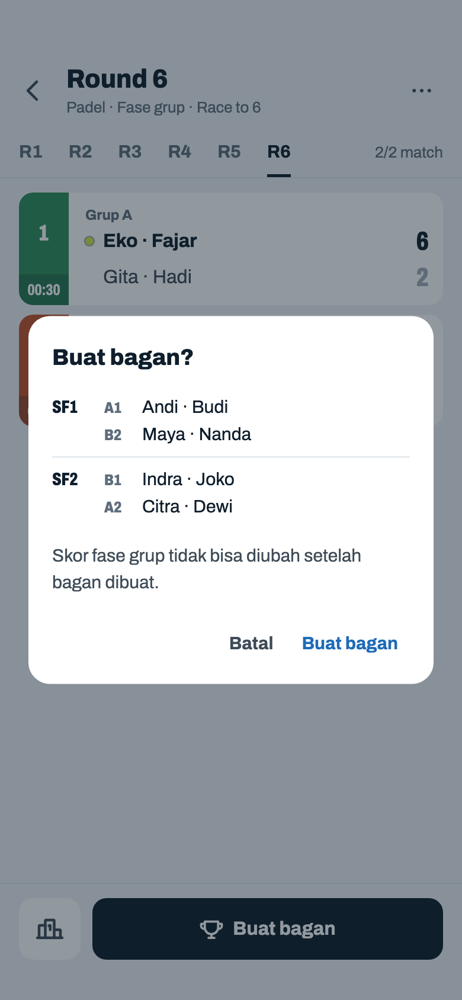

Komponen: `MabarAppBar`, `MabarButton`, `MabarTextButton`, `MabarIconButton`, `MabarActionBar`, `RoundTabs`, `MatchScoreRow`, `showMabarSheet`, `showMabarConfirm`

- Latar = 20e. Dialog kunci (GU6, Q2) memuat match babak pertama bagan silang (G9): SF1 = A1 vs B2, SF2 = B1 vs A2, slot di kiri nama. Akibatnya satu kalimat, pola 04d.
- "Buat bagan" mengunci yang lolos, urutan A1/A2/B1/B2, dan skor fase grup; round gugur ditambahkan ke Jadwal (R7 SF1 + SF2, R8 Final + Perebutan juara 3, 16E) dan bagan tampil (frame 21).
- "Batal" menutup dialog tanpa mengubah apa pun. App ditutup sebelum konfirmasi → dibuka lagi di 20e (AC-G7).
- Babak pertama 2 grup = Semifinal, 4 grup = Perempat final (20o).

## 20h · Klasemen grup · seri tiga pasangan di #2

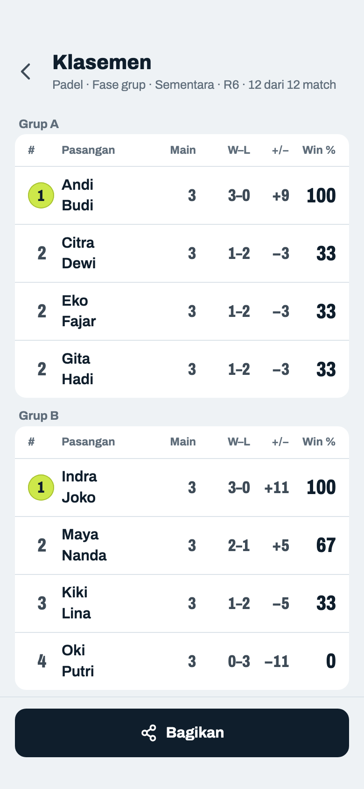

Komponen: `MabarAppBar`, `MabarButton`, `MabarIconButton`, `MabarActionBar`, `MabarGroup / MabarRow`, `StandingTable`

- Grup A = 16D-iii: Andi · Budi menang 6–3 atas ketiganya; Citra · Dewi 6–4 Eko · Fajar (R2), Gita · Hadi 6–4 Citra · Dewi (R4), Eko · Fajar 6–4 Gita · Hadi (R6). Tiga pasangan 1–2, −3, 33% → nomor 2, 2, 2. Grup B sama dengan 20f.
- Head-to-head di antara ketiganya 1–1 semua (GU7, satu kali) → A2 belum pasti → host memilih di langkah Buat bagan (20i). Klasemen tidak menandai seri; hanya angka.

## 20i · Sheet · pilih A2 · belum dipilih

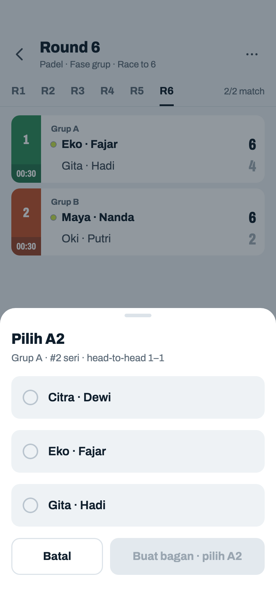

Komponen: `MabarAppBar`, `MabarButton`, `MabarIconButton`, `MabarActionBar`, `RoundTabs`, `MatchScoreRow`, `showMabarSheet`

- Latar = Jadwal R6 data 20h (Eko · Fajar 6–4 Gita · Hadi), tombol "Buat bagan" diketuk. Muncul hanya kalau nomor grup + head-to-head tidak memastikan peringkat 1 dan 2 (G8).
- Pilihan = pasangan yang seri di slot itu, urut nama. Judul = slot yang dipilih; subjudul = grup, posisi seri, hasil head-to-head.
- Tombol mati sampai slot terisi, alasannya di tombol. Beberapa grup perlu pilihan → satu sheet, satu bagian per grup (label "Grup A", "Grup C"), tombol menyebut slot yang belum ("· pilih A2 dan C2").
- Batal → kembali ke Jadwal, pilihan dibuang (belum ada yang tersimpan, AC-G7).

## 20j · Sheet · pilih A2 · sudah dipilih

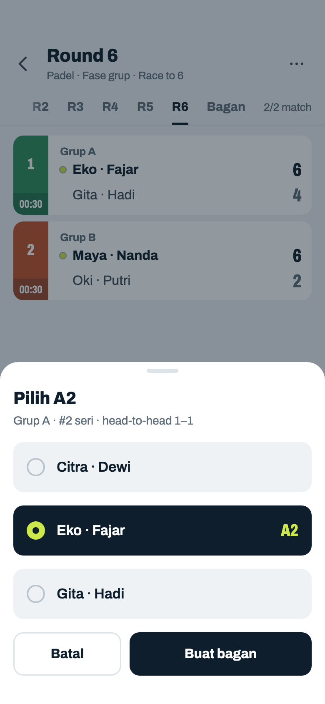

Komponen: `MabarAppBar`, `MabarButton`, `MabarIconButton`, `MabarActionBar`, `RoundTabs`, `MatchScoreRow`, `showMabarSheet`

- Host memilih Eko · Fajar: baris terpilih memakai `.opt.on` + slot yang didapat di kanan ("A2", bola di atas tinta). Ketuk pasangan lain memindahkan pilihan.
- "Buat bagan" → dialog 20k. Batal di dialog kembali ke sheet ini dengan pilihan tetap.

## 20k · Dialog · buat bagan · setelah host memilih

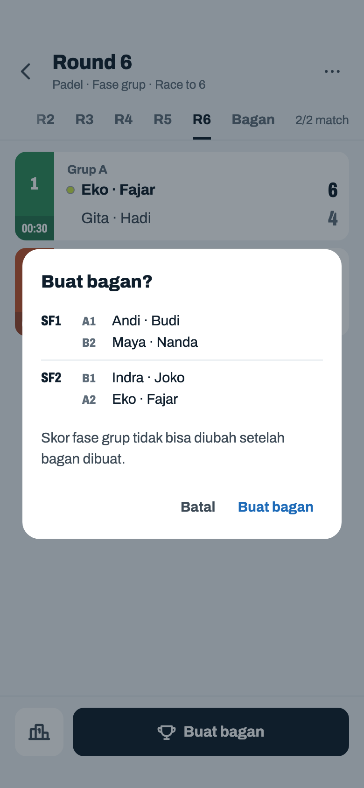

Komponen: `MabarAppBar`, `MabarButton`, `MabarTextButton`, `MabarIconButton`, `MabarActionBar`, `RoundTabs`, `MatchScoreRow`, `showMabarSheet`, `showMabarConfirm`

- Dialog sama dengan 20g; slot hasil pilihan host tidak dibedakan. Latar = Jadwal (sheet tertutup saat dialog muncul).
- "Buat bagan" menyimpan pilihan host bersama kuncian (16.5). App ditutup sebelum ini → dibuka lagi di 20h/Jadwal R6 tanpa pilihan (AC-G7).

## 20l · Sheet · seri tiga pasangan di #1 · pilih A1 dan A2

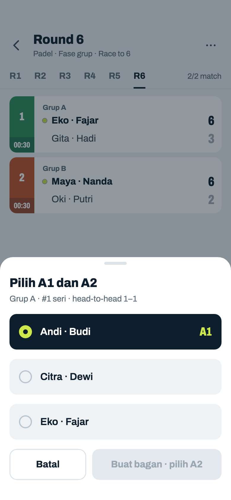

Komponen: `MabarAppBar`, `MabarButton`, `MabarIconButton`, `MabarActionBar`, `RoundTabs`, `MatchScoreRow`, `showMabarSheet`

- Data: R1 Andi · Budi 6–3 Gita · Hadi, R2 Citra · Dewi 6–4 Eko · Fajar, R3 Andi · Budi 4–6 Eko · Fajar, R4 Gita · Hadi 3–6 Citra · Dewi, R5 Andi · Budi 6–4 Citra · Dewi, R6 Eko · Fajar 6–3 Gita · Hadi. Andi · Budi, Citra · Dewi, Eko · Fajar 2–1, +3, 67% → nomor 1, 1, 1; Gita · Hadi 0–3, −9 → 2. Head-to-head 1–1 semua.
- Dua slot dari satu daftar: ketukan pertama = A1, kedua = A2 (slot tertulis di kanan baris). Ketuk baris terpilih → lepas, slot sesudahnya ikut lepas. Frame: A1 sudah dipilih.
- Seri di #1 yang hanya perlu urutan (dua pasangan, mis. Americano seri) → "Pilih A1" dengan dua pilihan, sheet sama dengan 20i.

## 20m · Jadwal fase grup · 4 grup, 2 court · bergantian

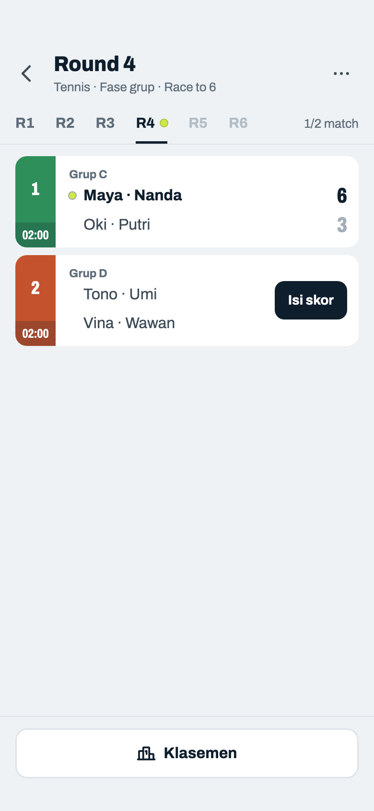

Komponen: `MabarAppBar`, `MabarButton`, `MabarIconButton`, `MabarActionBar`, `RoundTabs`, `MatchScoreRow`

- Contoh 16B: Tennis, Race to 6, 20 mnt, 2 court × 3 jam, 24 pemain = 12 pasangan, 4 grup × 3: A (Andi · Budi, Citra · Dewi, Eko · Fajar), B (Gita · Hadi, Indra · Joko, Kiki · Lina), C (Maya · Nanda, Rudi · Sari, Oki · Putri), D (Tono · Umi, Qori · Yuni, Vina · Wawan). A, C → Court 1; B, D → Court 2 (GU3).
- Grup yang berbagi court bergantian satu match per round urut huruf (GU4): R1/R3/R5 = A dan B, R2/R4/R6 = C dan D. Label grup membedakan round-nya; tidak ada pasangan main di dua round beruntun.
- Grup 3 pasangan: 2–3, 1–3, 1–2 (circle method, satu bye tiap putaran, tanpa baris Istirahat). R1: Citra · Dewi 6–4 Eko · Fajar, Indra · Joko 6–2 Kiki · Lina. R2: Rudi · Sari 6–3 Oki · Putri, Qori · Yuni 4–6 Vina · Wawan. R3: Andi · Budi 6–1 Eko · Fajar, Gita · Hadi 6–4 Kiki · Lina. R4 Court 1: Maya · Nanda 6–3 Oki · Putri.
- Hitung mundur 02:00 = 3 jam − 3 round × 20 mnt. 2 grup di 1 court tampil sama: satu baris per round, A dan B bergantian.
- 12 match grup (4 grup × 3), 7 terisi → "Buat bagan · tunggu 5 match" (20b).
- Simpanan 3.8.x–3.9.x (4 grup × 3, contoh 16B): tetap dimuat dan diselesaikan dengan aturan lamanya (AC-G29). Turnamen baru 4 grup = tepat 32 pemain, 4 × 4 (keputusan 142): 23a, 23i.

## 20n · Klasemen grup · 4 grup · Sementara

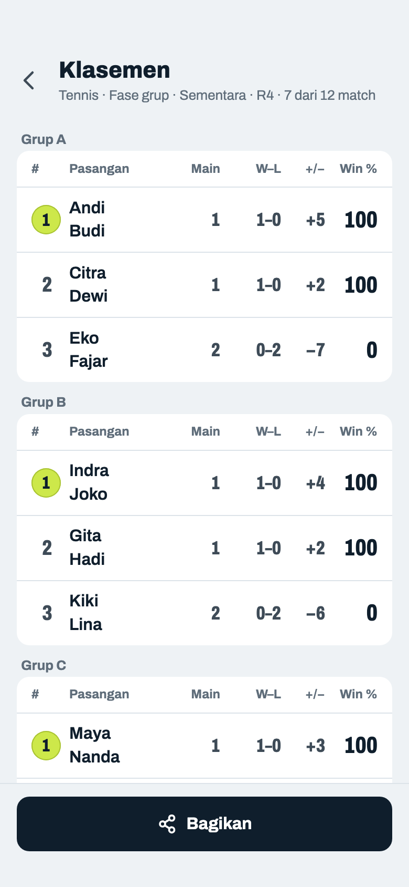

Komponen: `MabarAppBar`, `MabarButton`, `MabarIconButton`, `MabarActionBar`, `MabarGroup / MabarRow`, `StandingTable`

- Data 20m (7 dari 12 match). Empat tabel berurutan A–D; halaman digulir, app bar dan action bar tetap. Frame di posisi gulir paling atas; Grup C dan D berlanjut di bawah action bar.
- Grup C: Maya · Nanda dan Rudi · Sari sama-sama 100% +3 → nomor 1, 1. Grup D: Tono · Umi belum main (R4 Court 2 belum diisi) → baris "Belum main" seperti 09c.
- Simpanan 3.8.x–3.9.x (4 grup × 3, contoh 16B): tetap dimuat dan diselesaikan dengan aturan lamanya (AC-G29). Turnamen baru 4 grup = tepat 32 pemain, 4 × 4 (keputusan 142): 23a, 23i.

## 20o · Dialog · buat bagan · 4 grup

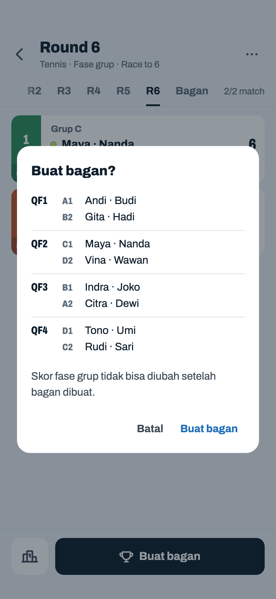

Komponen: `MabarAppBar`, `MabarButton`, `MabarTextButton`, `MabarIconButton`, `MabarActionBar`, `RoundTabs`, `MatchScoreRow`, `showMabarSheet`, `showMabarConfirm`

- Latar = Jadwal 16B R6 semua terisi (pola 20e). Sisa skor: R4 Tono · Umi 6–2 Vina · Wawan; R5 Andi · Budi 6–4 Citra · Dewi, Gita · Hadi 3–6 Indra · Joko; R6 Maya · Nanda 6–4 Rudi · Sari, Tono · Umi 6–3 Qori · Yuni. Hitung mundur 01:00 = 3 jam − 6 × 20 mnt.
- Akhir grup (Win %, selisih): A Andi · Budi 100 +7, Citra · Dewi 50 0, Eko · Fajar 0 −7 · B Indra · Joko 100 +7, Gita · Hadi 50 −1, Kiki · Lina 0 −6 · C Maya · Nanda 100 +5, Rudi · Sari 50 +1, Oki · Putri 0 −6 · D Tono · Umi 100 +7, Vina · Wawan 50 −2, Qori · Yuni 0 −5.
- Perempat final (G9): QF1 A1–B2, QF2 C1–D2, QF3 B1–A2, QF4 D1–C2; A1, B2, C1, D2 di paruh atas. Round gugur sesudahnya: R7 QF1 + QF2, R8 QF3 + QF4, R9 SF1 + SF2, R10 Final + Perebutan juara 3 (16B).
- Simpanan 3.8.x–3.9.x (4 grup × 3, contoh 16B): tetap dimuat dan diselesaikan dengan aturan lamanya (AC-G29). Turnamen baru 4 grup = tepat 32 pemain, 4 × 4 (keputusan 142): 23a, 23i.

## 20p · Jadwal fase grup · court lebih banyak dari grup

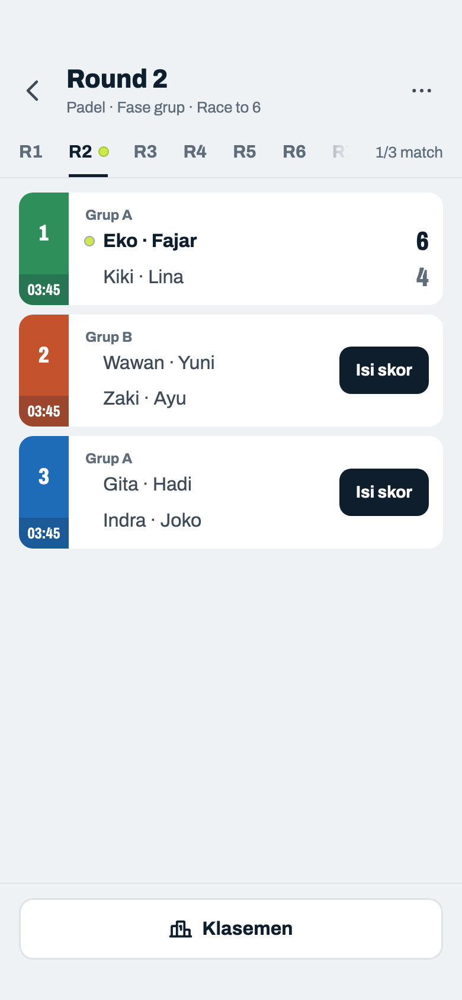

Komponen: `MabarAppBar`, `MabarButton`, `MabarIconButton`, `MabarActionBar`, `RoundTabs`, `MatchScoreRow`

- Contoh 16C: Padel, Race to 6, 15 mnt, 4 court × 4 jam, 30 pemain = 15 pasangan, A 8 (Andi · Budi … Oki · Putri) di Court 1 + 3, B 7 (Qori · Rudi, Sari · Tono, Umar · Vina, Wawan · Yuni, Zaki · Ayu, Bayu · Cici, Dodi · Elsa) di Court 2 + 4 (GU3). Fase grup 14 round (R1–R14).
- Grup B ganjil: putaran 3 match dipotong 2 + 1, jadi Court 4 tanpa match di round genap; court tanpa match tidak tampil (pola 06r), tidak ada baris "kosong". R1: Court 1 Andi · Budi – Oki · Putri, Court 2 Sari · Tono – Dodi · Elsa, Court 3 Citra · Dewi – Maya · Nanda, Court 4 Umar · Vina – Bayu · Cici; Qori · Rudi bye di R1–R2 tanpa baris Istirahat.
- Baris tetap urut nomor court, jadi grup bisa berselang (A, B, A); label grup yang membedakan.
- Court yang tidak dipakai sama sekali di fase grup (16C, 6 pasangan, 3 court: Court 3) juga tidak tampil; tampilannya sama dengan 20a.
- 49 match grup (A 28 + B 21), R1 (4) + R2 Court 1 terisi → "Buat bagan · tunggu 44 match" (20b).

## 20q · Jadwal fase grup · turnamen diakhiri

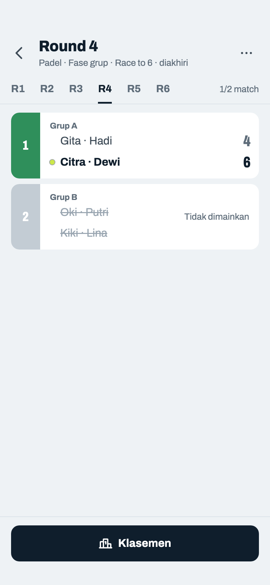

Komponen: `MabarAppBar`, `MabarButton`, `MabarIconButton`, `MabarActionBar`, `RoundTabs`, `MatchScoreRow`

- Data 20b, lalu R3 Court 2 Indra · Joko 6–4 Maya · Nanda dan R4 Court 1 Gita · Hadi 4–6 Citra · Dewi; host memilih Akhiri (dialog 20r) saat R4 Court 2 belum diisi.
- Sama dengan 06c: match Belum (R4 Court 2, R5, R6) jadi "Tidak dimainkan", tanpa hitung mundur dan titik live, "Klasemen" jadi tombol utama. Bagan tidak dibuat dan tidak ada "Buat bagan" (16.9).
- Peringkat akhir = urut posisi grup Sementara saat diakhiri (16.8); tampilan Klasemen setelah diakhiri di fase grup: 22g.

## 20r · Dialog · akhiri turnamen di fase grup

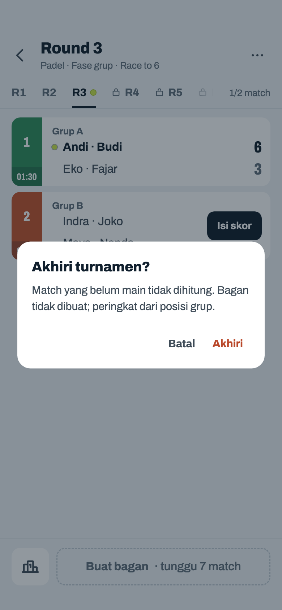

Komponen: `MabarAppBar`, `MabarButton`, `MabarTextButton`, `MabarIconButton`, `MabarActionBar`, `RoundTabs`, `MatchScoreRow`, `showMabarSheet`, `showMabarConfirm`

- Latar = 20b (R3, 5 dari 12 match), lewat menu ⋯ → Akhiri turnamen. Judul dan tombol sama dengan 06e; isinya menyebut akibat khusus fase grup (PATCH 3.8.1, C-1).
- Akhiri: match Belum jadi "Tidak dimainkan", bagan tidak dibuat, peringkat akhir = urut posisi grup Sementara (16.8, 16.9), hasilnya seperti 20q. Grup + Gugur tidak bisa dilanjutkan, sama dengan Fixed.

## 20s · Klasemen grup · Americano 21 · Point % · satu WO

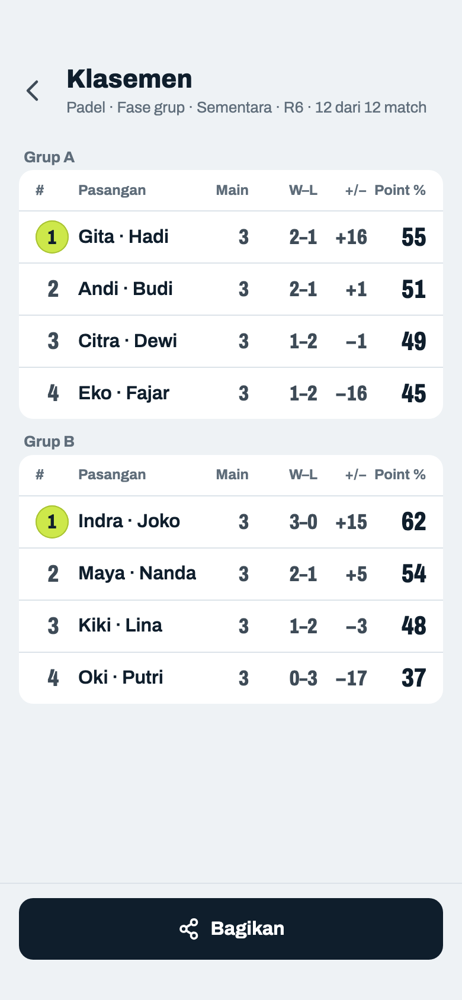

Komponen: `MabarAppBar`, `MabarButton`, `MabarIconButton`, `MabarActionBar`, `MabarGroup / MabarRow`, `StandingTable`

- Data AC-RP13 (keputusan 131 #4): Padel, Group - Playoff, format grup Americano 21, 16 pemain = 8 pasangan, 2 grup, urutan match = 16A (circle method). Semua 12 match grup terisi, bagan belum dibuat. Pola tabel dan subjudul = 20f; kolom nilai "Point %" angka saja, tanpa tab metode (GU8).
- Grup A: R1 Andi · Budi 6–15 Gita · Hadi, R2 Citra · Dewi 14–7 Eko · Fajar, R3 Andi · Budi 15–6 Eko · Fajar, R4 Gita · Hadi 14–7 Citra · Dewi, R5 Andi · Budi 11–10 Citra · Dewi, R6 Eko · Fajar menang WO atas Gita · Hadi (Gita · Hadi tidak bisa main).
- Nilai WO Eko = Fajar = rata-rata sendiri (7 + 6) ÷ 2 = 6,5 → 7, di bawah skor menang terkecil → 11 (4.4); `woPairValue(11, 11)` = 11 kalah untuk Gita dan Hadi (20.4). Selisih tidak berubah oleh WO.
- Hitungan Grup A (Total Point · didapat/dimainkan → Point % · selisih → nomor): Gita · Hadi 29 · 29/53 (29 + kalah 13 + WO 11) → 55 · +16 #1; Andi · Budi 32 · 32/63 → 51 · +1 #2; Citra · Dewi 31 · 31/63 → 49 · −1 #3; Eko · Fajar 24 (13 + WO 11) · 24/53 → 45 · −16 #4. Point % = `(200 × didapat + dimainkan) ~/ (2 × dimainkan)`.
- 2 teratas Point % = Gita · Hadi, Andi · Budi (A1, A2); 2 teratas Total Point = Andi · Budi 32, Citra · Dewi 31 (Gita · Hadi 29 di #3). Yang lolos ke bagan = 2 teratas tabel ini (U-RP6, AC-RP13); di 3.8.x (Total Point) Citra · Dewi yang lolos.
- Grup B: R1 Indra · Joko 14–7 Oki · Putri, R2 Kiki · Lina 9–12 Maya · Nanda, R3 Indra · Joko 12–9 Maya · Nanda, R4 Oki · Putri 8–13 Kiki · Lina, R5 Indra · Joko 13–8 Kiki · Lina, R6 Maya · Nanda 13–8 Oki · Putri. Indra · Joko 39/63 → 62 · +15 #1; Maya · Nanda 34/63 → 54 · +5 #2; Kiki · Lina 30/63 → 48 · −3 #3; Oki · Putri 23/63 → 37 · −17 #4. Tanpa WO, urutan Total Point sama → B1 Indra · Joko, B2 Maya · Nanda.
- Σ didapat Grup A 105 + WO 11 = 116, Σ selisih 0; Grup B 126, Σ selisih 0. Americano 21 tidak bisa seri, jadi kolom W–L. Grup B berlanjut di bawah action bar seperti 22b.
