# Grup + Gugur · fase gugur & Bagan

> Dihasilkan `tool/hifi_extract.py` dari `design/hifi.html`. Jangan diedit langsung.

Fase gugur Grup + Gugur (PRD §16.5–16.7, keputusan 97–102): round gugur dengan nama babak, Bagan sebagai tab terakhir Jadwal, pemenang maju otomatis, WO, juara 3 nyala/mati, ubah skor yang membalik pemenang. Contoh 2 grup = 16E (Padel, 2 court), 4 grup = 16B (Tennis, 2 court). Komponen baru: `.bagan` dan tambahan `.bug` (`.gg-babak`, `.gg-seed`, `.team.gg-tbd`).

## 21a · Bagan · 2 grup · baru dibuat

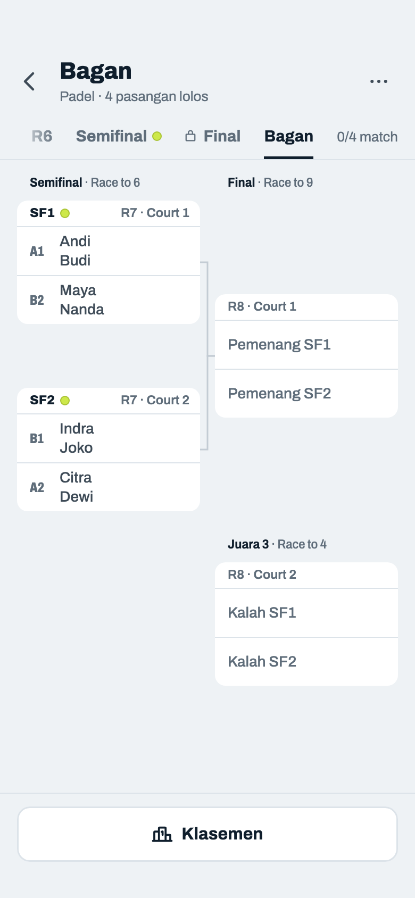

Komponen: `MabarAppBar`, `MabarButton`, `MabarIconButton`, `MabarActionBar`, `RoundTabs`

- Contoh 16E: Padel, 15 mnt, 2 court × 2 jam (18.00–20.00), 16 pemain. Format grup Race to 6; Semifinal Race to 6, Perebutan juara 3 Race to 4, Final Race to 9. A1 Andi · Budi, A2 Citra · Dewi (16D-ii), B1 Indra · Joko, B2 Maya · Nanda.
- Setelah dialog "Buat bagan" dikonfirmasi, Jadwal terbuka di tab Bagan (usulan). Selanjutnya tab default tetap aturan 06a: round pertama yang masih ada match kosong (21b).
- Tab "Bagan" ada sejak bagan dibuat, selalu paling kanan setelah round terakhir. Ujung tab di Bagan = match gugur terisi / semua match gugur (SF1, SF2, Juara 3, Final = 4; tanpa juara 3 = 3).
- Bagan 2 grup = dua kolom selebar setengah layar (172 pt, jarak 14), muat tanpa digeser. Final di kanan, tengahnya di tengah dua kartu SF. Perebutan juara 3 di bawah Final dengan labelnya sendiri, tanpa garis (yang masuk = yang kalah).
- Kartu: kepala = kode match · round · court (Final dan Juara 3 tanpa kode, labelnya sudah di atas); dua baris tim, nama dua pemain bertumpuk (seperti papan Input Skor) supaya nama tidak terpotong di lebar 172. Kode slot (A1, B2) di kolom tetap kiri.
- Slot yang belum diketahui: "Pemenang SF1" / "Kalah SF1" tinta-3. Titik bola di kepala kartu = match di round yang sedang berjalan dan belum ada skor (makna sama dengan titik di tab round).
- Ketuk kartu yang bisa diisi → Input Skor, sama dengan baris di tab round. Kartu di round terkunci atau dengan slot belum lengkap tidak bisa diketuk.

## 21b · Semifinal · belum ada skor

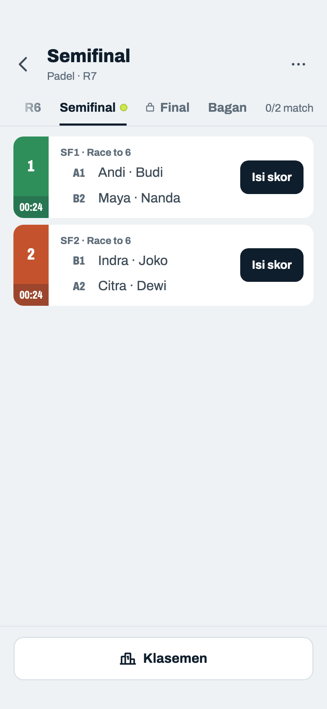

Komponen: `MabarAppBar`, `MabarButton`, `MabarIconButton`, `MabarActionBar`, `RoundTabs`, `MatchScoreRow`

- Tab round gugur memakai nama babak (GU5): R7 = "Semifinal" (SF1 + SF2), R8 = "Final" (Final + Juara 3). Judul = nama babak lengkap; subjudul = olahraga · nomor round, seperti subjudul Jadwal lain (format pindah ke baris match; PATCH 3.8.1, C-14).
- Tiap baris gugur diberi label kode match · format babak di atas nama ("SF1 · Race to 6"), karena satu round bisa berisi dua babak dengan format berbeda (R8, 21f). Kode slot di kolom tetap 22 pt di depan nama.
- Court urut bagan (GU10): SF1 Court 1, SF2 Court 2; court kunci grup tidak berlaku lagi. Hitung mundur 00:24 = booking 2 jam − 96 mnt (aturan 06p).
- Fase gugur tanpa baris Istirahat. Tab R1–R6 tetap bisa dibuka (skor grup terkunci, lihat alur fase grup).
- Tab "Final" pudar (terkunci) sampai semua skor R7 terisi (21e).

## 21c · Semifinal · SF1 terisi

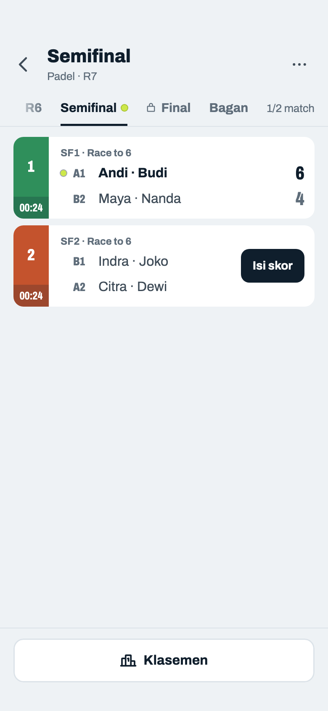

Komponen: `MabarAppBar`, `MabarButton`, `MabarIconButton`, `MabarActionBar`, `RoundTabs`, `MatchScoreRow`

- SF1 6–4 disimpan dari Input Skor (tanpa toast, seperti 07b). Andi · Budi langsung masuk slot atas Final dan Maya · Nanda slot atas Juara 3 (G12), terlihat di 21d dan 21e.
- Ketuk SF1 → Input Skor mode ubah (07i); aturan ganti pemenang di 21k–21m.

## 21d · Bagan · 2 grup · SF1 terisi

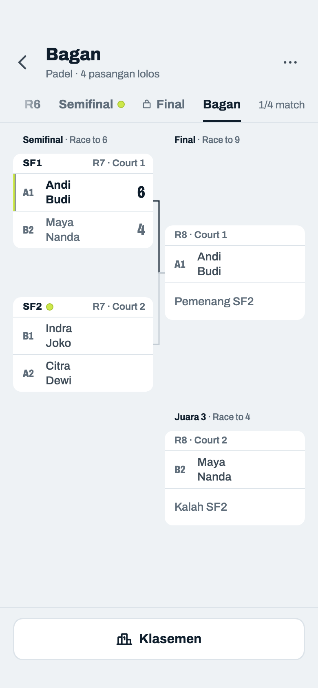

Komponen: `MabarAppBar`, `MabarButton`, `MabarIconButton`, `MabarActionBar`, `RoundTabs`

- Pemenang = garis bola 3 pt di tepi kiri baris + nama tebal + skor tinta; yang kalah tinta-3. Garis penghubung dari match yang sudah ada pemenangnya jadi tinta, yang belum abu-abu.
- Slot Final atas = pemenang SF1, slot Juara 3 atas = yang kalah di SF1, terisi begitu skor SF1 disimpan. Final dan Juara 3 tetap tanpa titik bola: R8 belum terbuka.

## 21e · Final · terkunci

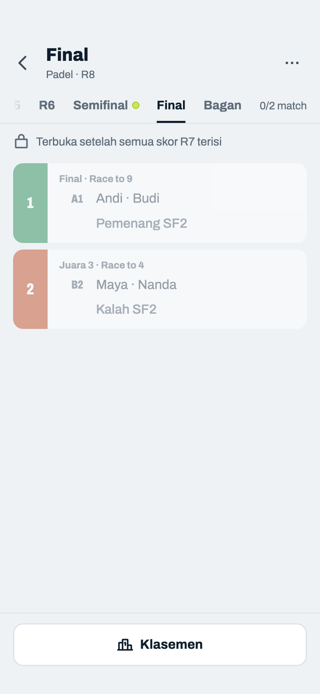

Komponen: `MabarAppBar`, `MabarButton`, `MabarIconButton`, `MabarActionBar`, `RoundTabs`, `MatchScoreRow`

- Kunci round sama dengan Fixed (06b): R8 terbuka setelah semua match R7 terisi. Baris tidak bisa diketuk dan tanpa "Isi skor".
- Round terakhir: Final di Court 1, Perebutan juara 3 di Court 2 (GU10). Label baris menulis nama pendek "Juara 3" (GU1); judul tab "Final" mewakili round ini.

## 21f · Final · berjalan

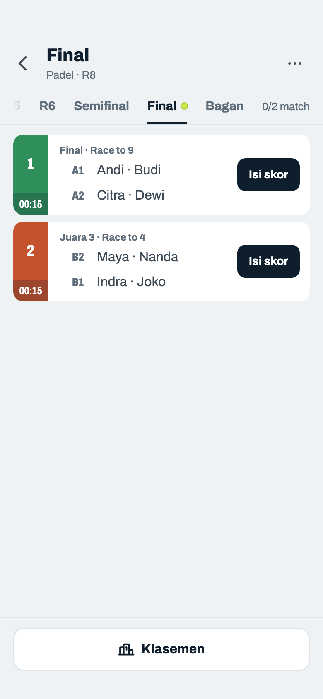

Komponen: `MabarAppBar`, `MabarButton`, `MabarIconButton`, `MabarActionBar`, `RoundTabs`, `MatchScoreRow`

- SF2 4–6 → Citra · Dewi ke Final, Indra · Joko ke Juara 3. Andi · Budi dan Citra · Dewi (sama-sama Grup A) baru bertemu di Final (keputusan 97).
- Format per baris (G11): Final Race to 9, Juara 3 Race to 4. Input Skor memakai format babak match itu (21g, 21h).

## 21g · Input Skor · Final · Race to 9

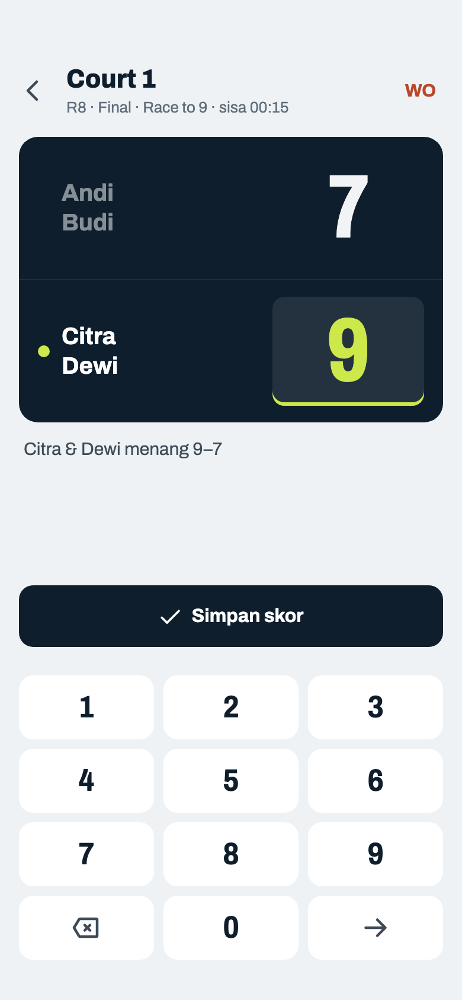

Komponen: `MabarAppBar`, `MabarButton`, `MabarTextButton`, `MabarIconButton`, `ScoreBoard / ScoreKeypad`

- Subjudul gugur: round · nama babak · format babak · sisa court (aturan 07l). Final menerima 9–7 (AC-G10); Race to 9 = semua angka satu digit.
- Simpan → kembali ke Jadwal tanpa toast; turnamen belum Final selama Juara 3 masih Belum (AC-G14).

## 21h · Input Skor · Juara 3 · Race to 4

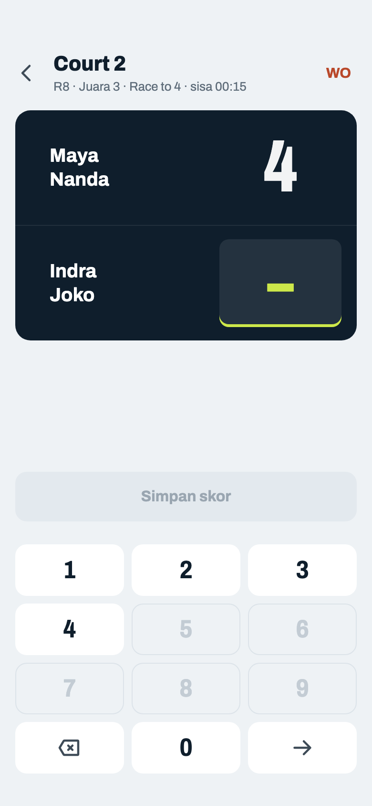

Komponen: `MabarAppBar`, `MabarButton`, `MabarTextButton`, `MabarIconButton`, `ScoreBoard / ScoreKeypad`

- Batas keypad ikut format babak: Race to 4 → 5–9 mati (aturan 07k), jadi 6–2 tidak bisa diketik (AC-G10).
- Satu sisi terisi, sisi lain kosong: Simpan mati tanpa pesan (07d).

## 21i · Final · selesai

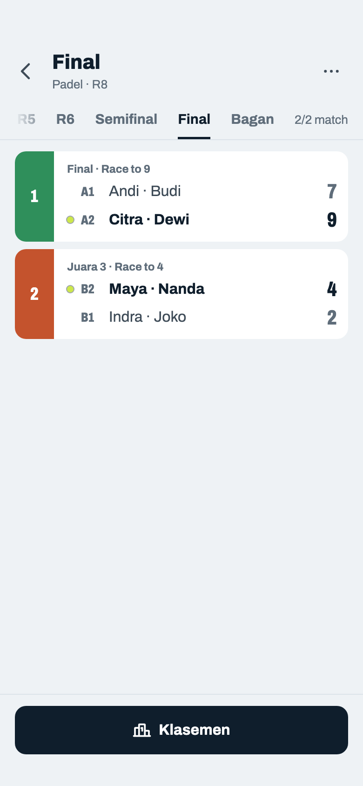

Komponen: `MabarAppBar`, `MabarButton`, `MabarIconButton`, `MabarActionBar`, `RoundTabs`, `MatchScoreRow`

- Final dan Perebutan juara 3 terisi → status Final (16.8): tidak ada titik live, hitung mundur hilang, tombol "Klasemen" jadi tombol utama seperti 06c. Tidak ada "Tambah round" (16.2).
- Peringkat akhir 16F: #1 Citra · Dewi, #2 Andi · Budi, #3 Maya · Nanda, #4 Indra · Joko.

## 21j · Bagan · 2 grup · selesai

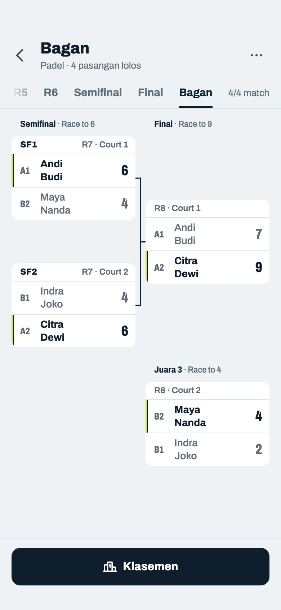

Komponen: `MabarAppBar`, `MabarButton`, `MabarIconButton`, `MabarActionBar`, `RoundTabs`

- Semua garis tinta: tiap match punya pemenang. Juara = pemenang kartu Final (garis bola), tidak ada label "Juara" tambahan; peringkat ada di Klasemen.
- Kartu tetap bisa diketuk untuk mengubah skor (aturan ganti pemenang 21k–21m).

## 21k · Ubah SF1 · pemenang berganti · R8 belum ada skor

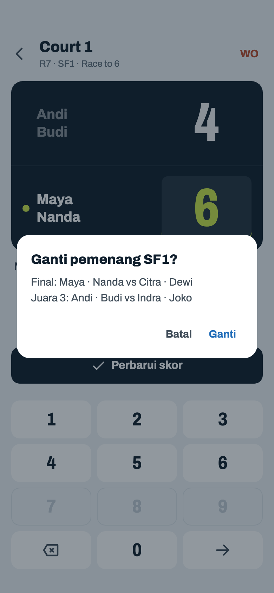

Komponen: `MabarAppBar`, `MabarButton`, `MabarTextButton`, `MabarIconButton`, `ScoreBoard / ScoreKeypad`, `showMabarSheet`, `showMabarConfirm`

- SF1 6–4 diubah jadi 4–6 saat Final dan Juara 3 (R8) masih Belum: boleh (GU11). "Perbarui skor" memunculkan dialog ini (usulan) karena lawan di dua match lain ikut berganti; isinya susunan baru, bukan penjelasan.
- "Ganti" → skor tersimpan, slot Final dan Juara 3 langsung berganti, kembali ke Jadwal. "Batal" → kembali ke papan skor dengan angka yang diketik.
- Mengubah skor tanpa membalik pemenang (mis. 6–4 → 6–5) tidak memunculkan dialog. Final dan Juara 3 tidak mengisi match lain, jadi pemenangnya selalu boleh diganti tanpa dialog.

## 21l · Ubah SF1 · ditolak · Final sudah ada skor

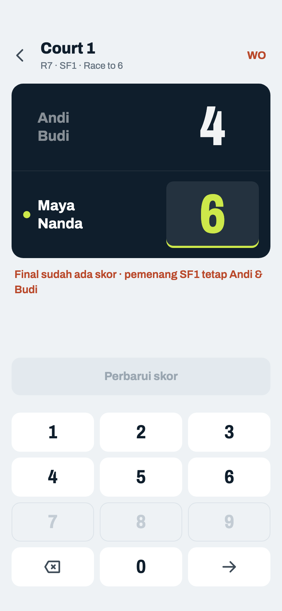

Komponen: `MabarAppBar`, `MabarButton`, `MabarTextButton`, `MabarIconButton`, `ScoreBoard / ScoreKeypad`

- Final 7–9 sudah disimpan, Juara 3 belum. Membalik pemenang SF1 ditolak (GU11, AC-G9): pesan merah menggantikan "menang …", tombol mati. Kalau Juara 3 juga sudah ada skor: "Final dan Juara 3 sudah ada skor · …".
- Pesan muncul begitu skor yang diketik membalik pemenang; kembali ke pemenang yang sama (21m) → pesan hilang, tombol aktif.

## 21m · Ubah SF1 · pemenang sama · boleh

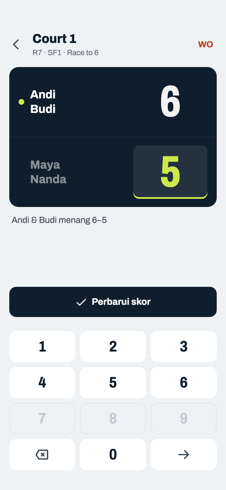

Komponen: `MabarAppBar`, `MabarButton`, `MabarTextButton`, `MabarIconButton`, `ScoreBoard / ScoreKeypad`

- Final sudah ada skor, tetapi 6–5 tidak membalik pemenang → boleh, tanpa dialog (AC-G9). Bagan dan Klasemen grup tidak berubah.

## 21n · Sheet · walkover di Semifinal

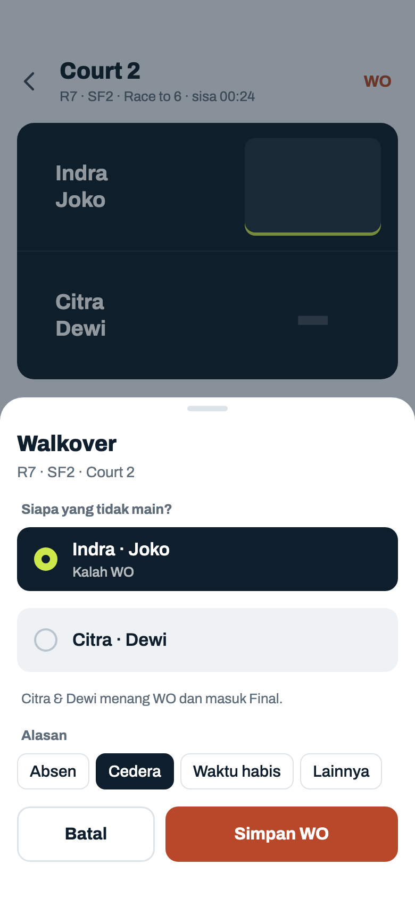

Komponen: `MabarAppBar`, `MabarButton`, `MabarTextButton`, `MabarIconButton`, `MabarGroup / MabarRow`, `MabarChip`, `ScoreBoard / ScoreKeypad`, `showMabarSheet`

- Alur WO sama dengan 07j (4.4). Kalimat di bawah pilihan menulis akibatnya di gugur: lawan masuk babak berikutnya (G12); nilai WO tidak ditulis karena peringkat gugur dari babak (16.7).
- WO di Final: "… menang WO dan juara"; di Juara 3: "… menang WO dan juara 3"; di perempat final: "… masuk Semifinal".
- Isi di belakang sheet = Input Skor SF2 kosong (seperti 07a).

## 21o · Semifinal · SF2 WO

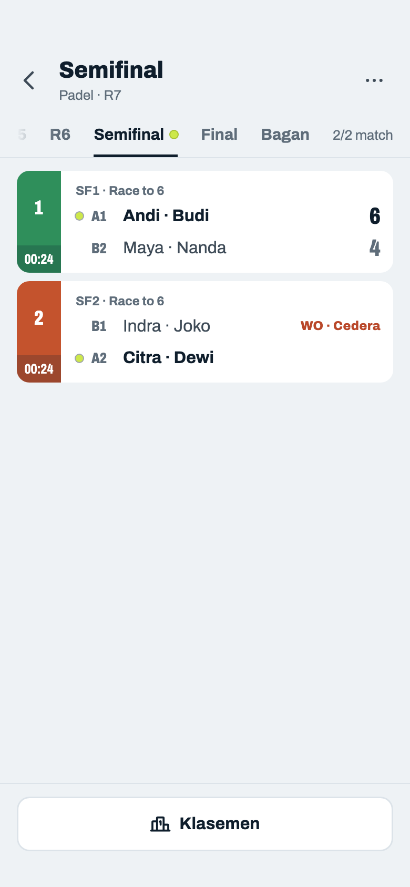

Komponen: `MabarAppBar`, `MabarButton`, `MabarIconButton`, `MabarActionBar`, `RoundTabs`, `MatchScoreRow`

- Baris WO sama dengan 06g: pemenang tebal tanpa skor, tag "WO · alasan" di yang kalah. Citra · Dewi masuk Final, Indra · Joko ke Juara 3 (AC-G11). Klasemen grup tidak berubah.
- Semua match R7 terisi → tab Final terbuka; titik live tetap di R7 sampai host membuka R8 (tab tidak pindah otomatis, 06a).

## 21p · Bagan · 2 grup · SF2 WO

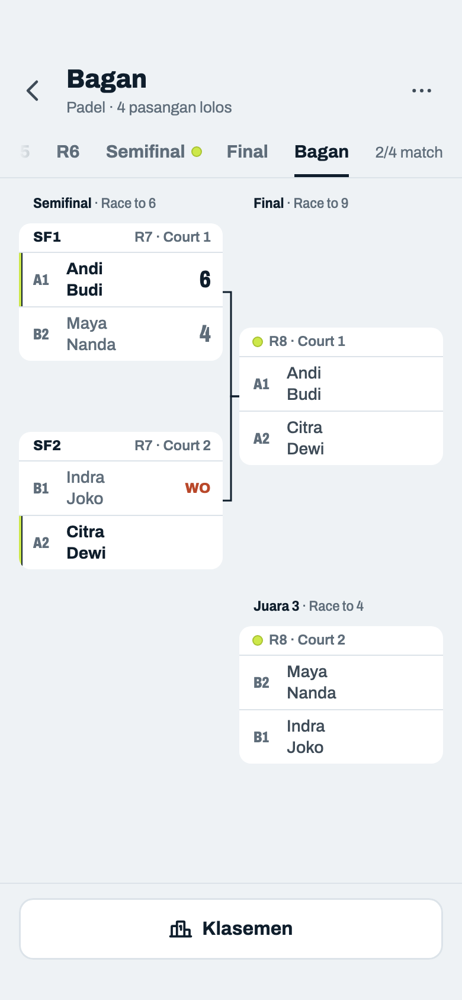

Komponen: `MabarAppBar`, `MabarButton`, `MabarIconButton`, `MabarActionBar`, `RoundTabs`

- Di kartu, WO ditulis di kolom skor yang kalah (clay, kontras 5,2:1 di putih); pemenang tanpa angka, ditandai garis bola + tebal.
- Final dan Juara 3 sekarang lengkap dan R8 terbuka → titik bola di kedua kartu.

## 21q · Final · tanpa Perebutan juara 3

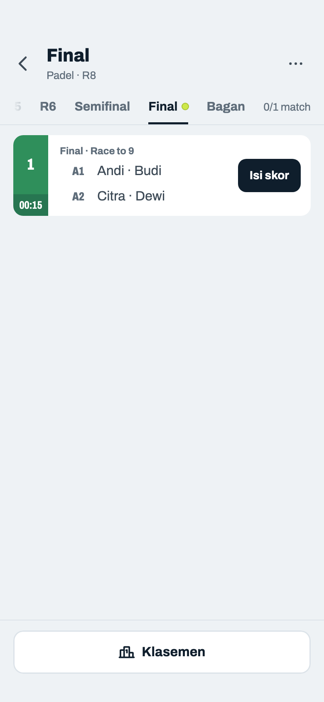

Komponen: `MabarAppBar`, `MabarButton`, `MabarIconButton`, `MabarActionBar`, `RoundTabs`, `MatchScoreRow`

- Juara 3 dimatikan di Konfigurasi (keputusan 100): R8 hanya Final di Court 1, Court 2 kosong. Tab tetap "Final".
- Final terisi → status Final; peringkat #3 dipakai bersama Maya · Nanda dan Indra · Joko (16F, podium 4 anak tangga).

## 21r · Bagan · tanpa Perebutan juara 3 · selesai

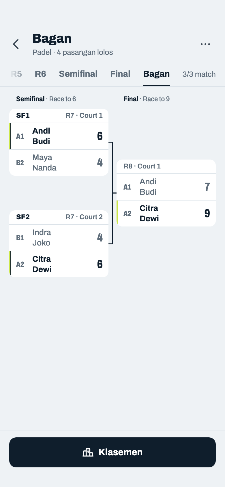

Komponen: `MabarAppBar`, `MabarButton`, `MabarIconButton`, `MabarActionBar`, `RoundTabs`

- Tanpa juara 3: kartu dan label "Juara 3" tidak ada; ujung tab menghitung 3 match.

## 21s · 1 court · Perebutan juara 3 sebelum Final

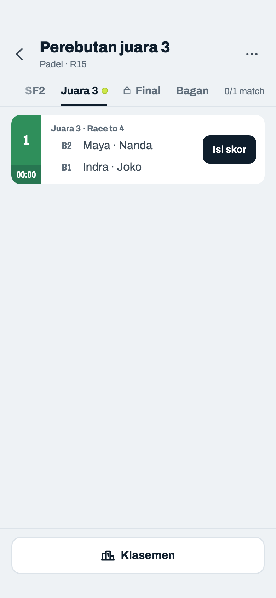

Komponen: `MabarAppBar`, `MabarButton`, `MabarIconButton`, `MabarActionBar`, `RoundTabs`, `MatchScoreRow`

- Varian 16A 1 court: fase grup R1–R12, R13 SF1, R14 SF2, R15 Perebutan juara 3, R16 Final (GU10), 16 round = 240 mnt, lewat booking 02:00. Hitung mundur berhenti di 00:00 (06p).
- Satu babak tersebar di beberapa round → tab memakai kode match ("SF1", "SF2"; 4 grup 2 court: "PF1–2", "PF3–4"); babak dalam satu round → nama babak ("Semifinal"). Final + Juara 3 dalam satu round → "Final" (usulan).
- Judul = nama babak lengkap; kode pendek hanya di tab.

## 21t · Bagan · diakhiri setelah Semifinal

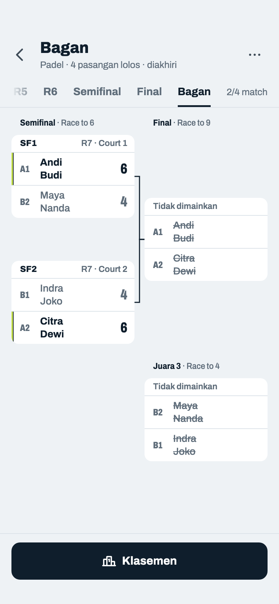

Komponen: `MabarAppBar`, `MabarButton`, `MabarIconButton`, `MabarActionBar`, `RoundTabs`

- Akhiri (dialog 21z) setelah R7: Final dan Juara 3 jadi "Tidak dimainkan", nama dicoret dan pudar seperti 06c; garis SF tetap tinta karena SF punya pemenang.
- Peringkat akhir 16F varian "diakhiri setelah R7": #1 Andi · Budi + Citra · Dewi, #2 Maya · Nanda + Indra · Joko.
- Tab Final (R8) menampilkan dua baris "Tidak dimainkan" seperti 06c.

## 21u · Bagan · 4 grup · baru dibuat

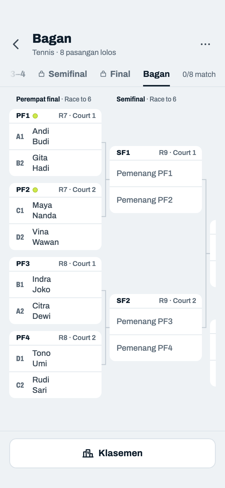

Komponen: `MabarAppBar`, `MabarButton`, `MabarIconButton`, `MabarActionBar`, `RoundTabs`

- Contoh 16B: Tennis, 20 mnt, 2 court × 3 jam, 24 pemain = 12 pasangan, 4 grup × 3. Semua babak Race to 6 kecuali Juara 3 Race to 4 dan Final Race to 9 (contoh). Lolos: A1 Andi · Budi, A2 Citra · Dewi, B1 Indra · Joko, B2 Gita · Hadi, C1 Maya · Nanda, C2 Rudi · Sari, D1 Tono · Umi, D2 Vina · Wawan.
- Bagan silang (keputusan 97): PF1 A1–B2, PF2 C1–D2 di paruh atas; PF3 B1–A2, PF4 D1–C2 di paruh bawah. A1 dan A2 paling cepat bertemu di Final (AC-G8).
- Tiga babak tidak muat di 390 dengan nama terbaca (tiga kolom = ±112 pt, nama terpotong). Jadi bagan digeser horizontal per kolom: kolom 160, jarak 14, dua babak terlihat penuh, babak ketiga mengintip 10 pt sebagai tanda bisa digeser. Bagan terpotong di tepi body (358), tidak sampai tepi layar; label kolom menjorok 12 pt, jadi bagian yang mengintip hanya tepi kartu dan garis, tanpa potongan huruf.
- Posisi geser awal: kolom babak pertama yang masih ada match kosong rata kiri, dibatasi ujung kanan (21x). Geser berhenti per kolom.
- Round gugur: R7 PF1 + PF2, R8 PF3 + PF4, R9 SF1 + SF2, R10 Final + Juara 3 → 10 round × 20 mnt = 200 mnt, lewat booking 00:20 (AC-G4).

## 21v · PF1–2 · belum ada skor

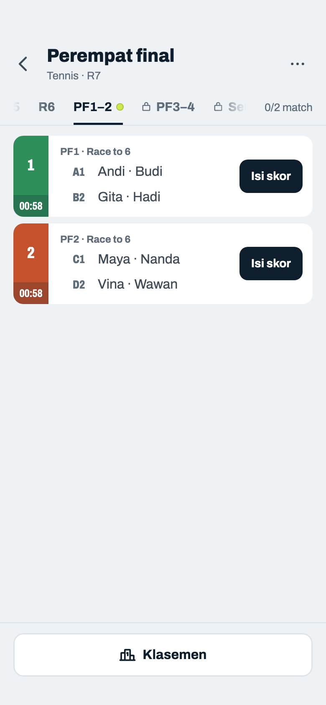

Komponen: `MabarAppBar`, `MabarButton`, `MabarIconButton`, `MabarActionBar`, `RoundTabs`, `MatchScoreRow`

- Perempat final tersebar di dua round (2 court) → tab "PF1–2" dan "PF3–4"; judul tetap "Perempat final". Hitung mundur 00:58 = 3 jam − 122 mnt.
- Tab yang dipilih selalu terlihat: strip digeser secukupnya, kedua tepi yang menyembunyikan tab dipudarkan (`.strip.gg-fade-lr`, tambahan untuk .tabs). Tab Bagan di ujung kanan; terlihat penuh saat strip di ujung (21u).

## 21w · Bagan · 4 grup · perempat final berjalan

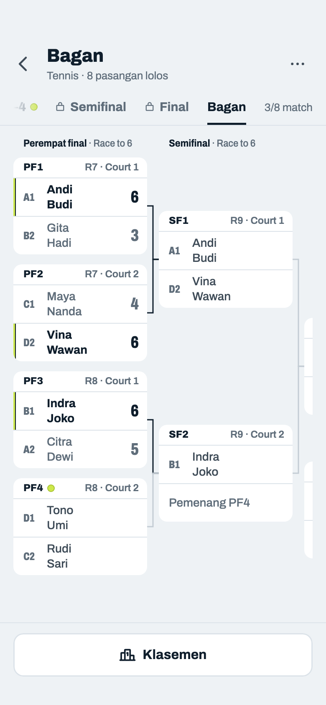

Komponen: `MabarAppBar`, `MabarButton`, `MabarIconButton`, `MabarActionBar`, `RoundTabs`

- PF1 6–3, PF2 4–6, PF3 6–5 terisi; PF4 di R8 masih jalan. Pemenang langsung di slot SF; SF1 lengkap tapi belum bisa diisi karena R9 terkunci (tanpa titik bola).
- Selama perempat final belum selesai, geseran awal = kolom Perempat final rata kiri.

## 21x · Bagan · 4 grup · digeser ke Semifinal–Final

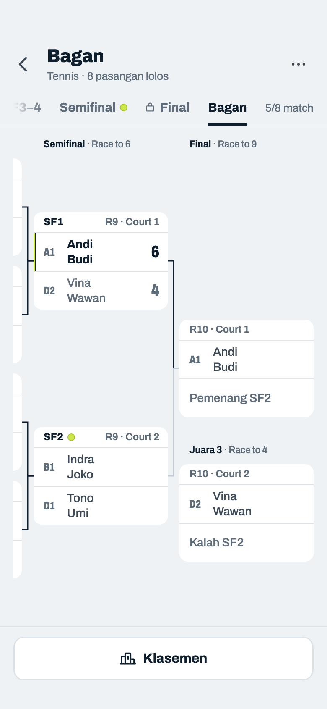

Komponen: `MabarAppBar`, `MabarButton`, `MabarIconButton`, `MabarActionBar`, `RoundTabs`

- Perempat final selesai → geseran awal = ujung kanan (Semifinal + Final). Kolom Perempat final tinggal 10 pt di kiri (hanya tepi kartu dan garis); geser ke kanan untuk melihatnya lagi.
- SF1 6–4 terisi: Andi · Budi ke Final, Vina · Wawan ke Juara 3. SF2 di R9 masih jalan.

## 21y · Bagan · 4 grup · selesai

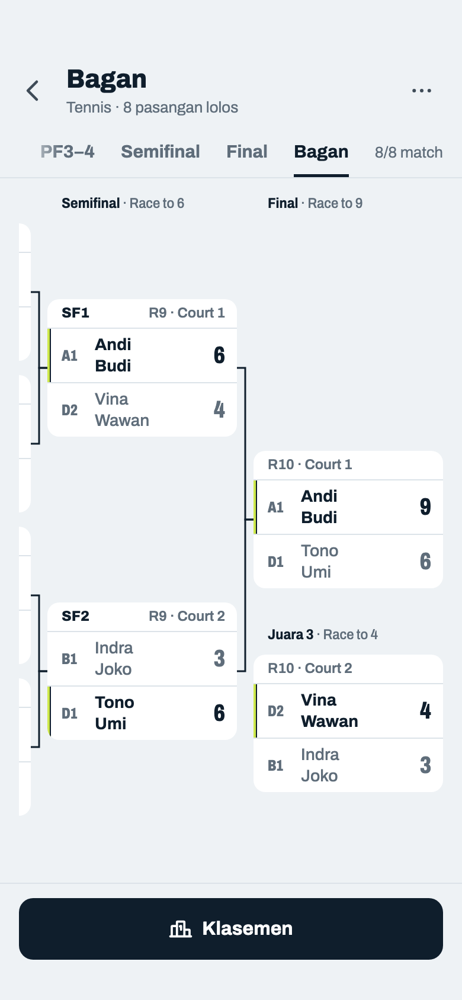

Komponen: `MabarAppBar`, `MabarButton`, `MabarIconButton`, `MabarActionBar`, `RoundTabs`

- Final 9–6: Andi · Budi juara; Juara 3 4–3: Vina · Wawan. Peringkat akhir: #1 Andi · Budi, #2 Tono · Umi, #3 Vina · Wawan, #4 Indra · Joko, #5 Gita · Hadi, Maya · Nanda, Citra · Dewi, Rudi · Sari (kalah perempat final, satu nomor), lalu posisi grup 3.
- Semua match terisi → geseran awal tetap ujung kanan (babak terakhir).

## 21z · Dialog · akhiri turnamen sebelum Final

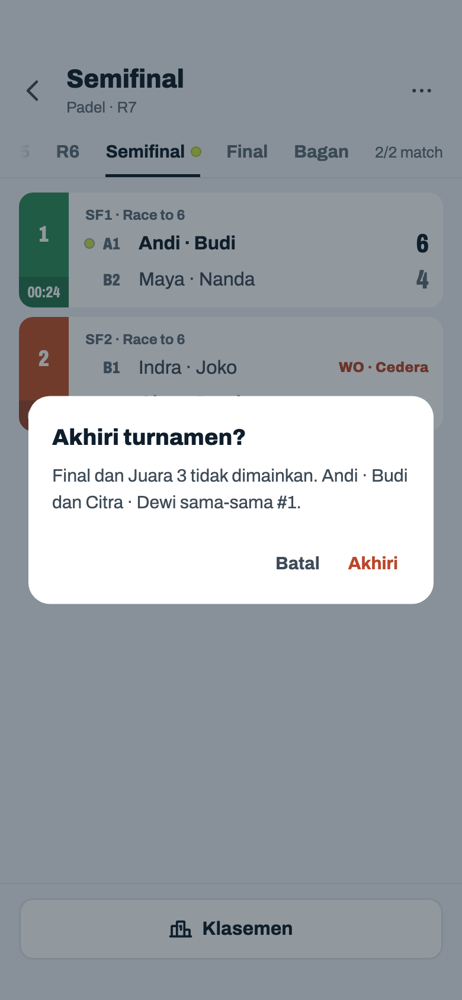

Komponen: `MabarAppBar`, `MabarButton`, `MabarTextButton`, `MabarIconButton`, `MabarActionBar`, `RoundTabs`, `MatchScoreRow`, `showMabarSheet`, `showMabarConfirm`

- Latar = 21o (Semifinal lengkap, SF2 WO), lewat menu ⋯ → Akhiri turnamen. Judul dan tombol sama dengan 06e; isinya menyebut babak yang tidak dimainkan dan pasangan yang berbagi #1, yaitu pemenang SF1 dan SF2 (PATCH 3.8.1, C-1).
- Akhiri saat Perempat final, atau Semifinal belum lengkap: isinya cukup babak yang batal, mis. "Semifinal, Final, dan Juara 3 tidak dimainkan.", tanpa kalimat "#1" (keputusan host 2026-11-18).
- Akhiri → 21t: Final dan Juara 3 "Tidak dimainkan"; peringkat akhir #1 Andi · Budi + Citra · Dewi, #2 Maya · Nanda + Indra · Joko (16F varian diakhiri setelah R7). Tidak bisa dilanjutkan.
