# Grup + Gugur · peringkat akhir

> Dihasilkan `tool/hifi_extract.py` dari `design/hifi.html`. Jangan diedit langsung.

Peringkat akhir Grup + Gugur (PRD §16.8–16.9, keputusan 93–102, GU12, GU13, GU16): Klasemen, Detail, poster Bagikan, dan caption menulis babak yang dicapai, bukan nilai · selisih. Data utama 16A/16E/16F (Padel, 2 grup, Race to 6, Semifinal Race to 6, Juara 3 Race to 4, Final Race to 9); 4 grup = bagan 21y (16B, Tennis).

## 22a · Klasemen · Peringkat · 2 grup · Final

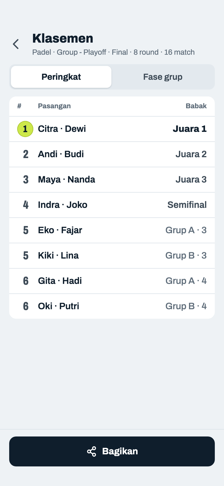

Komponen: `MabarAppBar`, `MabarButton`, `MabarIconButton`, `MabarActionBar`, `MabarSegmented`, `StandingTable`

- Data 16E/16F: SF1 Andi · Budi 6–4 Maya · Nanda, SF2 Indra · Joko 4–6 Citra · Dewi, Final Andi · Budi 7–9 Citra · Dewi, Perebutan juara 3 Maya · Nanda 4–2 Indra · Joko. 12 match grup + 4 gugur = 16 match, R1–R8.
- Setelah bagan dibuat Klasemen punya dua tab: Peringkat (peringkat akhir, terbuka pertama) dan Fase grup (22b). Sebelum bagan dan belum diakhiri hanya tabel grup tanpa tab (20d, 20f); diakhiri di fase grup → dua tab (22g).
- Nomor dari tingkat babak (16.8): Juara, Final, Juara 3, Semifinal, lalu yang tidak lolos per posisi grup. Posisi grup sama = nomor sama (#5 Eko · Fajar dan Kiki · Lina, posisi 3); nomor rapat. Yang senomor urut nama.
- Kolom Babak menggantikan Main, W–L, +/−, dan nilai (GU16): angka fase grup tidak menentukan nomor, jadi tidak ditampilkan di sini. Pasangan yang tidak lolos menulis grup · posisi grup ("Grup A · 3").
- Juara 4 menulis "Semifinal" (16F): kalah di Semifinal lalu kalah Perebutan juara 3. #1 diberi bola seperti Klasemen lain. Ketuk baris → Detail pasangan (22j).
- Status Final setelah Final dan Perebutan juara 3 terisi; subjudul pola 09c dengan nama format "Group - Playoff" di tempat mode (keputusan 127). Bagikan memakai urutan tab Peringkat.

## 22b · Klasemen · Fase grup · setelah bagan · Final

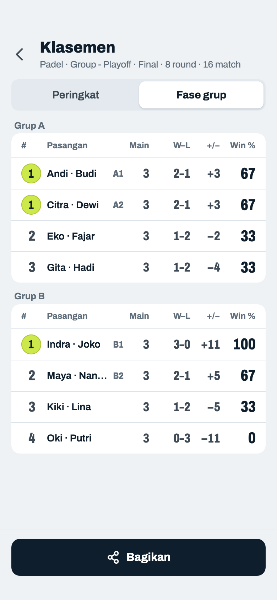

Komponen: `MabarAppBar`, `MabarButton`, `MabarIconButton`, `MabarActionBar`, `MabarGroup / MabarRow`, `MabarSegmented`, `StandingTable`

- Tabel grup = 20f apa adanya (nomor 4.3, tanpa tab metode), ditambah slot lolos di kanan nama (16.8): A1, A2, B1, B2. Huruf slot sama dengan dialog Buat bagan (20g).
- Andi · Budi dan Citra · Dewi sama-sama #1; slot A1/A2 dari head-to-head (R5 6–4) atau pilihan host (20i–20k) terbaca dari kode slotnya, nomor tabel tidak berubah.
- Format grup Race to 6 → kolom Win %; grup Americano → kolom Point % dan slot lolos dari Point % → selisih (keputusan 129, U-RP6), tetap tanpa tab.
- Angka hanya match grup; match gugur tidak masuk tabel ini (G7). Tab ini tetap ada setelah Final. Halaman digulir seperti 20n; Grup B berlanjut di bawah action bar.

## 22c · Klasemen · Peringkat · tanpa Perebutan juara 3 · Final

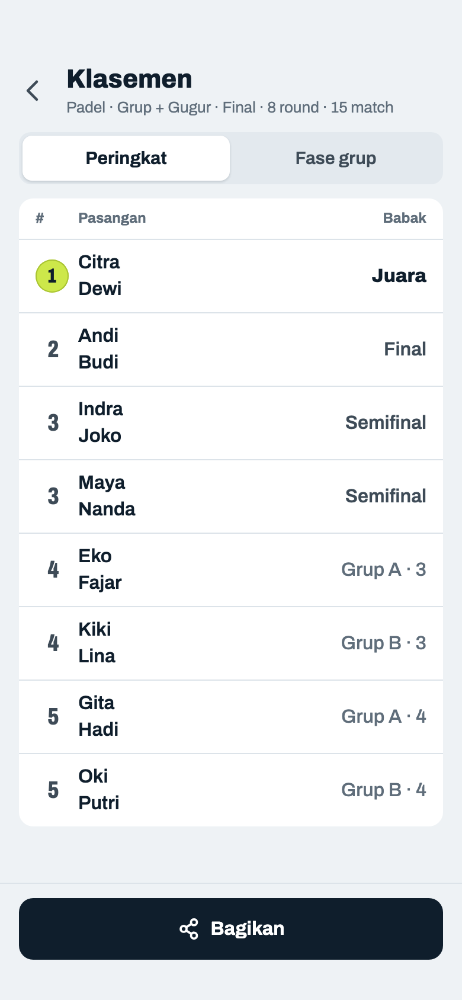

Komponen: `MabarAppBar`, `MabarButton`, `MabarIconButton`, `MabarActionBar`, `MabarSegmented`, `StandingTable`

- Juara 3 dimatikan (19g, keputusan 100): kedua yang kalah Semifinal satu tingkat → #3 Indra · Joko dan Maya · Nanda, keduanya "Semifinal". Nomor berikutnya rapat: posisi grup 3 di #4, posisi 4 di #5.
- 15 match (12 grup + SF1, SF2, Final); R8 hanya Final (21q, 21r). Poster: empat anak tangga #1 #2 #3 #3 (22n).

## 22d · Klasemen · Peringkat · bagan baru dibuat · Sementara

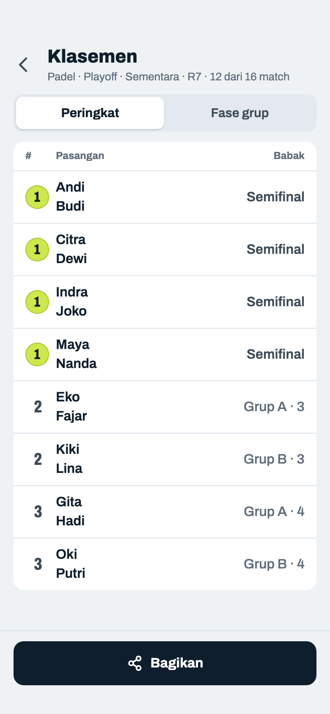

Komponen: `MabarAppBar`, `MabarButton`, `MabarIconButton`, `MabarActionBar`, `MabarSegmented`, `StandingTable`

- Tepat setelah Buat bagan (20g → 21a): keempat pasangan masih di Semifinal tanpa hasil → satu tingkat di atas yang kalah Semifinal, bernomor sama #1 (16.8), urut nama. Posisi grup 3 dan 4 di bawahnya.
- Subjudul pola 20d dengan fase "Playoff"; jumlah match = semua match di Jadwal (12 grup + 4 gugur yang ditambahkan Buat bagan).
- Klasemen dibuka dari tombol ikon Klasemen di Jadwal; tab Peringkat terbuka pertama.

## 22e · Klasemen · Peringkat · SF1 terisi · Sementara

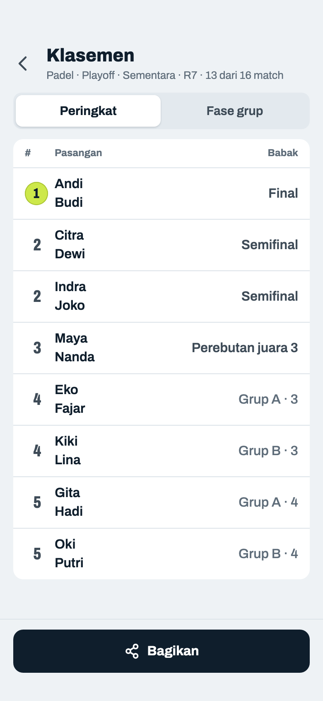

Komponen: `MabarAppBar`, `MabarButton`, `MabarIconButton`, `MabarActionBar`, `MabarSegmented`, `StandingTable`

- Keadaan 21c/21d: SF1 Andi · Budi 6–4 Maya · Nanda, SF2 belum. Andi · Budi sudah di Final (belum ada hasil) → di atas tingkat kalah Final; Citra · Dewi dan Indra · Joko masih di Semifinal → #2 bersama; Maya · Nanda sudah kalah Semifinal dan menunggu Perebutan juara 3 → #3.
- Babak untuk pasangan yang match-nya belum ada hasil = babak yang sedang dijalani ("Final", "Semifinal", "Perebutan juara 3", nama lengkap GU1). Setelah hasil: Juara/Final, Juara 3/Semifinal.
- Status Sementara tertulis di subjudul; tidak ada tanda lain di baris.

## 22f · Klasemen · Peringkat · diakhiri setelah Semifinal

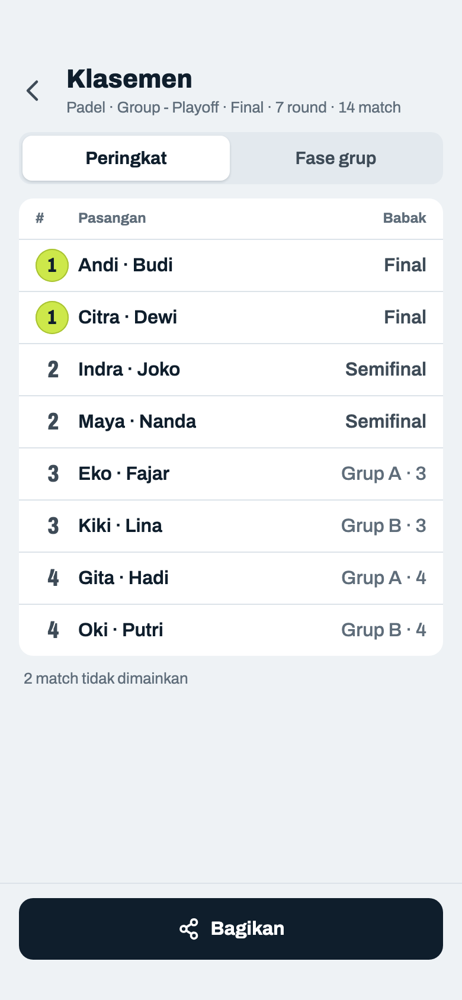

Komponen: `MabarAppBar`, `MabarButton`, `MabarIconButton`, `MabarActionBar`, `MabarSegmented`, `StandingTable`

- Data 21t: Akhiri setelah R7, Final dan Perebutan juara 3 "Tidak dimainkan". Varian 16F: #1 Andi · Budi + Citra · Dewi ("Final"), #2 Indra · Joko + Maya · Nanda ("Semifinal"), lalu posisi grup 3 dan 4.
- Match tidak dimainkan tidak dihitung sebagai babak yang dicapai: yang menunggu Perebutan juara 3 tetap "Semifinal". Catatan bawah pola 09f.

## 22g · Klasemen · Peringkat · diakhiri di fase grup

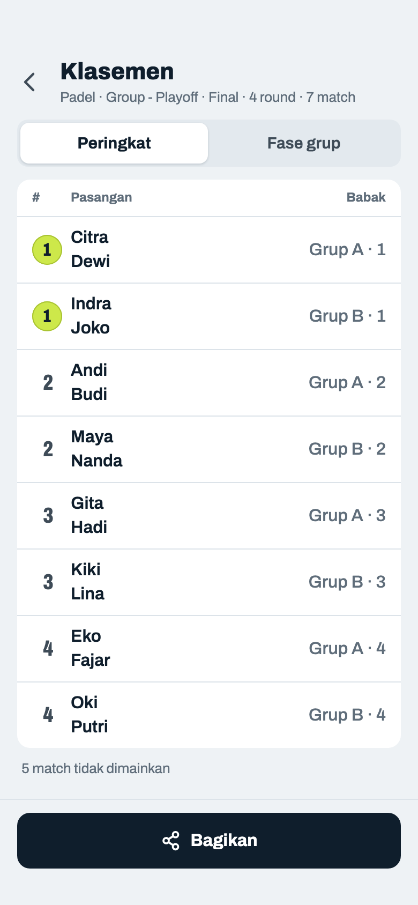

Komponen: `MabarAppBar`, `MabarButton`, `MabarIconButton`, `MabarActionBar`, `MabarSegmented`, `StandingTable`

- Data 20q: diakhiri saat R4 Court 2 belum diisi; bagan tidak dibuat. Peringkat = urut posisi grup (16.8): semua posisi 1 lintas grup satu tingkat, dst. Babak = "Grup A · 1".
- Grup A saat itu: Citra · Dewi 2–0 +5, Andi · Budi 1–1 +1, Gita · Hadi 1–1 0, Eko · Fajar 0–2 −6. Grup B: Indra · Joko 2–0 +7, Maya · Nanda 1–1 +1, Kiki · Lina 0–1 −3, Oki · Putri 0–1 −5.
- Tab Fase grup = tabel grup tanpa slot lolos (pola 20d, status Final). 5 match tidak dimainkan: R4 Court 2, R5, R6.

## 22h · Klasemen · Peringkat · 4 grup · Final

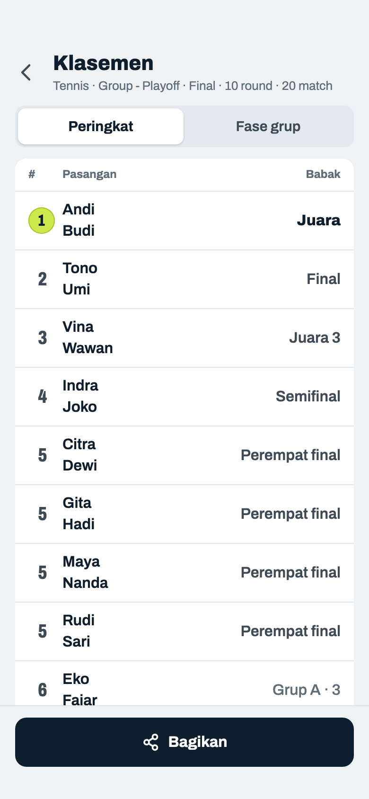

Komponen: `MabarAppBar`, `MabarButton`, `MabarIconButton`, `MabarActionBar`, `MabarSegmented`, `StandingTable`

- Data 21y (16B): PF1 Andi · Budi 6–3 Gita · Hadi, PF2 Maya · Nanda 4–6 Vina · Wawan, PF3 Indra · Joko 6–5 Citra · Dewi, PF4 Tono · Umi 6–2 Rudi · Sari; SF1 Andi · Budi 6–4 Vina · Wawan, SF2 Indra · Joko 3–6 Tono · Umi; Final 9–6, Juara 3 Vina · Wawan 4–3 Indra · Joko.
- Empat yang kalah Perempat final satu nomor (#5), urut nama. 12 match grup + 8 gugur = 20 match, R1–R10.
- Halaman digulir; app bar, tab, dan action bar tetap. Bawah daftar: 22i.

## 22i · Klasemen · Peringkat · 4 grup · digulir ke bawah

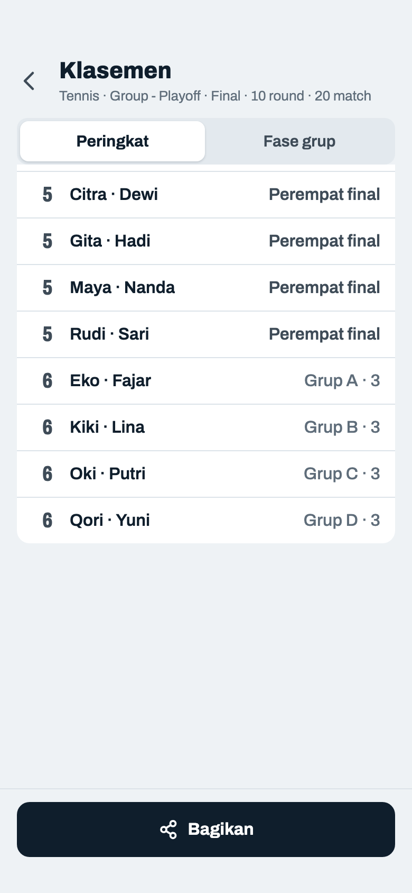

Komponen: `MabarAppBar`, `MabarButton`, `MabarIconButton`, `MabarActionBar`, `MabarSegmented`, `StandingTable`

- Posisi grup 3 dari keempat grup berbagi #6 (16.8). Grup 3 pasangan → tidak ada posisi 4.
- Nama posisi 3 (Eko · Fajar, Kiki · Lina, Oki · Putri, Qori · Yuni) ditetapkan di sini; 21u–21y hanya menulis yang lolos.

## 22j · Detail · pasangan juara

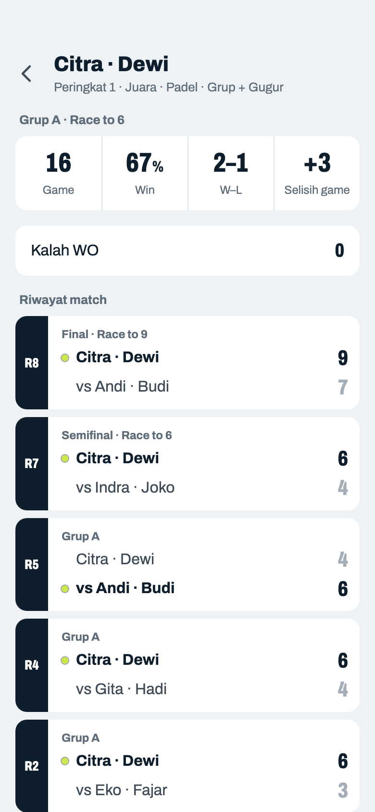

Komponen: `MabarAppBar`, `MabarIconButton`, `MabarGroup / MabarRow`, `MatchScoreRow`, `StatLine`

- Subjudul: peringkat · babak (sama dengan baris Klasemen 22a) · olahraga · format turnamen. Format skor tidak di subjudul karena beda per babak (GU9).
- Baris angka = fase grup saja (GU13): 6 + 6 + 4 = 16 game, Point % 16 ÷ 29 = 55%, Win 67%, 2–1, 16 − 13 = +3 — sama dengan baris tabel Grup A (22b). Statline lima angka seperti 10b (sejak 3.9.0, keputusan 130); Point % tampil walau tabel grup Race to memakai Win %. Label "Grup A · Race to 6" di atasnya = grup dan format fase grup.
- "Beda lawan" tidak ditampilkan: di fase grup selalu semua pasangan grup sendiri. Kalah WO = fase grup.
- Riwayat semua match, terbaru di atas, dengan nama babak di atas nama (komponen .gg-babak dari Jadwal 21): match gugur "Final · Race to 9", "Semifinal · Race to 6"; match grup "Grup A". Hasil gugur tidak masuk angka di atas.

## 22k · Detail · pasangan tidak lolos

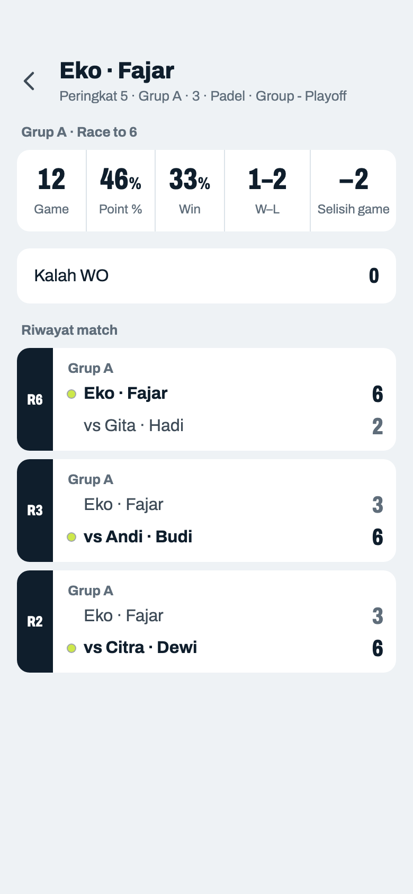

Komponen: `MabarAppBar`, `MabarIconButton`, `MabarGroup / MabarRow`, `MatchScoreRow`, `StatLine`

- Statline lima angka (10b): Point % 12 ÷ 26 = 46% (6–2, 3–6, 3–6).
- Data 16D-ii: #2 di tabel Grup A (1–2, −2), tidak lolos → posisi grup 3 → peringkat akhir #5 (22a).
- Riwayat hanya match grup; R1, R4, R5 Eko · Fajar tidak main (grup 4 pasangan, satu court).

## 22l · Bagikan · Ringkas · podium · Final · bernama

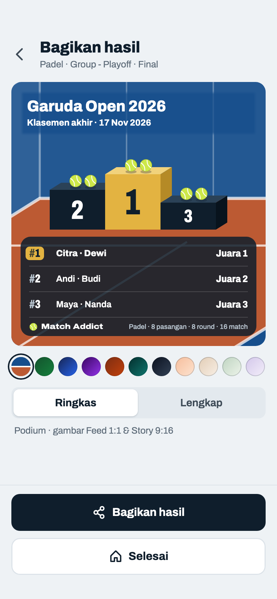

Komponen: `MabarAppBar`, `MabarButton`, `MabarIconButton`, `MabarActionBar`, `MabarGroup / MabarRow`, `MabarSegmented`, `SharePoster`, `PodiumPoster (PodiumScenePainter)`

- Podium dan lantai tetap (keputusan 60–92): tiga baris teratas peringkat akhir naik, pasangan = dua bola per blok dan dua nama bertumpuk (18a, 18e). Hanya isi kolom kanan panel yang berubah: babak, bukan "nilai · selisih" (GU16).
- Babak di panel: Archivo 13,5 tebal 800 lebar 88%, warna teks panel (Story 17). Satu teks, tanpa satuan; baris emas tetap lencana #1.
- Fakta Final "Padel · 8 pasangan · 8 round · 16 match" (pola 11a bernama). Tanpa nama turnamen: judul "Klasemen akhir", baris kecil "Padel · Group - Playoff · tanggal".
- Caption (Ringkas) — baris peringkat menulis babak, tanpa poin dan Win %: `🏆 Garuda Open 2026 · Padel` `17 November 2026` `Klasemen Akhir` `1. Citra + Dewi — Juara` `2. Andi + Budi — Final` `3. Maya + Nanda — Juara 3` `4. Indra + Joko — Semifinal` `5. Eko + Fajar — Grup A · 3` `5. Kiki + Lina — Grup B · 3` `6. Gita + Hadi — Grup A · 4` `6. Oki + Putri — Grup B · 4` `8 round · 16 match · 17 Nov 2026`

## 22m · Gambar Ringkas · Feed dan Story · Final · bernama

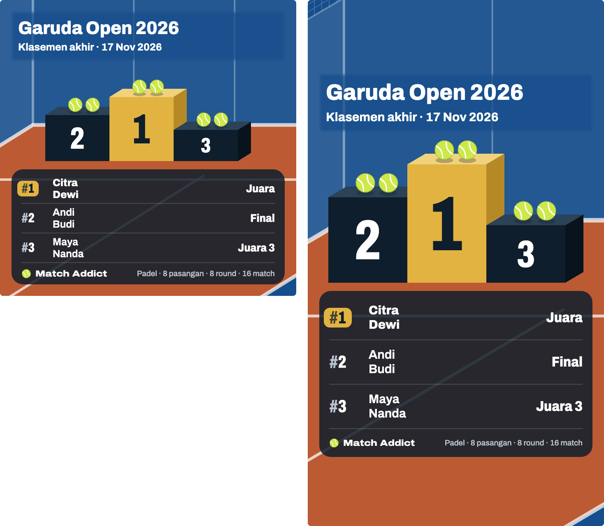

Komponen: `SharePoster`, `PodiumPoster (PodiumScenePainter)`

- Geometri = 18e versi padel: Feed blok 78 / 56 / 38, baris 36; Story 144 / 104 / 70, baris 54. Judul satu baris, jadi Story tidak ditekan aturan batas tinggi.
- Babak terpanjang di podium dengan Perebutan juara 3 = "Semifinal" (empat anak tangga, 22n); "Perempat final" dan posisi grup hanya muncul di Lengkap.

## 22n · Gambar Ringkas · tanpa Perebutan juara 3 · #1 #2 #3 #3

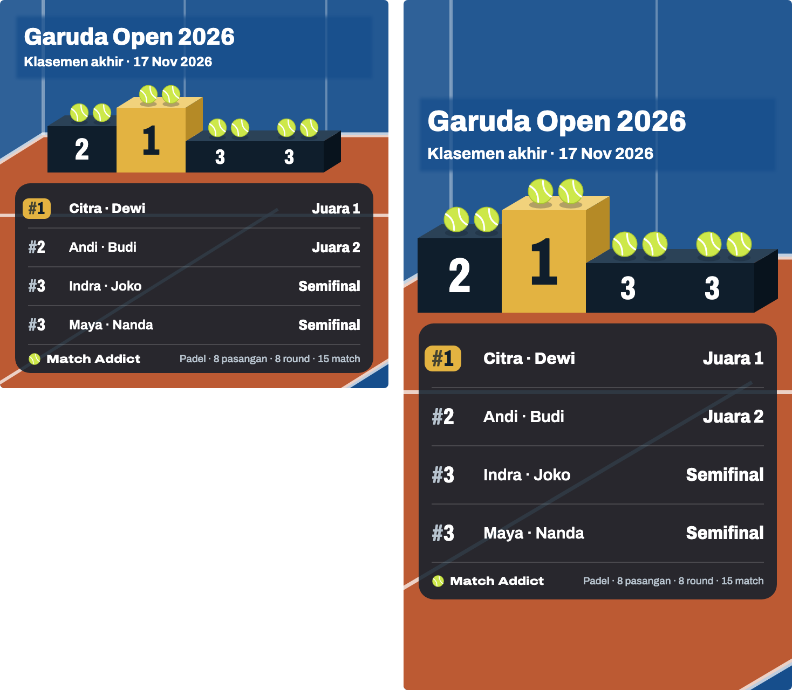

Komponen: `SharePoster`, `PodiumPoster (PodiumScenePainter)`

- Data 22c: dua pasangan #3 senomor → ikut naik (keputusan 65), empat anak tangga 2 · 1 · 3 · 3, kedua #3 sama tinggi (18h). Keduanya "Semifinal".
- Pasangan + empat baris panel 36 → dasar blok naik dan aturan batas tinggi menekan blok: Feed 60 / 43 / 29, Story 95 / 69 / 46 (podiumLayout). Kombinasi pasangan + empat anak tangga belum pernah digambar sebelumnya.

## 22o · Gambar Ringkas · Sementara · SF1 terisi

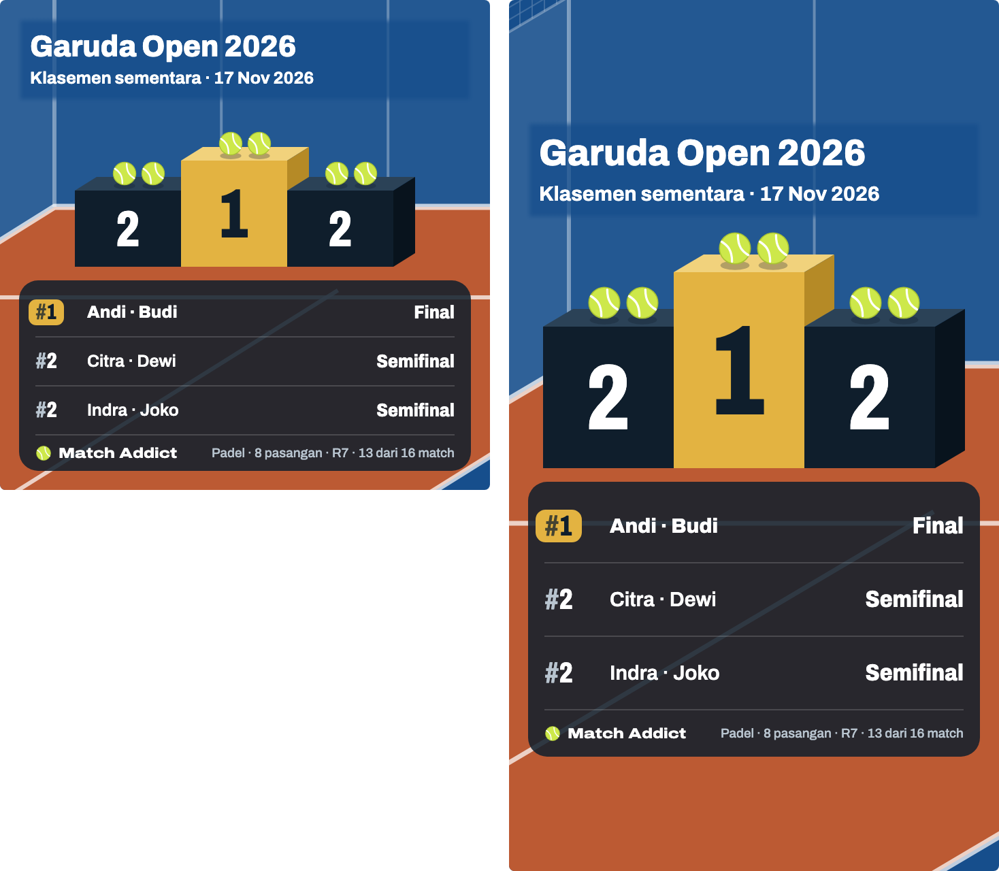

Komponen: `SharePoster`, `PodiumPoster (PodiumScenePainter)`

- Data 22e: tiga baris teratas #1 Andi · Budi ("Final"), #2 Citra · Dewi dan Indra · Joko ("Semifinal") → blok 2 · 1 · 2, dua #2 sama tinggi (keputusan 64). Maya · Nanda (#3) tidak naik.
- Fakta Sementara pola subjudul Klasemen: "R7 · 13 dari 16 match" (semua match di Jadwal). Baris kecil "Klasemen sementara".

## 22p · Bagikan · Lengkap · 2 grup · tema peach

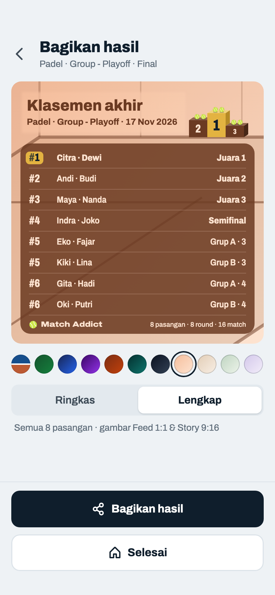

Komponen: `MabarAppBar`, `MabarButton`, `MabarIconButton`, `MabarActionBar`, `MabarGroup / MabarRow`, `MabarSegmented`, `SharePoster`

- Lengkap arah B (11b) dengan semua 8 baris peringkat akhir; kolom kanan = babak (GU16), ukuran huruf = nama baris (12,5 di batas), tebal 800. Posisi grup memakai warna baris kecil (--psub; di peach sama dengan teks panel).
- Kepadatan (keputusan 80): pratinjau 238 ÷ 8 = 29,75 → skala 1,04 (batas). Podium mini pasangan 2 · 1 · 3 seperti 11b.
- Tanpa nama turnamen: judul "Klasemen akhir", baris kecil "Padel · Group - Playoff · 17 Nov 2026", fakta "8 pasangan · 8 round · 16 match".
- Caption Lengkap = caption 22l + "Hasil per Round"; tiap match diawali nama babak seperti label Jadwal (grup "Grup A", gugur "Semifinal", "Final", "Juara 3"): `Hasil per Round` `· Round 1` ` Grup A · Andi+Budi vs Gita+Hadi → 4-6` ` Grup B · Indra+Joko vs Oki+Putri → 6-1` `…` `· Round 7` ` Semifinal · Andi+Budi vs Maya+Nanda → 6-4` ` Semifinal · Indra+Joko vs Citra+Dewi → 4-6` `· Round 8` ` Final · Andi+Budi vs Citra+Dewi → 7-9` ` Juara 3 · Maya+Nanda vs Indra+Joko → 4-2`

## 22q · Gambar Lengkap · 2 grup · Feed dan Story · tema peach

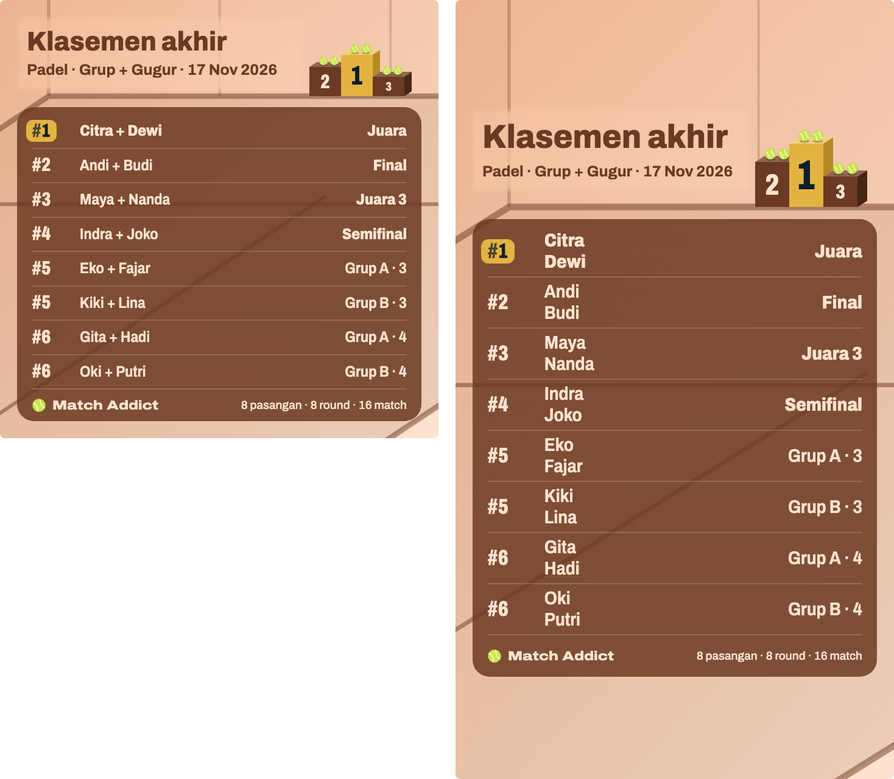

Komponen: `SharePoster`

- Feed 226 ÷ 8 = 28,25 → skala 1,04. Story pasangan bertumpuk = 16 satuan: 336 ÷ 16 = 21 → skala 1,235; nama dan babak di batas 15.
- Babak rata kanan di tengah baris dua nama (Story).

## 22r · Gambar Lengkap · 4 grup · 12 pasangan · Feed, Story dan pratinjau

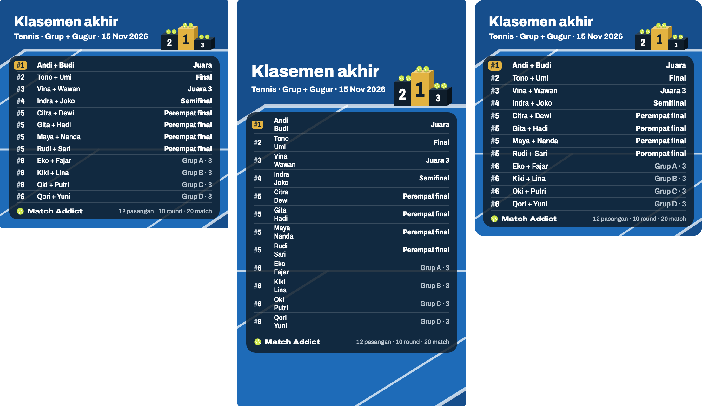

Komponen: `SharePoster`

- Data 22h. Pasangan selalu satu kolom (keputusan 81). Kepadatan: Feed 226 ÷ 12 = 18,83 → skala 0,856; Story 336 ÷ 24 = 14 → 0,823; pratinjau 238 ÷ 12 = 19,83 → 0,901.
- Babak terlebar "Perempat final" menentukan lebar kolom kanan; nama pasangan tetap utuh. Tema lapangan tennis (lantai court).

## 22s · Beranda · Grup + Gugur berjalan · fase grup

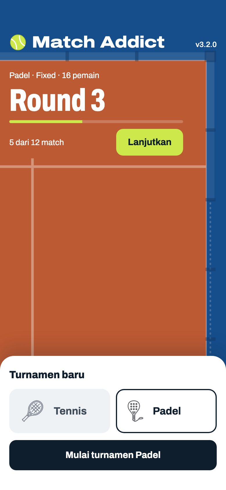

Komponen: `MabarButton`, `CourtBanner (CourtPainter)`, `HomePanel / SportPicker`

- Data 16E (Padel, 8 pasangan = 16 pemain, 2 grup, Race to 6), sama dengan 20b/20d: R3 berjalan, 5 dari 12 match grup selesai. Tanpa nama turnamen.
- Banner sama dengan Fixed biasa (01f), tapi di tempat mode tertulis nama format: baris kecil "Padel · Group - Playoff · 16 pemain" (keputusan 127, 128 #6 C-4), "Round n" = round pertama yang belum lengkap (fase grup), "x dari y match" dari semua match yang sudah ada. Selama fase grup y = 12 (match grup saja).

## 22t · Beranda · Grup + Gugur berjalan · Semifinal

Komponen: `MabarButton`, `CourtBanner (CourtPainter)`, `HomePanel / SportPicker`

- Setelah Buat bagan (21a): match gugur ikut dihitung, jadi y naik dari 12 ke 16 (2 Semifinal, Final, Juara 3). Latar = 21b (Semifinal R7, belum ada skor): 12 dari 16 match.
- Judul = nama babak "Semifinal", sama dengan judul Jadwal babak itu (21b), bukan "Round 7" (keputusan 128 #6, C-4); babak lain sama dengan judul Jadwal-nya ("Perempat final" 21v, "Final" 21f, "Perebutan juara 3" 21s). Baris kecil "Padel · Group - Playoff · 16 pemain" (keputusan 127). "Lanjutkan" membuka Jadwal di babak itu.

## 22u · Dialog · mulai turnamen baru saat Grup + Gugur berjalan

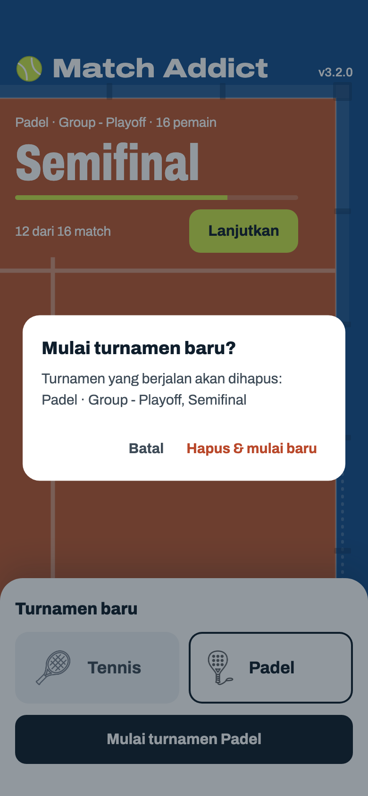

Komponen: `MabarButton`, `MabarTextButton`, `showMabarSheet`, `showMabarConfirm`, `CourtBanner (CourtPainter)`, `HomePanel / SportPicker`

- Latar = 22t. Isi sama dengan 01h untuk turnamen tanpa nama, dengan nama format dan judul banner: "olahraga · format, babak" → "Padel · Group - Playoff, Semifinal" (keputusan 127, 128 #6 C-4); di fase grup "…, Round 3". Bernama: nama turnamen, lalu ", Semifinal".
- "Hapus & mulai baru" membuang turnamen ini (tidak bisa dilanjutkan, seperti Fixed) dan menghentikan live-nya kalau aktif (12e).
