# Group - Playoff 3.10.0 · 3 dan 4 grup, wildcard, ubah format

> Dihasilkan `tool/hifi_extract.py` dari `design/hifi.html`. Jangan diedit langsung.

PRD §16 3.10.0 (keputusan 135–149): jumlah grup 2 / 3 / 4, minimal 4 pasangan, babak awal otomatis, wildcard 3 grup, label Juara 1–3, ubah format babak setelah jadwal dibuat (G16). Data utama 16G (Padel, 24 pemain, 3 grup × 4, 2 court × 3 jam, 15 mnt) dan 16.4 (32 pemain, 4 grup × 4). Konfigurasi dan layar Grup: 19c, 19d, 19i, 19j, 19v–19x.

## 23a · Sheet Fase grup · 32 pemain · 4 grup

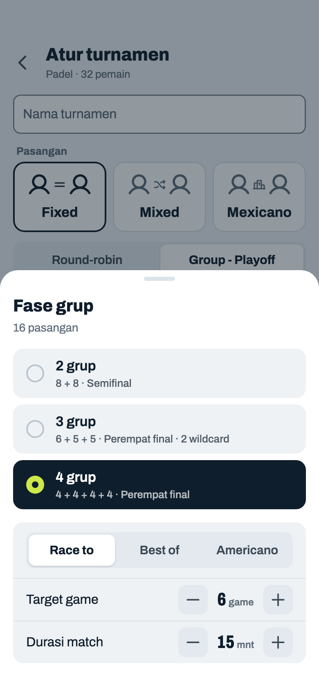

Komponen: `MabarAppBar`, `MabarButton`, `MabarIconButton`, `MabarActionBar`, `MabarGroup / MabarRow`, `MabarSegmented`, `MabarStepper`, `MabarField`, `showMabarSheet`, `ModePicker`

- 32 pemain = 16 pasangan: ketiga pilihan sah (AC-G21). 4 grup hanya 4 + 4 + 4 + 4 (keputusan 142); tanpa wildcard.
- Latar = layar dengan 4 grup terpilih: label "Playoff · Perempat final", estimasi 16.4: A → Court 1, B → Court 2, C → Court 1, D → Court 2, fase grup R1–R12, R13 PF1 + PF2, R14 PF3 + PF4, R15 SF1 + SF2, R16 Final + Perebutan juara 3 → 16 round × 15 = 240 menit, lewat booking 01:00 (match 24 + 4 + 2 + 1 + 1 = 32, tidak ditulis).
- Varian: 3 grup 1 court = 43 round; 2 grup 1 court = 60 round (terpanjang, §8). Pemain 32 → 30 → pilihan jadi 3 grup (GP9).

## 23b · Jadwal fase grup · 3 grup · R12 · Court 2 kosong · Buat bagan

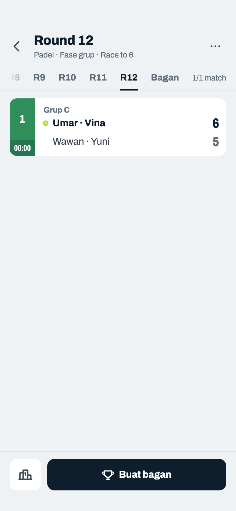

Komponen: `MabarAppBar`, `MabarButton`, `MabarIconButton`, `MabarActionBar`, `RoundTabs`, `MatchScoreRow`

- Contoh 16G: semua 18 match grup terisi. R12 hanya Court 1 (Grup C); Court 2 selesai dengan Grup B di R6 dan kosong R7–R12 (court dikunci per grup, keputusan 146). Round tanpa match di satu court tidak menggambar kartu kosong.
- Match R12 = Umar · Vina 6–5 Wawan · Yuni (urutan match grup dari circle method; data contoh). Hitung mundur 00:00 = booking 3 jam − 12 × 15 mnt.
- 3 grup: "Buat bagan" selalu membuka sheet 23c dulu, karena nilai juara dan wildcard yang menentukan bagan harus terlihat sebelum dikunci (16.5, AC-G24). 2 dan 4 grup tetap langsung dialog (20g/20o) kecuali ada seri (20i).

## 23c · Sheet Buat bagan · 3 grup · juara + wildcard

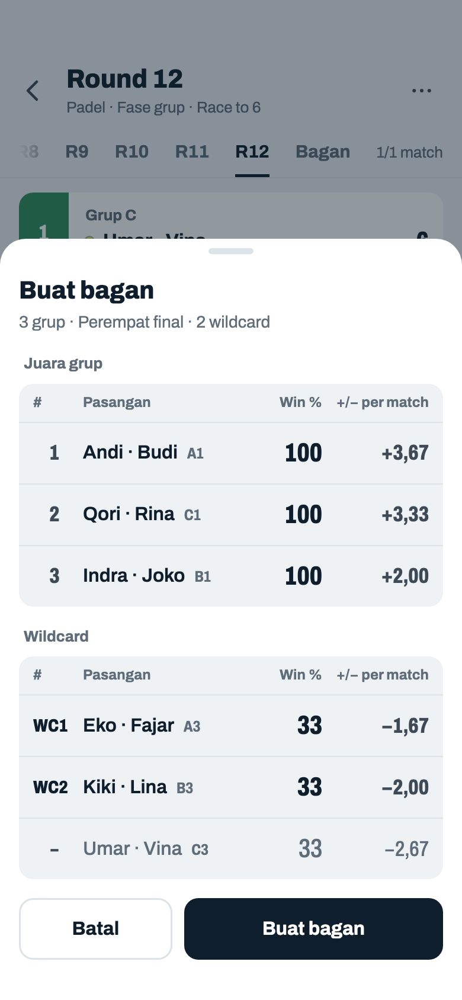

Komponen: `MabarAppBar`, `MabarButton`, `MabarIconButton`, `MabarActionBar`, `MabarGroup / MabarRow`, `RoundTabs`, `MatchScoreRow`, `StandingTable`, `showMabarSheet`

- Data 16G (AC-G24). Metode Playoff = Win % (format grup Race to, G7a, keputusan 141); subjudul tabel kolom ikut metode: grup Americano → "Point %".
- Juara grup diurutkan nilai metode → +/− per match → huruf grup (GP4): Andi · Budi +11 ÷ 3 = +3,67, Qori · Rina +3,33, Indra · Joko +2,00. Wildcard dari peringkat 3 tiap grup (G14): Eko · Fajar −1,67 dan Kiki · Lina −2,00 lolos; Umar · Vina −2,67 tidak lolos (baris redup, tanpa slot).
- +/− per match = selisih ÷ match fase grup, dua desimal (pecahan dengan penyebut ≤ 7 selalu berbeda di dua desimal, jadi yang tampil sama = seri persis). Ukuran grup sama → urutannya sama dengan +/−.
- Tidak ada aksi ganti wildcard (keputusan 145). "Buat bagan" → dialog kunci 23d; Batal → Jadwal tanpa perubahan.

## 23d · Dialog · buat bagan · 3 grup · wildcard

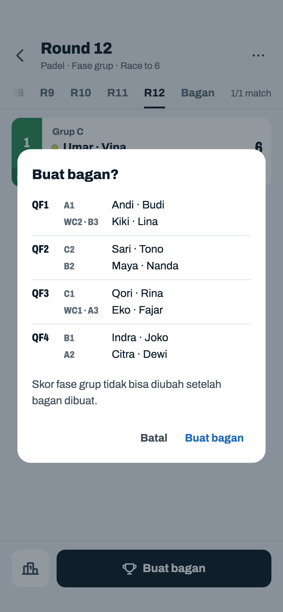

Komponen: `MabarAppBar`, `MabarButton`, `MabarTextButton`, `MabarIconButton`, `MabarActionBar`, `RoundTabs`, `MatchScoreRow`, `showMabarSheet`, `showMabarConfirm`

- Bagan 3 grup G15 (keputusan 138, 147): PF1 J1–WC1, PF2 R(J2)–R(J3), PF3 J2–WC2, PF4 J3–R(J1). WC1 Eko · Fajar segrup dengan J1 Andi · Budi → WC1 dan WC2 bertukar: PF1 Andi · Budi vs Kiki · Lina (WC2 · B3), PF3 Qori · Rina vs Eko · Fajar (WC1 · A3). Tidak ada Perempat final segrup.
- Slot wildcard ditulis dengan asalnya "WC2 · B3" (GP5); kolom slot dialog melebar ke 58 pt hanya di bagan dengan wildcard (.bracket.wc). Latar = Jadwal 23b (sheet tertutup saat dialog muncul, pola 20k).
- "Buat bagan" mengunci yang lolos, slot, WC1/WC2, J1–J3, dan skor fase grup; round R13–R16 ditambahkan dan Jadwal terbuka di tab Bagan (23h).

## 23e · Sheet Buat bagan · seri di WC2 · belum dipilih

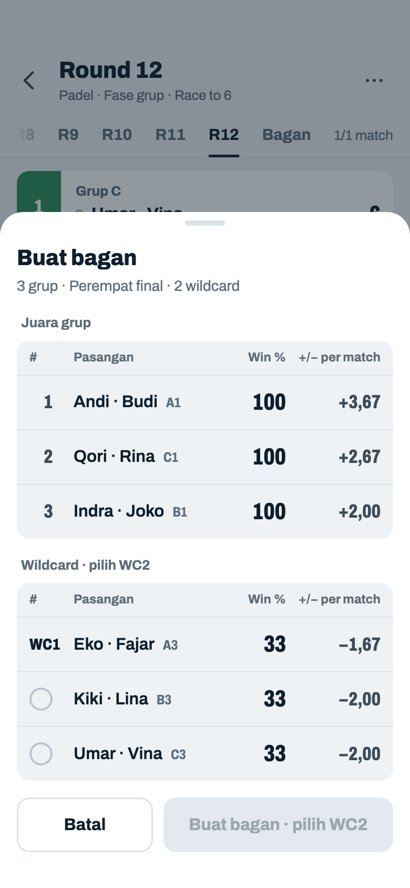

Komponen: `MabarAppBar`, `MabarButton`, `MabarIconButton`, `MabarActionBar`, `MabarGroup / MabarRow`, `RoundTabs`, `MatchScoreRow`, `StandingTable`, `showMabarSheet`

- Data 16G-iii (AC-G25): Qori · Rina – Umar · Vina 6–3 → Umar · Vina 33%, −6 ÷ 3 = −2,00, sama persis dengan Kiki · Lina. Seri ini menentukan siapa tersingkir → host memilih (G14, GP3, keputusan 141). Qori · Rina +8 ÷ 3 = +2,67 tetap J2.
- Baris yang seri mendapat radio di kolom #, urut huruf grup; label menyebut slot yang dipilih. Tombol mati dengan alasan di tombol (pola 20i). Seri yang tidak menyingkirkan siapa pun (16G-ii) tidak memunculkan pilihan: urut huruf grup, tampil seperti 23c.
- Seri di dalam grup (A2, C3, …) tetap sheet 20i/20l dulu; kalau keduanya perlu, satu sheet berisi bagian grup di atas bagian wildcard.

## 23f · Sheet Buat bagan · seri di WC2 · Umar · Vina dipilih

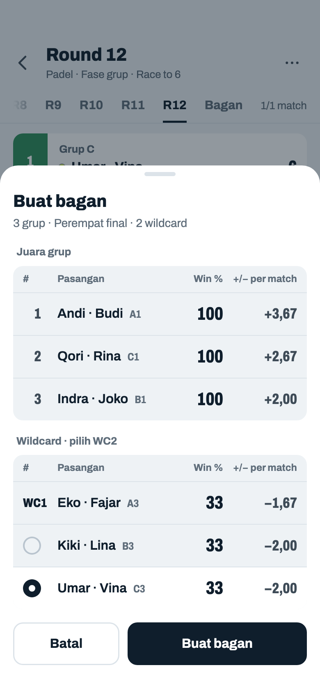

Komponen: `MabarAppBar`, `MabarButton`, `MabarIconButton`, `MabarActionBar`, `MabarGroup / MabarRow`, `RoundTabs`, `MatchScoreRow`, `StandingTable`, `showMabarSheet`

- Baris terpilih berlatar putih dan radio terisi; tombol aktif → dialog 23g. Pilihan baru disimpan saat dialog dikonfirmasi (16.5); Batal membuangnya.

## 23g · Dialog · buat bagan · setelah memilih WC2

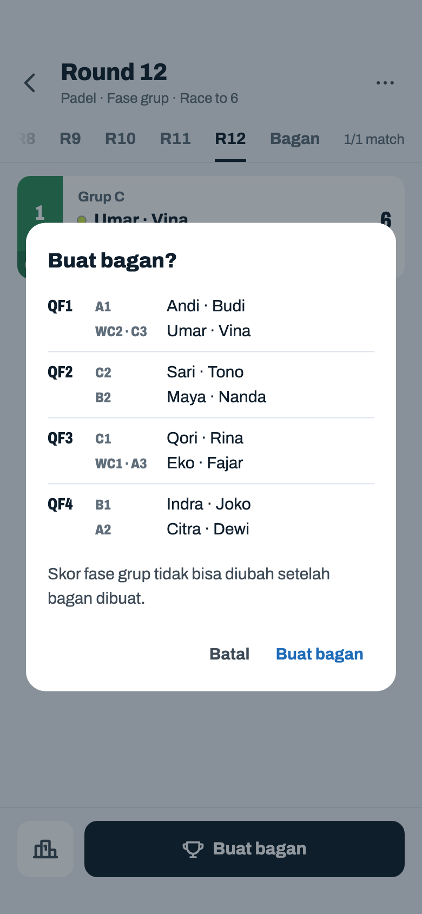

Komponen: `MabarAppBar`, `MabarButton`, `MabarTextButton`, `MabarIconButton`, `MabarActionBar`, `RoundTabs`, `MatchScoreRow`, `showMabarSheet`, `showMabarConfirm`

- 16G-iii, Umar · Vina dipilih: WC1 Eko · Fajar segrup J1 → tukar: PF1 Andi · Budi vs Umar · Vina (WC2 · C3), PF3 Qori · Rina vs Eko · Fajar (WC1 · A3). Kiki · Lina tidak lolos ("Grup B · 3"). Slot hasil pilihan host tidak dibedakan (20k).

## 23h · Bagan · 3 grup · baru dibuat

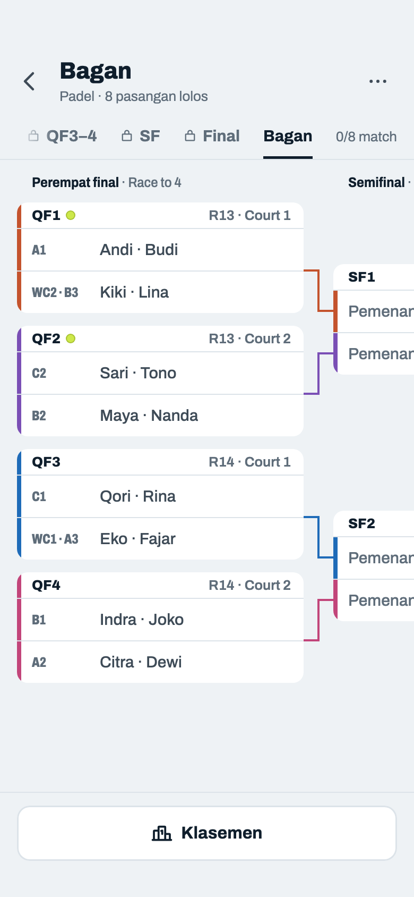

Komponen: `MabarAppBar`, `MabarButton`, `MabarIconButton`, `MabarActionBar`, `RoundTabs`

- Data 16G, bagan = tabel 16G setelah tukar. Wildcard di kolom slot dua baris "WC2 / B3" (GP5 "WC2 · B3" dalam kolom 26 pt); semua slot bagan dengan wildcard memakai lebar 26 pt supaya nama sejajar (.bagan.wc).
- Round R13 PF1 + PF2, R14 PF3 + PF4, R15 SF1 + SF2, R16 Final (Court 1) + Juara 3 (Court 2). Format kolom 16G: Race to 4 / 5 / 6, Juara 3 Race to 5. Geser, posisi awal, dan tab sama dengan 21u.
- Ketuk label babak ("Perempat final · Race to 4") → sheet format babak (23o, G16, keputusan 120); tampilan label tidak berubah.

## 23i · Bagan · 4 grup × 4 · baru dibuat

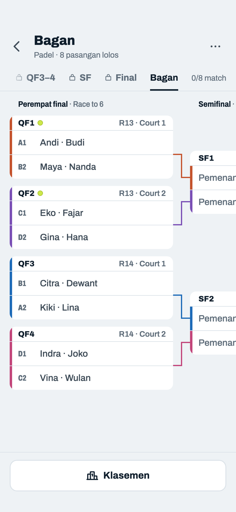

Komponen: `MabarAppBar`, `MabarButton`, `MabarIconButton`, `MabarActionBar`, `RoundTabs`

- 32 pemain, 4 grup × 4 (keputusan 142), 2 court, 15 mnt: fase grup R1–R12; R13 PF1 + PF2, R14 PF3 + PF4, R15 SF1 + SF2, R16 Final + Perebutan juara 3 (16.4). Bagan silang G9 tanpa wildcard: PF1 A1–B2, PF2 C1–D2, PF3 B1–A2, PF4 D1–C2.
- Lolos (data contoh): A1 Andi · Budi, A2 Kiki · Lina, B1 Citra · Dewant, B2 Maya · Nanda, C1 Eko · Fajar, C2 Vina · Wulan, D1 Indra · Joko, D2 Gina · Hana. Semua babak Race to 6 (default = format grup). Komponen sama dengan 21u.

## 23j · Klasemen · Fase grup · 3 grup · WC1 WC2

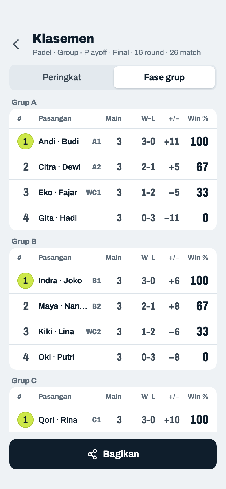

Komponen: `MabarAppBar`, `MabarButton`, `MabarIconButton`, `MabarActionBar`, `MabarGroup / MabarRow`, `MabarSegmented`, `StandingTable`

- Data 16G setelah Final. Slot lolos di kanan nama (22b); wildcard ditulis "WC1" / "WC2" di tempat yang sama (GP5); asalnya sudah terbaca dari tabel grupnya. Umar · Vina (C3) tanpa slot.
- Nomor tabel tetap 4.3 dari metode Playoff (Win %) → selisih; tanpa tab metode (AC-G30). Grup C berlanjut di bawah action bar; tabel tidak rata (5 + 4 + 4) memakai pola yang sama, satu baris lebih panjang.

## 23k · Klasemen · Peringkat · 3 grup · Final

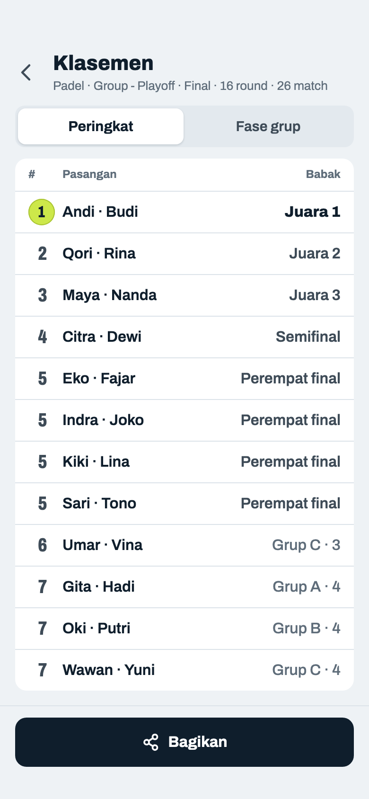

Komponen: `MabarAppBar`, `MabarButton`, `MabarIconButton`, `MabarActionBar`, `MabarSegmented`, `StandingTable`

- Data 16G-akhir (AC-G27): Final Andi · Budi 6–4 Qori · Rina, Perebutan juara 3 Maya · Nanda 5–2 Citra · Dewi. 18 match grup + 8 playoff = 26 match, R1–R16.
- Label babak (keputusan 149, ralat host 2026-11-23): "Juara 1", "Juara 2" dari Final, "Juara 3" pemenang Perebutan juara 3; yang kalah di sana "Semifinal"; kalah Perempat final (termasuk wildcard) "Perempat final".
- #5 berempat urut nama. Frame di posisi gulir paling atas; sisanya 23l.

## 23l · Klasemen · Peringkat · 3 grup · digulir ke bawah

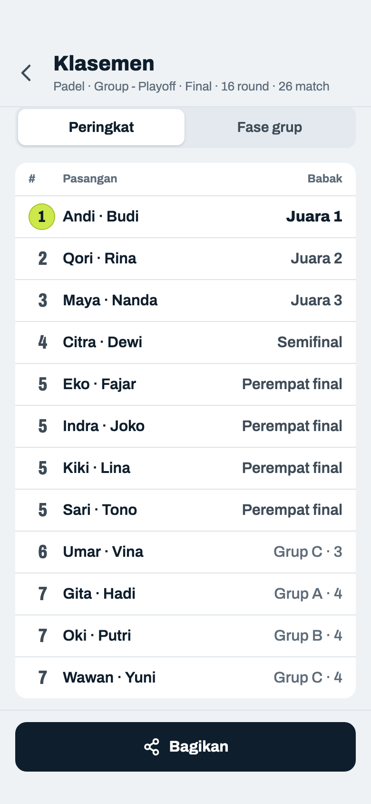

Komponen: `MabarAppBar`, `MabarButton`, `MabarIconButton`, `MabarActionBar`, `MabarSegmented`, `StandingTable`

- Posisi grup tidak lolos menghitung wildcard sebagai lolos (GP7): Grup A meloloskan 3 → Gita · Hadi posisi 4 ("Grup A · 4"); Umar · Vina, kandidat yang tidak dapat wildcard, posisi 3 → #6 "Grup C · 3" sendirian; posisi 4 ketiga grup #7.

## 23m · Menu ⋯ · fase grup · Format playoff

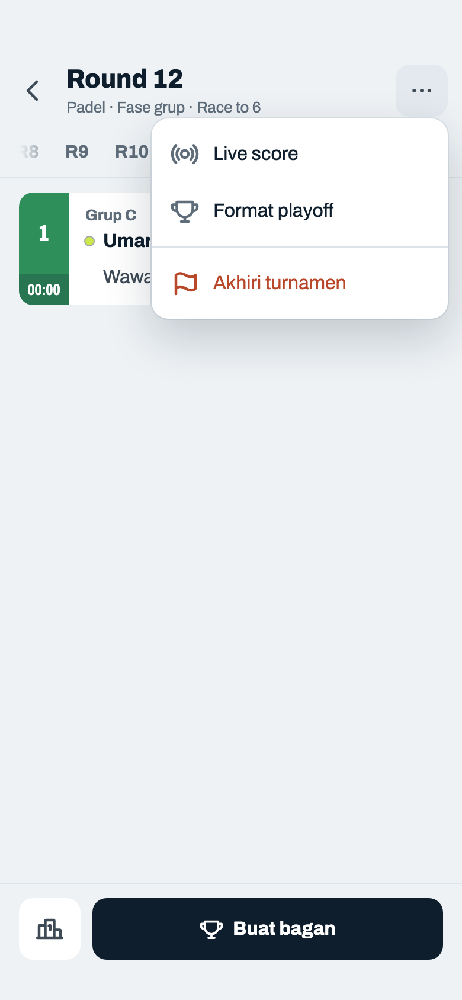

Komponen: `MabarAppBar`, `MabarButton`, `MabarIconButton`, `MabarActionBar`, `RoundTabs`, `MatchScoreRow`, `MabarMenu`

- Titik masuk ubah format di fase grup (GP8): menu ⋯ Jadwal → "Format playoff" → sheet 23n. Item ada di fase grup dan fase playoff selama turnamen belum diakhiri; setelah diakhiri item hilang (bersama Akhiri turnamen).
- Urutan: Live score, Format playoff, garis, Akhiri turnamen (pola 06d). Ikon trofi sama dengan tombol Buat bagan.

## 23n · Sheet Playoff · dari Jadwal · fase grup

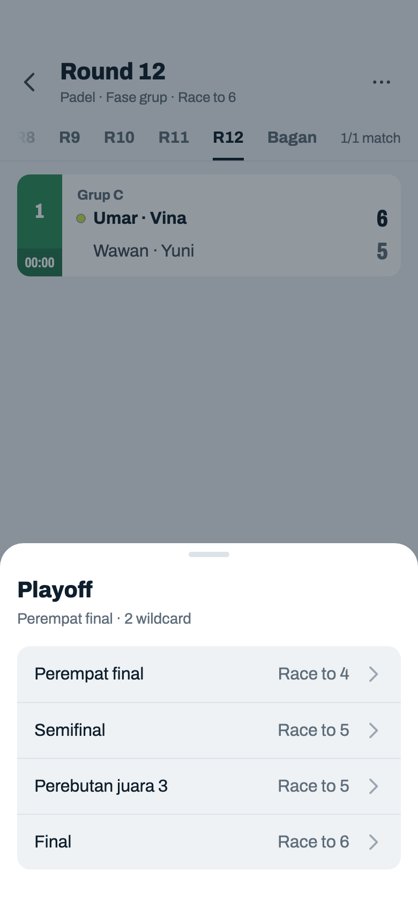

Komponen: `MabarAppBar`, `MabarButton`, `MabarIconButton`, `MabarActionBar`, `MabarGroup / MabarRow`, `RoundTabs`, `MatchScoreRow`, `showMabarSheet`

- Isi = sheet Playoff Konfigurasi (19j) apa adanya; di fase grup semua babak belum ada skor, jadi semua bisa diubah (G16). Ketuk baris → sheet babak di atasnya (19f, 19g); perubahan langsung berlaku tanpa dialog.
- Jumlah grup dan babak awal tidak bisa diubah di sini (subjudul fakta). Estimasi tidak ditampilkan; juara 3 di 1 court mengubah jumlah round ±1 (G16), terbaca di tab round.

## 23o · Sheet Perempat final · dari label bagan

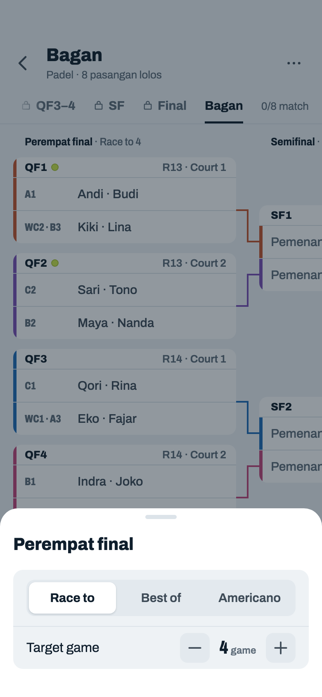

Komponen: `MabarAppBar`, `MabarButton`, `MabarIconButton`, `MabarActionBar`, `MabarGroup / MabarRow`, `MabarSegmented`, `MabarStepper`, `RoundTabs`, `showMabarSheet`

- Ketuk label kolom di Bagan (23h) → sheet babak itu (keputusan 120). Isi = 19f. Perempat final belum ada skor → bisa diubah; contoh 16H: Race to 4 → 5, label kolom dan baris match ikut berubah.
- Best of / Americano hanya N ganjil (GU9, 19h). Live: penonton melihat format baru di kiriman berikutnya.

## 23p · Sheet Perempat final · terkunci · PF1 ada skor

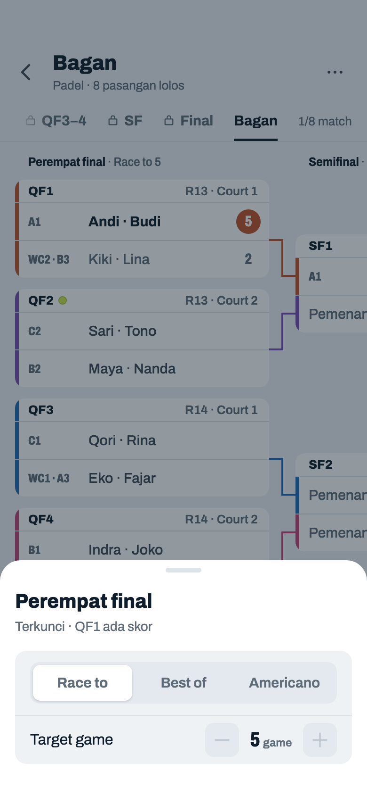

Komponen: `MabarAppBar`, `MabarButton`, `MabarIconButton`, `MabarActionBar`, `MabarGroup / MabarRow`, `MabarSegmented`, `MabarStepper`, `RoundTabs`, `showMabarSheet`

- Contoh 16H: Perempat final Race to 5, PF1 Andi · Budi 5–2 Kiki · Lina tersimpan → format babak terkunci (G16). Sheet tetap terbuka saat label diketuk; segmented dan stepper mati, alasannya di subjudul.
- Kosongkan skor PF1 (boleh, SF1 masih Belum, keputusan 114) → babak tanpa skor lagi → bisa diubah lagi (23o). Semifinal, Juara 3, dan Final masih bisa diubah.

## 23q · Sheet Playoff · dari Jadwal · Final berskor

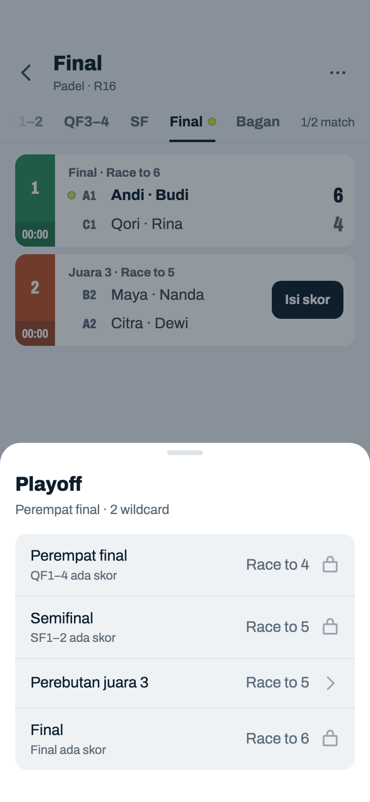

Komponen: `MabarAppBar`, `MabarButton`, `MabarIconButton`, `MabarActionBar`, `MabarGroup / MabarRow`, `RoundTabs`, `MatchScoreRow`, `showMabarSheet`

- 16G-akhir sebelum Juara 3 diisi: R16 Final 6–4 tersimpan, Perebutan juara 3 Belum. Babak yang ada skor menulis alasannya di baris ("PF1–4 ada skor", pola "<match> ada skor" sama dengan 23p) dengan ikon kunci, tanpa chevron; ketuk tetap membuka sheet babak terkunci (23p).
- Perebutan juara 3 masih bisa diubah formatnya; Ada / Tidak ada terkunci karena Final ada skor (23r).

## 23r · Sheet Perebutan juara 3 · Ada terkunci · Final ada skor

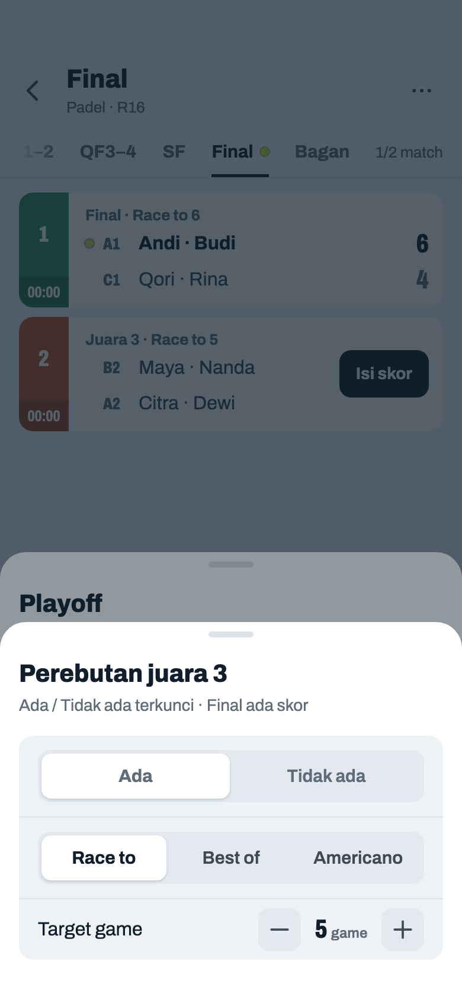

Komponen: `MabarAppBar`, `MabarButton`, `MabarIconButton`, `MabarActionBar`, `MabarGroup / MabarRow`, `MabarSegmented`, `MabarStepper`, `RoundTabs`, `MatchScoreRow`, `showMabarSheet`

- Juara 3 bisa dinyalakan/dimatikan hanya selama Final dan Perebutan juara 3 sama-sama Belum (G16). Di sini Final ada skor: segmented Ada / Tidak ada mati, format Race to 5 masih bisa diubah.
- Sebelum Final ada skor: Tidak ada → match Juara 3 hilang (2 court: R16 hanya Final; 1 court: Final naik satu round); Ada lagi → kembali sesuai GU10. Tanpa dialog, bisa dibalik. Peringkat ikut 16.8 (22c).
